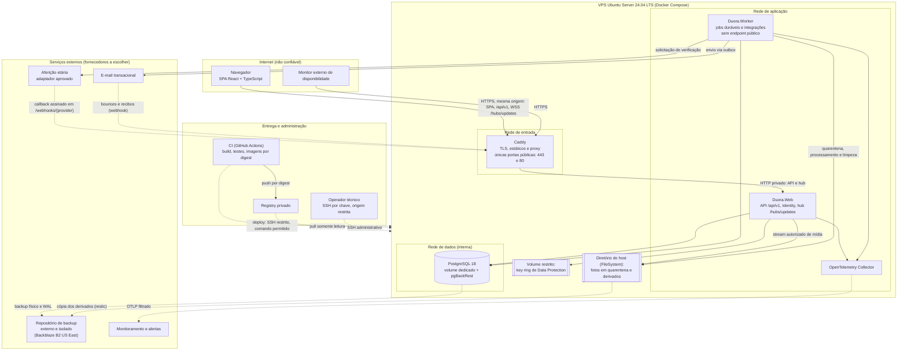

# Contexto, containers e fronteiras de confiança

Visão de contexto e de containers do Duora no piloto. Fonte: spec 3.1 (topologia), 15 (VPS, redes e
exposição), 16 (integrações) e 17.2 (transporte da release). Decisões relacionadas:
[ADR-0003](adr/0003-monolito-modular-web-worker.md), [ADR-0006](adr/0006-mesma-origem-spa-api-hub.md),
[ADR-0009](adr/0009-uma-instancia-web-no-piloto.md), [ADR-0010](adr/0010-object-storage-externo-leitura-via-api.md)
e [ADR-0011](adr/0011-pgbackrest-wal-externo-restore-obrigatorio.md).

Fornecedores de storage, e-mail, aferição etária, backup e monitoramento **ainda não foram escolhidos**
(spec 23.2). O diagrama mostra papéis, não produtos.

## Diagrama

Linha contínua: chamada síncrona. Linha tracejada: fluxo assíncrono, agendado ou de operação.

Agentes de desenvolvimento não aparecem no diagrama de produção de propósito: eles não têm caminho até a VPS,
o banco, os segredos ou o registry de produção (INV-12, [permissions.md](../automation/permissions.md)).

## Containers

| Container | Responsabilidade | Exposição | Dados que guarda |
|---|---|---|---|
| Caddy | TLS, arquivos estáticos da SPA, proxy de `/api/*`, `/hubs/*` e `/webhooks/*` (corpo até 64 KiB), fallback da SPA | Único serviço com portas públicas (443; 80 só para redirecionamento/ACME) | Certificados e configuração (volume persistente) |
| Duora.Web | API HTTP, Identity com cookie e ticket persistente, hub SignalR, publicação da outbox de tempo real, stream de mídia | Só pela rede do proxy; Kestrel nunca publicado | Nenhum em disco local além de temporários limitados |
| Duora.Worker | Outbox (e-mail, mídia, verificação etária), expiração de rodadas e salas, retenção | Nenhuma; só egress para fornecedores necessários | Temporários limitados |
| PostgreSQL 18 | Fonte da verdade, filas, outbox, idempotência, tickets de sessão | Só na rede interna de dados; sem `ports` no Compose | Volume dedicado; backup físico e WAL externos |
| OpenTelemetry Collector | Filtrar e exportar traces, métricas e logs | Privado | Nenhum persistente |

Só o processo web publica notificações de tempo real; o worker grava eventos no banco e não usa `IHubContext`
(spec 3.1). Uma única instância web fica ativa ([ADR-0009](adr/0009-uma-instancia-web-no-piloto.md)).

## Fronteiras de confiança

| # | Fronteira | O que atravessa | Controles exigidos (spec) |
|---|---|---|---|
| F1 | Internet → Caddy | Requisições do navegador, WebSocket, callbacks de fornecedores, sondas de disponibilidade | TLS; só 443/80 abertos, inclusive em IPv6; firewall do provedor coerente com o Docker; varredura externa como prova (15.2) |
| F2 | Caddy → Web | API e hub encaminhados | Forwarded Headers confiando só no proxy esperado; antiforgery em mutações; validação de `Origin` no hub; limites de corpo, taxa e tempo (11.3, 11.5) |
| F3 | Web/Worker → PostgreSQL | Consultas e comandos | Conta de aplicação sem superuser/DDL; migrador separado; rede interna; SQL parametrizado (10.7, 11.4) |
| F4 | Worker → fornecedores | E-mail, verificação etária, storage | `IHttpClientFactory` com timeout, cancelamento e limite de concorrência; retry só com idempotência; nenhum dado íntimo em assunto de e-mail (16.3, 16.4) |
| F5 | Fornecedores → `/webhooks/{provider}` | Callbacks e recibos | Assinatura sobre os bytes recebidos, timestamp, janela contra replay, registro idempotente antes de processar, limite de tamanho (16.4) |
| F6 | Web → diretório de fotos no disco da VPS | Leitura de derivados aprovados | Autorização revalidada a cada leitura; `no-store`; chave interna nunca exposta; montagem por área, sem leitura da quarentena pelo Web (16.2; adendo do ADR-0010) |
| F7 | PostgreSQL → repositório de backup | Backup físico e WAL | Criptografia com chave sob custódia independente; aplicação sem permissão de leitura ou exclusão do backup (18.3) |
| F8 | Collector → monitoramento | Telemetria | Sem corpos, tokens, cookies, preferências ou IDs de pessoa como label; amostragem e teto de volume (19.2) |
| F9 | CI → registry → VPS | Imagens e manifesto da release | Permissões mínimas por job; actions fixadas por SHA; imagens por digest; host só lê o registry; SSH restrito com host key validada (17.1, 17.2) |
| F10 | Operador → VPS | Administração | SSH por chave, sem root/senha, origem restrita; socket do Docker nunca montado em web/worker (15.2) |
