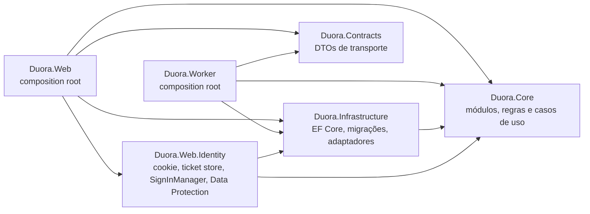

# Módulos, propriedade de dados e dependências

Fonte: spec 3.2 (módulos), 3.3 (organização e dependências), 10.1–10.3 (schemas, tabelas e constraints) e
10.4 (ordem de locks). Decisões relacionadas: [ADR-0003](adr/0003-monolito-modular-web-worker.md) e
[ADR-0004](adr/0004-dbcontext-unico-schemas-logicos.md).

Nem todas as tabelas existem desde o primeiro commit: cada fatia cria o schema de que precisa, com testes
(spec 10.2). Esta página define o dono de cada tabela para que fatias diferentes não divirjam.

## Projetos e regra de dependência

| Regra (spec 3.3) | Verificação |
|---|---|
| Web e Worker dependem de Core, Infrastructure e Contracts; Infrastructure depende de Core | `Duora.ArchitectureTests`: grafo de referências permitido e ausência de ciclos |
| Core não depende de ASP.NET Core, EF Core nem SDK de fornecedor | `Duora.ArchitectureTests`: prefixos proibidos nas referências do assembly |
| Contracts não carrega entidades persistidas | `Duora.ArchitectureTests`: Contracts sem referência a Core, EF Core, Npgsql ou ASP.NET Core |
| Endpoints chamam casos de uso; não contêm algoritmo de pareamento nem regra de bloqueio | Revisão de PR; teste de namespace a implementar no M1 |
| Sem interface para cada classe nem `GenericRepository<T>` sobre o EF Core | Revisão de PR |
| Só o Web usa o runtime do ASP.NET Core: Infrastructure, Worker, Core e Contracts não referenciam o framework `Microsoft.AspNetCore.App`, só o Web referencia o `Duora.Web.Identity`, e o `runtimeconfig` do Worker exige só `Microsoft.NETCore.App` ([ADR-0019](adr/0019-implementacao-identidade-sessao-outbox.md#revisão-separação-do-runtime-web)) | `Duora.ArchitectureTests.RuntimeSeparationTests` |

## Módulos

Schemas lógicos (spec 10.1): `identity`, `profiles`, `events`, `experiences`, `social`, `safety`, `media`,
`ops` e `privacy`. Quem **escreve** numa tabela é o seu dono; os demais módulos pedem pelas operações públicas.

| Módulo | Responsabilidade | Schema e tabelas próprias | Operações públicas (spec 3.2) | Não deve |
|---|---|---|---|---|
| Identity | Conta, credenciais, sessões, recuperação, estado etário e consentimentos | `identity`: `users`, tabelas do ASP.NET Core Identity, `login_sessions` (absorve `auth_tickets`, ADR-0019), `age_verifications`, `consent_records` | `GetEligibility`, `RevokeSessions`, `DisableAccount` | Decidir pareamento ou abrir conversas |
| Profiles | Perfil, fotos do perfil, preferências e visibilidade | `profiles`: `profiles`, `preferences`, `profile_photos` | `GetAuthorizedProfile`, `UpdatePreferences` | Expor preferências privadas no DTO de outra pessoa |
| Events | Evento, inscrição, lista de espera, check-in e rodada | `events`: `events`, `registrations`, `rounds` | `Register`, `CheckIn`, `StartRound`, `CancelEvent` | Formar pares ignorando Safety |
| Matching | Seleção, histórico de pares e reserva do par | `events` (nota 1): `pairings`, `pairing_participants` | `BuildRoundPairings`, `ReleaseReservation` | Inferir atributos sensíveis por IA |
| Experiences | Catálogo imutável, sala (= sessão de jogo, nota 5), ações e projeções | `experiences`: `experience_definitions`, `experience_versions`, `game_sessions`, `game_participants`, `game_actions`, `voice_credentials` (ADR-0028) | `AcceptInvitation`, `ApplyAction`, `GetParticipantView` | Aceitar estado ou resultado definido pelo cliente |
| Connections | Decisões privadas e conexão entre duas contas | `social` (nota 2): `relationship_guards`, `decisions`, `connections` | `SubmitDecision`, `EndConnection` | Revelar quem rejeitou ou quando rejeitou |
| Messaging | Conversa, membros e mensagens | `social`: `conversations`, `conversation_members`, `messages` | `SendMessage`, `GetMessages`, `CloseConversation` | Autorizar apenas pela existência do ID da conversa |
| Safety | Bloqueios, guardas de usuário, denúncias, evidências, sanções e recursos | `safety`: `user_guards`, `blocks`, `reports`, `report_evidence`, `moderation_actions`, `appeals` | `BlockUser`, `CheckInteraction`, `SubmitReport` | Tratar toda denúncia como condenação automática |
| Media | Upload, quarentena, processamento e acesso a arquivos | `media`: `upload_guards`, `uploads`, `media_assets`, `media_variants` | `StartUpload`, `GetAuthorizedAsset`, `DeleteAsset` | Servir o original não verificado |
| Notifications | E-mail, preferências de notificação e recibos de entrega | A definir (nota 3) | `ScheduleNotification`, `CancelPendingNotification` | Incluir conteúdo íntimo em assunto ou push |
| Operations | Configurações, feature flags, comandos operacionais, outbox, jobs, idempotência, webhooks e auditoria | `ops`: `outbox_events`, `outbox_deliveries`, `jobs`, `idempotency_records`, `webhook_receipts`; `audit_events` (nota 4) | `PauseMatching`, `EnterMaintenanceMode` | Expor shell ou SQL genérico ao painel |
| Privacy | Exportação, exclusão, retenção e reconciliação | `privacy`: `export_requests`, `deletion_requests`, `retention_holds`, `deletion_tombstones` | `RequestExport`, `RequestDeletion`, `ApplyRetention` | Apagar registros sob preservação aprovada sem avaliação |

Notas de propriedade (notas 1 a 4: lacunas da spec, a confirmar em ADR ou na primeira migração do módulo,
com proposta em [model.md](../data/model.md#decisões-de-modelagem-propostas), D1 a D5; nota 5: já decidida):

1. A spec não lista schema `matching`; o exemplo de DDL da 10.3 cria `events.pairing_participants`. Até
   decisão contrária, as tabelas do Matching ficam no schema `events`, com dono lógico Matching.
2. A spec não diz em que schema ficam `relationship_guards`, `decisions` e `connections`; `social` é o schema
   do exemplo `social.messages` e o mais próximo do domínio de relações.
3. A tabela 10.2 não lista tabelas para preferências de notificação (API-N01/N02) nem para recibos de entrega,
   e não há tabela para configurações e feature flags de Operations.
4. A spec não diz o schema de `audit_events`. A outbox, os jobs e a idempotência têm propriedade **comum**:
   todo módulo grava na outbox dentro da própria transação, e só Operations consome, reprocessa e limpa. O mesmo vale para `webhook_receipts`: quem processa o callback grava o recibo na própria transação pela API de Operations (`WebhookReceipts`), e só Operations limpa.
5. Decidido em [ADR-0016](adr/0016-sala-e-sessao-de-jogo.md): não existe tabela `rooms`. A sala é a
   `game_session` de um par numa rodada e `roomId` é o `gameSessionId`. Matching cria o `pairing` (reserva do
   par); Experiences cria a `game_session` a partir do convite, ligada ao `pairing`, e é dona da máquina de
   estados da sala (spec 4.2). Connections referencia a sessão em `decisions`, única por
   `(game_session_id, user_id)`.

## Comunicação entre módulos

- Operações que atravessam módulos usam um **coordenador de caso de uso** em `Duora.Core`, nunca chamada
  HTTP interna (spec 3.2).
- Invariantes que precisam valer imediatamente ficam na **mesma transação** (bloqueio, decisão mútua, reserva).
  Efeitos posteriores (notificação, e-mail, processamento de mídia) saem por **evento interno via outbox**.
- Safety é consultado por Events, Matching, Experiences, Connections e Messaging antes de qualquer interação
  (`CheckInteraction`); Identity responde elegibilidade (`GetEligibility`) para todos. No HTTP, a policy `EligibleParticipant` (`ParticipationPolicies`) consulta `GetEligibility` a cada requisição, e toda rota de `/api/v1` fora das de conta, sessão e verificação etária precisa dela (`EligibleParticipantPolicyTests`).
- Dados de outro módulo entram como projeção mínima, nunca como entidade compartilhada.

## Ordem global de locks (spec 10.4)

Todo caso de uso coordenado adquire locks nesta ordem; quem descobre recurso fora dela reinicia a transação:

1. Registro de idempotência, quando houver; num job de efeito interno, a linha do job em `ops.jobs`, que nunca
   espera ([ADR-0021](adr/0021-jobs-duraveis-e-leases-no-postgresql.md)).
2. Guardas de usuários (`user_guards`), em UUID ordenado.
3. Coordenador de evento/rodada, quando houver.
4. Guarda de relação (`relationship_guards`).
5. Sala/conversa, em ordem estável.

Nenhuma chamada a e-mail, storage, IA ou webhook de terceiro acontece enquanto os locks de negócio estão
mantidos. O protocolo de cada cenário está em [concurrency.md](../data/concurrency.md).
