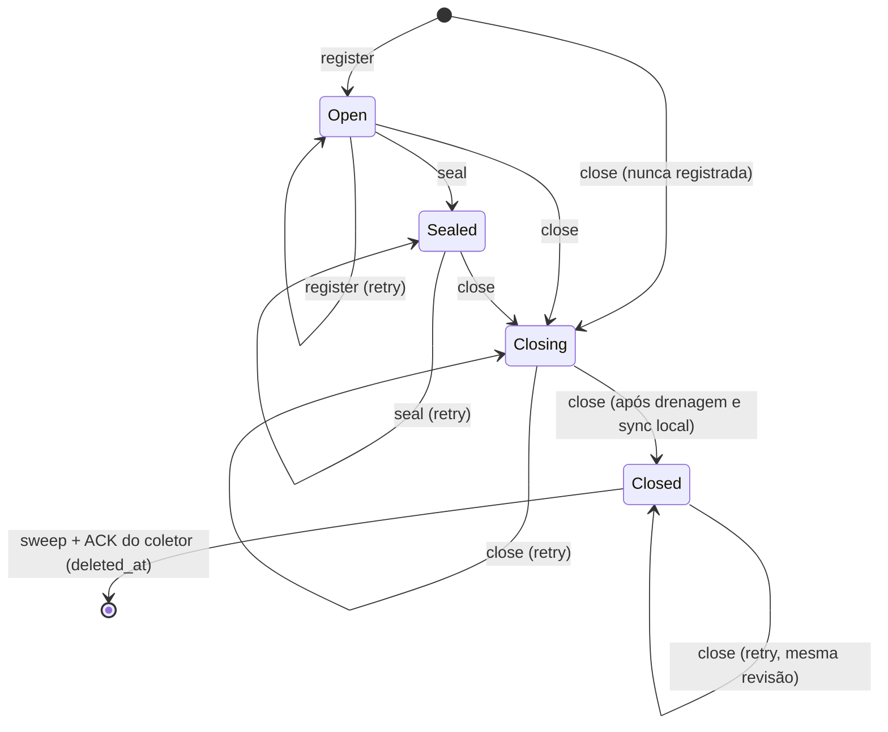

# Máquina de estados do fechamento de gerações privadas (#311)

- **Status:** especificação do candidato técnico existente (ADR-0047), restrito a Testing e desligado por
  padrão. Não habilita fechamento terminal operacional de escritores incertos, uploads nem rollout.
- **Fonte de verdade:** o código citado em cada seção. Se divergir deste texto, vale o código, e este documento
  deve ser corrigido no mesmo PR que mudar o comportamento.
- **Relacionados:** [ADR-0045](adr/0045-protecao-dos-controles-de-geracao.md),
  [ADR-0047](adr/0047-autoridade-exclusiva-de-geracoes-privadas.md),
  [runbook](../operations/private-generation-authority.md),
  [relatório do candidato](../testing/reports/private-generation-authority-candidate.md).

Atende ao primeiro critério da #311 ("Especificar a prova"): máquina de estados, autoridade de fechamento,
ponto de linearização, evidência persistida e condições de recuperação. Os demais critérios, como
qualificação de armazenamento, restore e compatibilidade, continuam abertos (seção 8).

## 1. Identidade e autoridade

Uma geração é identificada por `(domain, epoch, layout, incarnation, area, generation, manifest_hash)`.
`area` é `Candidate = 1` ou `Promotion = 2` (`IPrivateGenerationStore.cs`).

| Papel | Quem | Pode |
|---|---|---|
| Cliente | Web/Worker, via socket Unix com `SO_PEERCRED` nos dois sentidos | `register`, `put`, `seal`, `read`, `delete`, `close` e `sweep`. A autoridade não distingue quem chama entre os UIDs cliente: restringir `close`/`sweep` aos coletores é convenção do chamador; o que a autoridade exige é `CanClose`, revisão e token |
| Autoridade | `Duora.StorageAuthority`, processo único por domínio (`domain.lock`) | I/O real, journal local, transições na referência |
| Referência | PostgreSQL próprio, schema `storage_control` (`scripts/storage-authority/reference.sql`) | Guardar estado e revisão; `attach` e `transition` via `security definer` |
| Coletor | Os cinco dispatchers de limpeza, com token e lease SQL | Pedir `close` → `sweep` e gravar `deleted_at` com prova |
| Custodiante | Operação manual, fora do runtime | Criar nova época; o runtime nunca faz isso |

A autoridade de fechamento é a autoridade de armazenamento. Lease, token SQL e marcador cooperativo **não**
fecham uma geração.

## 2. Estados

O journal local (`PrivateGenerationJournal.cs`) e a referência externa (`storage_control.generations`) usam o
mesmo conjunto de estados: `Open`, `Sealed`, `Closing` e `Closed`. A ausência de registro não é um estado
aberto. Na referência, ela só admite as transições `Open` (reserva nova) e `Closing` (fechamento de geração
que nunca foi registrada). No journal, controle ausente ou corrompido recusa a operação.



Transições aceitas pelo journal (`PrivateGenerationJournal.cs`, validadas na leitura):

| Destino | Estado anterior aceito |
|---|---|
| `Open` | ausente ou `Open` |
| `Sealed` | `Open` ou `Sealed` |
| `Closing` | ausente, `Open`, `Sealed` ou `Closing` |
| `Closed` | `Closing`, ou `Closed` com a mesma revisão |

`Persist` só barra a regressão de `Closed`: qualquer outro destino, ou `Closed` com revisão diferente, lança
`InvalidDataException`. Outra transição inválida é gravada e envenena o journal, que passa a ser recusado na
leitura seguinte (fail-closed, mas sem rejeição na escrita).

Cada transição na referência consome um novo valor de `storage_control.revisions`, exceto `Closed`, que conserva
a revisão de `Closing`. Repetir o estado atual não muda a revisão.

## 3. Comandos

A admissão inicial (versão, UID/GID do peer, tamanho e operação) roda antes do gate. Depois dela, cada operação
roda sob o gate da autoridade, um `SemaphoreSlim(1, 1)` obtido sem espera, que cobre validação de layout e
manifesto, consulta à referência e todo o I/O, inclusive EOF, cópia, dispose, rename e fsync. A resposta final é
enviada depois de liberar o gate (`StorageOperationBoundary.cs`); não há I/O de armazenamento após a liberação.
Cada operação tem prazo de 30 s (`OperationBudget`), que cancela a própria operação; o gate só é liberado
quando o I/O retorna. Gate ocupado responde `busy`, e o cliente trata `busy`, `denied` e EOF como falha, nunca
como confirmação (`PrivateGenerationWire.cs`).

| Comando | Pré-condição | Efeito, em ordem |
|---|---|---|
| `register` | Registro de negócio gravável e domínio igual ao enrolled | Referência `Open` (insere ou no-op; outro estado recusa "cannot be readmitted"), depois journal `Open` com fsync |
| `put` | Gravável; referência **e** journal em `Open`; tamanho declarado confere | Responde "admitted", lê o corpo, confere SHA-256, grava pelo adaptador FileSystem, `chmod 0600`, fsync do arquivo e do diretório. Não muda estado |
| `seal` | Gravável (`RequireWritable`); referência em `Open` ou `Sealed` | Re-hash e fsync das três variantes e do diretório, depois referência `Sealed` e journal `Sealed` |
| `close` | Registro de negócio elegível (`CanClose`) | Referência `Closing`, depois journal `Closing` (omitido se já `Closed`), journal `Closed` e referência `Closed`. As revisões têm de coincidir |
| `sweep` | `CanClose`; referência `Closed` com a revisão do recibo; journal `Closed` na mesma revisão; token não vazio | Sync do journal, DELETE das três chaves e dos temporários com sufixo exato `.<32 hex>.partial`, sync do diretório e `record_private_generation_sweep` |
| `read` | Referência e journal idênticos em estado e revisão; journal sincronizado | `Closing`/`Closed` respondem `missing`. Senão, abre o arquivo conferindo dono, `nlink = 1` e tipo, depois tamanho e SHA |
| `delete` | Upload `Deleted` com obrigação em `photo_deletion_cleanup` (`CanDelete`) | Executa `close`, apaga a chave pedida e sincroniza o diretório. Não grava prova de varredura |

`close` não exige a época corrente: gerações de épocas aposentadas podem ser fechadas, nunca reabertas.
`Open` e `Sealed` exigem que a época da identidade seja igual à corrente.

## 4. Ponto de linearização do fechamento

A revogação passa a valer para escritores quando **commita a transação que leva a referência a `Closing`**.
`storage_control.transition` faz `FOR UPDATE` na linha da época e na da geração. A partir desse commit,
qualquer `put` ou `seal` lê um estado diferente de `Open` na referência e falha.

Esse ponto é seguro contra I/O já admitido porque o gate é o mesmo do `put`. Enquanto um corpo admitido não
termina (EOF, cópia, rename e fsync), `close` recebe `busy` e não avança. O prazo de 30 s cancela a
operação admitida, mas o gate só é liberado quando o I/O retorna; um cliente pausado no meio do corpo atrasa o
`close` por no máximo cerca de 30 s. PID ou lease não rompem o gate.

O ACK de fechamento (`Closed` na referência) só vem depois do journal local `Closed` sincronizado. Ele atesta
que todo I/O admitido terminou, mas ainda não é remoção.

## 5. Evidência persistida e conclusão

| Evidência | Onde | Garante |
|---|---|---|
| Estado e revisão | `storage_control.generations` (referência) e journal local encadeado por hash | Fechamento monotônico e recuperável |
| Binding | `media.private_generation_bindings`, gravado na transação de preparo, antes dos bytes | Vincula geração a domínio, época, layout e manifesto |
| Prova de varredura | `media.private_generation_proofs`, única por `(generation, area, token)` | Varredura completa posterior ao `Closed`, sob a posse corrente |
| Conclusão | `deleted_at` e `storage_proof_id` em `review_candidates`/`review_promotions` | Remoção física confirmada pelo dono atual |

O trigger `media.guard_private_generation_removal` exige, para geração com binding, uma prova que case com o
binding, com o token **antigo** (`OLD.cleanup_token`), com lease vivo e com `swept_at <= statement_timestamp()`.
Depois de gravados, `deleted_at` e `storage_proof_id` são imutáveis. INSERT já removido é recusado.

Propriedade de segurança, **sob a premissa de custódia** abaixo:

```text
deleted_at(g) != null  e  binding(g) existe
  => referência(g) = Closed  e  journal(g) = Closed  (mesma revisão)
     e  sweep completo iniciado depois do Closed removeu finais e temporários atribuíveis
     e  a prova foi gravada com token e lease válidos no relógio do PostgreSQL
```

**Premissa de custódia.** O banco não verifica que a referência está `Closed` nem que `closed_revision`
corresponde a um fechamento real: `record_private_generation_sweep` confere apenas token, lease e binding. A
implicação acima vale porque o EXECUTE dessa função fica restrito ao papel `duora_storage_verifier`, que só a
autoridade pode usar, e porque a autoridade confere referência e journal `Closed` na mesma revisão antes de
varrer. Se essa credencial sair da autoridade, a garantia deixa de valer; a migration não cria o papel nem
segredo, e a custódia operacional continua pendente.

Sem binding, o caminho legado permanece conservador: o coletor tenta o DELETE genérico, que a autoridade
recusa no modo gerenciado, e a obrigação segue em retry. A relação com `writer_settled_at` não muda aqui: a
constraint atual aceita `deleted_at` com `writer_settled_at` **ou** prova, e o trigger exige prova sempre que
houver binding. O redesenho dessa evidência é decisão de design separada (seção 8).

## 6. Recuperação

| Falha | Comportamento |
|---|---|
| Morte da autoridade antes do commit `Closing` | Nada foi revogado. A recuperação **não é automática**: a autoridade não volta na mesma época (`attach` exige `session` nula e não há detach; o boot sai com código 2). O custodiante cria nova época; só então o `close` da geração, agora de época aposentada, é aceito e começa de novo |
| Morte entre referência `Closing` e journal `Closed` | A revogação já vale. A retomada exige o custodiante criar nova época, como na linha anterior. Na nova época, o `close` da geração aposentada recebe `Closing` com a mesma revisão, o journal repete ou sincroniza e a referência vai a `Closed` |
| Resposta de `close` perdida, autoridade viva | Retry idempotente devolve `Closed` com a mesma revisão; a geração nunca reabre |
| Falha durante `sweep` ou ACK perdido | O coletor limpa token e lease e recua exponencialmente até 900 s; a próxima posse refaz `close` e um `sweep` **completo** com novo token |
| Assentamento do escritor (`writer_settled_at`) surgido durante um DELETE antigo | O coletor usa o assentamento capturado no claim; o que surge durante a passada não a torna terminal. É preciso outra varredura completa após `Closed` |
| Restart da autoridade na mesma época | `attach` exige `session` nula; uma sessão nova é recusada (`STORAGE_AUTHORITY_STARTUP_DENIED`, saída 2). Só o custodiante cria nova época |
| Journal ausente | `FileNotFoundException`; mesmo efeito: nega a operação e, no boot, saída 2. Nunca cria o controle |
| Journal truncado, com cadeia quebrada, encarnação diferente ou estado regredido | `InvalidDataException`; nega leitura, escrita e varredura. Nunca inicializa `Open` |
| Geração desconhecida na referência | Só aceita `Open` ou `Closing`; o resto falha com `23514` |

Busy, timeout, cancelamento, heartbeat ausente, PID ausente ou HEAD/GET sem objeto **não** são prova de
encerramento.

## 7. Gate de configuração

- **Aplicação:** a seção `Media:PrivateGenerations` (`Enabled`, `SocketPath`, `AuthorityUid`, `DomainId`,
  `Epoch` e `Layout`) vem com `Enabled = false`. Ela só é aceita em `Testing` e exige o provider FileSystem
  (`MediaServiceCollectionExtensions.cs`).
- **Host da autoridade:** o arquivo de configuração tem de ser root-owned com modo `0440` e
  `Environment = Testing`. Os bancos de negócio e de referência precisam ter nomes reais distintos
  (`current_database()`).

## 8. Fora desta especificação e ainda aberto

- **Redesenho de `writer_settled_at`:** separar a evidência de fechamento do assentamento do escritor é a
  decisão de design G. Até lá vale a semântica atual da seção 5.
- **Queda abrupta de host ou energia:** SIGKILL e reinício de container conservam kernel e disco. A mutação
  que omite o sync de diretório sobrevive aos testes de processo.
- **Restore real:** barreira de admissão, staging sem leitura e reconciliação com a referência e o ledger da
  #69 ainda não foram exercitados num restore operacional.
- **S3/B2:** não há fechamento remoto. Requisição aceita com resposta perdida, commit tardio, versões e
  delete markers continuam sem qualificação.
- **Retirada de escritores antigos e rollout/rollback:** falta provar a retirada de famílias de processos,
  descritores e imagens antigas fora da fixture.
- **Matriz de arquitetura do candidato e de `boundary/`:** os runners desses experimentos continuam presos a
  arm64.
