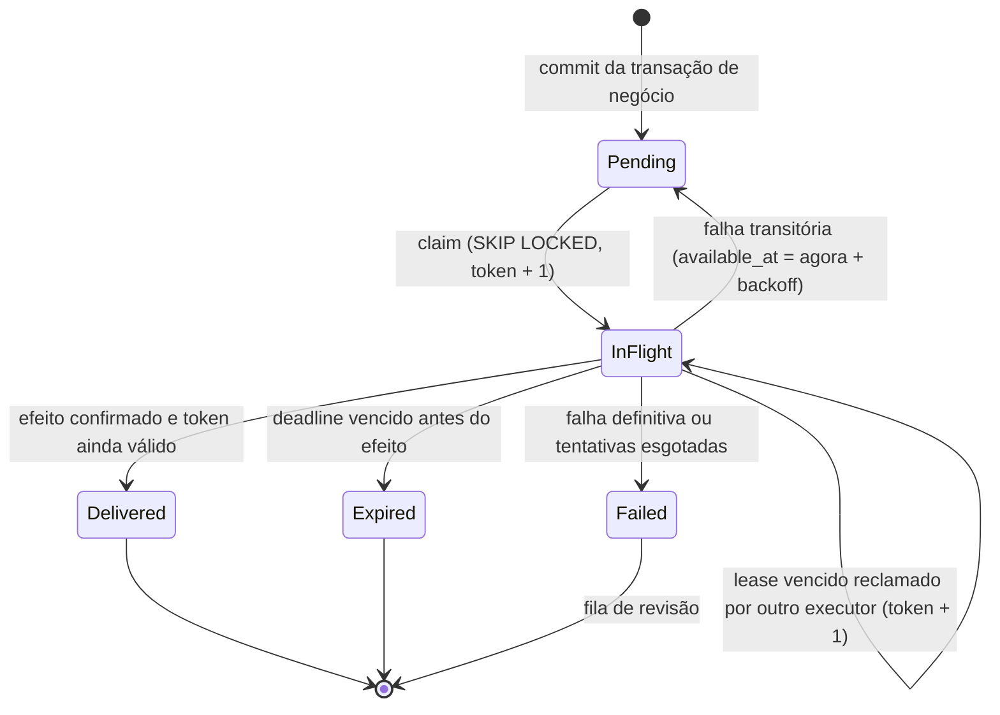

# Concorrência, idempotência e jobs duráveis

Ordem de locks, protocolo de cada cenário concorrente, idempotência, outbox com lease e fencing, política de
retry e como testar cada cenário com conexões reais. Fontes: spec 5.2, 7.1, 7.3, 8.7, 10.3–10.6, 16.4 e 20.3;
ADRs [0004](../architecture/adr/0004-dbcontext-unico-schemas-logicos.md),
[0008](../architecture/adr/0008-postgresql-para-jobs-e-outbox.md),
[0016](../architecture/adr/0016-sala-e-sessao-de-jogo.md),
[0020](../architecture/adr/0020-persistencia-da-sessao-de-jogo.md) e
[0021](../architecture/adr/0021-jobs-duraveis-e-leases-no-postgresql.md); fichas D-PG-03, D-EF-03 e D-EF-04. Tabelas e
constraints: [model.md](model.md). Ameaças: [threat-model.md](../security/threat-model.md) (TM-23, TM-50,
TM-52, TM-53, TM-56).

Fundamentos: anomalias de `READ COMMITTED` (lost update, write skew, phantom) e técnicas para cada uma
(*Designing Data-Intensive Applications*, 2ª ed., cap. 8; *The Art of PostgreSQL*, caps. 34–36); leases,
pausas de processo e fencing token (*Designing Data-Intensive Applications*, 2ª ed., cap. 9, "Distributed
Locks and Leases"); outbox, entrega at-least-once e consumidor idempotente (idem, caps. 8 e 12); argumento
fim a fim para idempotência e constraints como garantia de integridade (idem, cap. 13).

> **Estado:** especificação. A outbox de e-mail e os cenários marcados (M1) já estão implementados; o resto, não. Mudança em transação crítica atualiza
> este documento no mesmo PR (spec 21.2).

## Princípios

1. **Isolamento:** `READ COMMITTED` com locks explícitos nos fluxos coordenados e versão otimista na edição
   comum (spec 10.4). Nível mais forte só com medição e estratégia de retry.
2. **Revalidar depois do lock.** Em `READ COMMITTED` cada comando vê um snapshot novo. A checagem de bloqueio,
   elegibilidade, prazo e versão é um comando executado **depois** de o lock ser concedido; a leitura feita
   antes do lock só serve como pré-seleção. Isso é o que faz "operações ordenadas pelo commit" valer (T-03).
3. **Constraint é a última defesa.** Toda invariante tem `UNIQUE`, `CHECK` ou índice parcial
   ([model.md](model.md#índices-e-constraints-transversais-spec-103)); o lock evita o erro, a constraint
   garante que ele não passe. Check-then-insert sem constraint é write skew.
4. **Nada externo sob lock.** Nenhuma chamada a e-mail, storage, fornecedor etário, processamento externo ou webhook com locks de
   negócio mantidos; o efeito sai pela outbox no mesmo commit (spec 10.4).
5. **Transação curta e limitada.** `SET LOCAL lock_timeout` em toda transação coordenada (**2 s, hipótese**) e
   `statement_timeout` da conta da aplicação; `idle_in_transaction_session_timeout` no servidor.
6. **Relógio do servidor.** Prazos vêm do `TimeProvider` e de colunas `timestamptz` persistidas; o relógio do
   cliente não decide disputa (spec 10.4).
7. **SQL direto respeita o protocolo.** `ExecuteUpdate`, SQL parametrizado e lote passam pela mesma ordem de
   locks, versão e outbox (spec 10.5).

## Ordem global de locks

Todo caso de uso coordenado adquire locks nesta ordem (spec 10.4). Quem descobre um recurso fora da ordem
**reinicia a transação** com o conjunto completo; nunca adquire lock invertido.

| Ordem | Recurso | Comando | Observação |
|---|---|---|---|
| 0 | Registro de idempotência, quando houver; ou a linha do job, no handler de efeito interno (ADR-0021) | `INSERT ... ON CONFLICT` em `ops.idempotency_records`; `UPDATE ops.jobs ... WHERE id = $id AND fencing_token = $t` | Bloqueia uma segunda requisição com a mesma chave até o commit ou rollback da primeira. A linha do job nunca espera: transação de negócio não tranca job, e o claim usa `SKIP LOCKED` |
| 1 | Guardas de usuários | `SELECT 1 FROM safety.user_guards WHERE user_id = ANY($ids) ORDER BY user_id FOR UPDATE` | UUID crescente; o `ORDER BY` faz o lock seguir a ordem |
| 2 | Coordenador de evento ou rodada | `SELECT ... FROM events.events / events.rounds WHERE id = $id FOR UPDATE` | Evento antes da rodada quando os dois forem necessários |
| 3 | Guarda de relação | `INSERT ... ON CONFLICT DO NOTHING` e `SELECT ... FROM social.relationship_guards WHERE (user_low, user_high) = ($l, $h) FOR UPDATE` | Criada sob demanda; vários pares em ordem `(user_low, user_high)` |
| 4 | Sala (`game_session`) e conversa | `SELECT ... FOR UPDATE` | Sala antes de conversa; várias em ordem de `id` |

Guardas próprias de um módulo, que serializam só operações daquele módulo e de uma conta (como
`media.upload_guards`, C14), ficam fora desta ordem: o caso de uso que as toma não adquire nenhum outro lock de
negócio na mesma transação.

Linhas filhas (registros, decisões, mensagens, reservas) são escritas depois do coordenador que as protege;
inserções em índice único também esperam a transação concorrente, o que é desejado. Operações em lote
(pareamento de uma rodada inteira, cancelamento de evento) obedecem à mesma ordem: primeiro todas as guardas
de usuário ordenadas, depois o coordenador.

Erros esperados: `40P01` (deadlock) indica violação desta ordem e é bug, ainda que o retry o absorva; o
contador de deadlocks entra na observabilidade do banco (spec 19.1).

## Cenários concorrentes

### C1. Duas decisões positivas

API-R06 (M2). Invariante INV-04; teste T-04. Protocolo da spec 7.1:

1. Autenticar; abrir transação; `SET LOCAL lock_timeout`.
2. Ordem 0: idempotência da chave (`PUT .../my-decision` com `Idempotency-Key`).
3. Ordem 1: guardas dos dois participantes, em UUID crescente.
4. Ordem 3: guarda da relação `(user_low, user_high)`.
5. Ordem 4: `game_sessions` da sala `FOR UPDATE`.
6. Revalidar: participante da sala, janela de decisão aberta, ambos elegíveis, nenhum bloqueio, nenhuma
   conexão `Ended`/`Blocked` do par.
7. Gravar a própria decisão com `version` esperada (`UPDATE ... WHERE version = $v`; 0 linhas → `409`).
8. Ler a decisão da outra pessoa (agora estável: ninguém mais escreve no par sem a guarda).
9. Se as duas são `Interested`: `INSERT INTO social.connections ... ON CONFLICT (user_low, user_high) DO
   NOTHING`, conversa persistente, membros e outbox; senão, só outbox da própria mudança.
10. Gravar o resultado de idempotência; commit.

Sem o passo 4, duas transações em `READ COMMITTED` não enxergam a decisão não commitada uma da outra e o
resultado é **zero** conexões (write skew); o `UNIQUE` só impede duas, não zero.

### C2. Bloquear vs enviar mensagem, ler ou parear

API-S01 contra API-C04, API-C03, API-P04, API-M04 e `BuildRoundPairings`. Invariante INV-03; teste T-03.

| Operação | Locks | Revalidação depois do lock |
|---|---|---|
| Bloquear | 1: guardas de A e B → 3: guarda da relação → 4: conversas do par | — (é quem muda o estado) |
| Enviar mensagem | 0: idempotência → 1: guardas do remetente e do outro membro → 4: conversa | Membro, conversa aberta, conexão `Active` (persistente) ou sala ativa, sem bloqueio entre os dois |
| Parear | 1: guardas de todos os candidatos → 2: rodada | Elegibilidade e ausência de bloqueio de cada aresta |
| Ler (C03, P04, M04) | Nenhum | O bloqueio é condição da própria consulta (`NOT EXISTS` em `safety.blocks`) |

Bloquear, na mesma transação: insere em `safety.blocks` (`ON CONFLICT DO NOTHING`), incrementa
`security_version` das duas guardas, passa conexão ativa a `Blocked`, fecha conversa persistente, encerra
participação em sala ativa e libera reservas do par, cancela entregas `Pending` da outbox destinadas ao par
sobre recursos do par, grava auditoria e outbox de revogação de assinatura no hub; commit.

Resultado: envio e pareamento serializam com o bloqueio pelas guardas; o que adquire o lock depois do commit do
bloqueio falha na revalidação. Leitura sem lock que começa depois do commit vê o bloqueio. Leitura em voo antes
do commit pode concluir: é o limite aceito pela spec 1.2 ("impedir após o bloqueio").

**O que existe no M1** (`BlockService.BlockAsync`, decisões G7 e G8 de 2026-10-15): numa transação com
`lock_timeout` de 2 s, cria as guardas que faltam (`INSERT ... ON CONFLICT DO NOTHING`, na ordem de UUID), tranca
as duas guardas em ordem de UUID, insere o bloqueio com `ON CONFLICT (blocker_id, blocked_id) DO NOTHING` e, só
se a linha é nova, incrementa `security_version` das duas guardas e grava `safety.block_created` em
`ops.audit_events`; commit. Repetir o bloqueio não muda nada. Primeiro bloqueio, bloqueio repetido e alvo inexistente
percorrem os mesmos comandos (a versão e a auditoria rodam sempre, com efeito condicionado à linha nova; sem
guarda para o alvo inexistente, o insert condicionado a ela não grava nada): não há caminho curto para alvo
inexistente (`BlockSideChannelTests`). Resta o lock: o alvo inexistente não tem guarda e nunca espera por ela (risco
residual no TM-24). `lock_timeout` (55P03) e deadlock (40P01) repetem a transação inteira até 3 vezes, com backoff
e jitter; esgotadas as tentativas, `503 TEMPORARILY_UNAVAILABLE` com `Retry-After`, nada gravado
(`BlockConcurrencyTests.GuardHeldBeyondEveryRetryAnswers503AndChangesNothing`). Conta do alvo apagada entre a
checagem e o upsert (23503) responde como alvo inexistente (`BlockTargetDeletedTests`).

**Exclusão de conta (job futuro do Privacy):** antes de apagar ou anonimizar a conta e os bloqueios dela, o job
tranca a guarda da pessoa (`safety.user_guards`, ordem 1), e só então mexe em `identity.users`. Assim ele serializa
com bloqueios em andamento e respeita a ordem global; mexer na conta antes da guarda inverteria a ordem com o
bloqueio, que lê a conta e depois tranca a guarda. Leitura: `CheckInteractionAsync`, bilateral, sem lock. Testes: `BlockConcurrencyTests` (barreira com as
guardas trancadas por um terceiro, bloqueios cruzados sem deadlock, corrida livre repetida) e
`InteractionCheckTests`.

**Regra para o M2:** cada módulo que nascer com estado entre duas pessoas (Connections, Messaging, Experiences,
Matching, outbox de notificações) acrescenta o próprio efeito **dentro da transação do bloqueio**, depois do
`INSERT` em `safety.blocks` e na ordem global de locks (guarda da relação, depois sala e conversa): conexão
`Blocked`, conversa fechada, participação encerrada, reservas liberadas, entregas `Pending` canceladas e outbox
de revogação no hub. Efeito fora dessa transação abriria uma janela em que o bloqueio existe e a interação
continua.

### C3. Alterar preferência vs parear

API-P03 contra `BuildRoundPairings`. A atualização tranca a guarda da pessoa (ordem 1), grava com `If-Match`
e incrementa `security_version`. O pareamento tranca as guardas dos candidatos e só então lê as preferências
que vai usar; uma preferência alterada depois do commit vale para o próximo pareamento, nunca para sala já
iniciada sem necessidade de segurança (spec 8.2).

### C4. Duas ações de jogo

API-R03 (M2), protocolo do [ADR-0020](../architecture/adr/0020-persistencia-da-sessao-de-jogo.md) (item 7).
Idempotência (ordem 0); `game_sessions FOR UPDATE` (ordem 4); ler `game_participants` e `game_actions` da sessão;
`Restore`; comparar `version` com `expectedVersion`; aplicar `ApplyAction`; `UPDATE ... SET ..., version =
version + 1 WHERE id = $id AND version = $v` (zero linhas é bug do protocolo → rollback, nunca sobrescrita),
`UPDATE` das linhas privadas alteradas, `INSERT` em `game_actions` (PK `(game_session_id, actor_id, action_id)`
deduplica reenvio do mesmo `actionId`; guarda `payload_sha256`, não o corpo), outbox e resultado de idempotência
no mesmo commit. A segunda ação com versão antiga recebe `409 ROOM_VERSION_CONFLICT` (spec 8.6); reenvio com o
mesmo `actionId` e o mesmo hash devolve o resultado da primeira; mesmo `actionId` com hash diferente é rejeitado.
A leitura de projeção não tranca e lê as três tabelas em `REPEATABLE READ READ ONLY`.

### C5. Duas inscrições na última vaga

API-E03, API-E04 e promoção da lista de espera (M2). Teste T-28.

1. Ordem 1: guarda de quem se inscreve (elegibilidade e sanções).
2. Ordem 2: `events.events FOR UPDATE`.
3. `confirmed_count < capacity` → `Confirmed` e `confirmed_count + 1`; senão `Waitlisted` com
   `waitlist_position = next_waitlist_position` e incremento do contador.
4. Retirada ou no-show: mesmo lock do evento; liberar a vaga e promover a inscrição `Waitlisted` de menor
   posição (determinístico), na mesma transação, com outbox para a pessoa promovida.

O `CHECK (confirmed_count BETWEEN 0 AND capacity)` e os `UNIQUE` de inscrição e de posição garantem que um bug
no protocolo vire erro, não lotação estourada.

### C6. Timeout vs ação

Job de expiração e API-R01/R03 (M2). Teste T-18. Os dois trancam a `game_session` e comparam o deadline
persistido com o instante do servidor. Quem trancar primeiro decide; o job só transiciona se `state` e
`version` ainda forem os que ele leu (`UPDATE ... WHERE id = $id AND version = $v AND state = 'Active'`). O job
tranca antes a própria linha em `ops.jobs` (ordem 0, [ADR-0021](../architecture/adr/0021-jobs-duraveis-e-leases-no-postgresql.md)
item 4); se a sala já saiu de `Active` ou o prazo persistido não é o instante do job, conclui sem efeito. Mudar o
prazo insere um job novo com a chave do instante novo (`active-deadline:<sala>:<prazo>`); a API nunca cancela,
altera nem tranca o job.

### C7. Worker atrasado vs novo lease

Outbox e jobs. Teste T-08. Ver [Outbox, lease e fencing](#outbox-lease-e-fencing).

### C8. Exclusão vs notificação

API-D03 contra entregas da outbox (M2+). A exclusão tranca a guarda da pessoa, passa a conta a
`DeletionPending` e revoga sessões; ela **não** altera entregas da outbox, assim como transação de negócio não
altera jobs. O consumidor, imediatamente antes do efeito externo, revalida o destinatário numa leitura curta
(estado da conta, bloqueio, preferências) e, se ele não for mais válido, encerra a entrega sem efeito. A outbox
implementada no M1 (`OutboxDeliveryStatus`: `Pending`, `InFlight`, `Delivered`, `Failed`, `Expired`) não tem
`Cancelled` nem essa revalidação; a fatia de API-D03 acrescenta as duas (o estado novo entra por expand/contract:
primeiro o `CHECK` e o leitor, depois a escrita). Entrega já em envio quando a exclusão comita pode sair: bytes
em trânsito não são recolhidos (spec 1.2).

### C9. Revogação de sessão vs requisição em voo (M1)

API-A05, A10, A16 contra qualquer requisição autenticada. Sem lock: a revogação comita `revoked_at` e o
`ITicketStore` consulta a sessão a cada requisição ([auth.md](../security/auth.md#ticket-no-servidor)).
Requisição autorizada antes do commit pode concluir; qualquer requisição cujo `RetrieveAsync` rode depois do
commit recebe `401`. O hub é fechado ativamente (T-14).

### C10. Troca de senha vs login simultâneo (M1)

A troca de senha atualiza o security stamp e revoga as outras sessões numa transação. Um login concorrente que
grave a sessão com o stamp antigo é barrado na requisição seguinte, porque `RetrieveAsync` compara o stamp da
sessão com o atual.

### C11. Callback etário duplicado ou concorrente com a consulta do worker (M1)

`/webhooks/{provider}` e o job que consulta o fornecedor. Teste T-17. Na mesma transação: `INSERT INTO
ops.webhook_receipts ... ON CONFLICT (provider, provider_event_id) DO NOTHING` (0 linhas → já processado,
responde `200` sem efeito); depois `UPDATE identity.age_verifications SET state = $novo, version = version +
1 WHERE id = $id AND state IN ('Pending', 'ManualReview')`. A transição condicional faz callback e consulta do
worker convergirem: o segundo encontra 0 linhas e não repete o efeito.

### C12. Duas decisões de moderação no mesmo caso (M1)

API-ADM14/ADM15. Caso com `version`; o comando traz a versão esperada (spec 8.5); `UPDATE ... WHERE version =
$v` → 0 linhas → `409`. Não há retry automático: a segunda pessoa revê o caso atualizado.

### C13. Duas abas editando o perfil (M1)

API-P02/P03 e N02. Teste T-19. `If-Match` obrigatório (ausente → `428`); `UPDATE ... WHERE user_id = $u AND
version = $etag` → 0 linhas → `412` e nada gravado (spec 8.1).

### C14. Uploads simultâneos da mesma conta (M1)

API-M01, ADR-0025, teste `PendingUploadsPerAccountAreCapped`. Teto de pendentes por conta (spec 11.5) com
"contar e inserir" na mesma transação, que sozinho seria write skew em READ COMMITTED. A reserva toma a guarda do
Media: `INSERT INTO media.upload_guards (owner_id) VALUES ($o) ON CONFLICT DO NOTHING`, depois `SELECT ... FROM
media.upload_guards WHERE owner_id = $o FOR UPDATE`; só então relê a situação da conta (pela operação pública
`AccountService.FindStatusAsync` do Identity, na mesma transação, sem ler `identity.users` direto), procura a chave de
idempotência, conta os pendentes e insere o `Pending`. O segundo envio espera o commit do primeiro e o conta. Conta
inexistente: a FK recusa o insert da guarda (`23503`) e a reserva responde "dono ausente". O streaming para o
storage acontece depois do commit, sem lock; a promoção a `Quarantined` é `UPDATE` condicional por estado e versão
(0 linhas = reserva perdida, compensada). Sabotado sem o `FOR UPDATE`, o teste falha.

## Idempotência

Contrato da spec 8.7, implementado sobre `ops.idempotency_records`
([model.md](model.md#t-ops-idempotency-records); PK `(principal_id, operation, idempotency_key)`).

| Passo | Comando | Resultado |
|---|---|---|
| 1. Validar a chave | Formato e tamanho (≤ 100); ausente onde é obrigatória → `400` | — |
| 2. Reservar | Primeiro comando da transação: `INSERT ... VALUES ($principal, $op, $key, $hash, $expira) ON CONFLICT (principal_id, operation, idempotency_key) DO UPDATE SET request_sha256 = EXCLUDED.request_sha256, ... WHERE idempotency_records.expires_at <= $agora RETURNING ...` | Linha devolvida: chave nova (ou vencida e reaproveitada) → executar |
| 3. Concorrência | Requisição com a mesma chave enquanto a primeira não comitou espera no índice único até `lock_timeout` | Estourou → `409 IDEMPOTENCY_REQUEST_IN_PROGRESS` + `Retry-After`; nunca segunda execução |
| 4. Repetição | Nenhuma linha devolvida no passo 2 → ler o registro existente | Hash igual → revalidar autorização atual e devolver o resultado mínimo guardado; hash diferente → `409 IDEMPOTENCY_KEY_REUSED` |
| 5. Efeito | Executar o caso de uso com o protocolo do cenário | — |
| 6. Concluir | `UPDATE` do registro com `response_status` e `result` mínimo, no **mesmo commit** do efeito | Commit incerto: o cliente repete com a mesma chave e recebe o resultado |

- Rejeição de domínio (`4xx`) faz rollback, inclusive da reserva: a repetição reavalia. Só efeitos comitados
  ficam registrados.
- O hash é do conteúdo canônico relevante (campos do DTO normalizados), não dos bytes brutos.
- **Revalidar antes de devolver:** se a autorização atual não permite mais ver o recurso (bloqueio, exclusão),
  devolver a resposta neutra de indisponibilidade, nunca o resultado guardado (spec 8.7; T-27).
- Resultado guardado é mínimo (IDs, versões, status); nunca texto de mensagem, foto ou pista.
- Unicidades de negócio continuam: inscrição única, ação única e mensagem única valem mesmo com chave diferente
  (spec 8.1).
- Limpeza: job em lotes pequenos apaga registros com `expires_at <= agora` (48 h, spec 4.3).

Operações com chave: API-E03, R01, R03, R06, C02, C04, S04, M01, D01, D03, ADM02, ADM20 e as demais criações
com efeito (spec 8.1). Rotas públicas de autenticação não usam chave (não há principal); a repetição delas é
tratada por anti-enumeração e rate limit.

## Outbox, lease e fencing



**Claim** (transação curta, sem chamada externa):

```sql
WITH picked AS (
    SELECT id
    FROM ops.outbox_deliveries
    WHERE (status = 'Pending' AND available_at <= $now)
       OR (status = 'InFlight' AND lease_expires_at <= $now)
    ORDER BY available_at, id
    LIMIT $batch
    FOR UPDATE SKIP LOCKED
)
UPDATE ops.outbox_deliveries AS d
SET status = 'InFlight',
    lease_expires_at = $now + $lease,
    fencing_token = d.fencing_token + 1,
    attempts = d.attempts + 1
FROM picked
WHERE d.id = picked.id
RETURNING d.id, d.outbox_event_id, d.consumer, d.recipient_key, d.fencing_token, d.deadline_at;
```

**Efeito** (fora da transação): conferir deadline; revalidar destinatário; chamar o fornecedor com timeout,
cancelamento e chave de idempotência do fornecedor quando existir (`id` da entrega, estável entre tentativas);
o consumidor de tempo real publica pelo `IHubContext` só no processo web.

**Conclusão** (transação curta):

```sql
UPDATE ops.outbox_deliveries
SET status = 'Delivered', completed_at = $now, lease_expires_at = NULL
WHERE id = $id AND status = 'InFlight' AND fencing_token = $token AND lease_expires_at > $now;
```

0 linhas afetadas = outro executor assumiu (lease vencido durante pausa de GC, rede ou VM): o resultado é
descartado, com métrica `stale_completion`, e nunca sobrescreve o estado. O efeito externo pode ter acontecido
duas vezes; por isso o fornecedor recebe chave de idempotência e o destinatário deduplica por `eventId`
(spec 10.6). Exactly-once não é prometido.

Nomes da implementação do M1 (`OutboxDeliveryQueue`): o claim filtra por `consumer`, e a expiração por deadline é
decidida pelo consumidor depois do claim, encerrando a entrega como `Expired`.

Jobs (`ops.jobs`) usam o mesmo claim, lease e fencing, com as diferenças do
[ADR-0021](../architecture/adr/0021-jobs-duraveis-e-leases-no-postgresql.md): estado final `Done` e `Cancelled`
(este só pela área administrativa); uma chave por agendamento (`<kind>:<agregado>:<instante>`), e transação de
negócio só insere chave nova; claim só dos tipos conhecidos pela release e não pausados, que no mesmo comando leva
a `Expired` o deadline vencido e a `Failed` o lease vencido de tentativas esgotadas, devolvendo como trabalho só as
`InFlight` (SQL no ADR-0021, item 3); prazo do item limitando a unidade inteira e conferido contra o lease restante
antes de cada item; efeito interno conclui o job e aplica a transição de negócio na mesma transação, com a linha do
job na ordem 0; efeito externo autoriza no banco antes de agir no storage. Job de expiração de sala, rodada ou convite aplica a transição condicional do cenário
[C6](#c6-timeout-vs-ação), de modo que uma conclusão com token válido mas estado já mudado não tem efeito.

| Parâmetro | Valor inicial (hipótese) |
|---|---|
| Lote | 20 entregas |
| Lease | 60 s, renovável por heartbeat em jobs longos (processamento de imagem) |
| Intervalo de polling | 1 s com jitter (`JitteredInterval` já existe no `Duora.Core`) |
| Idade máxima antes de alerta | 30 s por 5 min na outbox de tempo real (spec 19.1) |

## Política de retry

### Transações no banco

| Erro | SQLSTATE | Retry |
|---|---|---|
| Deadlock | `40P01` | Sim, a unidade inteira |
| Falha de serialização | `40001` | Sim, a unidade inteira (só se algum fluxo usar `SERIALIZABLE`) |
| `lock_timeout` | `55P03` | Sim, a unidade inteira; esgotado → `503` com `Retry-After` |
| Conexão perdida antes do commit | — | Sim, se o comando tem chave de idempotência ou identificador estável; commit incerto → consultar pelo identificador antes de repetir (spec 10.5) |
| Violação de unicidade, `CHECK`, FK | `23505`, `23514`, `23503` | **Não**; mapear para resposta de domínio (`409`) ou bug |
| Autorização, validação, versão divergente | — | **Não** |

No máximo 3 tentativas, backoff de 50 ms, 100 ms e 200 ms com jitter **(hipótese)**, envolvendo a unidade
transacional inteira pela estratégia de execução do EF Core; nunca combinar transação manual e retry
improvisado (spec 10.5; D-EF-04). A lista de erros transitórios da estratégia é configurada explicitamente.

### Entregas da outbox

Spec 10.6: até 8 tentativas, backoff exponencial com jitter e teto de 15 min.

| Tentativa | Atraso-base | Atraso aplicado |
|---|---|---|
| 1 | 15 s | entre 7,5 s e 15 s |
| 2 | 30 s | entre 15 s e 30 s |
| 3 | 1 min | entre 30 s e 1 min |
| 4 | 2 min | entre 1 e 2 min |
| 5 | 4 min | entre 2 e 4 min |
| 6 | 8 min | entre 4 e 8 min |
| 7 | 15 min (teto) | entre 7,5 e 15 min |
| 8 | — | Última; falhou → `Failed` |

Atraso aplicado = metade do atraso-base mais um valor aleatório até a outra metade (jitter que nunca zera a
espera) **(proposta)**. `429` ou `503` do fornecedor com `Retry-After` substitui o atraso calculado, limitado
ao deadline. Erro definitivo (`4xx` de validação, destinatário inválido, assinatura rejeitada) vai direto a
`Failed`. Deadline vencido → `Expired`, nunca envio atrasado (notificação de convite não sai dias depois).
`Failed` entra na fila de revisão com causa sanitizada; reprocessar exige permissão, chave de operação e nova
verificação de elegibilidade (API-ADM20).

Circuit breaker por fornecedor no `HttpClient` (`AddStandardResilienceHandler`), sem retry automático de
`POST` sem chave de idempotência do fornecedor (spec 16.4).

## Como testar

Spec 20.3: testes de concorrência usam múltiplas conexões e contextos reais com barreiras controladas, nunca
chamadas sequenciais que só parecem simultâneas. Base: Testcontainers com PostgreSQL 18, `DbContext` e
`NpgsqlConnection` independentes por ator, `FakeTimeProvider` para prazos (D-TEST-01).

### Técnica

1. **Interleaving determinístico:** o ator A abre a transação e para logo depois de adquirir o lock (gancho de
   teste no caso de uso ou execução do protocolo passo a passo em SQL). O ator B começa e o teste espera, sem
   `sleep`, até B estar bloqueado por A: `SELECT pg_blocking_pids($pidB)` contém `$pidA`. Então A comita ou
   aborta e o teste verifica o resultado de B.
2. **Corrida livre repetida:** N execuções (ex.: 50) com os dois atores liberados por `Barrier` ao mesmo
   tempo, para achar interleavings não previstos; o resultado precisa ser o mesmo invariante em todas.
3. **Verificação pelo estado:** depois de cada cenário, reler o banco por outra conexão e afirmar a invariante
   (contagens, unicidade, estados), não só o status HTTP.
4. **Sabotagem:** cada teste é conferido uma vez com o lock ou a constraint removidos, para provar que falharia
   sem a mitigação (devil's advocate).

### Testes de aceite

| Teste | Montagem | Interleaving | Asserções |
|---|---|---|---|
| T-02 (M2) | Rodada com A, B, C elegíveis; dois coordenadores da mesma rodada ou de rodadas sobrepostas tentam reservar A | Coordenador 1 tranca as guardas e para; coordenador 2 bloqueia em `pg_blocking_pids`; 1 comita | Exatamente uma reserva ativa de A (`ux_pairing_participants_active_user`); o coordenador 2 revalida e escolhe outra aresta ou deixa A sem par; nenhum `23505` chega ao cliente |
| T-03 (M1 parcial, M2) | Par com conversa ativa e perfis visíveis um ao outro | (a) bloqueio tranca as guardas e para; envio de mensagem bloqueia; bloqueio comita. (b) envio primeiro e bloqueio depois | (a) envio falha com indisponibilidade neutra, nenhuma linha em `messages`. (b) mensagem gravada com sequência anterior ao bloqueio; depois do commit do bloqueio, API-C03, P04 e M04 negam. No M1 só o ramo de leitura de perfil e foto |
| T-04 (M2) | Sala concluída com janela aberta | A e B gravam `Interested` liberados pela mesma `Barrier`; depois cada um repete com a mesma chave | Uma conexão, uma conversa persistente, dois membros; nenhuma conexão zero; a repetição devolve o mesmo resultado; nenhuma decisão aparece na resposta do outro |
| T-06 (M2) | Comando com `Idempotency-Key` (ação de jogo, inscrição ou mensagem) | Duas requisições com a mesma chave e corpo simultâneas; uma terceira com a mesma chave e corpo diferente | Um efeito; a concorrente espera e devolve o mesmo resultado ou `409 IDEMPOTENCY_REQUEST_IN_PROGRESS`; corpo diferente → `409 IDEMPOTENCY_KEY_REUSED`; outro usuário com a mesma chave não recebe o resultado do primeiro |
| T-08 (M2; outbox de e-mail já no M1) | Entrega `Pending`; dois executores do worker | Executor 1 faz claim (token t) e para antes de concluir; `FakeTimeProvider` passa do lease; executor 2 faz claim (token t + 1) e conclui; executor 1 tenta concluir | Conclusão do executor 1 afeta 0 linhas; estado final `Done` pelo token t + 1; o fornecedor falso recebeu a mesma chave de idempotência nas duas chamadas. Variantes: processo encerrado antes do commit (nada enviado), depois do envio e antes do ACK (envio repetido, deduplicado) |
| T-28 (M2) | Evento com capacidade N e N − 1 confirmados; lista de espera com duas pessoas | Duas inscrições na última vaga pela mesma `Barrier`; depois retirada concorrente com check-in | `confirmed_count = capacity`, uma inscrição `Confirmed` e outra `Waitlisted`; a retirada promove a menor posição da espera; nenhum `CHECK` violado chega ao cliente |

Testes de M1 que também seguem a técnica: C11 (`DuplicateAgeCallbackAndProviderQueryConvergeToOneTransition`),
C12 (`ConcurrentModerationDecisionsSecondGets409`) e C13 (T-19). Nomes "a criar" seguem o
[threat-model.md](../security/threat-model.md#6-ameaça--mitigação--teste).
