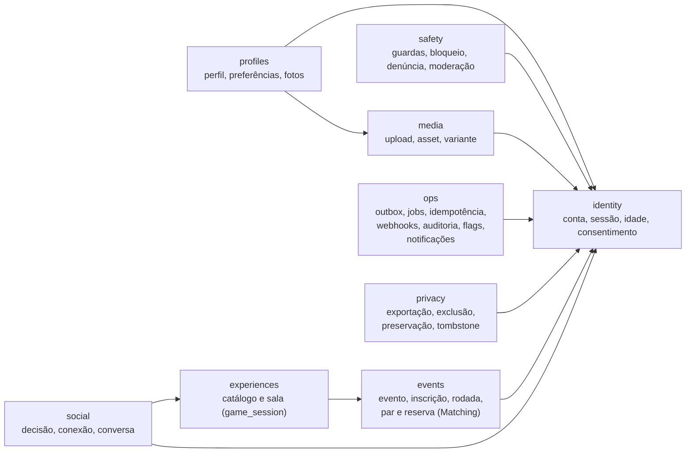
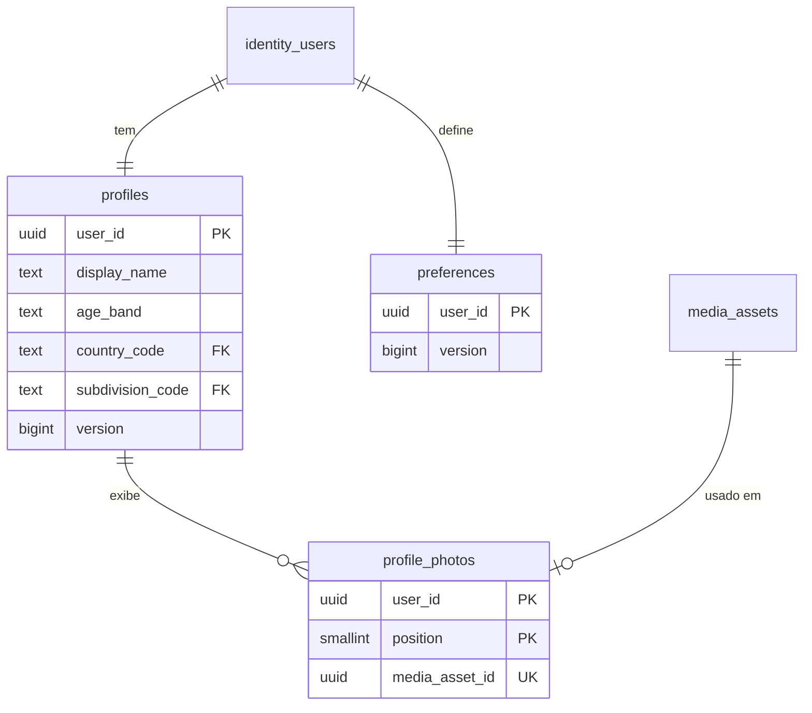
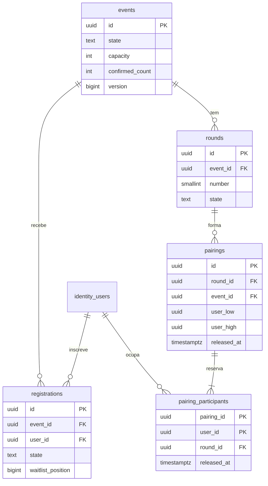
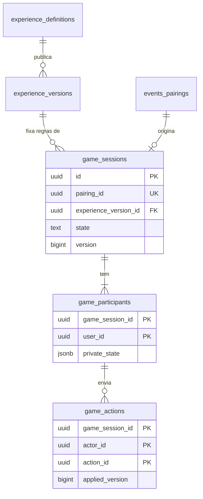
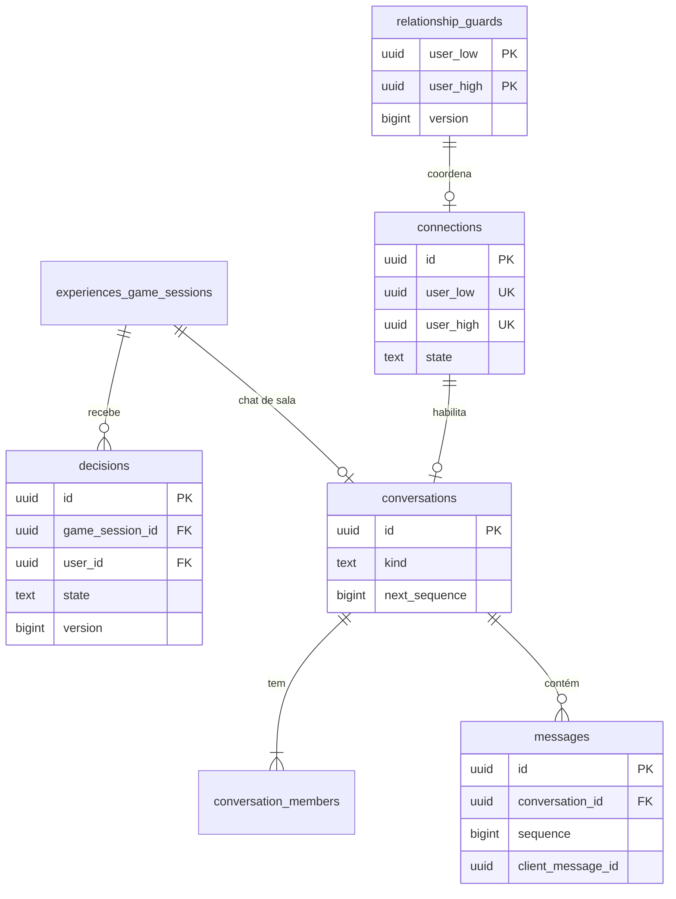
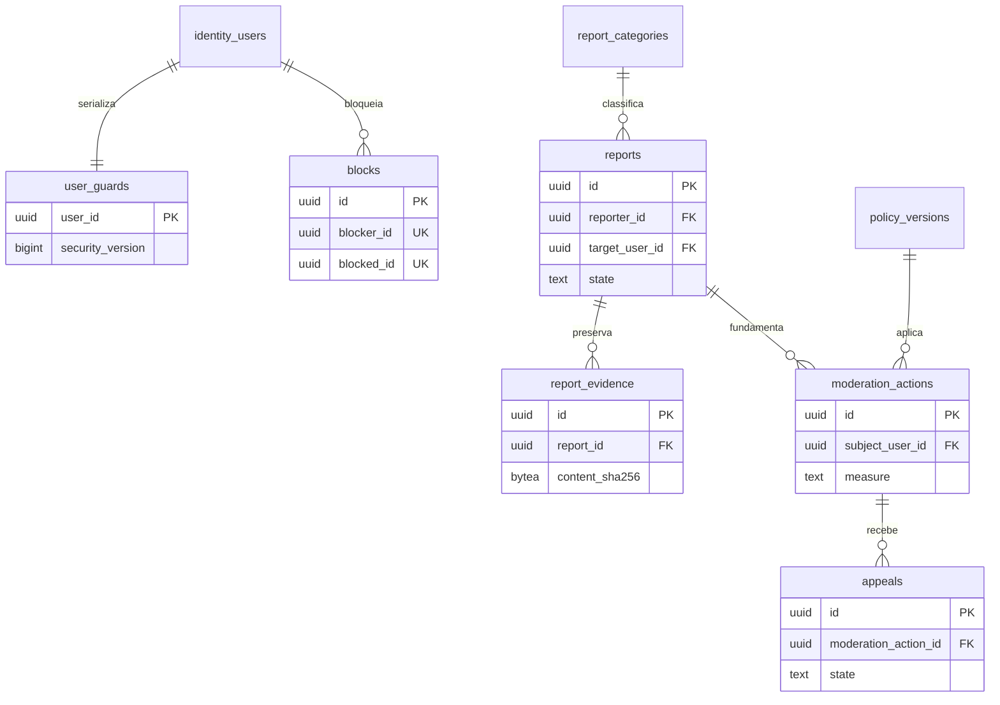
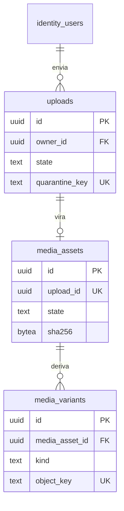
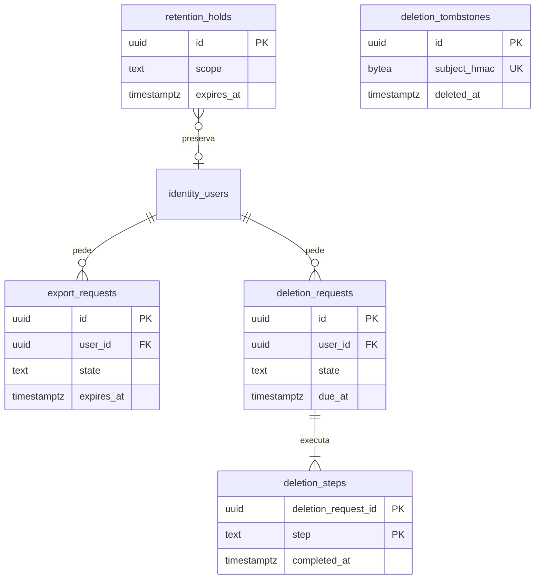

# Modelo de dados

ER, dicionário, constraints, índices previstos e classificação de sensibilidade das tabelas da spec 10.2, por
schema. Fontes: spec 4.2, 4.3, 7, 8, 10.1–10.7, 12 e 16; [modules.md](../architecture/modules.md) (dono de
cada tabela); ADRs [0004](../architecture/adr/0004-dbcontext-unico-schemas-logicos.md),
[0005](../architecture/adr/0005-identity-local-cookie-ticket-persistente.md),
[0008](../architecture/adr/0008-postgresql-para-jobs-e-outbox.md),
[0010](../architecture/adr/0010-object-storage-externo-leitura-via-api.md),
[0016](../architecture/adr/0016-sala-e-sessao-de-jogo.md),
[0020](../architecture/adr/0020-persistencia-da-sessao-de-jogo.md) e
[0021](../architecture/adr/0021-jobs-duraveis-e-leases-no-postgresql.md); fichas D-PG-02, D-PG-03, D-EF-02 e D-EF-03.
Protocolos transacionais: [concurrency.md](concurrency.md). Finalidade e acesso de cada dado:
[data-map.md](../privacy/data-map.md). Prazos: [retention.md](../privacy/retention.md).

> **Estado:** proposta para revisão. Hoje o banco só tem o schema `ops` e a migração `Baseline`. Cada fatia
> cria as tabelas de que precisa, com testes contra PostgreSQL 18 real (spec 10.2). Itens marcados
> **Proposta — confirmar** resolvem lacunas da spec e precisam de aprovação do responsável técnico antes da
> primeira migração que os usa; os nomes de coluna são indicativos e podem mudar na migração revisada.

## Convenções

| Tema | Regra | Fonte |
|---|---|---|
| Nomes | `snake_case` por mapeamento explícito; tabelas no plural; constraints `pk_`, `fk_`, `ux_`, `ix_`, `ck_` + tabela + colunas | spec 10.1 |
| Chave primária | `uuid`, gerado pela aplicação com `Guid.CreateVersion7()` (UUIDv7: ordenado no tempo, bom para B-tree). **Proposta — confirmar:** `identity.users.id` usa UUIDv4, porque o ID da conta aparece para outras pessoas (API-P04) e o UUIDv7 revelaria o instante de criação da conta. Exceção de fila: `ops.outbox_deliveries.id` e `ops.audit_events.id` são `bigint generated always as identity` (só ordem interna, nunca na API) | spec 8.1, 10.1; *The Art of PostgreSQL*, caps. 22–23 |
| Instantes | `timestamptz`, sempre UTC, valor vindo do `TimeProvider` da aplicação (nunca `now()` como regra de negócio); `date` só para data civil | spec 8.1, 10.1 |
| Concorrência | `version bigint not null default 0` em toda tabela editável ou com máquina de estados; incrementada pela aplicação em toda escrita relevante, inclusive SQL direto; nunca `xmin` no contrato público | spec 10.5 |
| Texto | `text` + `CHECK (char_length(col) <= n)`; nunca `varchar(n)` nem `char(n)`; limites de bytes onde a spec pede | *The Art of PostgreSQL*, cap. 22 |
| Estados | `text` + `CHECK (col IN (...))` com os estados da spec 4.2 (conjunto fixo); conjuntos que o negócio altera vão em tabela de referência com FK | *SQL Antipatterns*, cap. 11 |
| FKs | Toda relação é FK, com `ON DELETE` escolhido abaixo e **índice na coluna da FK** (o PostgreSQL não cria) | *SQL Antipatterns*, cap. 5 |
| `ON DELETE` | `CASCADE` só para filho que não existe sem o pai dentro do mesmo agregado; `RESTRICT` para referências a `identity.users` vindas de outros módulos (a exclusão de conta é um job do Privacy que apaga módulo por módulo, com trilha; nada some por cascata silenciosa); `SET NULL` só onde o registro precisa sobreviver sem o autor | spec 12.4 |
| Pares | Par de pessoas normalizado: `user_low < user_high`, `CHECK (user_low < user_high)` | spec 10.3 |
| Associação polimórfica | Proibida (`*_type` + `*_id` sem FK). Contextos alternativos usam arco exclusivo: FKs anuláveis + `CHECK (num_nonnulls(...) <= 1)`. Exceções documentadas: auditoria e evidência guardam referências históricas sem FK, porque precisam sobreviver ao alvo | *SQL Antipatterns*, cap. 7 |
| JSONB | Só para estado variável de jogo e payloads versionados, com `schema_version`, limite de tamanho e validação; nunca para autorização, participantes, preferências ou relações | spec 6.1, 10.1 |
| Evolução de payload (outbox, jobs, JSONB) | Campo novo segue expand/contract, em dois deploys: primeiro vai a deploy um leitor tolerante, que aceita e ignora o campo (ou o lê com padrão quando ausente); só num deploy seguinte o campo passa a ser gravado. Assim o rollback elegível ([deploy.md](../operations/deploy.md#rollback-de-aplicação)) nunca põe um leitor estrito diante de um payload que ele recusa. Remover campo segue a ordem inversa: parar de ler, depois parar de gravar. Valor novo de enum no payload (o `kind` do pedido de e-mail de conta, por exemplo) segue a mesma regra, porque o leitor estrito o recusa como payload inválido: os avisos de credencial (TM-21) e o `PasswordResetUnavailable` do bootstrap administrativo entraram com o leitor num PR e a gravação no seguinte. Exceção registrada: o `language` do pedido de e-mail de conta (PR #22) entrou num deploy só, e o rollback dele tem restrição própria no deploy.md | spec 17.4; DDIA cap. 5 |
| Índices | Os listados aqui são os previstos pelas consultas conhecidas e pelas FKs; qualquer outro só com `EXPLAIN (ANALYZE, BUFFERS)` de consulta real | spec 10.7; *SQL Antipatterns*, cap. 13 |
| Expiração | Nunca `now()` em predicado de índice parcial; liberar ou expirar é transição persistida | spec 10.3 |

### Classificação de sensibilidade

| Classe | Significado | Exemplos | Regras mínimas |
|---|---|---|---|
| P0 | Público ou de catálogo | Conteúdo publicado de experiência | Sem restrição de leitura além da publicação |
| P1 | Interno operacional | Estado de jobs, flags, contagens | Sem dado pessoal; acesso de operação |
| P2 | Pessoal | E-mail, nome de exibição, região, IDs de conta, auditoria | Acesso por finalidade; fora de telemetria; exportável ao titular |
| P3 | Pessoal sensível ou íntimo | Preferências, decisões, mensagens, fotos, verificação etária, bloqueios, denúncias, evidências | Projeção por destinatário; acesso por caso; nunca em log, métrica, issue ou contexto de agente |
| S | Segredo ou credencial | Hash de senha, chave TOTP, códigos de recuperação, ticket de sessão | Nunca exposto por API (exceto a exibição única ao titular), nunca em log; protegido em repouso |

A classe de cada tabela é a da coluna mais sensível; colunas mais sensíveis que a tabela são indicadas.

## Visão geral

Seta: "tem FK para". Quase toda tabela referencia `identity.users`; o diagrama mostra só as dependências entre
schemas que guiam a ordem de migração.

## Decisões de modelagem propostas

Respostas às lacunas de [modules.md](../architecture/modules.md#módulos) (notas 1 a 4) e às encontradas ao
detalhar este modelo. Todas **Proposta — confirmar**.

| # | Lacuna | Proposta | Alternativa descartada |
|---|---|---|---|
| D1 | Schema do Matching (nota 1) | Manter `events.pairings` e `events.pairing_participants`, como no DDL da spec 10.3; dono lógico Matching | Schema `matching` novo: diverge da lista de schemas do ADR-0004 e do DDL da spec sem ganho de isolamento (mesmo `DbContext`) |
| D2 | Schema de Connections (nota 2) | `social.relationship_guards`, `social.decisions`, `social.connections`; dono lógico Connections | `safety`: guardas de relação servem também a decisão e chat, não só a segurança |
| D3 | Schema de `audit_events` (nota 4) | `ops.audit_events`, append-only por permissão de tabela (a conta da aplicação só tem `INSERT` e `SELECT`) | Schema `audit` novo: mesma proteção dá-se por `GRANT` por tabela, sem alterar o ADR-0004 |
| D4 | Tabelas do Notifications (nota 3) | `ops.notification_preferences` (API-N01/N02) e `ops.email_receipts` (recibos e bounces do fornecedor); dono lógico Notifications. A entrega em si é `ops.outbox_deliveries` com `consumer = 'email'` | Schema `notifications` novo: mesma razão de D3; tabela própria de envios: duplicaria a outbox |
| D5 | Configuração e flags do Operations (nota 3) | `ops.operational_flags` (pausa de matching, pausa de uploads, manutenção) e `ops.parameter_sets` (parâmetros da spec 4.3, versionados e imutáveis); salas e eventos guardam o `parameter_set_id` do snapshot | Feature flags genéricas com avaliação dinâmica: não há caso de uso além de três pausas |
| D6 | Exclusão de conta × FKs | `ON DELETE RESTRICT` nas referências a `identity.users` vindas de outros módulos; o job de exclusão do Privacy remove ou anonimiza por etapas (`privacy.deletion_steps`) e só então apaga a conta | `CASCADE` geral: apagaria em silêncio evidência sob preservação e não deixaria trilha por etapa |
| D7 | Evidência de denúncia × retenção do chat | `safety.report_evidence` guarda **cópia** do recorte autorizado, com hash, e só uma referência histórica (sem FK) à origem | FK para `social.messages`: a evidência morreria com a retenção do chat, ou o chat ficaria preso à evidência |
| D8 | Contexto da denúncia | Arco exclusivo: `game_session_id`, `conversation_id`, `media_asset_id` anuláveis com FK + `CHECK (num_nonnulls(...) <= 1)` | `context_type` + `context_id`: associação polimórfica sem FK |
| D9 | Não repetir par no evento | `events.pairings` carrega `event_id` (consistente com a rodada por FK composta) e `UNIQUE (event_id, user_low, user_high)` | Checar repetição só no algoritmo: check-then-insert sem constraint |
| D10 | Uma conexão por par para sempre | `UNIQUE (user_low, user_high)` em `social.connections` vale também para conexões encerradas (reconexão fora do MVP, spec 7.1); o pareamento exclui pares com conexão `Ended` ou `Blocked` | Unicidade só de conexão ativa: permitiria reconexão implícita, que a spec deixa fora do MVP |
| D11 | Sequência de mensagens | `social.conversations.next_sequence bigint`, incrementado sob o lock da conversa no envio | `SEQUENCE` global ou `max(sequence)+1`: a primeira não é por conversa; a segunda é read-modify-write |
| D12 | Data de nascimento | `identity.users.birth_date date` (classe P3), nunca exposta; o perfil guarda só a faixa etária derivada | Só faixa etária autodeclarada: a faixa precisa ser recalculada com o tempo e conferida com a verificação etária |
| D13 | Conta privilegiada separada (**Accepted**, 2026-10-15) | Trigger de atribuição: conta com papel privilegiado não tem papel `participant` ([auth.md](../security/auth.md#papéis-e-contas)) | Elevação de sessão de participante |

## Schema `identity`

Dono: Identity. Tabelas do ASP.NET Core Identity mapeadas para nomes `snake_case` sob este schema.

### identity.users

Preferência de apresentação (issue #81, aprovação de 2026-10-21): `preferred_time_zone text null` e `time_zone_version bigint not null default 0`, privados do titular. Sem migração por idioma/residência. Escolha IANA suportada ou null explícito via recurso ETag/If-Match; versão independente de matching e segurança. Atualização Identity não sobrescreve estes campos. A migração aditiva é preservada em rollback. Avisos de credenciais capturam a escolha na outbox; referência UTC e datas civis permanecem intactas. Ver [contrato e rollout](../testing/event-time-zones.md).

- **Colunas:** `id uuid`; `email text` (≤ 254), `normalized_email text`, `email_confirmed boolean`;
  `password_hash text`; `security_stamp text`, `concurrency_stamp text` (Identity);
  `two_factor_enabled boolean`; `lockout_end timestamptz`, `lockout_enabled boolean`,
  `access_failed_count int`; `state text` (`PendingEmail`, `PendingEligibility`, `Active`, `Restricted`,
  `Suspended`, `DeletionPending`, `Deleted`); `birth_date date` (D12); `created_at`, `state_changed_at
  timestamptz`; `version bigint`.
- **Chaves e constraints:** PK `id`; `UNIQUE (normalized_email)` (`RequireUniqueEmail`; normalização do
  Identity, explícita e testada); `CHECK` de estado; `CHECK (access_failed_count >= 0)`.
- **Índices:** o da unicidade de e-mail; `ix_users_state` só se uma consulta medida pedir.
- **`last_totp_step bigint null`:** último passo TOTP (RFC 6238) aceito; gravado só por UPDATE condicional que
  exige passo maior, para o mesmo código não valer duas vezes (auth.md, "MFA").
- **`temporary_password_expires_at timestamptz null`:** fim da validade da senha temporária do bootstrap
  administrativo (D4); com valor, a sessão só troca a senha, e a troca o limpa. `CHECK
  ck_users_temporary_password_requires_confirmed_email (temporary_password_expires_at IS NULL OR
  email_confirmed)`: conta com senha temporária é confirmada, e o upsert do cadastro nunca a substitui (TM-66;
  auth.md, "Bootstrap administrativo").
- **Classe:** S (`password_hash`, `security_stamp`); P3 (`birth_date`); P2 (e-mail).
- **Exclusão:** a linha é anonimizada (e-mail substituído por valor não reversível, hash e stamp zerados) e,
  depois das etapas do Privacy, apagada; nenhuma FK de outro módulo cascateia.

### identity.roles, identity.user_roles, identity.role_claims, identity.user_claims, identity.user_logins

- `roles`: `id`, `name`, `normalized_name` (`UNIQUE`); papéis fixos `participant`, `moderator`,
  `product_admin`, `operator`. `role_claims` guarda as permissões específicas por papel (spec 8.5).
- `roles` nasce por seed da migration `AdminMfa`, com ids fixos; nenhum usuário nem permissão vem por seed
  (spec 17).
- `user_roles`: PK `(user_id, role_id)`; FKs `CASCADE` para ambos; índice em `role_id`. **D13 (Accepted,
  2026-10-15):** "privilegiado não é participante" é garantido pelo trigger
  `trg_user_roles_privileged_is_not_participant` (`BEFORE INSERT OR UPDATE`), que trava a linha da conta
  (`FOR NO KEY UPDATE`) para serializar concessões simultâneas e recusa com `check_violation` e constraint
  `ck_user_roles_privileged_is_not_participant`. O cadastro grava o papel `participant` na mesma transação
  (só se a conta ainda não tem papel), e a migration `AdminMfa` fez o backfill das contas existentes. Testes:
  `RoleSeparationTests`, `SecondFactorHardeningTests.RegistrationGrantsTheParticipantRoleSoNoPrivilegedRoleCanBeAdded`.
- `user_claims`: não usado no M1 (claims ficam no servidor); existe porque o modelo do Identity o inclui.
- `user_logins`: vazio (login externo fora do escopo, spec 1.1).
- **Classe:** P2.

### identity.user_tokens

- **Colunas:** `user_id`, `login_provider`, `name`, `value` (chave do autenticador TOTP, códigos de
  recuperação).
- **Chaves:** PK `(user_id, login_provider, name)`; FK `user_id` `CASCADE`.
- **Classe:** S. O Identity 10.0.13 grava `value` em claro; por isso (decisões D2 e D3 de
  [auth.md](../security/auth.md#mfa)): a chave do autenticador fica protegida por Data Protection
  (`DuoraUserManager`, purpose `Duora.Identity.AuthenticatorKey.v1`), e os códigos de recuperação ficam só como
  hash PBKDF2 do `PasswordHasher`, um por código, na linha `([DuoraUserStore], RecoveryCodeHashes)`
  (`DuoraUserStore`). Teste: `MfaEnrollmentTests.TheDatabaseNeverHoldsTheKeyOrTheRecoveryCodesInClear`.

### identity.login_sessions

- **Colunas:** `id uuid` (= `sessionId` de API-A09/A10); `user_id`; `policy text` (`Normal`,
  `Administrative`); `security_stamp text` (stamp do login); `created_at`, `last_seen_at`,
  `idle_expires_at`, `absolute_expires_at`, `reauthenticated_at`, `mfa_verified_at`, `totp_verified_at timestamptz`
  (`mfa_verified_at`: qualquer segundo fator; `totp_verified_at`: só TOTP, exigido no step-up);
  `revoked_at timestamptz`, `revoke_reason text` (`logout`, `user`, `password_change`, `reset`, `mfa_change`,
  `suspension`, `deletion`, `restore`, `key_compromise`); `device_summary text` (≤ 120); `network_prefix
  text` (IP truncado: /24 IPv4, /48 IPv6); `version bigint`.
- **Constraints:** PK `id`; FK `user_id` `CASCADE` (sessão não existe sem conta);
  `CHECK (idle_expires_at <= absolute_expires_at)`; `CHECK (revoked_at IS NULL OR revoke_reason IS NOT
  NULL)`; `CHECK` dos valores de `policy` e `revoke_reason`.
- **Índices:** `ix_login_sessions_user_id` (FK e API-A09); `ix_login_sessions_absolute_expires_at` para a
  limpeza em lote (spec 10.2: "índice de expiração").
- **Classe:** P2.

### identity.auth_tickets

- **Colunas:** `key text` (256 bits base64url); `session_id uuid`; `protected_ticket bytea` (ticket
  serializado e protegido pelo Data Protection); `expires_at timestamptz` (= absoluta); `version bigint`.
- **Constraints:** PK `key`; `UNIQUE (session_id)` (1:1 com a sessão); FK `session_id` `CASCADE`.
- **Índices:** o da unicidade; `ix_auth_tickets_expires_at` para limpeza.
- **Classe:** S.

### identity.age_verifications

- **Colunas:** `id uuid`; `seq bigint generated always as identity` (ordem de gravação, só interna: desempata a
  leitura sem depender do relógio da aplicação; as linhas anteriores à migration `AgeVerificationInsertionOrder`
  foram numeradas em ordem arbitrária); `user_id`; `state text` (`Pending`, `VerifiedAdult`, `Rejected`, `Expired`,
  `ManualReview`); `policy_version text` (≤ 32); `provider text` (≤ 32); `provider_reference text` (≤ 200,
  gravada pelo worker ao abrir no fornecedor); `request_nonce text` (≥ 256 bits em base64url, gerado pelo servidor,
  casado com o callback); `provider_flow_url text` (≤ 2048, https, origem na allowlist do adaptador; ADR-0024);
  `requested_at`, `decided_at timestamptz`; `expires_at timestamptz` (**obsoleta**: a verificação adulta não vence
  desde o adendo de 2026-10-16 do ADR-0024; não é gravada nem lida e sai num PR futuro, por expand/contract);
  `decision_source text` (`Callback`, `ProviderQuery`, `ManualReview`); `minor_suspected_at timestamptz` (primeiro
  `NotAdult` do fornecedor sobre a solicitação, em qualquer estado dela: suspeita de menor durável, que nega a
  elegibilidade de todas as solicitações da pessoa até a revisão humana do M2; as linhas anteriores à coluna foram
  preenchidas pela migration `AgeVerificationMinorSuspicionBackfill`: toda `Rejected` e toda solicitação citada na
  auditoria de `NotAdult` tardio; ADR-0024); `version bigint`.
- **Constraints:** PK `id`; FK `user_id` `RESTRICT`; `UNIQUE (provider, provider_reference)`;
  `UNIQUE (request_nonce)`; índice único parcial `ux_age_verifications_open_user` em `(user_id)` onde
  `state IN ('Pending', 'ManualReview')` (uma solicitação aberta por pessoa); `CHECK` de estado, de
  `decision_source`, de `version >= 0` e de `provider_flow_url` https (`ck_age_verifications_verified_expiry`, que
  exigia `expires_at` em `VerifiedAdult`, saiu na migration `AgeVerificationWithoutExpiry`).
- **Índices:** `ix_age_verifications_user_id_requested_at` (FK e leitura da última solicitação da pessoa).
- **Leitura da elegibilidade:** a decisão mais recente (`VerifiedAdult`, `Rejected`, `ManualReview`); sem nenhuma, a
  `Pending` aberta (um relógio que voltou não a esconde) e, sem ela, o pedido mais recente; empates por `requested_at`
  e depois `seq`. Se o índice de uma aberta por pessoa ainda recusar uma nova em API-P05 (só um caminho de escrita sem
  a trava da conta chegaria lá), a resposta é 409, nunca 500.
- **Escrita:** só SQL condicional no estado (`WHERE state = 'Pending'`); a conta é travada antes da solicitação
  em API-P05 e no webhook, nessa ordem ([ADR-0024](../architecture/adr/0024-fluxo-de-verificacao-etaria.md)).
- **Solicitação abandonada:** `Pending` além de `RequestLifetime`, ou sem `provider_reference` com a tarefa do worker
  em `Failed`/`Expired`, vira `Expired` quando a pessoa pede de novo (API-P05).
- **Pedido ao worker:** `identity.age-verification-requested` grava `verificationId` e, até a release seguinte,
  `loginSessionId` (só para o worker da release anterior; o atual o ignora). A gravação sai na release seguinte e o
  campo sai do leitor depois que nenhuma entrega com ele puder estar pendente ([deploy.md](../operations/deploy.md)).
- **Classe:** P3. Sem documento, imagem ou biometria (spec 12.1, 12.2).

### identity.consent_records

- **Colunas:** `id uuid`; `user_id`; `document text` (`terms`, `privacy`, futuros por tabela de referência
  se crescerem); `document_version text`; `accepted_at timestamptz`; `withdrawn_at timestamptz`;
  `source text` (`register`, `reconsent`).
- **Constraints:** PK `id`; FK `user_id` `RESTRICT`; `UNIQUE (user_id, document, document_version)`.
- **Índices:** `ix_consent_records_user_id`.
- **Classe:** P2. Registro de aceite não é base legal por si (ver [data-map.md](../privacy/data-map.md)).

## Schema `profiles`

Dono: Profiles.

### profiles.profiles

- **Colunas:** `user_id uuid`; `display_name text` (≤ 40); `age_band text` (faixas fechadas, ex. `18-24`,
  `25-34`; derivada de `birth_date`); `country_code text` e `subdivision_code text` (localização aproximada e
  opcional: país ISO 3166-1 e subdivisão ISO 3166-2 do catálogo, ADR-0030); `bio text` (≤ 500); `updated_at`;
  `version bigint` (`ETag` de API-P01/P02).
- **Constraints:** PK e FK `user_id` → `identity.users` `RESTRICT`; `CHECK` de tamanhos e de `age_band`; FKs de
  localização para o catálogo e `CHECK` de país quando há subdivisão.
- **Classe:** P2 (perfil exibido a contextos legítimos, spec 12.1).
- **Implementado (migração `Profiles`):** `user_id`, `display_name text null` (1 a 40), `bio text null` (1 a 500),
  `version bigint` (`CHECK version >= 1`; a linha só nasce na primeira gravação, e o perfil sem linha é lido como
  versão 0) e `updated_at`, com `CHECK` de tamanho por `char_length` e FK `RESTRICT`. O texto é gravado em NFC,
  sem Cc, Cf, Zl, Zp nem surrogate solto (`ProfileText`). `age_band` **ainda não existe**: a origem da faixa (issue
  #9 item 7, D12) está por decidir.
- **Expansão para revisão (issue #78, [ADR-0030](../architecture/adr/0030-profile-country-subdivision.md)):**
  `country_code text null` referencia `profiles.countries(code)`; `subdivision_code text null` participa da FK
  composta para `profiles.subdivisions(country_code, code)` (MATCH SIMPLE). CHECK exige país quando há subdivisão;
  índice `ix_profiles_location(country_code, subdivision_code)` atende as FKs e consulta por país.
  O seed conserva BR e as 27 UFs; backfill preserva versão, timestamp e ausência de localização.
  A fonte definitiva do catálogo e os países de lançamento não são decididos por esta expansão.
  Ver ADR-0030 para PATCH atômico da localização, ordem de atualização dos componentes e rollback sem apagar dados.
- **Contract (migração `ProfileRegionContract`, issue #78):** retira `region_code`, `ck_profiles_region_code` e o
  trigger/função `profiles.sync_legacy_region`. A API mantém o campo `regionCode`, derivado da localização
  canônica: a UF quando o país é `BR` e a subdivisão é uma das 27 de `RegionCode.All`; `null` nos demais casos
  (inclusive EUA). O `Down` devolve coluna, CHECK e trigger, com `region_code` recomposto de país + subdivisão, sem
  alterar versão nem `updated_at`.

- **Histórico (migração `ProfileRegion`, aditiva; retirado pelo contract acima):** `region_code text null` com
  `ck_profiles_region_code` (`region_code IN ('BR-AC', ..., 'BR-TO')`, as 27 UFs). `null` é "não informada".
  - **CHECK, não lookup table** (regra de Estados acima, *SQL Antipatterns* cap. 11): as 27 UFs são um conjunto
    fixo, que muda raramente e exige processo legislativo (e revisão do ISO 3166-2:BR; o último ajuste foi em
    1988), e não há atributo por UF a guardar. Uma tabela de referência traria FK, índice e seed para um conjunto que
    o negócio não altera. Se um dia a região
    passar a ser editável pelo negócio (outro país, microrregião), a troca é uma migração expand/contract para
    lookup table.
  - **Proposta de troca ([ADR-0026](../architecture/adr/0026-publico-idiomas-e-regiao-do-servidor.md), proposta
    1):** o público principal não é brasileiro, então "outro país" deixou de ser hipótese. Recomendado: país
    (ISO 3166-1 alfa-2) mais subdivisão opcional (ISO 3166-2), com FK para uma lookup table dos países habilitados,
    em expand/contract. Até a decisão do dono e o PR dessa mudança, vale o `CHECK` das 27 UFs abaixo descrito.
  - A lista vem de `RegionCode.All` (Core), a mesma que gera o CHECK, o `enum` do OpenAPI e, pelo tipo gerado, o
    `Record` de rótulos do frontend: não há segunda cópia a manter.
  - **Só a forma canônica** (`BR-SP`): `br-sp`, borda com espaço, outro separador, vazio ou NUL são recusados com
    `400` e `errors.regionCode = ["UNKNOWN_REGION"]`, não normalizados. Normalizar criaria uma segunda forma aceita
    que o enum do contrato e o CHECK não descrevem; o frontend só envia valores do select.
  - Sem precisão maior que a UF: nem cidade, nem CEP, nem coordenada (spec 1.1, fora do escopo "geolocalização
    precisa"; [data-map.md](../privacy/data-map.md)).

### profiles.preferences

- **Colunas:** `user_id uuid`; colunas relacionais por dimensão de preferência; `updated_at`; `version bigint`
  (`ETag` de API-P07/P03, independente do perfil).
- **Constraints:** PK e FK `user_id` `RESTRICT`.
- **Lacuna:** a spec não define as dimensões. Se incluírem gênero buscado ou orientação, podem ser dado pessoal
  sensível (no Brasil, vida sexual pela LGPD art. 5.º, II, se ela se aplicar; nas outras jurisdições, as categorias
  equivalentes, como a categoria especial do GDPR e os "dados sensíveis" das leis estaduais dos EUA, a confirmar em
  J-03 e J-10) e mudam a análise de base legal ([data-map.md](../privacy/data-map.md#lacunas)). Dimensões multivaloradas vão em tabela dependente
  (`preference_values (user_id, dimension, value)`), nunca em lista dentro de string ou JSONB
  (*SQL Antipatterns*, cap. 2).
- **Classe:** P3.

### profiles.profile_photos

- **Colunas:** `user_id`; `position smallint`; `media_asset_id uuid`; `created_at`.
- **Constraints:** PK `(user_id, position)`; `CHECK (position BETWEEN 1 AND 6)` (máximo de 6 fotos, spec
  4.3); `UNIQUE (media_asset_id)`; FK `user_id` → `profiles.profiles` `CASCADE`; FK `media_asset_id` →
  `media.media_assets` `RESTRICT`. Só asset `Approved` entra (regra do caso de uso, testada).
- **Índices:** o da unicidade em `media_asset_id`.
- **Classe:** P3.

## Schema `events`

Donos: Events (`events`, `registrations`, `rounds`) e Matching (`pairings`, `pairing_participants`, D1).

### events.events

- **Colunas:** `id`; `title text` (≤ 120); `state text` (`Draft`, `Published`, `CheckInOpen`, `Running`,
  `Completed`, `Cancelled`); `starts_at timestamptz`; `time_zone text` (IANA, para apresentação; nullable para legado sem fuso conhecido, nunca inferido do instante; ver [tratamento de apresentação](../testing/event-time-zones.md));
  `capacity int`; `confirmed_count int`; `next_waitlist_position bigint`; `experience_version_id uuid`;
  `parameter_set_id uuid`; `cancel_reason text`; `version bigint`.
- **Horários derivados, sem coluna:** a abertura do check-in (`starts_at` menos a antecedência do conjunto de
  parâmetros) e o fim do evento vêm de `starts_at` e do `parameter_set_id`, que é imutável (spec 4.3). Guardar
  esses valores criaria uma segunda fonte para o mesmo fato. O job de abertura seleciona pelo
  `ix_events_state_starts_at`, e o domínio (`Event.OpenCheckIn`) recusa com `NotDueYet` quem ainda não chegou ao
  horário.
- **Contadores:** `confirmed_count` e `next_waitlist_position` são estado do agregado `Event`, mantidos na mesma
  transação de cada inscrição, retirada, promoção, ausência e conclusão (concurrency.md, C5). Não são recalculados
  por contagem de `registrations`.
- **Constraints:** `CHECK (capacity > 0)`; `CHECK (confirmed_count BETWEEN 0 AND capacity)` (capacidade não
  depende de contagem prévia, spec 10.2); `CHECK (next_waitlist_position >= 1)`; FK `experience_version_id` →
  `experiences.experience_versions` `RESTRICT`; FK `parameter_set_id` → `ops.parameter_sets` `RESTRICT`.
- **Índices:** FKs; `ix_events_state_starts_at` para a listagem pública (API-E01) e para os jobs de abertura.
- **Classe:** P1/P0 (dados do evento publicado).

### events.registrations

- **Colunas:** `id`; `event_id`; `user_id`; `state text` (`Waitlisted`, `Confirmed`, `CheckedIn`, `Withdrawn`,
  `NoShow`, `Completed`); `waitlist_position bigint`; `registered_at`, `confirmed_at`, `checked_in_at`,
  `withdrawn_at timestamptz`; `version bigint`.
- **Constraints:** `UNIQUE (event_id, user_id)` (spec 10.3); `CHECK ((state = 'Waitlisted') = (waitlist_position
  IS NOT NULL))`; índice único parcial `(event_id, waitlist_position)` onde `state = 'Waitlisted'`; FK
  `event_id` `RESTRICT`; FK `user_id` `RESTRICT`.
- **Índices:** `ix_registrations_user_id`; o `UNIQUE` cobre `event_id`; `ix_registrations_event_state` para
  check-in e promoção.
- **Classe:** P2 (participação num evento de encontros pode ser sensível no contexto; nunca listada a terceiros,
  API-E02).

### events.rounds

- **Colunas:** `id`; `event_id`; `number smallint`; `state text` (`Scheduled`, `Preparing`, `Inviting`,
  `Running`, `Closed`, `Cancelled`); `starts_at`, `deadline_at timestamptz`; `seed bytea` (desempate,
  nunca exposto); `algorithm_version text`; `version bigint`.
- **Constraints:** `UNIQUE (event_id, number)`; `UNIQUE (id, event_id)` (alvo da FK composta de
  `pairings`); FK `event_id` `RESTRICT`; `CHECK (number >= 1)`.
- **Índices:** `ix_rounds_state_starts_at` (rodadas vencidas para o worker).
- **Classe:** P1.

### events.pairings

- **Colunas:** `id`; `round_id`; `event_id`; `user_low`, `user_high uuid`; `algorithm_version text`;
  `created_at`; `released_at timestamptz`; `release_reason text`.
- **Constraints:** `CHECK (user_low < user_high)`; FK `(round_id, event_id)` → `rounds (id, event_id)`
  `RESTRICT`; `UNIQUE (event_id, user_low, user_high)` (D9, não repetir par no evento); FKs `user_low`,
  `user_high` → `identity.users` `RESTRICT`.
- **Índices:** `ix_pairings_round_id`; `ix_pairings_user_high` (o `UNIQUE` cobre consultas por `event_id` e
  `user_low`).
- **Classe:** P3 (quem encontrou quem).

### events.pairing_participants

- **Colunas:** `pairing_id`; `user_id`; `round_id`; `released_at timestamptz`.
- **Constraints:** PK `(pairing_id, user_id)`; `UNIQUE (round_id, user_id)` (spec 10.3); índice único
  parcial `ux_pairing_participants_active_user` em `(user_id)` onde `released_at IS NULL` (INV-02, spec 10.3);
  FK `pairing_id` `CASCADE`; FK `user_id` `RESTRICT`; FK `round_id` `RESTRICT`.
- **Índices:** os únicos acima cobrem `user_id` e `round_id`.
- **Classe:** P3.

## Schema `experiences`

Dono: Experiences. A sala é a `game_session` (ADR-0016).

### experiences.experience_definitions

- **Colunas:** `id`; `slug text` (`UNIQUE`); `title text`; `created_at`.
- **Classe:** P0.

### experiences.experience_versions

- **Colunas:** `id`; `definition_id`; `rules_version`, `content_version`, `schema_version int` (`CHECK (> 0)`,
  como `ExperienceVersion` no Core);
  `editorial_state text` (`Draft`, `Validated`, `Published`, `Retired`); `content jsonb`; `content_sha256
  bytea`; `license text`; `model text`; `approved_by uuid`;
  `approved_at`, `published_at`, `retired_at timestamptz`; `version bigint`.
- **Constraints:** `UNIQUE (definition_id, rules_version, content_version)`; FK `definition_id` `RESTRICT`;
  FK `approved_by` → `identity.users` `SET NULL` (coluna anulável; a aprovação também está na auditoria);
  imutabilidade de versão publicada por trigger `BEFORE UPDATE` que rejeita mudança de `content`,
  `rules_version` e `content_version` quando `editorial_state` já é `Published` ou `Retired` **(Proposta —
  confirmar;** alternativa: só regra de aplicação + teste T-09).
- **Índices:** `ix_experience_versions_definition_id` (coberto pelo `UNIQUE`); `ix_experience_versions_approved_by`.
- **Classe:** P0 (conteúdo publicado), P2 (`approved_by`).

### experiences.game_sessions

- **Colunas:** `id` (= `roomId`); `pairing_id`; `experience_version_id`; `parameter_set_id`; `state text`
  (`Invited`, `Ready`, `Active`, `Completed`, `Aborted`, `Expired`); `schema_version int` (igual à da versão
  publicada, ADR-0020); `invite_expires_at`, `game_started_at`, `active_deadline_at`, `decision_window_ends_at`,
  `completed_at timestamptz`; `seed bytea`; `public_state jsonb`; `control_state jsonb` (resultado do sorteio,
  ordem de escolha, limites fixados; o conteúdo vem de `experience_versions`, nunca copiado aqui); `version
  bigint` (única versão da sala e `StateVersion` do motor: nasce 1 no `Invited` e sobe em toda transição).
- **Constraints:** `UNIQUE (pairing_id)` (uma sala por par); FK `pairing_id` → `events.pairings` `RESTRICT`;
  FK `experience_version_id` `RESTRICT` (INV-09); FK `parameter_set_id` `RESTRICT`; `CHECK` de estado;
  `CHECK (version >= 1)` (exceção à convenção `default 0`, ADR-0020); estado de jogo existe se e só se o jogo
  começou (uma sala pode expirar ou ser abortada antes de `Active`): `CHECK ((game_started_at IS NULL) =
  (public_state IS NULL))` e idem para `control_state`, `CHECK (state <> 'Active' OR game_started_at IS NOT
  NULL)`, `CHECK (state NOT IN ('Invited', 'Ready') OR game_started_at IS NULL)`; `CHECK (octet_length(public_state::text) <= 32768)` e idem para `control_state`
  **(hipótese de limite)**.
- **Índices:** FKs. Os prazos de convite e de jogo são executados por jobs em `ops.jobs` (ADR-0021), criados na
  mesma transação da transição; índice parcial de prazos aqui só se surgir consulta de reconciliação medida.
- **Escrita:** só pela ordem e gravação condicional do ADR-0020 (item 7). Invariante: todo escritor de
  `game_participants` e `game_actions` tranca antes esta linha. Leitura de projeção em `REPEATABLE READ READ
  ONLY` com `game_participants` e `game_actions`.
- **Classe:** P3 (`control_state` e `seed` são de controle e nunca vão a API, log, métrica ou contexto de agente).

### experiences.game_participants

- **Colunas:** `game_session_id`; `user_id`; `accepted_at`, `departed_at timestamptz`; `private_state jsonb`
  (índices das pistas sorteadas para o participante, nunca o texto; nunca projetado para o outro; nulo enquanto
  `game_sessions.game_started_at` for nulo, gravado na transação que o preenche; `CHECK (octet_length(private_state::text) <= 32768)`).
- **Constraints:** PK `(game_session_id, user_id)`; FK `game_session_id` `CASCADE`; FK `user_id` `RESTRICT`.
- **Índices:** `ix_game_participants_user_id`.
- **Classe:** P3.

### experiences.game_actions

- **Colunas:** `game_session_id`; `actor_id`; `action_id uuid`; `type text`; `payload_sha256 bytea` (SHA-256
  da forma canônica da ação, `ActionFingerprint`; o corpo não é guardado, ADR-0020); `expected_version`,
  `applied_version bigint`; `created_at`. O limite de 32 KiB da spec 4.3 vale para o corpo do comando na API.
- **Constraints:** PK `(game_session_id, actor_id, action_id)` (spec 10.3); FK `(game_session_id, actor_id)`
  → `game_participants` `CASCADE` (só participante age); `CHECK (octet_length(payload_sha256) = 32)`;
  `CHECK (applied_version > expected_version)`.
- **Classe:** P3.

## Schema `social`

Donos: Connections (`relationship_guards`, `decisions`, `connections`, D2) e Messaging (`conversations`,
`conversation_members`, `messages`).

### social.relationship_guards

- **Colunas:** `user_low`, `user_high uuid`; `version bigint`.
- **Constraints:** PK `(user_low, user_high)`; `CHECK (user_low < user_high)`; FKs para `identity.users`
  `CASCADE` (a guarda não tem valor sem as contas).
- **Índices:** `ix_relationship_guards_user_high` (FK).
- **Uso:** linha-lock do par, criada sob demanda com `INSERT ... ON CONFLICT DO NOTHING`. Nunca representa
  consentimento (spec 10.2).
- **Classe:** P1.

### social.decisions

- **Colunas:** `id`; `game_session_id`; `user_id`; `state text` (`Pending`, `Interested`, `NotInterested`,
  `Withdrawn`, `Expired`); `window_ends_at`, `decided_at timestamptz`; `version bigint` (cada mudança
  versionada, spec 4.2).
- **Constraints:** `UNIQUE (game_session_id, user_id)` (spec 10.3); FK `(game_session_id, user_id)` →
  `experiences.game_participants` `RESTRICT` (só participante decide).
- **Índices:** `ix_decisions_user_id`; `ix_decisions_pending_window` em `(window_ends_at)` onde `state =
  'Pending'` (expiração).
- **Classe:** P3. Nunca projetada para a outra pessoa (INV-05).

### social.connections

- **Colunas:** `id`; `user_low`, `user_high`; `origin_game_session_id uuid`; `state text` (`Active`, `Ended`,
  `Blocked`); `created_at`, `ended_at timestamptz`; `ended_by uuid`; `version bigint`.
- **Constraints:** `UNIQUE (user_low, user_high)` (spec 10.3; D10); `CHECK (user_low < user_high)`; FK
  `(user_low, user_high)` → `relationship_guards` `RESTRICT`; FK `origin_game_session_id` `RESTRICT`.
- **Índices:** `ix_connections_user_high`; `ix_connections_origin_game_session_id`.
- **Classe:** P3.

### social.conversations

- **Colunas:** `id`; `kind text` (`Room`, `Persistent`); `game_session_id uuid`; `connection_id uuid`;
  `state text` (`Open`, `Closed`); `next_sequence bigint` (D11); `closed_at timestamptz`; `version bigint`.
- **Constraints:** arco exclusivo `CHECK ((kind = 'Room' AND game_session_id IS NOT NULL AND connection_id IS
  NULL) OR (kind = 'Persistent' AND connection_id IS NOT NULL AND game_session_id IS NULL))`;
  `UNIQUE (game_session_id)`; `UNIQUE (connection_id)` (PostgreSQL não colide `NULL` em `UNIQUE`, como
  desejado aqui); FKs `RESTRICT`; `CHECK (next_sequence >= 1)`.
- **Classe:** P1 (metadados).

### social.conversation_members

- **Colunas:** `conversation_id`; `user_id`; `joined_at`, `left_at timestamptz`; `last_read_sequence bigint`.
- **Constraints:** PK `(conversation_id, user_id)`; FK `conversation_id` `CASCADE`; FK `user_id` `RESTRICT`.
- **Índices:** `ix_conversation_members_user_id` (lista de conversas, API-C01).
- **Classe:** P2.

### social.messages

- **Colunas:** `id`; `conversation_id`; `sender_id`; `client_message_id uuid`; `sequence bigint`; `body text`;
  `created_at timestamptz`.
- **Constraints:** `UNIQUE (conversation_id, sequence)`; `UNIQUE (conversation_id, sender_id,
  client_message_id)` (spec 10.3); FK `(conversation_id, sender_id)` → `conversation_members` `RESTRICT` (só
  membro envia); `CHECK (char_length(body) BETWEEN 1 AND 2000 AND octet_length(body) <= 8000)` (2.000
  caracteres e limite de bytes, spec 4.3; o limite de bytes é **hipótese**); rejeição de `\u0000` e caracteres
  de controle na borda.
- **Índices:** os dois únicos (o primeiro serve à paginação keyset por `sequence`, spec 10.7).
- **Classe:** P3. Sem edição nem exclusão no MVP (spec 7.2).

## Schema `safety`

Dono: Safety.

### safety.user_guards

- **Colunas:** `user_id uuid`; `security_version bigint` (incrementada por bloqueio, sanção, mudança de
  preferência que afete elegibilidade).
- **Constraints:** PK e FK `user_id` `CASCADE`; `CHECK (security_version >= 0)`. A linha **não** nasce com a
  conta (decisão G7, para o cadastro do Identity não depender do Safety): a migration `SafetyBlocks` dá guarda a
  toda conta existente e o primeiro bloqueio cria as que faltam com `ON CONFLICT DO NOTHING`. Quem precisar
  trancar a guarda de uma pessoa no M2 usa o mesmo upsert antes do `FOR UPDATE`.
- **Uso:** linha-lock por pessoa, sempre em ordem de UUID ([concurrency.md](concurrency.md#ordem-global-de-locks)).
- **Classe:** P1.

### safety.blocks

- **Colunas:** `id`; `blocker_id`; `blocked_id`; `created_at`.
- **Constraints:** `UNIQUE (blocker_id, blocked_id)` (`ux_blocks_pair`); `CHECK (blocker_id <> blocked_id)`
  (`ck_blocks_not_self`, spec 10.3); FKs `RESTRICT`. Desbloqueio (API-S02, fatia futura) apaga a linha e grava
  auditoria.
- **Índices:** `ix_blocks_blocked_id` (consulta bilateral "existe bloqueio entre A e B").
- **Classe:** P3 (o bloqueado nunca sabe quem bloqueou).

### safety.report_categories e safety.policy_versions

- `report_categories`: `code text` PK, `label text`, `active boolean`, `is_severe boolean NOT NULL DEFAULT false`.
  Tabela de referência porque a política muda (*SQL Antipatterns*, cap. 11). `is_severe` marca a denúncia grave
  (spec 19.3): ela chega com prioridade urgente e a triagem automatizada não a rebaixa; o código não tem lista de
  categorias graves. `CHECK (code ~ '^[a-z][a-z0-9._-]{0,63}$')`, o mesmo formato de `ReportCategoryCode`.
- `policy_versions`: `id`, `code text`, `version text`, `published_at`, `document_sha256 bytea`;
  `UNIQUE (code, version)`. Toda medida aponta a versão da política (INV-10).
- `policy_clauses`: `policy_version_id` FK `RESTRICT`, `code text` (formato de `SubjectNotice.ReasonCode`, como
  `conduta.assedio`), `summary text`; PK `(policy_version_id, code)`. É o catálogo de motivos que o aviso à pessoa
  sancionada cita.
- **Classe:** P0.

### safety.reports

- **Colunas:** `id` (= protocolo); `reporter_id uuid` (anulável, D6: `SET NULL` só após avaliação de
  preservação); `target_user_id`; `category_code`; arco de contexto `game_session_id`, `conversation_id`,
  `media_asset_id` (D8); `narrative text` (≤ 2000); `state text` (`Received`, `Triaged`, `UnderReview`,
  `Actioned`, `Closed`, `Appealed`); `priority smallint`; `assigned_moderator_id uuid`; `created_at`,
  `closed_at timestamptz`; `version bigint`.
- **Constraints:** FK `target_user_id` `RESTRICT`; FK `reporter_id` `SET NULL`; FK `category_code`
  `RESTRICT`; FKs de contexto `RESTRICT`; `CHECK (num_nonnulls(game_session_id, conversation_id,
  media_asset_id) <= 1)`; `CHECK (reporter_id IS NULL OR reporter_id <> target_user_id)`; FK
  `assigned_moderator_id` → `identity.users` `RESTRICT`.
- **Índices:** um por FK; `ix_reports_assigned_state` em `(assigned_moderator_id, state)` (API-ADM11);
  `ix_reports_reporter_id` (API-S05).
- **Classe:** P3.

### safety.report_evidence

- **Colunas:** `id`; `report_id`; `kind text` (`MessageExcerpt`, `ProfileSnapshot`, `MediaReference`,
  `GameContext`); `content jsonb` (recorte copiado e autorizado, D7); `content_sha256 bytea`;
  `source_message_id`, `source_media_asset_id uuid` (referência histórica, **sem FK**); `captured_at`;
  `retention_until timestamptz`.
- **Constraints:** FK `report_id` `RESTRICT`; conteúdo imutável (trigger rejeita `UPDATE` de `content` e
  `content_sha256`, ou permissão de coluna) **(Proposta — confirmar)**; `CHECK (octet_length(content::text)
  <= 65536)` **(hipótese)**.
- **Índices:** `ix_report_evidence_report_id`.
- **Classe:** P3. Leitura só pelo caso atribuído, sempre auditada (spec 8.5, 12.3).

### safety.moderation_actions

**Implementado (#299, [ADR-0042](../architecture/adr/0042-suspensao-de-conta-por-violacao-dos-termos.md)), só para
suspensão de conta:**

- **Colunas:** `id uuid`; `subject_user_id`; `measure varchar(32)` (`Suspension`); `reason_code varchar(64)`
  (`TermsViolation`, `SelfieVerificationFailed`); `internal_reason varchar(2000)` (auditoria, nunca exibido à
  pessoa); `author_kind` (`Human`, `Automated`); `author_user_id uuid`; `decided_at`; `command_key varchar(64)`
  (SHA-256 do escopo do comando) e `command_intent bytea` (SHA-256 do pedido), para idempotência; `source_code` e
  `source_id` (origem da medida automática, a evidência utilizada; obrigatórios só para `Automated`); `version bigint`
  (1 ativa, 2 revogada); `lifted_at`, `lifted_by_kind`, `lifted_by_user_id`, `lift_reason`.
- **Constraints:** FKs `subject_user_id`, `author_user_id` e `lifted_by_user_id` → `identity.users` `RESTRICT`;
  `UNIQUE (command_key)`; índice único parcial `ux_moderation_actions_active_suspension` em `(subject_user_id)`
  `WHERE measure = 'Suspension' AND lifted_at IS NULL` (uma suspensão ativa por conta); CHECKs de autor coerente,
  `TermsViolation` só com autor humano, autor diferente da pessoa, motivo não vazio, revogação completa ou ausente
  com `version`; trigger `safety.keep_moderation_decision` rejeita mudar a decisão ou uma medida revogada.
- **Índices:** `ix_moderation_actions_subject` `(subject_user_id, decided_at)`, `ix_moderation_actions_author`,
  `ix_moderation_actions_lifted_by`.
- **Privilégios:** `duora_app` com `SELECT`, `INSERT` e `UPDATE`, sem `DELETE` nem `TRUNCATE`.
- **Estado da conta:** `identity.users.status_before_suspension` guarda o estado de onde a suspensão partiu (dono:
  Identity). A revogação recalcula a elegibilidade a partir dele; sair de `Suspended` exige limpar a coluna (CHECK).
- **Classe:** P3.

**Proposto para quando existirem denúncias e versões de política (migração aditiva):** `report_id uuid` (anulável);
`policy_version_id`; `notice_reason_code` e `notice_text` (≤ 500), o aviso que a pessoa lê; `effective_until` para
medidas temporárias (nunca para suspensão, spec 4.2); `supersedes_action_id` com `UNIQUE`, para a revisão do
recurso; demais medidas (`Warning`, `Restriction`, `PermanentBan`, `Cleared`) com as regras de autor de TM-34; FK
`(policy_version_id, notice_reason_code)` → `policy_clauses` `RESTRICT`.

### safety.appeals

- **Colunas:** `id`; `moderation_action_id`; `appellant_id`; `reason text` (≤ 2000); `state text`
  (`Received`, `UnderReview`, `Upheld`, `Overturned`); `reviewer_id uuid`; `decided_at timestamptz`;
  `version bigint`.
- **Constraints:** FKs `RESTRICT`; índice único **não parcial** `ux_appeals_moderation_action_id` em
  `(moderation_action_id)`: um só recurso por medida, aberto ou decidido (um nível de recurso; a decisão do recurso
  também não admite outro). A independência (revisor fora das partes do caso e diferente do autor da medida)
  atravessa tabelas: regra do domínio (`Appeal.StartReview`), testada (TM-34).
- **Índices:** `ix_appeals_appellant_id`, `ix_appeals_reviewer_id`.
- **Classe:** P3.

## Schema `media`

Dono: Media. Os arquivos ficam no disco da VPS, pelo `IObjectStore` de filesystem (adendo de 2026-10-16 do ADR-0010); o banco guarda chaves internas, nunca expostas.

### media.upload_guards

- **Colunas:** `owner_id uuid` (PK).
- **Constraints:** FK `owner_id` → `identity.users` `ON DELETE CASCADE` (a guarda não sobrevive à conta).
- **Uso:** só lock. A reserva de upload faz `INSERT ... ON CONFLICT DO NOTHING` e `SELECT ... FOR UPDATE` desta linha
  antes de contar pendentes e inserir (C14 em [concurrency.md](concurrency.md)); o Media não trava tabela de outro
  módulo.
- **Classe:** P3 (só o id da conta).

### media.uploads

Implementada na migration `Media` ([ADR-0025](../architecture/adr/0025-pipeline-de-fotos-imagesharp-s3-outbox.md)).

- **Colunas:** `id`; `owner_id`; `state text` (`Pending`, `Quarantined`, `Processing`, `Approved`, `Rejected`,
  `Deleted`, `AwaitingReview`); `client_key text` (≤ 64, `Idempotency-Key` do cliente); `quarantine_key text` (aleatória, gerada pelo
  servidor); `declared_content_type text`; `size_bytes bigint`; `content_sha256 bytea` (SHA-256 dos bytes recebidos;
  nulo enquanto `Pending`); `created_at`, `abandon_after timestamptz` (24 h, spec 12.4); `rejection_code text`;
  `version bigint`.
- **Constraints:** `UNIQUE (owner_id, client_key)` (idempotência local, ADR-0025; a coluna líder indexa a FK do
  dono); `UNIQUE (quarantine_key)`; FK `owner_id` `RESTRICT`; `CHECK (size_bytes BETWEEN 1 AND 5242880)` (5 MiB,
  spec 4.3); `CHECK` de estado, de tipo declarado (allowlist), do formato de `client_key`, do hash (32 bytes; ausente
  só em `Pending` e `Deleted`) e do código de rejeição (só em `Rejected`, mantido em `Deleted`).
- **Índices:** `ix_uploads_pending_owner` em `(owner_id)` onde `state IN ('Pending', 'Quarantined', 'Processing', 'AwaitingReview')`
  (teto de pendentes, spec 11.5); `ix_uploads_abandon_after` onde `state IN ('Pending', 'Quarantined')` (limpeza).
- **Concorrência:** a reserva conta os pendentes e insere sob o lock de `media.upload_guards` (sem write skew; C14,
  teste `PendingUploadsPerAccountAreCapped`). Toda transição é `UPDATE` condicional por `state` e `version`.
- **Classe:** P3.

### safety.photo_review_cases — raiz preparada em M1

Migração aditiva `MediaReviewReaders` (ADR-0035). Tabela SQL sob responsabilidade de Safety, ainda sem
repositório, escritor ou seed: M2 gravará a raiz na mesma transação de AwaitingReview; M3 acrescentará
atribuição e decisões (o recurso foi removido em 28/10/2026). Não reutiliza reports de participantes.

- **Colunas:** `id uuid`; `upload_id uuid`; `candidate_generation uuid`; `policy_version varchar(64)`;
  `awaiting_review_at`, `review_deadline timestamptz`; `version bigint`.
- **Constraints:** PK `id`, UNIQUE `upload_id`, FK para `media.uploads` RESTRICT, versão positiva, identificador
  de versão da política fechado em letras/dígitos/ponto/hífen/sublinhado e prazo exato desde início finito: 168
  horas (7 dias) desde `20261029120000_PhotoReviewSevenDayWait`, que mantém aceitos os 72 horas da release
  anterior (expand; nenhuma linha reescrita, e os casos pendentes conservam o prazo com que entraram). A unicidade é da raiz: uma revisão por upload; foto recusada gera outro upload e outra raiz.
- **Índice:** `(review_deadline, id)` para futura varredura limitada. Nenhum job de expiração é ativado por M1.
- **Classe:** P3; só referências/versionamento/prazos, sem imagem, chaves de storage ou motivo sensível.
- **Permissões:** DML comum de `duora_app`, coberto pela allowlist de privilégios; nenhuma nova permissão de
  usuário/moderador ou endpoint. A aplicação não aplica migrações no startup.

M1 acrescenta ao CHECK do upload os três resultados editoriais PHOTO_REVIEW_REJECTED/EXPIRED/UNAVAILABLE,
separados de PhotoRejection técnico. A consulta de cota conta AwaitingReview mesmo antiga; tetos3/100 intactos.
Leitores e replay preservam o valor explícito. Não existem escritores HumanReview nesta entrega.
Ver [compatibilidade e reversão](../testing/reports/media-review-readers.md).

### Revisão de fotos sem recurso (28/10/2026): tabelas de recurso legadas

Pela [decisão de 28/10/2026](../architecture/adr/0035-revisao-humana-de-fotos.md#decisões-de-28102026), a revisão
de fotos não tem recurso: nenhuma rota, serviço ou dispatcher grava nas tabelas `safety.photo_review_appeal*`
abaixo, e as colunas `appeal_id` e `original_decision_id` de `safety.photo_review_decisions` e `appeal_id` e
`appeal_version` de `media.review_promotions` ficam nulas nos registros novos. Elas são **legado sem escritor**, mantidas só para o rollback à release anterior. A migração
`20261028120000_PhotoReviewWithoutAppeals` é o expand: falha se `safety.photo_review_appeals` tiver alguma linha;
amplia `ck_photo_review_decisions_candidate_retention` para aceitar rejeição com `candidate_retention_until_snapshot
= decided_at + 24 h`, mantendo os 168 h da release anterior; e grava em `media.review_candidates` a obrigação de
limpeza (`cleanup_requested_at = decided_at`) das rejeições antigas de 168 h. O Down é recusado de propósito para
preservar decisões e obrigações. O contract (remover as tabelas e colunas de recurso e a alternativa de 168 h)
fica para migração posterior, quando nenhuma release em uso as conhecer. A coleta do candidato decidido, aprovado
ou rejeitado, é do `DecidedCandidateCleanupDispatcher` (antigo `ApprovedCandidateCleanupDispatcher`); o
`AppealCandidateCleanupDispatcher` foi removido.

### safety.photo_review_appeals / safety.photo_review_appeal_commands — pedido de recurso (legado, sem escritor)

Preparação interna M4b1, sem rota, DI, grant pessoal ou ativação. O root referencia caso, decisão humana inicial,
titular, geração e política; começa Open/version1. UNIQUE por caso e por decisão original impede cadeias de
recursos. `original_rejected_at`, `requested_at`, `response_target_at` e `maximum_retention_until` são finitos:
pedido em até7dias, alvo7dias após pedido e teto30dias desde a rejeição original. FKs RESTRICT preservam os
vínculos. Decisões antigas mantêm `appeal_id` nullable/NULL; a coluna é leitor compatível antes do futuro escritor.

Os recibos guardam actor/keyHash/intençãoSHA256, recurso/foto e resultado confirmado, com PK(actor,keyHash).
São append-only; repetir chave/intenção autenticada devolve a mesma precisão temporal persistida. O root
permite SELECT/INSERT/UPDATE, sem DELETE/TRUNCATE; recibos permitem só SELECT/INSERT. A allowlist enumera
ambas as tabelas e os testes negativos exigem42501 para operações proibidas. A reconciliação canônica deve
manter as mesmas restrições antes de instalação. ClasseP3, apenas IDs/prazos/versões/hashes, sem imagem,
path, URL ou texto sensível. Decisão do recurso, encerramento/coleta e restore continuam entregas próprias.

### safety.photo_review_appeal_evidence_accesses — leitura privada do recurso (legado, sem escritor)

O histórico append-only `safety.photo_review_appeal_evidence_accesses` registra leituras privadas de recurso:
`id`, raiz/versão, atribuição, ator, decisão humana original, geração, política, variante, hash e instante finito.
A FK composta prende atribuição/raiz/versão/revisor; outra FK prende decisão/variante. Não armazena bytes,
chave de objeto ou sessão. UPDATE/DELETE/TRUNCATE são recusados a `duora_app` pela migration e pelo SQL
canônico do migrador. A raiz mutável de recurso preserva SELECT/INSERT/UPDATE e perde DELETE/TRUNCATE.
O candidato inclui verificações adversariais de grants diretos, PUBLIC e roles herdados, com rollback da
reconciliação inteira em caso de privilégio residual, inclusive UPDATE por coluna nos históricos e na auditoria.
Qualificação da composição e aceite operacional
continuam gates antes de instalar. Acesso não estende retenção nem modifica a decisão.

### safety.photo_review_appeal_assignments / safety.photo_review_appeal_assignment_commands — atribuição de recurso (legado, sem escritor)

M4b2a permite avançar apenas a versão do root de recurso aberto, com CHECK version>=1. Histórico de atribuições
guarda id, recurso/versão>=2, destinatário, autor e instante finito, com UNIQUE(recurso,versão) e FKs RESTRICT.
Os recibos próprios guardam actor/keyHash/intençãoSHA256, recurso/versão confirmados e instante; a FK composta
aponta para a atribuição histórica, nunca para a versão corrente mutável do root. Ambos os objetos são
append-only SELECT/INSERT, com UPDATE/DELETE/TRUNCATE revogados e negativos42501 na suíte do papel da aplicação.

O ator precisa de autoridade administrativa/MFA/Assign viva; o destinatário precisa de Evidence/Appeal explícitos
e prontidão, e deve ser distinto do rejeitador humano original. Atribuição não concede acesso. O teto30dias é
validado contra a decisão humana imutável, sem alterar foto/caso/candidato ou sua retenção. Titular
Restricted/Suspended mantém o canal assíncrono sem exigir sessão própria viva. Sem rota/DI/ativação ou grant
pessoal; decisão, leitura privada do recurso e composição canônica dos REVOKEs continuam gates próprios.

### media.media_assets

- **Colunas:** `id` (= `assetId` de API-M04); `upload_id`; `owner_id`; `state text` (`Approved`, `Rejected`,
  `Deleted`); `detected_type text` (`image/jpeg`, `image/png`, `image/webp`); `width`, `height int`; `sha256
  bytea`; `original_key text` (anulável: apagado depois da derivação, spec 12.4); `approved_at`,
  `deleted_at timestamptz`; `version bigint`.
- **Constraints:** `UNIQUE (upload_id)`; FK `upload_id` `RESTRICT`; FK `owner_id` `RESTRICT`;
  `CHECK (width::bigint * height <= 20000000)` (20 megapixels, spec 4.3); `CHECK` de estado, tipo detectado,
  dimensões positivas e `sha256` de 32 bytes.
- **Índices:** `ix_media_assets_owner_id`.
- **Classe:** P3.

### media.media_variants

- **Colunas:** `id`; `media_asset_id`; `kind text` (`thumb`, `card`, `full`); `object_key text`; `width`,
  `height int`; `size_bytes bigint`.
- **Constraints:** `UNIQUE (media_asset_id, kind)`; `UNIQUE (object_key)`; FK `media_asset_id` `CASCADE`.
- **Classe:** P3.

### media.photo_tombstones, media.photo_deletion_commands, media.photo_deletion_cleanup — API-M03

- **Escrita:** uma transação curta da exclusão pelo titular grava foto e asset `Deleted`, o tombstone (uma linha
  por foto: dono, chave de operação HMAC V1, hash da intenção, versão resultante, instante), o recibo idempotente
  por chave de operação (snapshot capturado sob lock, versões esperada e resultante) e uma obrigação de limpeza
  por chave exata (derivados do asset e o original sem obrigação própria em `original_cleanup`), mais a auditoria
  `media.photo_deleted`. Nenhum I/O de storage nessa transação.
- **Coletor:** o Worker reivindica uma chave por lease (`fencing_token`, `lease_until`), só de foto com tombstone
  e ainda `Deleted`, e só se a chave for o original, derivado do asset excluído ou derivado determinístico do
  original (foto excluída em `Quarantined`/`Processing`, disponível após 15 min); apaga fora de transação e remove
  a obrigação, ou mantém com backoff de 15 s a 15 min.
- **Constraints:** FKs `RESTRICT` para `media.uploads` e `identity.users`; chave de operação `^[0-9a-f]{64}$`;
  hashes de 32 bytes; chaves de objeto só nos formatos gerados pelo servidor; lease e token juntos.
- **Índices:** dono e foto (FKs), `(available_at, object_key)` da fila.
- **Limites conhecidos:** o tombstone vive só neste banco; um restore anterior à exclusão o perde. O ledger externo
  (docs/superpowers/specs/2026-10-24-photo-delete-tombstones-design.md) continua aberto.
- **Retenção:** tombstone e recibo ficam 1 ano, igual à auditoria (decisão de 29/10/2026). A aplicação continua sem
  `UPDATE`/`DELETE`/`TRUNCATE` nessas tabelas; o Worker chama a função `SECURITY DEFINER`
  `media.purge_photo_deletion_records(p_as_of, p_limit)` (dona: `duora_migrator`; `EXECUTE` só para `duora_app`;
  `search_path` fixo, fuso UTC, lote de 1 a 1.000 com `SKIP LOCKED`). Ela apaga recibos com `created_at` e tombstones
  com `deleted_at` até `least(p_as_of, statement_timestamp()) - 1 year`, e nunca um tombstone com obrigação em
  `photo_deletion_cleanup` ou `original_cleanup`, ou com candidato privado da foto não removido há pelo menos 65
  dias no relógio do banco. O upload continua `Deleted`. Dono fixado no `Up` (`duora_migrator`); é a única função
  `SECURITY DEFINER` (`OnlyAllowlistedFunctionsRunAsTheirOwner`).
- **Classe:** P3 (ids e hashes; nenhum conteúdo ou chave do cliente em claro).

## Schema `ops`

Propriedade comum para outbox, jobs e idempotência (todo módulo grava na própria transação; Operations consome
e limpa, [modules.md](../architecture/modules.md#módulos) nota 4); demais tabelas com dono indicado.

### ops.outbox_events

- **Colunas:** `id uuid` (= `eventId`); `event_type text`; `schema_version int`; `resource_type text`;
  `resource_id uuid`; `resource_version bigint`; `payload jsonb` (mínimo: IDs e versões, nunca conteúdo
  privado); `producer_module text`; `occurred_at timestamptz`.
- **Constraints:** `CHECK (octet_length(payload::text) <= 4096)` **(hipótese)**.
- **Índices:** `ix_outbox_events_occurred_at` (limpeza).
- **Classe:** P1/P2 (IDs).

### ops.outbox_deliveries

- **Colunas:** `id bigint identity`; `outbox_event_id`; `consumer text` (`realtime`, `email`,
  `age_verification`, `media`...); `recipient_key text` (ID lógico do destinatário, nunca e-mail);
  `status text` (`Pending`, `InFlight`, `Delivered`, `Failed`, `Expired`, como implementado no M1); `attempts int`;
  `available_at`, `deadline_at`, `lease_expires_at timestamptz`; `fencing_token bigint`; `last_error
  varchar(200)` (como na migração `Outbox` do M1: categoria sanitizada, hoje o nome do tipo da exceção, nunca a
  mensagem do fornecedor); `created_at`, `completed_at timestamptz`.
- **Constraints:** `UNIQUE (outbox_event_id, consumer, recipient_key)` (spec 10.3); FK `outbox_event_id`
  `CASCADE`; `CHECK (attempts >= 0)`; `CHECK ((status = 'InFlight') = (lease_expires_at IS NOT NULL))`.
- **Índices:** `ix_outbox_deliveries_pending (consumer, available_at, id) WHERE status = 'Pending'` (spec 10.3);
  `ix_outbox_deliveries_in_flight (consumer, lease_expires_at) WHERE status = 'InFlight'` (retomada de lease vencido);
  `ix_outbox_oldest_pending` pelo mesmo índice serve o alerta de idade (spec 10.6).
- **Classe:** P1.

### ops.jobs

Protocolo e regras em [ADR-0021](../architecture/adr/0021-jobs-duraveis-e-leases-no-postgresql.md).

- **Colunas:** `id uuid` (UUIDv7); `kind text`; `dedupe_key text` (`<kind>:<id do agregado>:<instante agendado>`,
  uma chave por agendamento; tipo recorrente tem uma linha fixa com `dedupe_key = '<kind>'`); `payload jsonb` (IDs,
  versões e instante agendado do agregado alvo); `status text` (`Pending`, `InFlight`, `Done`, `Failed`, `Expired`, `Cancelled`); `available_at`,
  `deadline_at` (anulável), `lease_expires_at timestamptz`; `attempts int not null default 0`; `max_attempts int
  not null default 8`; `fencing_token bigint not null default 0`; `last_error_code text`; `created_at`,
  `completed_at timestamptz`.
- **Constraints:** `UNIQUE (kind, dedupe_key)` (ex.: `expire-invite:<gameSessionId>:2026-10-16T19:00:00.000000Z`; instante
  truncado a microssegundo, formato canônico fixo); `CHECK` de `kind` (conjunto
  fechado) e de estado; `CHECK ((status = 'InFlight') = (lease_expires_at IS NOT NULL))`; `CHECK (attempts >= 0
  AND max_attempts BETWEEN 1 AND 20)` (sem `attempts <= max_attempts`, que abortaria o claim de lease vencido);
  `CHECK ((status IN ('Done', 'Failed', 'Expired', 'Cancelled')) = (completed_at IS NOT NULL))`;
  `CHECK (octet_length(payload::text) <= 4096)`; `CHECK (char_length(last_error_code) <= 64)`. `CHECK (NOT (status = 'Cancelled' AND
  dedupe_key = kind))` (linha fixa de tipo recorrente só é reprocessada, nunca descartada).
- **Índices:** `ix_jobs_due (available_at, id) WHERE status = 'Pending'`; `ix_jobs_in_flight (lease_expires_at)
  WHERE status = 'InFlight'`; `ix_jobs_completed (completed_at) WHERE status IN ('Done', 'Expired', 'Cancelled')`
  (limpeza).
- **Escrita:** transação de negócio só insere (`ON CONFLICT (kind, dedupe_key) DO NOTHING`), sempre uma chave
  nova; nunca atualiza nem tranca job. Claim, conclusão, reagendamento por retry ou recorrência, devolução e
  limpeza são do worker; reprocessar e cancelar (só a partir de `Failed`), da área administrativa com auditoria.
- **Manutenção:** tabela de fila, com autovacuum por tabela na migração (`autovacuum_vacuum_scale_factor = 0.02`,
  `autovacuum_vacuum_threshold = 200`, **hipótese** a medir no ensaio de carga).
- **Classe:** P1.

### ops.country_database_versions e ops.country_database_state

Dono: Operations; classe P1, sem IPs consultados ou dados de participantes (ADR-0033, etapas 7–8).
`country_database_versions`: SHA-256 hexadecimal PK e manifesto JSONB de até 8192 bytes, com hash correspondente.
Manifesto registra produto/schema/licença/origem, tamanho, epoch de construção, primeiro download e validação.
A role `duora_app` tem somente SELECT/INSERT: versões são imutáveis. Retenção da etapa 9 exige data source de manutenção separado, com privilégio específico ainda não provisionado.

`country_database_state`: singleton boolean PK CHECK true, active_sha256 FK para versões, active_fencing_token >= 0,
first_failure_at, last_attempt_at, last_error_code limitado a 64 caracteres e blocked. Ponteiro e geração são confirmados
pela posse vigente do job. Ausência de ponteiro é válida e não ativa detector.
`ops.jobs` admite `country-database-update` com índice parcial único por kind; agenda recorrente singleton,
claims exclusivos e até quatro tentativas por ciclo. Nenhuma linha é semeada pela migração. Jobs anteriores mantêm seus consumidores.

### Metadados operacionais da base — etapa 9

Dono: Operations, classe P1. `country_database_approvals` (sha256 FK/PK, promoted_at) distingue versão aprovada
de candidato; migração importa apenas a ativa previamente confirmada. `country_database_retired` (sha256 FK/PK,
retired_at) impede readmissão/recuperação de arquivo excluído por retenção. Ambas append-only para duora_app;
deletes de 90 dias são exclusivos da manutenção autorizada. Nenhum grant destrutivo é acrescentado à aplicação.

`country_database_incidents`: code de catálogo fechado PK, severity 1/2, opened_at e last_notified_at.
`country_database_notifications`: identity bigint PK, code fechado, severity 0/1/2, recovered, occurred_at,
available_at, delivered_at, outbound e sha256 opcional. Histórico de promoção/recuperação é outbound=false;
só incidentes entram no transporte futuro. Índice parcial de pendências; retenção por occurred_at em 90 dias.
Não inclui dados de participante, IPs, endereço Gmail ou exceções/URLs do fornecedor.

Integração operacional (ADR-0038): `country_database_deliveries` usa notification_id como PK/FK com cascade
para notificações, attempted_at obrigatório e accepted_at opcional, nunca anterior à tentativa. A reserva é
persistida antes do SMTP; ausência de aceitação exige reconciliação humana. A role duora_app pode ler,
inserir e atualizar, mas não apagar nem truncar o journal ou a notificação pai. Exclusões pela retenção
autorizada usam a role de manutenção separada. O estado singleton acrescenta backup_failed boolean obrigatório,
false por padrão, para conservar a falha de cópia entre reinícios; só uma cópia concluída limpa o sinal.

Estado singleton acrescenta last_observed_at (marca UTC persistida), review_required e repair_authorized.
A autorização de reparo não atravessa gerações: promoção/recuperação a consomem e um novo bloqueio a revoga.
Recuperação/revogação incrementam geração e fencing do job na mesma transação, na ordem job → estado.
Liberação humana grava ops.audit_events com OperatorName, referência opaca de revisão e geração esperada;
o adaptador operacional de autenticação/autorização ainda não existe. Serviços estão desativados/não registrados.

### ops.idempotency_records

- **Colunas:** `principal_id uuid`; `operation text` (ex.: `POST /rooms/{roomId}/actions`); `idempotency_key
  text` (≤ 100, formato validado); `request_sha256 bytea` (hash canônico dos dados relevantes);
  `response_status int`; `result jsonb` (resultado mínimo: IDs e versões, sem conteúdo privado, spec 8.7);
  `created_at`, `expires_at timestamptz` (48 h, spec 4.3).
- **Constraints:** PK `(principal_id, operation, idempotency_key)` (escopo por principal impede que B receba a
  resposta de A); FK `principal_id` → `identity.users` `CASCADE`.
- **Índices:** `ix_idempotency_records_expires_at` (limpeza em lote).
- **Classe:** P2.

### ops.webhook_receipts

- **Colunas:** `id uuid`; `provider text` (≤ 32); `provider_event_id text` (≤ 200); `received_at`,
  `signature_verified_at`, `processed_at timestamptz`; `payload_sha256 bytea` (SHA-256 do corpo cru, 32 bytes);
  `payload jsonb` (só os campos validados contra schema próprio, sem o nonce; ≤ 64 KiB); `state text` (`Received`
  dentro da transação, `Processed` com efeito aplicado, `Rejected` autêntico sem efeito: referência ou nonce que não
  casam, ou solicitação já decidida).
- **Escrita:** recibo gravado com `ON CONFLICT DO NOTHING` na mesma transação do efeito, por quem processa o callback
  (`WebhookReceipts`, dono Operations; [ADR-0024](../architecture/adr/0024-fluxo-de-verificacao-etaria.md)).
  `duora_app` tem DML completo: o estado muda no processamento e a retenção apaga em lote.
  Mesmo evento com `payload_sha256` diferente não tem efeito e gera alerta (`webhook_event_conflict`). Retenção:
  issue #46.
- **Constraints:** `UNIQUE (provider, provider_event_id)` (spec 10.3); `CHECK` de estado, do tamanho do hash e do
  payload.
- **Índices:** `ix_webhook_receipts_received_at` (limpeza).
- **Classe:** P2/P3 conforme o fornecedor (callback etário: P3).

### ops.audit_events

Dono: Operations (D3).

- **Colunas (implementadas):** `id bigint generated always as identity`; `occurred_at timestamptz`; `actor_kind
  varchar(16)` (`User`, `Moderator`, `Admin`, `Operator`, `TerminalOperator`, `System`); `actor_id uuid` (nulo só
  para `System` e `TerminalOperator`); `actor_label varchar(32)` (só com `TerminalOperator`: o rótulo `--operator` de
  quem rodou um comando no host, como o bootstrap administrativo; formato de usuário de sistema, `CHECK
  ck_audit_events_actor_label`);
  `action varchar(64)` (catálogo fechado `AuditAction` no código: `safety.block_created`, as ações `identity.*` de
  conta, MFA, login e sessão listadas no [auth.md](../security/auth.md#auditoria-de-login-e-de-sessão), as do
  bootstrap `identity.admin_granted.<papel>` e `identity.admin_temporary_password_reissued`; próximas:
  `moderation.evidence_read`...);
  `target_type varchar(32)`; `target_id uuid`; `target_version bigint`; `correlation_id varchar(32)` (trace id
  W3C da requisição).
- **Colunas previstas, por migration aditiva quando o primeiro uso chegar (moderação, T-10):** `reason text`;
  `policy_version text`; `metadata jsonb` (allowlist de campos, sem senha, ticket nem corpo de conversa,
  spec 10.2).
- **Constraints:** sem FKs de propósito (o registro sobrevive ao alvo e ao autor; exceção documentada à regra
  de associação polimórfica); `CHECK` de `actor_kind`, de ator com id (salvo `System` e `TerminalOperator`), do
  rótulo (só e sempre no `TerminalOperator`, sem id) e do formato de `action`, `target_type` e `actor_label`;
  permissões: conta da aplicação só com `INSERT` e `SELECT` (`REVOKE UPDATE, DELETE, TRUNCATE` na migration
  `AuditEvents`; teste `AuditPrivilegesTests`).
- **Escrita:** só por `AuditTrail.AppendAsync`, que exige a transação aberta do efeito auditado: rollback do
  efeito leva o registro junto, e não há registro fora de transação (`AuditTrailTests`).
- **Índices:** `ix_audit_events_target (target_type, target_id, occurred_at)`; `ix_audit_events_actor
  (actor_id, occurred_at)`; outros só medidos.
- **Classe:** P2; P3 quando o alvo é denúncia ou evidência e em `safety.block_created` (quem bloqueou quem é dado
  de bloqueio, P3 como `safety.blocks`). `actor_id` pseudonimizado na exclusão da conta.
  **Lacuna:** a pseudonimização prevista cobre só `actor_id`; o `target_id` (por exemplo, a pessoa bloqueada em
  `safety.block_created`) continua apontando para a conta excluída. Decidir na fatia de exclusão se `target_id`
  também é pseudonimizado ou se a linha sai por retenção.
  Pendente: com a tabela append-only, a pseudonimização na exclusão precisa de um caminho próprio (papel do job
  de privacidade com `UPDATE` só em `actor_id`, ou função `SECURITY DEFINER`), a decidir na fatia de exclusão.

### ops.notification_preferences

Dono: Notifications (D4).

- **Colunas:** `user_id`; `optional_email_enabled boolean` (comunicação opcional; avisos de serviço e
  segurança não são desligáveis); `updated_at`; `version bigint` (`ETag` de API-N01/N02).
- **Constraints:** PK e FK `user_id` `RESTRICT`.
- **Classe:** P2.

### ops.email_receipts

Dono: Notifications (D4).

- **Colunas:** `id`; `outbox_delivery_id bigint`; `provider text`; `provider_message_id text`; `status text`
  (`Accepted`, `Delivered`, `Bounced`, `Complained`); `received_at timestamptz`.
- **Constraints:** `UNIQUE (provider, provider_message_id, status)`; FK `outbox_delivery_id` `CASCADE`.
- **Índices:** `ix_email_receipts_outbox_delivery_id`.
- **Classe:** P1.

### ops.operational_flags e ops.parameter_sets

Dono: Operations (D5).

- `operational_flags`: `key text` PK com `CHECK (key IN ('matching_paused', 'uploads_paused',
  'maintenance_mode'))`; `enabled boolean`; `reason text`; `changed_by uuid` (FK `SET NULL`); `changed_at`;
  `version bigint`. Estado persistente consultado pelo coordenador antes de novas formações (spec 8.5).
- `parameter_sets`: `id`; `version bigint` `UNIQUE`; `schema_version int`; `payload jsonb` (parâmetros da
  spec 4.3); `created_by uuid`; `created_at`. Imutável depois de criado; eventos e salas referenciam o snapshot.
- **Classe:** P1.

## Schema `privacy`

Dono: Privacy.

### privacy.export_requests

- **Colunas:** `id`; `user_id`; `state text` (`Requested`, `Processing`, `Ready`, `Expired`, `Failed`);
  `requested_at`, `ready_at`, `expires_at timestamptz` (24 h depois de pronto, spec 12.4); `object_key text`;
  `version bigint`.
- **Constraints:** FK `user_id` `CASCADE` (a exportação morre com a conta); índice único parcial `(user_id)`
  onde `state IN ('Requested', 'Processing', 'Ready')` (uma exportação ativa por conta, spec 11.5).
- **Índices:** `ix_export_requests_expires_at` onde `state = 'Ready'`.
- **Classe:** P3 (o arquivo contém tudo do titular).

### privacy.deletion_requests e privacy.deletion_steps

- `deletion_requests`: `id`; `user_id uuid` (anulável depois da conclusão); `state text` (`Requested`,
  `Deactivated`, `InProgress`, `Completed`, `Blocked`); `requested_at`, `deactivated_at`, `due_at` (30 dias,
  spec 12.4), `completed_at timestamptz`; `version bigint`. FK `user_id` `SET NULL`; índice único parcial
  `(user_id)` onde `state NOT IN ('Completed')`.
- `deletion_steps`: PK `(deletion_request_id, step)`; `step text` (`revoke_sessions`, `profiles`, `media`,
  `social`, `safety_review`, `ops`, `vendors`, `tombstone_external`, `identity`); `completed_at timestamptz`;
  `detail_code text`. FK `deletion_request_id` `CASCADE`. Execução por etapas rastreáveis (spec 12.4).
- **Classe:** P2.

### privacy.retention_holds

- **Colunas:** `id`; `scope text` (`account`, `report`, `evidence`); `subject_user_id uuid`; `report_id uuid`;
  `reason text`; `basis_reference text` (referência à decisão jurídica, não o documento); `approved_by uuid`;
  `approved_at`, `expires_at`, `released_at timestamptz`.
- **Constraints:** arco exclusivo `CHECK (num_nonnulls(subject_user_id, report_id) = 1)`; FKs `RESTRICT`;
  `CHECK (expires_at IS NOT NULL)` (nenhuma preservação sem vencimento, spec 12.4).
- **Índices:** um por FK; `ix_retention_holds_expires_at` onde `released_at IS NULL`.
- **Classe:** P3.

### privacy.deletion_tombstones

- **Colunas:** `id`; `subject_hmac bytea` (HMAC-SHA-256 do ID da conta e do e-mail normalizado com chave
  guardada fora do banco: permite reconhecer o registro no restore sem guardar o identificador); `scope text`;
  `deleted_at`, `external_confirmed_at timestamptz`.
- **Constraints:** `UNIQUE (subject_hmac, scope)`; sem FK (a conta não existe mais).
- **Classe:** P2 (pseudonimizado; continua dado pessoal enquanto a chave existir).
- A conclusão da exclusão exige o tombstone confirmado no registro externo protegido (spec 18.4).

## Índices e constraints transversais (spec 10.3)

| Regra | Onde |
|---|---|
| Par normalizado | `events.pairings`, `social.relationship_guards`, `social.connections` |
| Uma conexão por par | `social.connections (user_low, user_high)` |
| Uma decisão por pessoa e sessão | `social.decisions (game_session_id, user_id)` |
| Uma participação por rodada | `events.pairing_participants (round_id, user_id)` |
| Uma reserva ativa por pessoa | `ux_pairing_participants_active_user` parcial |
| Ação única | `experiences.game_actions` PK |
| Mensagem única e ordem | `social.messages` (dois `UNIQUE`) |
| Bloqueio não duplicado e sem auto-bloqueio | `safety.blocks` |
| Inscrição única | `events.registrations (event_id, user_id)` |
| Capacidade de evento | `CHECK (confirmed_count BETWEEN 0 AND capacity)` + lock do evento ([concurrency.md](concurrency.md#c5-duas-inscrições-na-última-vaga)) |
| Entrega identificável | `ops.outbox_deliveries (outbox_event_id, consumer, recipient_key)` |
| Webhook único | `ops.webhook_receipts (provider, provider_event_id)` |

## Permissões de banco (spec 10.7)

Conexões: cada processo tem fatia fixa no `max_connections=100` (web 40, worker 10, migrador 5; conta completa em
[deploy.md](../operations/deploy.md#orçamento-de-conexões-spec-107)).

| Papel do banco | Permissões |
|---|---|
| `duora_app` (web e worker) | `SELECT`, `INSERT`, `UPDATE`, `DELETE` nos schemas da aplicação, exceto `ops.audit_events` (só `INSERT`, `SELECT`); sem DDL, sem superuser. `EXECUTE` em `media.purge_photo_deletion_records`, única função `SECURITY DEFINER`, que apaga das tabelas append-only de exclusão de foto só o que tem mais de 1 ano no relógio do banco |
| `duora_migrator` | DDL; usado só pelo job de migração |
| `duora_monitor` | `pg_monitor`; sem leitura de tabelas de negócio |
| Backup | Papel e credenciais do pgBackRest, separados da aplicação |

Credencial própria para o worker (mesmo conjunto de permissões, identidade distinta nos logs do banco) é
desejável; decidir na fatia do worker.

**Como isso é aplicado** (`infra/images/postgres/`, testado em `scripts/deploy/test_db_privileges.py` contra a
imagem real):

- `duora_migrator` é dono do banco; os default privileges dele dão a `duora_app` `USAGE` nos schemas (sem
  `CREATE`), DML nas tabelas, `USAGE, SELECT` nas sequences e `EXECUTE` nas funções (revogado de `PUBLIC`). O app
  não tem `TEMPORARY` nem `CREATE` no banco.
- `ops.__ef_migrations_history`: o app não tem privilégio algum. Default privileges não aceitam exceção, então o
  deploy roda `reconcile-privileges.sql` como `postgres` logo depois de cada migração.
- **Convenção para tabela append-only** (`ops.audit_events` e futuras): a migration que cria a tabela termina com
  `REVOKE UPDATE, DELETE, TRUNCATE ON <tabela> FROM duora_app;` (em `migrationBuilder.Sql`). Revisão de migration
  confere a linha; o teste de privilégios cobre o mecanismo. `reconcile-privileges.sql` repete o REVOKE de
  `ops.audit_events` a cada deploy e **falha** se `has_table_privilege('duora_app', ..., 'UPDATE'|'DELETE'|'TRUNCATE')`
  ainda for verdadeiro (por exemplo, por um GRANT a `PUBLIC`), antes de a release subir.
- **Testes de integração com os papéis reais:** o `PostgresFixture` monta no PostgreSQL do Testcontainers o mesmo
  `initdb/10-duora-roles.sh` e o mesmo `reconcile-privileges.sql` da imagem, aplica as migrations como
  `duora_migrator` e conecta a suíte como `duora_app`. `AppRolePrivilegesTests` enumera todas as tabelas de todos
  os schemas e compara os privilégios de `duora_app` com a allowlist de
  `backend/tests/Duora.IntegrationTests/Database/AppRoleTableAccess.cs` (`ReadWrite`, `AppendOnly` ou `None`).
  **Toda migration que cria tabela acrescenta a linha dela nessa allowlist no mesmo PR**; sem a linha, o teste
  falha.

## Identidade — presença sem idade (ADR-0029)

Tabela implementada `identity.selfie_failures` (issue #300, ADR-0043): PK `verification_id` (a tentativa reprovada; sem FK, porque a tentativa sai em 30 dias), `user_id` com FK `ON DELETE CASCADE` e índice `(user_id, failed_at)`, `failed_at timestamptz` finito. Uma linha por reprovação; contagem e pausa são derivadas. duora_app tem SELECT/INSERT/UPDATE/DELETE (a aprovação e a revogação da suspensão por selfie apagam as linhas da conta).

Tabela implementada `identity.selfie_verifications`: PK id; FK user_id com Restrict; estados Pending/Capturing/Processing/Passed/RecaptureRequired/Inconclusive/Expired; policy_version, provider_reference transitório único, feedback_code, requested_at, expires_at, completed_at e version de concorrência. Índice único parcial permite uma tentativa aberta por conta, índice user_id/requested_at atende status e orçamento. duora_app tem SELECT/INSERT/UPDATE/DELETE conforme allowlist explícita. Não armazena imagens, idade, documentos ou scores. Registros etários antigos ficam somente para compatibilidade histórica.

Código de e-mail: identity.user_tokens guarda hash ligado ao security stamp e instante de emissão explícito. O registro separado Duora.RegistrationBudget/Hourly guarda início/contador do limite de emissões e não é segredo de autenticação nem fator MFA. Ambos são serializados pelo lock da conta.
## Estado implementado da fatia linguística (2026-10-19)

A migration aditiva `Participation` cria tabelas SQL de Events/Matching (`events`, `registrations`, `rounds`,
`pairings`, `pairing_participants`), Experiences (`experience_versions`, `audio_assets`, `game_sessions`,
`game_participants`, `game_actions`) e `ops.jobs`. `ParticipationSchema` é o DDL explícito; esses snapshots não
são entidades EF do domínio. A lista de privilégios de integração inclui cada tabela e continua verificando
DML exato do papel da aplicação.

As descrições acima continuam o modelo alvo completo. Esta fatia operacional suporta Constelação, catálogo
bilíngue aprovado por administrador autenticado com MFA recente, eventos de três rodadas, inscrição com fila,
check-in, reserva, aceite bilateral, ação, saída e prazos. Limites atuais são fixos (100 pessoas, rodadas de
12 minutos, convite de 60 segundos, jogo de até 8 minutos e teto de 9 minutos desde a rodada); o módulo geral
de `parameter_sets`, retirada/promoção de inscrições, conexões/interesse, chat e voz permanecem separados.
Rotas Improváveis mantém regras e localização no Core, sem adaptador de persistência HTTP nesta fatia.

`pairings` fixa `communication_language` e `communication_policy_version=1`; cada participante fixa
`display_locale`. Conteúdo EN/PT e manifesto de áudio compartilhado são guardados na mesma versão; triggers
impedem regressão editorial e alteração/exclusão de versões publicadas e de seus assets. Sessões conservam a
FK mesmo após retirada editorial. Áudio declarado exige as duas variantes e hash verificado; a rota de bytes
reautoriza a sala e só entrega o asset do locale fixado do participante. Dados sintéticos e WAVs de teste estão
somente nos projetos de teste, nunca em endpoints ou catálogo inicial de produção.

O snapshot do jogo separa estado público, privado por usuário e controle. Recibos de ações persistem hash e
versões, sem corpo de escolha. A API entrega DTO de projeção, nunca snapshot, private_state ou controle. Ações
trancam sala e gravam com versão esperada; zero linhas no UPDATE provoca rollback. Reserva ativa é única por
usuário e par não se repete no evento. Aborto, recusa, expiração e conclusão liberam as duas reservas; bloqueio
executa aborto/liberação na própria transação. Não se implementou entrega push de invalidações: HTTP e polling
são os caminhos de recuperação desta fatia.

## Preferência regional privada implementada — #108, etapas 1 e 2

Profiles possui `profiles.regional_preferences(user_id, mode, version, updated_at)` e
`profiles.regional_preference_countries(user_id, country_code)`. Ausência de linha significa `pending`, versão 0;
as linhas persistidas permitem somente `countries` ou `unrestricted`, com versão >= 1. Não há backfill de opt-in.
País aceito referencia `profiles.countries`; PK composta impede duplicação. Triggers diferidas verificam no
commit que `countries` tem países e `unrestricted` não tem; escritas de filhos travam o pai antes da mudança
para serializar com alterações do modo. FK de titular e de preferência usam RESTRICT. A aplicação tem DML
ordinário, sem TRUNCATE nem administração do catálogo.

GET lê modo, países e versão em um statement. PUT usa a guarda compartilhada, revalida conta e versão e
confirma pai/filhos/marcador de segurança na mesma transação. Dados são privados, independentes da localização
declarada e dos idiomas; esta expansão não muda perfil, versões legadas, catálogo BR + 27 UFs ou matching.
A migração é aditiva e sem inferência; Down recusa perda de dados. Nenhum detector, dado de IP ou histórico
regional foi acrescentado. Elegibilidade regional no pareamento permanece para as etapas seguintes.

## Ensaio de expansão regional — etapa 10

`RegionalRolloutRehearsalTests` cria 10.000 contas/perfis sintéticos no schema anterior à preferência regional,
com UF brasileira, versões e idiomas declarados. Sob lock exclusivo em `identity.users`, a expansão encontra
`lock_timeout=250ms` e deve abortar sem tabela parcial; após liberar o lock, a cadeia de migrações é aplicada,
reaplicada e comparada a um digest ordenado dos dados anteriores. Nenhuma preferência é inferida.
O ensaio cria 10.000 escolhas explícitas, tenta Down e exige recusa preservando escolhas, BR e 27 UFs.
Tempos são registrados pelo teste no CI; não são SLA de produção nem recomendação de timeout operacional.

`RegionalMatchingMigrationTests` complementa com histórico V2, FK rodada/par e compatibilidade das salas.
`AppRolePrivilegesTests` verifica o inventário de privilégios atual, inclusive registros imutáveis da base.
Nenhuma migração nova ou grant é introduzido nesta etapa. Reversão de binário mantém schema e dados; requer
pausa de escritas/pareamento incompatíveis e avaliação ADR-0030, nunca Down destrutivo.

## Expansão editorial planejada — M0 / #173

O [contrato de revisão humana](../api/media-review.md) fixa AwaitingReview e os resultados editoriais
como alvo futuro, separado do schema executável atual. Media mantém upload/candidato/asset; Safety terá
caso/atribuição/decisão (sem recurso desde 28/10/2026). Leitores, constraints, índices e as consultas reais de cota3/100 devem
preceder escritores; metadados de geração/versão impedem publicação ou limpeza por tentativa obsoleta.
M0 não cria migração, tabela, grant, enum ou valor persistido. retention_until e cleanup precisam
de serialização no PostgreSQL real; restore não reconstrói candidato ausente por metadados.

### safety.photo_review_appeal_decision_commands — decisões independentes de recurso (legado, sem escritor)

Tudo o que segue descreve a release anterior a 28/10/2026; ver [revisão de fotos sem recurso](#revisão-de-fotos-sem-recurso-28102026-tabelas-de-recurso-legadas).

A migração forward `20261025120000_PhotoReviewAppealDecisions` preserva fatos e recibos iniciais. Cada novo fato humano de recurso grava `appeal_id` e `original_decision_id` juntos, tem no máximo uma decisão por raiz e mantém o autor distinto do autor original. A raiz encerra como ClosedApproved ou ClosedRejected antes do limite original de30dias. Seu instante real de encerramento, versões da raiz/caso/foto e resultado/asset ficam em recibo append-only próprio. Decisão inicial conserva as igualdades de retenção24h/168h; recurso usa `min(decidedAt+24h,originalRejectedAt+30dias)`, estritamente posterior à decisão. Não há reescrita/backfill de fatos anteriores.

A promoção de recurso tem contexto fechado `appeal_id`+`appeal_version` (ambos presentes ou ambosNULL), validado contra a rejeição original e atribuição corrente. O preparador inicial continua restrito a AwaitingReview. Aprovação exige três derivados promovidos e manifestos completos; rejeição não cria asset e nenhuma decisão seleciona foto de perfil ou sanciona conta. Todas as guardas de sessão/MFA/capacidade/titular/versões são refeitas no efeito e após cópias, antes de COMMIT. Recibo é consultado após autenticação viva e antes da versão atual.

Perda comprovada de evidência ou limite vencido permitem somente encerramento System ClosedUnavailable, mantendo a rejeição humana. O coordenador grava o instante efetivo (inclusive se atrasado), preserva fatos/manifestos e salva identidade real da auditoria no marcador de limpeza. Não emite decisão humana. Sua chamada é interna e no fluxo de recurso; nenhum novo scheduler/HostedService ou admissão de política foi adicionado. O processamento periódico completo e o GC de rejeições iniciais continuam dependências M6 explícitas.

`AppealCandidateCleanupDispatcher` consome exclusivamente obrigações fechadas de recurso com prova original+root+decisão/recibo/auditoria (ou System indisponível), prazo vencido, lease e token atuais. Só remove as três chaves canônicas da geração privada. Os coletores iniciais não recebem autoridade de recurso. O catálogo Approved liga aprovações de recurso ao seu recibo/root/original e mantém as mesmas verificações de manifestos finais no mesmo snapshot somente leitura. Nada disso admite restore, qualifica provedor ou prova inventário real.

O novo histórico usa SELECT/INSERT de duora_app, sem UPDATE/DELETE/TRUNCATE, incluindo privilégios por coluna residuais e reconciliação no payload canônico do migrador. A raiz mutável continua sem DELETE/TRUNCATE. Nenhum grant a uma pessoa real é criado por migration ou HTTP.
