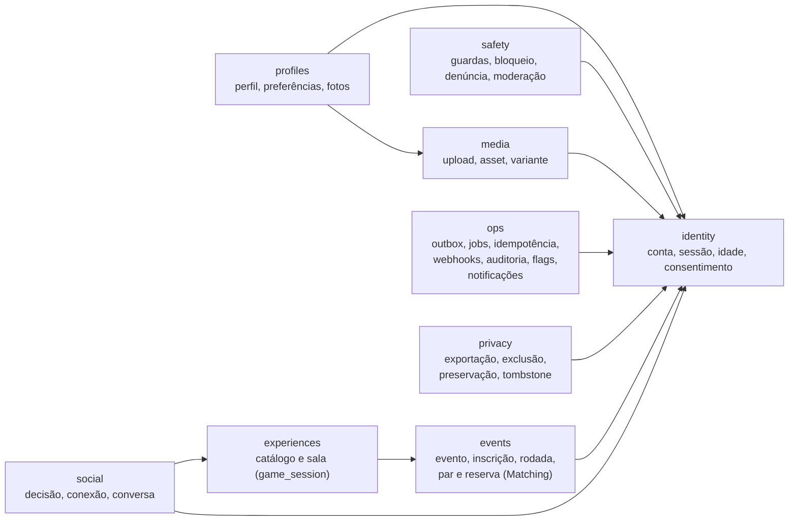
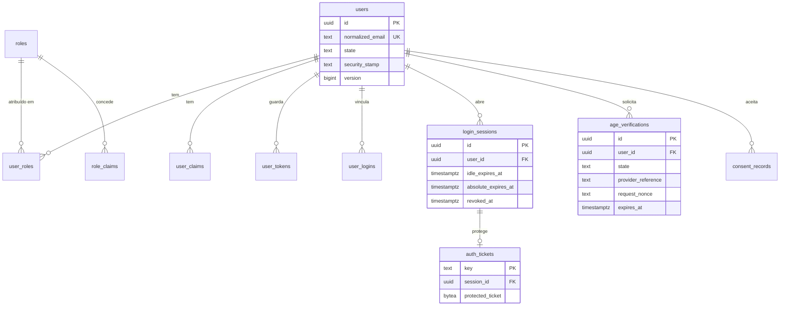
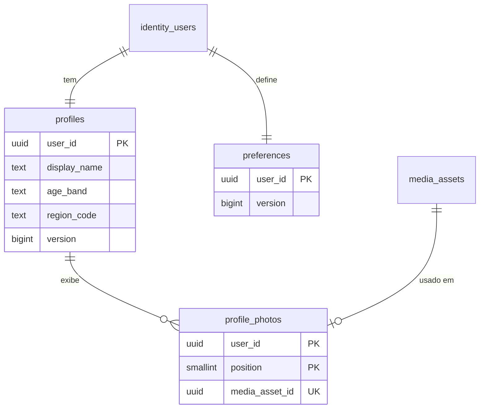
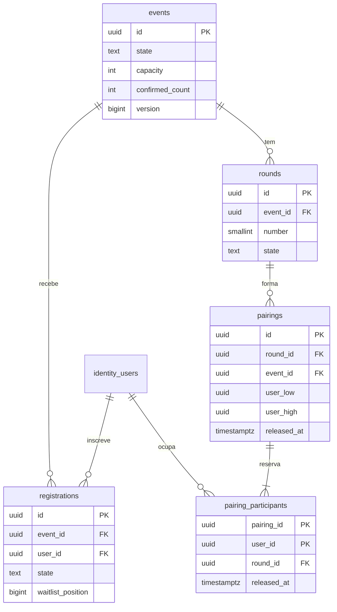
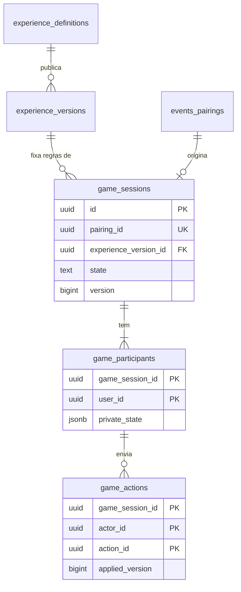
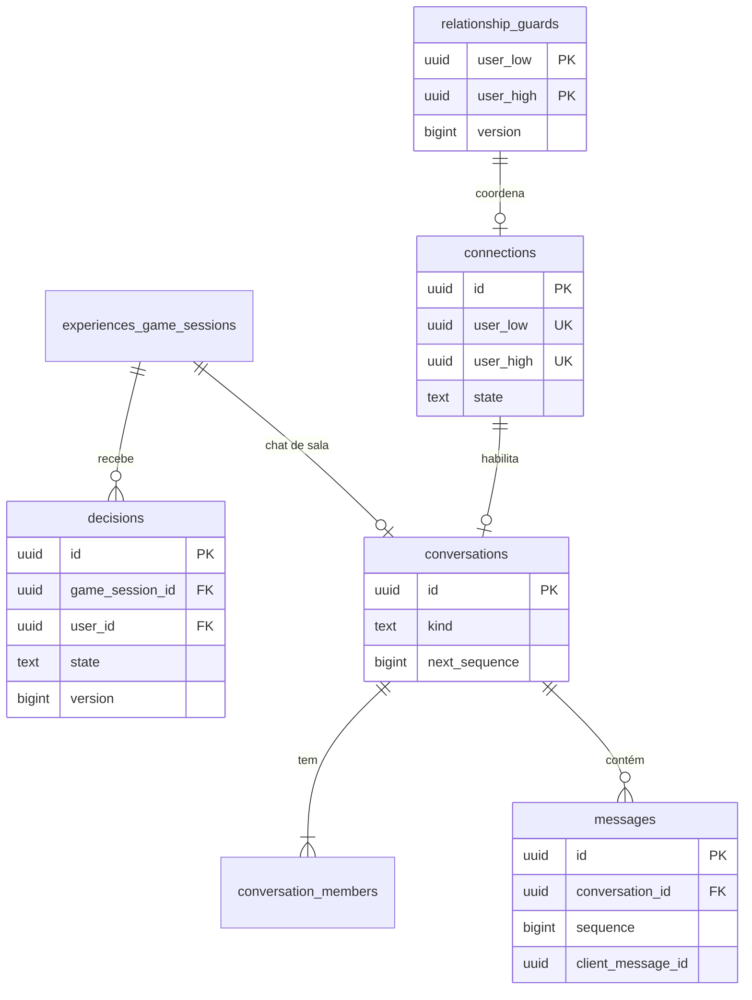
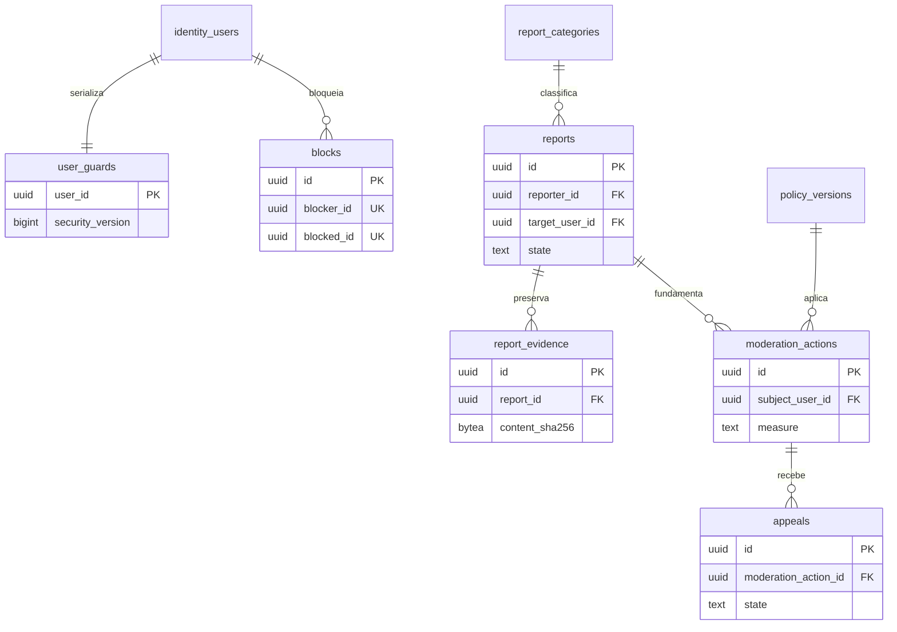
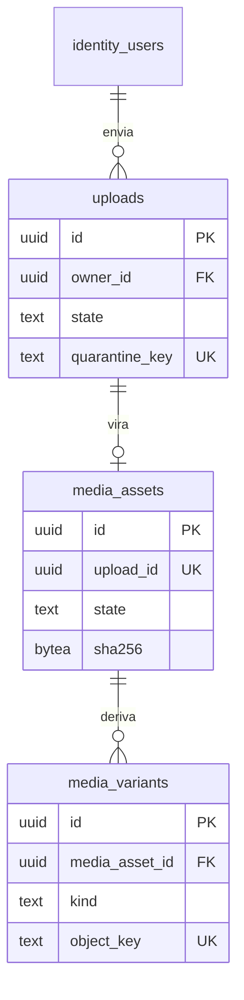
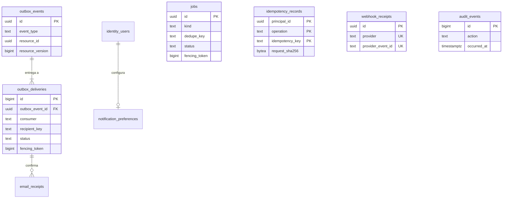
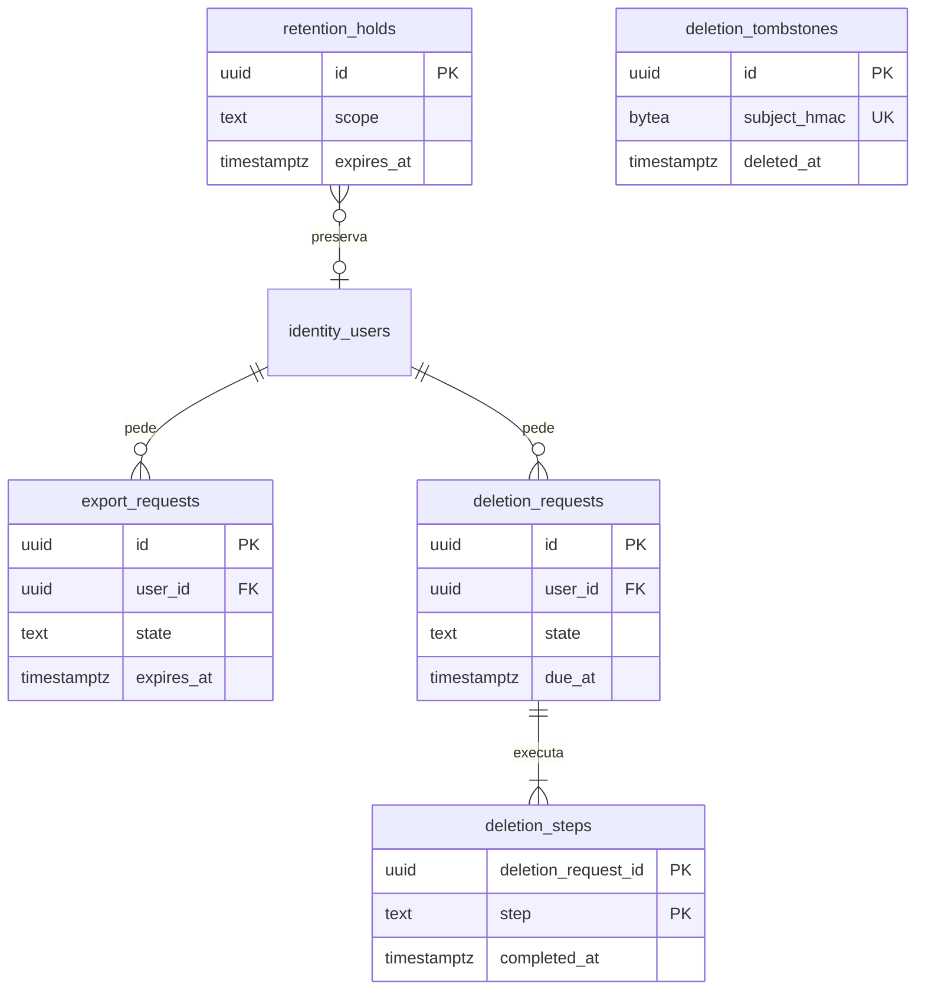

# Modelo de dados

ER, dicionário, constraints, índices previstos e classificação de sensibilidade das tabelas da spec 10.2, por
schema. Fontes: spec 4.2, 4.3, 7, 8, 10.1–10.7, 12 e 16; [modules.md](../architecture/modules.md) (dono de
cada tabela); ADRs [0004](../architecture/adr/0004-dbcontext-unico-schemas-logicos.md),
[0005](../architecture/adr/0005-identity-local-cookie-ticket-persistente.md),
[0008](../architecture/adr/0008-postgresql-para-jobs-e-outbox.md),
[0010](../architecture/adr/0010-object-storage-externo-leitura-via-api.md) e
[0016](../architecture/adr/0016-sala-e-sessao-de-jogo.md); fichas D-PG-02, D-PG-03, D-EF-02 e D-EF-03.
Protocolos transacionais: [concurrency.md](concurrency.md). Finalidade e acesso de cada dado:
[data-map.md](../privacy/data-map.md). Prazos: [retention.md](../privacy/retention.md).

> **Estado:** proposta para revisão. Hoje o banco só tem o schema `ops` e a migração `Baseline`. Cada fatia
> cria as tabelas de que precisa, com testes contra PostgreSQL 18 real (spec 10.2). Itens marcados
> **Proposta — confirmar** resolvem lacunas da spec e precisam de aprovação do responsável técnico antes da
> primeira migração que os usa; os nomes de coluna são indicativos e podem mudar na migração revisada.

## Convenções

| Tema | Regra | Fonte |
|---|---|---|
| Nomes | `snake_case` por mapeamento explícito; tabelas no plural; constraints `pk_`, `fk_`, `ux_`, `ix_`, `ck_` + tabela + colunas | spec 10.1 |
| Chave primária | `uuid`, gerado pela aplicação com `Guid.CreateVersion7()` (UUIDv7: ordenado no tempo, bom para B-tree). **Proposta — confirmar:** `identity.users.id` usa UUIDv4, porque o ID da conta aparece para outras pessoas (API-P04) e o UUIDv7 revelaria o instante de criação da conta. Exceção de fila: `ops.outbox_deliveries.id` e `ops.audit_events.id` são `bigint generated always as identity` (só ordem interna, nunca na API) | spec 8.1, 10.1; *The Art of PostgreSQL*, caps. 22–23 |
| Instantes | `timestamptz`, sempre UTC, valor vindo do `TimeProvider` da aplicação (nunca `now()` como regra de negócio); `date` só para data civil | spec 8.1, 10.1 |
| Concorrência | `version bigint not null default 0` em toda tabela editável ou com máquina de estados; incrementada pela aplicação em toda escrita relevante, inclusive SQL direto; nunca `xmin` no contrato público | spec 10.5 |
| Texto | `text` + `CHECK (char_length(col) <= n)`; nunca `varchar(n)` nem `char(n)`; limites de bytes onde a spec pede | *The Art of PostgreSQL*, cap. 22 |
| Estados | `text` + `CHECK (col IN (...))` com os estados da spec 4.2 (conjunto fixo); conjuntos que o negócio altera vão em tabela de referência com FK | *SQL Antipatterns*, cap. 11 |
| FKs | Toda relação é FK, com `ON DELETE` escolhido abaixo e **índice na coluna da FK** (o PostgreSQL não cria) | *SQL Antipatterns*, cap. 5 |
| `ON DELETE` | `CASCADE` só para filho que não existe sem o pai dentro do mesmo agregado; `RESTRICT` para referências a `identity.users` vindas de outros módulos (a exclusão de conta é um job do Privacy que apaga módulo por módulo, com trilha; nada some por cascata silenciosa); `SET NULL` só onde o registro precisa sobreviver sem o autor | spec 12.4 |
| Pares | Par de pessoas normalizado: `user_low < user_high`, `CHECK (user_low < user_high)` | spec 10.3 |
| Associação polimórfica | Proibida (`*_type` + `*_id` sem FK). Contextos alternativos usam arco exclusivo: FKs anuláveis + `CHECK (num_nonnulls(...) <= 1)`. Exceções documentadas: auditoria e evidência guardam referências históricas sem FK, porque precisam sobreviver ao alvo | *SQL Antipatterns*, cap. 7 |
| JSONB | Só para estado variável de jogo e payloads versionados, com `schema_version`, limite de tamanho e validação; nunca para autorização, participantes, preferências ou relações | spec 6.1, 10.1 |
| Evolução de payload (outbox, jobs, JSONB) | Campo novo segue expand/contract, em dois deploys: primeiro vai a deploy um leitor tolerante, que aceita e ignora o campo (ou o lê com padrão quando ausente); só num deploy seguinte o campo passa a ser gravado. Assim o rollback elegível ([deploy.md](../operations/deploy.md#rollback-de-aplicação)) nunca põe um leitor estrito diante de um payload que ele recusa. Remover campo segue a ordem inversa: parar de ler, depois parar de gravar. Exceção registrada: o `language` do pedido de e-mail de conta (PR #22) entrou num deploy só, e o rollback dele tem restrição própria no deploy.md | spec 17.4; DDIA cap. 5 |
| Índices | Os listados aqui são os previstos pelas consultas conhecidas e pelas FKs; qualquer outro só com `EXPLAIN (ANALYZE, BUFFERS)` de consulta real | spec 10.7; *SQL Antipatterns*, cap. 13 |
| Expiração | Nunca `now()` em predicado de índice parcial; liberar ou expirar é transição persistida | spec 10.3 |

### Classificação de sensibilidade

| Classe | Significado | Exemplos | Regras mínimas |
|---|---|---|---|
| P0 | Público ou de catálogo | Conteúdo publicado de experiência | Sem restrição de leitura além da publicação |
| P1 | Interno operacional | Estado de jobs, flags, contagens | Sem dado pessoal; acesso de operação |
| P2 | Pessoal | E-mail, nome de exibição, região, IDs de conta, auditoria | Acesso por finalidade; fora de telemetria; exportável ao titular |
| P3 | Pessoal sensível ou íntimo | Preferências, decisões, mensagens, fotos, verificação etária, bloqueios, denúncias, evidências | Projeção por destinatário; acesso por caso; nunca em log, métrica, issue ou contexto de agente |
| S | Segredo ou credencial | Hash de senha, chave TOTP, códigos de recuperação, ticket de sessão | Nunca exposto por API (exceto a exibição única ao titular), nunca em log; protegido em repouso |

A classe de cada tabela é a da coluna mais sensível; colunas mais sensíveis que a tabela são indicadas.

## Visão geral

Seta: "tem FK para". Quase toda tabela referencia `identity.users`; o diagrama mostra só as dependências entre
schemas que guiam a ordem de migração.

## Decisões de modelagem propostas

Respostas às lacunas de [modules.md](../architecture/modules.md#módulos) (notas 1 a 4) e às encontradas ao
detalhar este modelo. Todas **Proposta — confirmar**.

| # | Lacuna | Proposta | Alternativa descartada |
|---|---|---|---|
| D1 | Schema do Matching (nota 1) | Manter `events.pairings` e `events.pairing_participants`, como no DDL da spec 10.3; dono lógico Matching | Schema `matching` novo: diverge da lista de schemas do ADR-0004 e do DDL da spec sem ganho de isolamento (mesmo `DbContext`) |
| D2 | Schema de Connections (nota 2) | `social.relationship_guards`, `social.decisions`, `social.connections`; dono lógico Connections | `safety`: guardas de relação servem também a decisão e chat, não só a segurança |
| D3 | Schema de `audit_events` (nota 4) | `ops.audit_events`, append-only por permissão de tabela (a conta da aplicação só tem `INSERT` e `SELECT`) | Schema `audit` novo: mesma proteção dá-se por `GRANT` por tabela, sem alterar o ADR-0004 |
| D4 | Tabelas do Notifications (nota 3) | `ops.notification_preferences` (API-N01/N02) e `ops.email_receipts` (recibos e bounces do fornecedor); dono lógico Notifications. A entrega em si é `ops.outbox_deliveries` com `consumer = 'email'` | Schema `notifications` novo: mesma razão de D3; tabela própria de envios: duplicaria a outbox |
| D5 | Configuração e flags do Operations (nota 3) | `ops.operational_flags` (pausa de matching, pausa de uploads, manutenção) e `ops.parameter_sets` (parâmetros da spec 4.3, versionados e imutáveis); salas e eventos guardam o `parameter_set_id` do snapshot | Feature flags genéricas com avaliação dinâmica: não há caso de uso além de três pausas |
| D6 | Exclusão de conta × FKs | `ON DELETE RESTRICT` nas referências a `identity.users` vindas de outros módulos; o job de exclusão do Privacy remove ou anonimiza por etapas (`privacy.deletion_steps`) e só então apaga a conta | `CASCADE` geral: apagaria em silêncio evidência sob preservação e não deixaria trilha por etapa |
| D7 | Evidência de denúncia × retenção do chat | `safety.report_evidence` guarda **cópia** do recorte autorizado, com hash, e só uma referência histórica (sem FK) à origem | FK para `social.messages`: a evidência morreria com a retenção do chat, ou o chat ficaria preso à evidência |
| D8 | Contexto da denúncia | Arco exclusivo: `game_session_id`, `conversation_id`, `media_asset_id` anuláveis com FK + `CHECK (num_nonnulls(...) <= 1)` | `context_type` + `context_id`: associação polimórfica sem FK |
| D9 | Não repetir par no evento | `events.pairings` carrega `event_id` (consistente com a rodada por FK composta) e `UNIQUE (event_id, user_low, user_high)` | Checar repetição só no algoritmo: check-then-insert sem constraint |
| D10 | Uma conexão por par para sempre | `UNIQUE (user_low, user_high)` em `social.connections` vale também para conexões encerradas (reconexão fora do MVP, spec 7.1); o pareamento exclui pares com conexão `Ended` ou `Blocked` | Unicidade só de conexão ativa: permitiria reconexão implícita, que a spec deixa fora do MVP |
| D11 | Sequência de mensagens | `social.conversations.next_sequence bigint`, incrementado sob o lock da conversa no envio | `SEQUENCE` global ou `max(sequence)+1`: a primeira não é por conversa; a segunda é read-modify-write |
| D12 | Data de nascimento | `identity.users.birth_date date` (classe P3), nunca exposta; o perfil guarda só a faixa etária derivada | Só faixa etária autodeclarada: a faixa precisa ser recalculada com o tempo e conferida com a verificação etária |
| D13 | Conta privilegiada separada | Constraint de atribuição: conta com papel privilegiado não tem papel `participant` ([auth.md](../security/auth.md#papéis-e-contas)) | Elevação de sessão de participante |

## Schema `identity`

Dono: Identity. Tabelas do ASP.NET Core Identity mapeadas para nomes `snake_case` sob este schema.

### identity.users

- **Colunas:** `id uuid`; `email text` (≤ 254), `normalized_email text`, `email_confirmed boolean`;
  `password_hash text`; `security_stamp text`, `concurrency_stamp text` (Identity);
  `two_factor_enabled boolean`; `lockout_end timestamptz`, `lockout_enabled boolean`,
  `access_failed_count int`; `state text` (`PendingEmail`, `PendingEligibility`, `Active`, `Restricted`,
  `Suspended`, `DeletionPending`, `Deleted`); `birth_date date` (D12); `created_at`, `state_changed_at
  timestamptz`; `version bigint`.
- **Chaves e constraints:** PK `id`; `UNIQUE (normalized_email)` (`RequireUniqueEmail`; normalização do
  Identity, explícita e testada); `CHECK` de estado; `CHECK (access_failed_count >= 0)`.
- **Índices:** o da unicidade de e-mail; `ix_users_state` só se uma consulta medida pedir.
- **Classe:** S (`password_hash`, `security_stamp`); P3 (`birth_date`); P2 (e-mail).
- **Exclusão:** a linha é anonimizada (e-mail substituído por valor não reversível, hash e stamp zerados) e,
  depois das etapas do Privacy, apagada; nenhuma FK de outro módulo cascateia.

### identity.roles, identity.user_roles, identity.role_claims, identity.user_claims, identity.user_logins

- `roles`: `id`, `name`, `normalized_name` (`UNIQUE`); papéis fixos `participant`, `moderator`,
  `product_admin`, `operator`. `role_claims` guarda as permissões específicas por papel (spec 8.5).
- `user_roles`: PK `(user_id, role_id)`; FKs `CASCADE` para ambos; índice em `role_id`. **D13:** a regra
  "privilegiado não é participante" fica num `CHECK` via função ou trigger de atribuição **(Proposta —
  confirmar)**, testada em integração.
- `user_claims`: não usado no M1 (claims ficam no servidor); existe porque o modelo do Identity o inclui.
- `user_logins`: vazio (login externo fora do escopo, spec 1.1).
- **Classe:** P2.

### identity.user_tokens

- **Colunas:** `user_id`, `login_provider`, `name`, `value` (chave do autenticador TOTP, códigos de
  recuperação).
- **Chaves:** PK `(user_id, login_provider, name)`; FK `user_id` `CASCADE`.
- **Classe:** S. **A verificar:** se o Identity guarda `value` em claro, decidir proteção adicional
  ([auth.md](../security/auth.md#mfa)).

### identity.login_sessions

- **Colunas:** `id uuid` (= `sessionId` de API-A09/A10); `user_id`; `policy text` (`Normal`,
  `Administrative`); `security_stamp text` (stamp do login); `created_at`, `last_seen_at`,
  `idle_expires_at`, `absolute_expires_at`, `reauthenticated_at`, `mfa_verified_at timestamptz`;
  `revoked_at timestamptz`, `revoke_reason text` (`logout`, `user`, `password_change`, `reset`, `mfa_change`,
  `suspension`, `deletion`, `restore`, `key_compromise`); `device_summary text` (≤ 120); `network_prefix
  text` (IP truncado: /24 IPv4, /48 IPv6); `version bigint`.
- **Constraints:** PK `id`; FK `user_id` `CASCADE` (sessão não existe sem conta);
  `CHECK (idle_expires_at <= absolute_expires_at)`; `CHECK (revoked_at IS NULL OR revoke_reason IS NOT
  NULL)`; `CHECK` dos valores de `policy` e `revoke_reason`.
- **Índices:** `ix_login_sessions_user_id` (FK e API-A09); `ix_login_sessions_absolute_expires_at` para a
  limpeza em lote (spec 10.2: "índice de expiração").
- **Classe:** P2.

### identity.auth_tickets

- **Colunas:** `key text` (256 bits base64url); `session_id uuid`; `protected_ticket bytea` (ticket
  serializado e protegido pelo Data Protection); `expires_at timestamptz` (= absoluta); `version bigint`.
- **Constraints:** PK `key`; `UNIQUE (session_id)` (1:1 com a sessão); FK `session_id` `CASCADE`.
- **Índices:** o da unicidade; `ix_auth_tickets_expires_at` para limpeza.
- **Classe:** S.

### identity.age_verifications

- **Colunas:** `id uuid`; `user_id`; `state text` (`Pending`, `VerifiedAdult`, `Rejected`, `Expired`,
  `ManualReview`); `policy_version text` (≤ 32); `provider text` (≤ 32); `provider_reference text` (≤ 200,
  gravada pelo worker ao abrir no fornecedor); `request_nonce text` (≥ 256 bits em base64url, gerado pelo servidor,
  casado com o callback); `provider_flow_url text` (≤ 2048, https, origem na allowlist do adaptador; ADR-0024);
  `requested_at`, `decided_at`, `expires_at timestamptz`; `decision_source text` (`Callback`, `ProviderQuery`,
  `ManualReview`); `version bigint`.
- **Constraints:** PK `id`; FK `user_id` `RESTRICT`; `UNIQUE (provider, provider_reference)`;
  `UNIQUE (request_nonce)`; índice único parcial `ux_age_verifications_open_user` em `(user_id)` onde
  `state IN ('Pending', 'ManualReview')` (uma solicitação aberta por pessoa); `CHECK` de estado, de
  `decision_source`, de `version >= 0` e de `provider_flow_url` https;
  `CHECK (state <> 'VerifiedAdult' OR expires_at IS NOT NULL)`.
- **Índices:** `ix_age_verifications_user_id_requested_at` (FK e leitura da última solicitação da pessoa).
- **Escrita:** só SQL condicional no estado (`WHERE state = 'Pending'`); a conta é travada antes da solicitação
  em API-P05 e no webhook, nessa ordem ([ADR-0024](../architecture/adr/0024-fluxo-de-verificacao-etaria.md)).
- **Classe:** P3. Sem documento, imagem ou biometria (spec 12.1, 12.2).

### identity.consent_records

- **Colunas:** `id uuid`; `user_id`; `document text` (`terms`, `privacy`, futuros por tabela de referência
  se crescerem); `document_version text`; `accepted_at timestamptz`; `withdrawn_at timestamptz`;
  `source text` (`register`, `reconsent`).
- **Constraints:** PK `id`; FK `user_id` `RESTRICT`; `UNIQUE (user_id, document, document_version)`.
- **Índices:** `ix_consent_records_user_id`.
- **Classe:** P2. Registro de aceite não é base legal por si (ver [data-map.md](../privacy/data-map.md)).

## Schema `profiles`

Dono: Profiles.

### profiles.profiles

- **Colunas:** `user_id uuid`; `display_name text` (≤ 40); `age_band text` (faixas fechadas, ex. `18-24`,
  `25-34`; derivada de `birth_date`); `region_code text` (região aproximada, FK para tabela de referência de
  regiões **a definir**); `bio text` (≤ 500); `updated_at`; `version bigint` (`ETag` de API-P01/P02).
- **Constraints:** PK e FK `user_id` → `identity.users` `RESTRICT`; `CHECK` de tamanhos e de `age_band`.
- **Classe:** P2 (perfil exibido a contextos legítimos, spec 12.1).
- **Implementado (migração `Profiles`):** `user_id`, `display_name text null` (1 a 40), `bio text null` (1 a 500),
  `version bigint` (`CHECK version >= 1`; a linha só nasce na primeira gravação, e o perfil sem linha é lido como
  versão 0) e `updated_at`, com `CHECK` de tamanho por `char_length` e FK `RESTRICT`. O texto é gravado em NFC,
  sem Cc, Cf, Zl, Zp nem surrogate solto (`ProfileText`). `age_band` e `region_code` **ainda não existem**: a origem
  da faixa (issue #9 item 7, D12) e a tabela de regiões estão por decidir.

### profiles.preferences

- **Colunas:** `user_id uuid`; colunas relacionais por dimensão de preferência; `updated_at`; `version bigint`
  (`ETag` de API-P07/P03, independente do perfil).
- **Constraints:** PK e FK `user_id` `RESTRICT`.
- **Lacuna:** a spec não define as dimensões. Se incluírem gênero buscado ou orientação, são dado pessoal
  sensível (vida sexual, LGPD art. 5.º, II) e mudam a análise de base legal
  ([data-map.md](../privacy/data-map.md#lacunas)). Dimensões multivaloradas vão em tabela dependente
  (`preference_values (user_id, dimension, value)`), nunca em lista dentro de string ou JSONB
  (*SQL Antipatterns*, cap. 2).
- **Classe:** P3.

### profiles.profile_photos

- **Colunas:** `user_id`; `position smallint`; `media_asset_id uuid`; `created_at`.
- **Constraints:** PK `(user_id, position)`; `CHECK (position BETWEEN 1 AND 6)` (máximo de 6 fotos, spec
  4.3); `UNIQUE (media_asset_id)`; FK `user_id` → `profiles.profiles` `CASCADE`; FK `media_asset_id` →
  `media.media_assets` `RESTRICT`. Só asset `Approved` entra (regra do caso de uso, testada).
- **Índices:** o da unicidade em `media_asset_id`.
- **Classe:** P3.

## Schema `events`

Donos: Events (`events`, `registrations`, `rounds`) e Matching (`pairings`, `pairing_participants`, D1).

### events.events

- **Colunas:** `id`; `title text` (≤ 120); `state text` (`Draft`, `Published`, `CheckInOpen`, `Running`,
  `Completed`, `Cancelled`); `starts_at timestamptz`; `time_zone text` (IANA, para apresentação);
  `capacity int`; `confirmed_count int`; `next_waitlist_position bigint`; `experience_version_id uuid`;
  `parameter_set_id uuid`; `cancel_reason text`; `version bigint`.
- **Horários derivados, sem coluna:** a abertura do check-in (`starts_at` menos a antecedência do conjunto de
  parâmetros) e o fim do evento vêm de `starts_at` e do `parameter_set_id`, que é imutável (spec 4.3). Guardar
  esses valores criaria uma segunda fonte para o mesmo fato. O job de abertura seleciona pelo
  `ix_events_state_starts_at`, e o domínio (`Event.OpenCheckIn`) recusa com `NotDueYet` quem ainda não chegou ao
  horário.
- **Contadores:** `confirmed_count` e `next_waitlist_position` são estado do agregado `Event`, mantidos na mesma
  transação de cada inscrição, retirada, promoção, ausência e conclusão (concurrency.md, C5). Não são recalculados
  por contagem de `registrations`.
- **Constraints:** `CHECK (capacity > 0)`; `CHECK (confirmed_count BETWEEN 0 AND capacity)` (capacidade não
  depende de contagem prévia, spec 10.2); `CHECK (next_waitlist_position >= 1)`; FK `experience_version_id` →
  `experiences.experience_versions` `RESTRICT`; FK `parameter_set_id` → `ops.parameter_sets` `RESTRICT`.
- **Índices:** FKs; `ix_events_state_starts_at` para a listagem pública (API-E01) e para os jobs de abertura.
- **Classe:** P1/P0 (dados do evento publicado).

### events.registrations

- **Colunas:** `id`; `event_id`; `user_id`; `state text` (`Waitlisted`, `Confirmed`, `CheckedIn`, `Withdrawn`,
  `NoShow`, `Completed`); `waitlist_position bigint`; `registered_at`, `confirmed_at`, `checked_in_at`,
  `withdrawn_at timestamptz`; `version bigint`.
- **Constraints:** `UNIQUE (event_id, user_id)` (spec 10.3); `CHECK ((state = 'Waitlisted') = (waitlist_position
  IS NOT NULL))`; índice único parcial `(event_id, waitlist_position)` onde `state = 'Waitlisted'`; FK
  `event_id` `RESTRICT`; FK `user_id` `RESTRICT`.
- **Índices:** `ix_registrations_user_id`; o `UNIQUE` cobre `event_id`; `ix_registrations_event_state` para
  check-in e promoção.
- **Classe:** P2 (participação num evento de encontros pode ser sensível no contexto; nunca listada a terceiros,
  API-E02).

### events.rounds

- **Colunas:** `id`; `event_id`; `number smallint`; `state text` (`Scheduled`, `Preparing`, `Inviting`,
  `Running`, `Closed`, `Cancelled`); `starts_at`, `deadline_at timestamptz`; `seed bytea` (desempate,
  nunca exposto); `algorithm_version text`; `version bigint`.
- **Constraints:** `UNIQUE (event_id, number)`; `UNIQUE (id, event_id)` (alvo da FK composta de
  `pairings`); FK `event_id` `RESTRICT`; `CHECK (number >= 1)`.
- **Índices:** `ix_rounds_state_starts_at` (rodadas vencidas para o worker).
- **Classe:** P1.

### events.pairings

- **Colunas:** `id`; `round_id`; `event_id`; `user_low`, `user_high uuid`; `algorithm_version text`;
  `created_at`; `released_at timestamptz`; `release_reason text`.
- **Constraints:** `CHECK (user_low < user_high)`; FK `(round_id, event_id)` → `rounds (id, event_id)`
  `RESTRICT`; `UNIQUE (event_id, user_low, user_high)` (D9, não repetir par no evento); FKs `user_low`,
  `user_high` → `identity.users` `RESTRICT`.
- **Índices:** `ix_pairings_round_id`; `ix_pairings_user_high` (o `UNIQUE` cobre consultas por `event_id` e
  `user_low`).
- **Classe:** P3 (quem encontrou quem).

### events.pairing_participants

- **Colunas:** `pairing_id`; `user_id`; `round_id`; `released_at timestamptz`.
- **Constraints:** PK `(pairing_id, user_id)`; `UNIQUE (round_id, user_id)` (spec 10.3); índice único
  parcial `ux_pairing_participants_active_user` em `(user_id)` onde `released_at IS NULL` (INV-02, spec 10.3);
  FK `pairing_id` `CASCADE`; FK `user_id` `RESTRICT`; FK `round_id` `RESTRICT`.
- **Índices:** os únicos acima cobrem `user_id` e `round_id`.
- **Classe:** P3.

## Schema `experiences`

Dono: Experiences. A sala é a `game_session` (ADR-0016).

### experiences.experience_definitions

- **Colunas:** `id`; `slug text` (`UNIQUE`); `title text`; `created_at`.
- **Classe:** P0.

### experiences.experience_versions

- **Colunas:** `id`; `definition_id`; `rules_version`, `content_version`, `schema_version text`;
  `editorial_state text` (`Draft`, `Validated`, `Published`, `Retired`); `content jsonb`; `content_sha256
  bytea`; `license text`; `origin text` (`human`, `editorial_external`); `model text`; `approved_by uuid`;
  `approved_at`, `published_at`, `retired_at timestamptz`; `version bigint`.
- **Constraints:** `UNIQUE (definition_id, rules_version, content_version)`; FK `definition_id` `RESTRICT`;
  FK `approved_by` → `identity.users` `SET NULL` (coluna anulável; a aprovação também está na auditoria);
  imutabilidade de versão publicada por trigger `BEFORE UPDATE` que rejeita mudança de `content`,
  `rules_version` e `content_version` quando `editorial_state` já é `Published` ou `Retired` **(Proposta —
  confirmar;** alternativa: só regra de aplicação + teste T-09).
- **Índices:** `ix_experience_versions_definition_id` (coberto pelo `UNIQUE`); `ix_experience_versions_approved_by`.
- **Classe:** P0 (conteúdo publicado), P2 (`approved_by`).

### experiences.game_sessions

- **Colunas:** `id` (= `roomId`); `pairing_id`; `experience_version_id`; `parameter_set_id`; `state text`
  (`Invited`, `Ready`, `Active`, `Completed`, `Aborted`, `Expired`); `invite_expires_at`, `active_deadline_at`,
  `decision_window_ends_at`, `completed_at timestamptz`; `seed bytea`; `public_state jsonb`; `control_state
  jsonb`; `version bigint`.
- **Constraints:** `UNIQUE (pairing_id)` (uma sala por par); FK `pairing_id` → `events.pairings` `RESTRICT`;
  FK `experience_version_id` `RESTRICT` (INV-09); FK `parameter_set_id` `RESTRICT`; `CHECK` de estado;
  `CHECK (octet_length(public_state::text) <= 32768)` e idem para `control_state` **(hipótese de limite)**.
- **Índices:** FKs; `ix_game_sessions_open_deadlines` em `(invite_expires_at)` onde `state = 'Invited'` e em
  `(active_deadline_at)` onde `state = 'Active'` (jobs de expiração).
- **Classe:** P3 (`control_state` pode conter pistas).

### experiences.game_participants

- **Colunas:** `game_session_id`; `user_id`; `accepted_at`, `departed_at timestamptz`; `private_state jsonb`
  (pistas do participante, nunca projetadas para o outro).
- **Constraints:** PK `(game_session_id, user_id)`; FK `game_session_id` `CASCADE`; FK `user_id` `RESTRICT`.
- **Índices:** `ix_game_participants_user_id`.
- **Classe:** P3.

### experiences.game_actions

- **Colunas:** `game_session_id`; `actor_id`; `action_id uuid`; `type text`; `payload jsonb` (≤ 32 KiB, spec
  4.3); `expected_version`, `applied_version bigint`; `created_at`.
- **Constraints:** PK `(game_session_id, actor_id, action_id)` (spec 10.3); FK `(game_session_id, actor_id)`
  → `game_participants` `CASCADE` (só participante age).
- **Classe:** P3.

## Schema `social`

Donos: Connections (`relationship_guards`, `decisions`, `connections`, D2) e Messaging (`conversations`,
`conversation_members`, `messages`).

### social.relationship_guards

- **Colunas:** `user_low`, `user_high uuid`; `version bigint`.
- **Constraints:** PK `(user_low, user_high)`; `CHECK (user_low < user_high)`; FKs para `identity.users`
  `CASCADE` (a guarda não tem valor sem as contas).
- **Índices:** `ix_relationship_guards_user_high` (FK).
- **Uso:** linha-lock do par, criada sob demanda com `INSERT ... ON CONFLICT DO NOTHING`. Nunca representa
  consentimento (spec 10.2).
- **Classe:** P1.

### social.decisions

- **Colunas:** `id`; `game_session_id`; `user_id`; `state text` (`Pending`, `Interested`, `NotInterested`,
  `Withdrawn`, `Expired`); `window_ends_at`, `decided_at timestamptz`; `version bigint` (cada mudança
  versionada, spec 4.2).
- **Constraints:** `UNIQUE (game_session_id, user_id)` (spec 10.3); FK `(game_session_id, user_id)` →
  `experiences.game_participants` `RESTRICT` (só participante decide).
- **Índices:** `ix_decisions_user_id`; `ix_decisions_pending_window` em `(window_ends_at)` onde `state =
  'Pending'` (expiração).
- **Classe:** P3. Nunca projetada para a outra pessoa (INV-05).

### social.connections

- **Colunas:** `id`; `user_low`, `user_high`; `origin_game_session_id uuid`; `state text` (`Active`, `Ended`,
  `Blocked`); `created_at`, `ended_at timestamptz`; `ended_by uuid`; `version bigint`.
- **Constraints:** `UNIQUE (user_low, user_high)` (spec 10.3; D10); `CHECK (user_low < user_high)`; FK
  `(user_low, user_high)` → `relationship_guards` `RESTRICT`; FK `origin_game_session_id` `RESTRICT`.
- **Índices:** `ix_connections_user_high`; `ix_connections_origin_game_session_id`.
- **Classe:** P3.

### social.conversations

- **Colunas:** `id`; `kind text` (`Room`, `Persistent`); `game_session_id uuid`; `connection_id uuid`;
  `state text` (`Open`, `Closed`); `next_sequence bigint` (D11); `closed_at timestamptz`; `version bigint`.
- **Constraints:** arco exclusivo `CHECK ((kind = 'Room' AND game_session_id IS NOT NULL AND connection_id IS
  NULL) OR (kind = 'Persistent' AND connection_id IS NOT NULL AND game_session_id IS NULL))`;
  `UNIQUE (game_session_id)`; `UNIQUE (connection_id)` (PostgreSQL não colide `NULL` em `UNIQUE`, como
  desejado aqui); FKs `RESTRICT`; `CHECK (next_sequence >= 1)`.
- **Classe:** P1 (metadados).

### social.conversation_members

- **Colunas:** `conversation_id`; `user_id`; `joined_at`, `left_at timestamptz`; `last_read_sequence bigint`.
- **Constraints:** PK `(conversation_id, user_id)`; FK `conversation_id` `CASCADE`; FK `user_id` `RESTRICT`.
- **Índices:** `ix_conversation_members_user_id` (lista de conversas, API-C01).
- **Classe:** P2.

### social.messages

- **Colunas:** `id`; `conversation_id`; `sender_id`; `client_message_id uuid`; `sequence bigint`; `body text`;
  `created_at timestamptz`.
- **Constraints:** `UNIQUE (conversation_id, sequence)`; `UNIQUE (conversation_id, sender_id,
  client_message_id)` (spec 10.3); FK `(conversation_id, sender_id)` → `conversation_members` `RESTRICT` (só
  membro envia); `CHECK (char_length(body) BETWEEN 1 AND 2000 AND octet_length(body) <= 8000)` (2.000
  caracteres e limite de bytes, spec 4.3; o limite de bytes é **hipótese**); rejeição de `\u0000` e caracteres
  de controle na borda.
- **Índices:** os dois únicos (o primeiro serve à paginação keyset por `sequence`, spec 10.7).
- **Classe:** P3. Sem edição nem exclusão no MVP (spec 7.2).

## Schema `safety`

Dono: Safety.

### safety.user_guards

- **Colunas:** `user_id uuid`; `security_version bigint` (incrementada por bloqueio, sanção, mudança de
  preferência que afete elegibilidade).
- **Constraints:** PK e FK `user_id` `CASCADE`; `CHECK (security_version >= 0)`. A linha **não** nasce com a
  conta (decisão G7, para o cadastro do Identity não depender do Safety): a migration `SafetyBlocks` dá guarda a
  toda conta existente e o primeiro bloqueio cria as que faltam com `ON CONFLICT DO NOTHING`. Quem precisar
  trancar a guarda de uma pessoa no M2 usa o mesmo upsert antes do `FOR UPDATE`.
- **Uso:** linha-lock por pessoa, sempre em ordem de UUID ([concurrency.md](concurrency.md#ordem-global-de-locks)).
- **Classe:** P1.

### safety.blocks

- **Colunas:** `id`; `blocker_id`; `blocked_id`; `created_at`.
- **Constraints:** `UNIQUE (blocker_id, blocked_id)` (`ux_blocks_pair`); `CHECK (blocker_id <> blocked_id)`
  (`ck_blocks_not_self`, spec 10.3); FKs `RESTRICT`. Desbloqueio (API-S02, fatia futura) apaga a linha e grava
  auditoria.
- **Índices:** `ix_blocks_blocked_id` (consulta bilateral "existe bloqueio entre A e B").
- **Classe:** P3 (o bloqueado nunca sabe quem bloqueou).

### safety.report_categories e safety.policy_versions

- `report_categories`: `code text` PK, `label text`, `active boolean`, `is_severe boolean NOT NULL DEFAULT false`.
  Tabela de referência porque a política muda (*SQL Antipatterns*, cap. 11). `is_severe` marca a denúncia grave
  (spec 19.3): ela chega com prioridade urgente e a triagem automatizada não a rebaixa; o código não tem lista de
  categorias graves. `CHECK (code ~ '^[a-z][a-z0-9._-]{0,63}$')`, o mesmo formato de `ReportCategoryCode`.
- `policy_versions`: `id`, `code text`, `version text`, `published_at`, `document_sha256 bytea`;
  `UNIQUE (code, version)`. Toda medida aponta a versão da política (INV-10).
- `policy_clauses`: `policy_version_id` FK `RESTRICT`, `code text` (formato de `SubjectNotice.ReasonCode`, como
  `conduta.assedio`), `summary text`; PK `(policy_version_id, code)`. É o catálogo de motivos que o aviso à pessoa
  sancionada cita.
- **Classe:** P0.

### safety.reports

- **Colunas:** `id` (= protocolo); `reporter_id uuid` (anulável, D6: `SET NULL` só após avaliação de
  preservação); `target_user_id`; `category_code`; arco de contexto `game_session_id`, `conversation_id`,
  `media_asset_id` (D8); `narrative text` (≤ 2000); `state text` (`Received`, `Triaged`, `UnderReview`,
  `Actioned`, `Closed`, `Appealed`); `priority smallint`; `assigned_moderator_id uuid`; `created_at`,
  `closed_at timestamptz`; `version bigint`.
- **Constraints:** FK `target_user_id` `RESTRICT`; FK `reporter_id` `SET NULL`; FK `category_code`
  `RESTRICT`; FKs de contexto `RESTRICT`; `CHECK (num_nonnulls(game_session_id, conversation_id,
  media_asset_id) <= 1)`; `CHECK (reporter_id IS NULL OR reporter_id <> target_user_id)`; FK
  `assigned_moderator_id` → `identity.users` `RESTRICT`.
- **Índices:** um por FK; `ix_reports_assigned_state` em `(assigned_moderator_id, state)` (API-ADM11);
  `ix_reports_reporter_id` (API-S05).
- **Classe:** P3.

### safety.report_evidence

- **Colunas:** `id`; `report_id`; `kind text` (`MessageExcerpt`, `ProfileSnapshot`, `MediaReference`,
  `GameContext`); `content jsonb` (recorte copiado e autorizado, D7); `content_sha256 bytea`;
  `source_message_id`, `source_media_asset_id uuid` (referência histórica, **sem FK**); `captured_at`;
  `retention_until timestamptz`.
- **Constraints:** FK `report_id` `RESTRICT`; conteúdo imutável (trigger rejeita `UPDATE` de `content` e
  `content_sha256`, ou permissão de coluna) **(Proposta — confirmar)**; `CHECK (octet_length(content::text)
  <= 65536)` **(hipótese)**.
- **Índices:** `ix_report_evidence_report_id`.
- **Classe:** P3. Leitura só pelo caso atribuído, sempre auditada (spec 8.5, 12.3).

### safety.moderation_actions

- **Colunas:** `id`; `report_id uuid` (anulável: medida por sinal de abuso sem denúncia); `subject_user_id`;
  `measure text` (`Warning`, `Restriction`, `Suspension`, `PermanentBan`, `Cleared`; `Cleared` só existe como
  revisão que reverte uma medida em recurso; por tabela de referência se a política crescer); `policy_version_id`;
  `internal_reason text` (≤ 2000; auditoria, nunca exibido à pessoa); `notice_reason_code text` e `notice_text text`
  (≤ 500, anulável), o aviso que a pessoa sancionada lê; `author_kind text` (`Human`, `Automated`; o termo segue
  o domínio, `ModerationAuthor.Automated`, em vez do antigo `System`); `author_user_id uuid`; `decided_at`,
  `effective_until timestamptz`; `supersedes_action_id uuid`; `version bigint`.
- **Constraints:** FKs `RESTRICT` (`report_id`, `subject_user_id`, `policy_version_id`); FK
  `author_user_id` `SET NULL`; FK `supersedes_action_id` → `moderation_actions` `RESTRICT`;
  `UNIQUE (supersedes_action_id)` (uma medida tem no máximo uma revisão; sem revisões irmãs);
  FK `(policy_version_id, notice_reason_code)` → `policy_clauses` `RESTRICT` (o código do aviso é uma cláusula da
  versão aplicada);
  `CHECK (author_kind = 'Human' OR measure = 'Restriction')` (o sistema só aplica restrição de contenção; spec
  12.3, TM-34);
  `CHECK (measure <> 'Cleared' OR supersedes_action_id IS NOT NULL)`;
  `CHECK (effective_until IS NULL OR effective_until <= decided_at + interval '365 days')` (teto absoluto de
  `ModerationLimits`; o teto do parameter set e o da automação ficam no domínio, porque mudam com a versão);
  `CHECK ((author_kind = 'Human') = (author_user_id IS NOT NULL))` até a anonimização do autor.
- **Índices:** um por FK; `ix_moderation_actions_subject_user_id`.
- **Classe:** P3.

### safety.appeals

- **Colunas:** `id`; `moderation_action_id`; `appellant_id`; `reason text` (≤ 2000); `state text`
  (`Received`, `UnderReview`, `Upheld`, `Overturned`); `reviewer_id uuid`; `decided_at timestamptz`;
  `version bigint`.
- **Constraints:** FKs `RESTRICT`; índice único **não parcial** `ux_appeals_moderation_action_id` em
  `(moderation_action_id)`: um só recurso por medida, aberto ou decidido (um nível de recurso; a decisão do recurso
  também não admite outro). A independência (revisor fora das partes do caso e diferente do autor da medida)
  atravessa tabelas: regra do domínio (`Appeal.StartReview`), testada (TM-34).
- **Índices:** `ix_appeals_appellant_id`, `ix_appeals_reviewer_id`.
- **Classe:** P3.

## Schema `media`

Dono: Media. Objetos ficam no object storage (ADR-0010); o banco guarda chaves internas, nunca expostas.

### media.uploads

- **Colunas:** `id`; `owner_id`; `state text` (`Pending`, `Quarantined`, `Processing`, `Approved`, `Rejected`,
  `Deleted`); `quarantine_key text` (aleatória, gerada pelo servidor); `declared_content_type text`;
  `size_bytes bigint`; `created_at`, `abandon_after timestamptz` (24 h, spec 12.4); `rejection_code text`;
  `version bigint`.
- **Constraints:** `UNIQUE (quarantine_key)`; FK `owner_id` `RESTRICT`; `CHECK (size_bytes BETWEEN 1 AND
  5242880)` (5 MiB, spec 4.3); `CHECK` de estado.
- **Índices:** `ix_uploads_owner_id`; `ix_uploads_pending_owner` em `(owner_id)` onde `state IN ('Pending',
  'Quarantined', 'Processing')` (teto de pendentes, spec 11.5); `ix_uploads_abandon_after` onde `state IN
  ('Pending', 'Quarantined')` (limpeza).
- **Classe:** P3.

### media.media_assets

- **Colunas:** `id` (= `assetId` de API-M04); `upload_id`; `owner_id`; `state text` (`Approved`, `Rejected`,
  `Deleted`); `detected_type text` (`image/jpeg`, `image/png`, `image/webp`); `width`, `height int`; `sha256
  bytea`; `original_key text` (anulável: apagado depois da derivação, spec 12.4); `approved_at`,
  `deleted_at timestamptz`; `version bigint`.
- **Constraints:** `UNIQUE (upload_id)`; FK `upload_id` `RESTRICT`; FK `owner_id` `RESTRICT`;
  `CHECK (width::bigint * height <= 20000000)` (20 megapixels, spec 4.3).
- **Índices:** `ix_media_assets_owner_id`.
- **Classe:** P3.

### media.media_variants

- **Colunas:** `id`; `media_asset_id`; `kind text` (`thumb`, `card`, `full`); `object_key text`; `width`,
  `height int`; `size_bytes bigint`.
- **Constraints:** `UNIQUE (media_asset_id, kind)`; `UNIQUE (object_key)`; FK `media_asset_id` `CASCADE`.
- **Classe:** P3.

## Schema `ops`

Propriedade comum para outbox, jobs e idempotência (todo módulo grava na própria transação; Operations consome
e limpa, [modules.md](../architecture/modules.md#módulos) nota 4); demais tabelas com dono indicado.

### ops.outbox_events

- **Colunas:** `id uuid` (= `eventId`); `event_type text`; `schema_version int`; `resource_type text`;
  `resource_id uuid`; `resource_version bigint`; `payload jsonb` (mínimo: IDs e versões, nunca conteúdo
  privado); `producer_module text`; `occurred_at timestamptz`.
- **Constraints:** `CHECK (octet_length(payload::text) <= 4096)` **(hipótese)**.
- **Índices:** `ix_outbox_events_occurred_at` (limpeza).
- **Classe:** P1/P2 (IDs).

### ops.outbox_deliveries

- **Colunas:** `id bigint identity`; `outbox_event_id`; `consumer text` (`realtime`, `email`,
  `age_verification`, `media`...); `recipient_key text` (ID lógico do destinatário, nunca e-mail);
  `status text` (`Pending`, `Leased`, `Done`, `Failed`, `Expired`, `Cancelled`); `attempts int`;
  `available_at`, `deadline_at`, `lease_expires_at timestamptz`; `fencing_token bigint`; `last_error_code
  text` (causa sanitizada); `completed_at timestamptz`.
- **Constraints:** `UNIQUE (outbox_event_id, consumer, recipient_key)` (spec 10.3); FK `outbox_event_id`
  `CASCADE`; `CHECK (attempts >= 0)`; `CHECK ((status = 'Leased') = (lease_expires_at IS NOT NULL))`.
- **Índices:** `ix_outbox_pending (available_at, id) WHERE status = 'Pending'` (spec 10.3);
  `ix_outbox_leased (lease_expires_at) WHERE status = 'Leased'` (retomada de lease vencido);
  `ix_outbox_oldest_pending` pelo mesmo índice serve o alerta de idade (spec 10.6).
- **Classe:** P1.

### ops.jobs

- **Colunas:** `id`; `kind text`; `dedupe_key text`; `status text` (`Pending`, `Leased`, `Done`, `Failed`,
  `Cancelled`); `run_at`, `lease_expires_at timestamptz`; `fencing_token bigint`; `attempts int`; `payload
  jsonb` (IDs); `last_error_code text`; `created_at`, `completed_at timestamptz`.
- **Constraints:** `UNIQUE (kind, dedupe_key)` (ex.: `expire-round:<roundId>`); `CHECK` de estado e de
  lease como na outbox.
- **Índices:** `ix_jobs_due (run_at, id) WHERE status = 'Pending'`; `ix_jobs_leased (lease_expires_at) WHERE
  status = 'Leased'`.
- **Classe:** P1.

### ops.idempotency_records

- **Colunas:** `principal_id uuid`; `operation text` (ex.: `POST /rooms/{roomId}/actions`); `idempotency_key
  text` (≤ 100, formato validado); `request_sha256 bytea` (hash canônico dos dados relevantes);
  `response_status int`; `result jsonb` (resultado mínimo: IDs e versões, sem conteúdo privado, spec 8.7);
  `created_at`, `expires_at timestamptz` (48 h, spec 4.3).
- **Constraints:** PK `(principal_id, operation, idempotency_key)` (escopo por principal impede que B receba a
  resposta de A); FK `principal_id` → `identity.users` `CASCADE`.
- **Índices:** `ix_idempotency_records_expires_at` (limpeza em lote).
- **Classe:** P2.

### ops.webhook_receipts

- **Colunas:** `id`; `provider text`; `provider_event_id text`; `received_at`, `signature_verified_at`,
  `processed_at timestamptz`; `payload_sha256 bytea`; `payload jsonb` (validado contra schema próprio, ≤ 64 KiB);
  `state text` (`Received`, `Processed`, `Rejected`).
- **Constraints:** `UNIQUE (provider, provider_event_id)` (spec 10.3).
- **Índices:** `ix_webhook_receipts_received_at` (limpeza).
- **Classe:** P2/P3 conforme o fornecedor (callback etário: P3).

### ops.audit_events

Dono: Operations (D3).

- **Colunas (implementadas):** `id bigint generated always as identity`; `occurred_at timestamptz`; `actor_kind
  varchar(16)` (`User`, `Moderator`, `Admin`, `Operator`, `System`); `actor_id uuid` (nulo só para `System`);
  `action varchar(64)` (catálogo fechado `AuditAction` no código: `safety.block_created`; próximas:
  `auth.login_succeeded`, `auth.login_failed`, `session.revoked`, `moderation.evidence_read`...);
  `target_type varchar(32)`; `target_id uuid`; `target_version bigint`; `correlation_id varchar(32)` (trace id
  W3C da requisição).
- **Colunas previstas, por migration aditiva quando o primeiro uso chegar (moderação, T-10):** `reason text`;
  `policy_version text`; `metadata jsonb` (allowlist de campos, sem senha, ticket nem corpo de conversa,
  spec 10.2).
- **Constraints:** sem FKs de propósito (o registro sobrevive ao alvo e ao autor; exceção documentada à regra
  de associação polimórfica); `CHECK` de `actor_kind`, de ator com id e do formato de `action` e `target_type`;
  permissões: conta da aplicação só com `INSERT` e `SELECT` (`REVOKE UPDATE, DELETE, TRUNCATE` na migration
  `AuditEvents`; teste `AuditPrivilegesTests`).
- **Escrita:** só por `AuditTrail.AppendAsync`, que exige a transação aberta do efeito auditado: rollback do
  efeito leva o registro junto, e não há registro fora de transação (`AuditTrailTests`).
- **Índices:** `ix_audit_events_target (target_type, target_id, occurred_at)`; `ix_audit_events_actor
  (actor_id, occurred_at)`; outros só medidos.
- **Classe:** P2; P3 quando o alvo é denúncia ou evidência e em `safety.block_created` (quem bloqueou quem é dado
  de bloqueio, P3 como `safety.blocks`). `actor_id` pseudonimizado na exclusão da conta.
  **Lacuna:** a pseudonimização prevista cobre só `actor_id`; o `target_id` (por exemplo, a pessoa bloqueada em
  `safety.block_created`) continua apontando para a conta excluída. Decidir na fatia de exclusão se `target_id`
  também é pseudonimizado ou se a linha sai por retenção.
  Pendente: com a tabela append-only, a pseudonimização na exclusão precisa de um caminho próprio (papel do job
  de privacidade com `UPDATE` só em `actor_id`, ou função `SECURITY DEFINER`), a decidir na fatia de exclusão.

### ops.notification_preferences

Dono: Notifications (D4).

- **Colunas:** `user_id`; `optional_email_enabled boolean` (comunicação opcional; avisos de serviço e
  segurança não são desligáveis); `updated_at`; `version bigint` (`ETag` de API-N01/N02).
- **Constraints:** PK e FK `user_id` `RESTRICT`.
- **Classe:** P2.

### ops.email_receipts

Dono: Notifications (D4).

- **Colunas:** `id`; `outbox_delivery_id bigint`; `provider text`; `provider_message_id text`; `status text`
  (`Accepted`, `Delivered`, `Bounced`, `Complained`); `received_at timestamptz`.
- **Constraints:** `UNIQUE (provider, provider_message_id, status)`; FK `outbox_delivery_id` `CASCADE`.
- **Índices:** `ix_email_receipts_outbox_delivery_id`.
- **Classe:** P1.

### ops.operational_flags e ops.parameter_sets

Dono: Operations (D5).

- `operational_flags`: `key text` PK com `CHECK (key IN ('matching_paused', 'uploads_paused',
  'maintenance_mode'))`; `enabled boolean`; `reason text`; `changed_by uuid` (FK `SET NULL`); `changed_at`;
  `version bigint`. Estado persistente consultado pelo coordenador antes de novas formações (spec 8.5).
- `parameter_sets`: `id`; `version bigint` `UNIQUE`; `schema_version int`; `payload jsonb` (parâmetros da
  spec 4.3); `created_by uuid`; `created_at`. Imutável depois de criado; eventos e salas referenciam o snapshot.
- **Classe:** P1.

## Schema `privacy`

Dono: Privacy.

### privacy.export_requests

- **Colunas:** `id`; `user_id`; `state text` (`Requested`, `Processing`, `Ready`, `Expired`, `Failed`);
  `requested_at`, `ready_at`, `expires_at timestamptz` (24 h depois de pronto, spec 12.4); `object_key text`;
  `version bigint`.
- **Constraints:** FK `user_id` `CASCADE` (a exportação morre com a conta); índice único parcial `(user_id)`
  onde `state IN ('Requested', 'Processing', 'Ready')` (uma exportação ativa por conta, spec 11.5).
- **Índices:** `ix_export_requests_expires_at` onde `state = 'Ready'`.
- **Classe:** P3 (o arquivo contém tudo do titular).

### privacy.deletion_requests e privacy.deletion_steps

- `deletion_requests`: `id`; `user_id uuid` (anulável depois da conclusão); `state text` (`Requested`,
  `Deactivated`, `InProgress`, `Completed`, `Blocked`); `requested_at`, `deactivated_at`, `due_at` (30 dias,
  spec 12.4), `completed_at timestamptz`; `version bigint`. FK `user_id` `SET NULL`; índice único parcial
  `(user_id)` onde `state NOT IN ('Completed')`.
- `deletion_steps`: PK `(deletion_request_id, step)`; `step text` (`revoke_sessions`, `profiles`, `media`,
  `social`, `safety_review`, `ops`, `vendors`, `tombstone_external`, `identity`); `completed_at timestamptz`;
  `detail_code text`. FK `deletion_request_id` `CASCADE`. Execução por etapas rastreáveis (spec 12.4).
- **Classe:** P2.

### privacy.retention_holds

- **Colunas:** `id`; `scope text` (`account`, `report`, `evidence`); `subject_user_id uuid`; `report_id uuid`;
  `reason text`; `basis_reference text` (referência à decisão jurídica, não o documento); `approved_by uuid`;
  `approved_at`, `expires_at`, `released_at timestamptz`.
- **Constraints:** arco exclusivo `CHECK (num_nonnulls(subject_user_id, report_id) = 1)`; FKs `RESTRICT`;
  `CHECK (expires_at IS NOT NULL)` (nenhuma preservação sem vencimento, spec 12.4).
- **Índices:** um por FK; `ix_retention_holds_expires_at` onde `released_at IS NULL`.
- **Classe:** P3.

### privacy.deletion_tombstones

- **Colunas:** `id`; `subject_hmac bytea` (HMAC-SHA-256 do ID da conta e do e-mail normalizado com chave
  guardada fora do banco: permite reconhecer o registro no restore sem guardar o identificador); `scope text`;
  `deleted_at`, `external_confirmed_at timestamptz`.
- **Constraints:** `UNIQUE (subject_hmac, scope)`; sem FK (a conta não existe mais).
- **Classe:** P2 (pseudonimizado; continua dado pessoal enquanto a chave existir).
- A conclusão da exclusão exige o tombstone confirmado no registro externo protegido (spec 18.4).

## Índices e constraints transversais (spec 10.3)

| Regra | Onde |
|---|---|
| Par normalizado | `events.pairings`, `social.relationship_guards`, `social.connections` |
| Uma conexão por par | `social.connections (user_low, user_high)` |
| Uma decisão por pessoa e sessão | `social.decisions (game_session_id, user_id)` |
| Uma participação por rodada | `events.pairing_participants (round_id, user_id)` |
| Uma reserva ativa por pessoa | `ux_pairing_participants_active_user` parcial |
| Ação única | `experiences.game_actions` PK |
| Mensagem única e ordem | `social.messages` (dois `UNIQUE`) |
| Bloqueio não duplicado e sem auto-bloqueio | `safety.blocks` |
| Inscrição única | `events.registrations (event_id, user_id)` |
| Capacidade de evento | `CHECK (confirmed_count BETWEEN 0 AND capacity)` + lock do evento ([concurrency.md](concurrency.md#c5-duas-inscrições-na-última-vaga)) |
| Entrega identificável | `ops.outbox_deliveries (outbox_event_id, consumer, recipient_key)` |
| Webhook único | `ops.webhook_receipts (provider, provider_event_id)` |

## Permissões de banco (spec 10.7)

| Papel do banco | Permissões |
|---|---|
| `duora_app` (web e worker) | `SELECT`, `INSERT`, `UPDATE`, `DELETE` nos schemas da aplicação, exceto `ops.audit_events` (só `INSERT`, `SELECT`); sem DDL, sem superuser |
| `duora_migrator` | DDL; usado só pelo job de migração |
| `duora_monitor` | `pg_monitor`; sem leitura de tabelas de negócio |
| Backup | Papel e credenciais do pgBackRest, separados da aplicação |

Credencial própria para o worker (mesmo conjunto de permissões, identidade distinta nos logs do banco) é
desejável; decidir na fatia do worker.

**Como isso é aplicado** (`infra/images/postgres/`, testado em `scripts/deploy/test_db_privileges.py` contra a
imagem real):

- `duora_migrator` é dono do banco; os default privileges dele dão a `duora_app` `USAGE` nos schemas (sem
  `CREATE`), DML nas tabelas, `USAGE, SELECT` nas sequences e `EXECUTE` nas funções (revogado de `PUBLIC`). O app
  não tem `TEMPORARY` nem `CREATE` no banco.
- `ops.__ef_migrations_history`: o app não tem privilégio algum. Default privileges não aceitam exceção, então o
  deploy roda `reconcile-privileges.sql` como `postgres` logo depois de cada migração.
- **Convenção para tabela append-only** (`ops.audit_events` e futuras): a migration que cria a tabela termina com
  `REVOKE UPDATE, DELETE, TRUNCATE ON <tabela> FROM duora_app;` (em `migrationBuilder.Sql`). Revisão de migration
  confere a linha; o teste de privilégios cobre o mecanismo. `reconcile-privileges.sql` repete o REVOKE de
  `ops.audit_events` a cada deploy e **falha** se `has_table_privilege('duora_app', ..., 'UPDATE'|'DELETE'|'TRUNCATE')`
  ainda for verdadeiro (por exemplo, por um GRANT a `PUBLIC`), antes de a release subir.
- **Testes de integração com os papéis reais:** o `PostgresFixture` monta no PostgreSQL do Testcontainers o mesmo
  `initdb/10-duora-roles.sh` e o mesmo `reconcile-privileges.sql` da imagem, aplica as migrations como
  `duora_migrator` e conecta a suíte como `duora_app`. `AppRolePrivilegesTests` enumera todas as tabelas de todos
  os schemas e compara os privilégios de `duora_app` com a allowlist de
  `backend/tests/Duora.IntegrationTests/Database/AppRoleTableAccess.cs` (`ReadWrite`, `AppendOnly` ou `None`).
  **Toda migration que cria tabela acrescenta a linha dela nessa allowlist no mesmo PR**; sem a linha, o teste
  falha.
