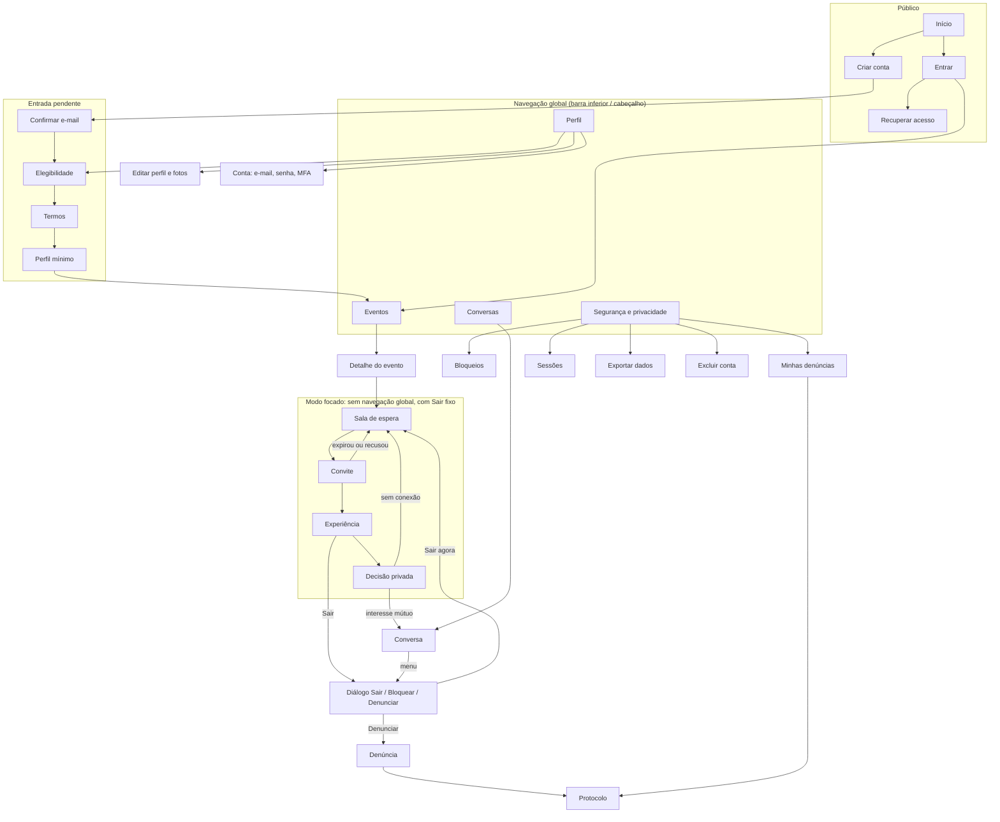

# Arquitetura de informação

Mapa de navegação, nomes das áreas e caminhos de recuperação do Duora (entrega "Arquitetura de informação" da
[spec 13.1](../product/spec.md#131-direção-visual-e-experiência)). Critério de aceite: encontrar eventos,
conversa, segurança e privacidade **sem decorar ícones**. As telas citadas estão detalhadas em
[screens.md](screens.md); os objetivos e situações de vulnerabilidade, no
[brief de experiência](../product/experience-brief.md).

> **Status:** proposta. Nomes e estrutura precisam passar pelo teste de compreensão da spec 13.6 antes de
> serem considerados validados.

## Princípios

1. **Áreas pelo que a pessoa quer fazer, não pelos módulos do backend.** O sistema tem `Events`, `Rooms`,
   `Connections`; a pessoa tem "Eventos", "Conversas", "Segurança" e "Perfil" (Designing Interfaces, cap. 2,
   organização por tarefa e fluxo de trabalho).
2. **Quatro áreas de primeiro nível, sempre com rótulo textual.** No mobile, barra inferior com ícone e texto;
   no desktop, as mesmas quatro no cabeçalho. Nenhum ícone sozinho (Designing Interfaces, cap. 6, "Bottom
   Navigation"; cap. 3, sinalização e orientação).
3. **A sala é um modo focado.** Durante convite, experiência e decisão, a navegação global sai de cena para
   reduzir distração, mas a saída fica fixa no cabeçalho (Designing Interfaces, cap. 3, "Escape Hatch"; cap. 2,
   tela do tipo "Do: facilitate a single task").
4. **Segurança é área de primeiro nível, não item de configuração.** Bloqueios, denúncias, sessões, exportação
   e exclusão ficam a um toque de qualquer tela autenticada fora da sala, e a um toque do botão "Sair" dentro
   dela.
5. **Toda tela de erro tem um caminho de volta nomeado.** Nunca "Voltar" genérico quando o destino real é
   conhecido ("Voltar ao evento", "Ir para Conversas").

## Áreas e nomes

| Área (rótulo) | Rota proposta | Conteúdo | Por que este nome |
|---|---|---|---|
| Início (público) | `/` | Apresentação, regras, acessibilidade, entrar, criar conta | Visitante não autenticado; some depois do login |
| Eventos | `/eventos` | Agenda, detalhes, inscrição, check-in, sala de espera | É o que a pessoa procura; "Agenda" foi descartado por não incluir a sala |
| Conversas | `/conversas` | Lista de conexões ativas e histórico por conversa | "Conexões" descreve o estado técnico; "Conversas" descreve a atividade |
| Segurança | `/seguranca` | Bloqueios, denúncias e protocolos, sessões, exportação, exclusão de conta | Título da página: "Segurança e privacidade"; o rótulo curto cabe na barra inferior a 320 px |
| Perfil | `/perfil` | Perfil próprio, fotos, preferências privadas, elegibilidade, conta | Inclui "Conta" (e-mail, senha, MFA) como seção, para não criar uma quinta área |
| Sala (modo focado) | `/eventos/{id}/sala` | Convite, experiência, chat da sala | Não aparece na navegação; entra-se pela sala de espera |
| Decisão | `/decisoes/{sessaoId}` | Decisão privada e janela | Alcançável pela sala ao fim do jogo e por aviso em Eventos até a janela fechar |

Os caminhos propostos acima são históricos. As rotas implementadas usam um único conjunto em inglês,
independente do idioma da interface, com aliases dos links antigos. O inventário e as regras de
compatibilidade estão em [spa-routes.md](../architecture/spa-routes.md). Nenhuma credencial deve ir no path ou na query.

**Alternativa considerada:** uma área "Conta" separada de "Perfil" (cinco itens). Descartada porque cinco
rótulos a 320 px exigiriam texto menor que 12 px ou rótulos truncados; "Conta" vira seção dentro de Perfil, e
as ações sensíveis de conta (exclusão, exportação, sessões) ficam em Segurança, onde a pessoa as procura.

## Mapa de navegação

Leitura textual do mapa, para quem não vê o diagrama:

- **Público:** Início leva a Criar conta e Entrar; Entrar leva a Recuperar acesso.
- **Entrada pendente:** Criar conta → Confirmar e-mail → Elegibilidade → Termos → Perfil mínimo → Eventos.
  Cada etapa pendente é retomada no próximo login, na etapa em que parou.
- **Navegação global:** Eventos, Conversas, Segurança e privacidade, Perfil.
- **Modo focado:** Detalhe do evento → Sala de espera → Convite → Experiência → Decisão privada. Convite
  expirado ou recusado volta à Sala de espera. "Sair" na Experiência abre o diálogo Sair/Bloquear/Denunciar;
  "Sair agora" volta à Sala de espera. Decisão com interesse mútuo abre a Conversa; sem conexão, volta à Sala de
  espera ou ao evento, se as rodadas terminaram.
- **Segurança:** Bloqueios, Minhas denúncias (com protocolos), Sessões, Exportar dados, Excluir conta.

## Sinalização e orientação

Padrões do Designing Interfaces, cap. 3 (sinalização, orientação e navegação):

| Pergunta da pessoa | Resposta na interface |
|---|---|
| Onde estou? | `<title>` por rota ("Sala de espera · Noite de quinta · Duora"), `h1` visível, item ativo da navegação com `aria-current="page"` e marcador além da cor |
| O que posso fazer aqui? | Uma ação primária por tarefa ([system.md](system.md#hierarquia-de-ações)) |
| Como saio? | Na sala: "Sair" fixo no cabeçalho. Fora dela: navegação global sempre visível |
| O que acontece depois? | Etapas da rodada nomeadas em texto ("Etapa 2 de 4: pistas"), não só por pontos ou barra |
| O que a outra pessoa vê? | Rótulo de visibilidade ("Só você vê isto") junto de pistas, decisões e preferências |

O link "Pular para o conteúdo" e os landmarks `banner`, `navigation`, `main` e `contentinfo` já existem em
`frontend/src/app/AppLayout.tsx`; a navegação global entra como `<nav aria-label="Principal">`.

## Caminhos de recuperação

Cada situação abaixo tem destino e redação definidos. O princípio é o mesmo do estado `offline` da
[spec 13.2](../product/spec.md#132-mapa-de-telas-e-estados): erro de rede nunca aparece como ausência de
conteúdo.

| Situação | Onde a pessoa fica | Ação primária | Ação alternativa | Observação |
|---|---|---|---|---|
| Sessão expirada | Tela de login com aviso "Sua sessão terminou" | Entrar novamente | — | Depois do login, volta à rota anterior se ainda autorizada; nenhum rascunho íntimo é preservado localmente (spec 13.2) |
| Sessão revogada (outra sessão, exclusão) | Login | Entrar | Ir para Início | Dados privados limpos do cache (spec 13.5) |
| E-mail não confirmado | Etapa "Confirmar e-mail" | Reenviar e-mail | Corrigir e-mail | Mensagem neutra, sem revelar se outro cadastro existe |
| Elegibilidade pendente ou falha do fornecedor | Etapa "Elegibilidade" | Tentar novamente (se o fornecedor permitir) | Excluir conta | Nunca libera por autodeclaração (spec 12.2) |
| Convite expirado | Sala de espera | Continuar aguardando | Sair do evento | Texto neutro: "O convite expirou. Você continua na rodada." |
| Outra pessoa ausente ou saiu | Sala de espera | Continuar aguardando | Sair do evento | Nunca dizer que a outra pessoa saiu por causa de você |
| Reconectando (até 90 s) | Experiência, com faixa de status | — (automático) | Sair | Estado do jogo vem do servidor ao reconectar (spec 9.1) |
| Sala abortada ou prazo encerrado | Tela "Sala encerrada" | Voltar à sala de espera | Denunciar | Mensagem neutra (spec 6.3) |
| Evento pausado ou cancelado | Detalhe do evento | Ver outros eventos | — | Cancelamento comunicado com motivo comunicável |
| Conflito de versão no jogo | Experiência | Atualizar estado | — | A ação não é aplicada duas vezes (spec 6.1) |
| Envio de mensagem falhou | Conversa, mensagem marcada "Não enviada" | Tentar de novo | Apagar rascunho | Texto preservado na tela até nova tentativa |
| Conversa indisponível (bloqueio, encerramento) | Conversas | Voltar a Conversas | Ir para Segurança | Texto genérico, sem dizer quem bloqueou (spec 7.3) |
| Conta restrita ou suspensa | Segurança | Ver motivo e recorrer | Excluir conta | Segurança e privacidade continuam acessíveis |
| Erro inesperado numa área | Error boundary da área | Tentar de novo | Ir para Eventos | Sem payload privado na tela (spec 13.5) |
| Página inexistente | 404 | Ir para Eventos (autenticado) ou Início | — | Não revela se o recurso existe e é de outra pessoa |
| Offline | Tela atual, com faixa "Sem conexão" | Tentar de novo | — | Dado já carregado continua legível e marcado como possivelmente desatualizado |
