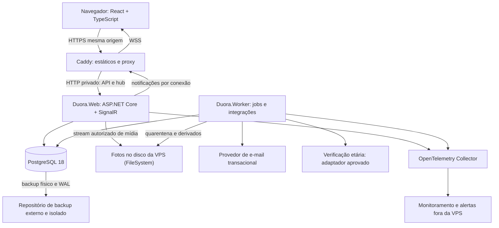

# Duora — Especificação técnica e plano de execução

**Data de referência:** 15 de outubro de 2026  
**Produto:** encontros entre adultos por experiências e minijogos cooperativos.  
**Backend:** C# 14 · .NET 10 LTS · ASP.NET Core 10 · EF Core 10 · Npgsql 10 · PostgreSQL 18.  
**Frontend:** React · TypeScript · Vite · Tailwind CSS · shadcn/ui.  
**Desenvolvimento:** macOS 27 Golden Gate.  
**Produção:** VPS Ubuntu Server 24.04 LTS · Docker Engine/Compose · Caddy.  
**Modelo:** monólito modular, processos web e worker, desenvolvimento assistido por agentes e operação amplamente automatizada.

> **Status:** especificação de requisitos e decisões de projeto. Metas de capacidade, desempenho e recuperação dependem de ensaios. Nenhum teste, deploy, contratação ou certificação é presumido por constar neste documento.

## Guia de navegação

| Bloco | Conteúdo | Seções |
|---|---|---|
| A — Produto e arquitetura | Escopo, ambientes, módulos e atributos de qualidade | [1. Escopo](#s01) · [2. Stack e ambientes](#s02) · [3. Arquitetura](#s03) |
| B — Comportamento e contratos | Jornadas, pares, jogos, chat, API e tempo real | [4. Jornadas](#s04) · [5. Pareamento](#s05) · [6. Experiências](#s06) · [7. Conexões](#s07) · [8. HTTP](#s08) · [9. SignalR](#s09) |
| C — Dados, segurança e interface | Persistência, concorrência, identidade, privacidade, design e acessibilidade | [10. Dados](#s10) · [11. Segurança](#s11) · [12. Privacidade](#s12) · [13. Interface](#s13) |
| D — Automação e operação | Agentes, Ubuntu, integrações, CI/CD, continuidade e diagnóstico | [14. Automação](#s14) · [15. VPS](#s15) · [16. Integrações](#s16) · [17. Entrega](#s17) · [18. Recuperação](#s18) · [19. Observabilidade](#s19) |
| E — Qualidade e execução | Testes, repositório, documentação interna, marcos e lançamento | [20. Testes](#s20) · [21. Repositório](#s21) · [22. Execução](#s22) · [23. Decisões e gates](#s23) |
| F — Fontes de trabalho | 20 livros, documentação por categoria e rastreabilidade dos controles | [24. Bibliografia](#s24) · [25. Documentação](#s25) |

**Leitura por tarefa:** partir do caso de uso, localizar `INV`/`API`/`T` afetados e consultar apenas os livros e páginas técnicas necessários. `B` identifica livro; `D`, ficha documental; `A11Y`, verificação de acessibilidade; `ADR`, decisão arquitetural. “Deve” indica requisito; “hipótese”, valor a medir; “condicional”, recurso cuja adoção exige justificativa.

**Ordem de autoridade:** obrigações aplicáveis e políticas aprovadas → requisitos do produto → documentação técnica da versão adotada → exemplos e livros. Um conflito é registrado e resolvido; não autoriza ignorar uma proteção. Fontes explicam comportamentos e decisões; evidências de teste demonstram a implementação.

<a id="s01"></a>
## 1. Escopo e critérios fundamentais

### 1.1. Produto a implementar

O Duora organiza encontros entre duas pessoas adultas em eventos com rodadas e experiências cooperativas. O sistema seleciona pares mutuamente elegíveis, conduz uma atividade curta, permite comunicação contextual e coleta interesse de forma privada. Uma conversa persistente só nasce de interesse mútuo. Segurança não é um complemento do chat: bloqueio, denúncia, retirada de participação, proteção etária e revisão de incidentes fazem parte do fluxo principal.

| Capacidade | Base obrigatória | Fora da primeira entrega |
|---|---|---|
| Conta | Cadastro, confirmação de e-mail, login, recuperação, gestão de sessões e exclusão | Servidor OAuth próprio; múltiplos provedores sociais simultâneos |
| Perfil | Nome de exibição, faixa etária pública, região aproximada, descrição curta, fotos aprovadas e preferências privadas | Geolocalização precisa, importação de redes sociais e enriquecimento de dados |
| Eventos | Publicação administrativa, inscrição, fila de espera, check-in, rodadas e cancelamento | Marketplace de organizadores e eventos de terceiros |
| Pareamento | Elegibilidade bilateral, bloqueios, não repetição no evento, justiça de espera e rastreabilidade técnica | Ranking de atratividade, inferência de orientação e recomendação por LLM |
| Experiências | Um jogo completo na primeira fatia; segundo jogo antes da expansão do piloto | 3D, voz, vídeo, scripts arbitrários e geração ao vivo no caminho crítico |
| Comunicação | Chat textual durante a sala e conversa persistente após interesse mútuo | Anexos, HTML, mensagens anônimas e criptografia ponta a ponta |
| Segurança interpessoal | Sair, bloquear, denunciar, encerrar conexão, revisão e recurso | Banimento permanente exclusivamente por classificador |
| Operação | Deploy repetível, telemetria, backups externos, restauração e controles administrativos | Alta disponibilidade prometida em uma única VPS |
| Cobrança | Fronteira de integração documentada, sem dependência no piloto técnico | Implementação de pagamentos antes de validar o fluxo central |

O frontend é uma SPA React/TypeScript, com build estático. ASP.NET Core concentra API, autenticação e tempo real; não há servidor Node em produção nem dependência de Blazor.

> **Divergência registrada ([ADR-0026](../architecture/adr/0026-publico-idiomas-e-regiao-do-servidor.md), decisão do dono de 2026-10-19):** o público-alvo principal **não é brasileiro**; os países do lançamento ainda não foram fixados. O produto inteiro funciona em **PT-BR e EN-US** (interface, e-mails, conteúdo das experiências, documentos voltados ao usuário e mensagens de erro). O servidor de produção fica em **Boston, EUA**, e o backup no Backblaze B2 **US East**. Onde esta spec supõe público brasileiro, legislação só brasileira ou um idioma só, vale o ADR.

### 1.2. Invariantes que não podem depender apenas da interface

| ID | Regra | Mecanismo principal | Teste |
|---|---|---|---|
| INV-01 | Somente contas elegíveis e com requisito etário satisfeito participam | Política de autorização e verificação de estado no comando | T-01 |
| INV-02 | Uma pessoa ocupa no máximo uma sala reservada/ativa | Restrição única de participação não liberada | T-02 |
| INV-03 | Um bloqueio impede novo pareamento, novo envio e novas leituras protegidas entre o par | Guardas transacionais, autorização e invalidação | T-03 |
| INV-04 | Duas decisões positivas concorrentes criam no máximo uma conexão | Transação serializada para o par e índice único | T-04 |
| INV-05 | Pistas privadas e decisões alheias não chegam a um cliente não autorizado | Projeções por destinatário; nenhum estado integral no navegador | T-05 |
| INV-06 | Repetir um comando não repete seu efeito | Idempotência persistente, unicidade e versão esperada | T-06 |
| INV-07 | Notificação perdida não implica perda do estado confirmado | Banco autoritativo e recuperação HTTP | T-07 |
| INV-08 | Reiniciar web/worker não reinicia uma rodada nem duplica transições | Prazos persistidos, leases e transições condicionais | T-08 |
| INV-09 | Um jogo iniciado mantém sua versão de regras e conteúdo | Versões publicadas imutáveis, ligadas à sessão | T-09 |
| INV-10 | Uma decisão de moderação é rastreável e pode ser revisada | Registro de política, evidência, autor e recurso | T-10 |
| INV-11 | Restaurar backup não reativa silenciosamente contas excluídas ou sessões revogadas | Procedimento de reconciliação e bloqueio de efeitos externos | T-11 |
| INV-12 | Nenhum agente de desenvolvimento possui autorização irrestrita em produção | Separação de credenciais, ambientes e gates | T-12 |

“Impedir após o bloqueio” significa negar operações cuja autorização ocorre depois do commit do bloqueio. Não é possível apagar uma mensagem que já foi recebida, recolher uma captura de tela ou garantir cancelamento de bytes que já estavam em trânsito.

### 1.3. Papéis e privilégio mínimo

| Papel | Pode | Não pode por padrão |
|---|---|---|
| Visitante | Ler apresentação, regras, acessibilidade e política de privacidade | Enumerar perfis, participantes ou eventos privados |
| Conta pendente | Confirmar e-mail, completar cadastro e resolver verificação | Entrar em sala ou ver dados de outras pessoas |
| Participante elegível | Inscrever-se, jogar, decidir, conversar quando autorizado, bloquear e denunciar | Consultar decisões negativas, pontuações internas ou evidências alheias |
| Moderador | Revisar casos atribuídos e aplicar medidas permitidas pela política | Acessar arbitrariamente todas as conversas ou operar infraestrutura |
| Administrador de produto | Gerir catálogo, eventos e configuração funcional | Conceder a si mesmo acesso irrestrito a dados sensíveis |
| Operador técnico | Gerir releases, saúde, recuperação e incidentes de infraestrutura | Usar acesso de banco como ferramenta rotineira de atendimento |
| Agente de desenvolvimento | Propor código e documentação em ambiente isolado | Ler banco real, segredos de produção ou evidências de moderação |

Uma equipe de uma pessoa pode acumular responsabilidades, mas deve conservar contas, ações e trilhas de auditoria distintas. A separação técnica continua útil mesmo sem separação de pessoas.

<a id="s02"></a>
## 2. Stack e política de dependências

### 2.1. Backend e dados

| Necessidade | Decisão | Aplicação e limite | Documentação |
|---|---|---|---|
| Runtime e linguagem | .NET 10 LTS e C# 14 | `net10.0`; versão concreta do SDK em `global.json`; patches de segurança revisados | [D-NET-01](#d-net-01) e [D-NET-02](#d-net-02) |
| Servidor HTTP | ASP.NET Core 10 sobre Kestrel | Minimal APIs organizadas por funcionalidade; DTOs explícitos; handlers testáveis | [D-NET-03](#d-net-03) |
| Validação | Validação integrada do ASP.NET Core e validadores de domínio | Formato na borda; elegibilidade, permissão e transições no servidor | [D-NET-03](#d-net-03) |
| Persistência | EF Core 10 + Npgsql.EntityFrameworkCore.PostgreSQL 10 | LINQ para consultas usuais e SQL parametrizado para locks/filas | [D-EF-01](#d-ef-01) e [D-EF-02](#d-ef-02) |
| Banco | PostgreSQL 18, com patch suportado fixado | Mesma major em desenvolvimento, CI e produção; sem presumir upgrade de major automático | [D-PG-01](#d-pg-01) |
| Evolução de schema | EF Core Migrations | SQL revisado e bundle executado por job exclusivo; aplicação não migra no startup | [D-EF-01](#d-ef-01) |
| Contas locais | ASP.NET Core Identity | Hash de senha, confirmação, recuperação e MFA pelo framework; não implementar criptografia de autenticação própria | [D-AUTH-01](#d-auth-01) |
| Sessão web | Cookie de autenticação + `ITicketStore` persistente | Ticket protegido no servidor; cookie apenas com referência protegida; revogação por sessão | [D-AUTH-01](#d-auth-01) e [D-AUTH-02](#d-auth-02) |
| Tempo real | ASP.NET Core SignalR | Hub autenticado para notificações de mudança; comandos de negócio continuam HTTP | [D-RT-01](#d-rt-01) |
| Tarefas | Worker .NET + tarefas persistidas no PostgreSQL | Rotinas específicas de produto, expiração, e-mail, arquivos e retenção; sem agendador genérico próprio | [D-NET-01](#d-net-01) |
| Contrato | OpenAPI nativo + cliente TypeScript gerado | Contrato gerado no CI, validado e revisado como artefato da release | [D-API-01](#d-api-01), [D-API-02](#d-api-02) e [D-API-03](#d-api-03) |
| Telemetria | `ILogger`, OpenTelemetry, métricas e tracing | Logs JSON; correlação técnica; sem corpos privados | [D-OBS-01](#d-obs-01) e [D-NET-03](#d-net-03) |
| Testes | xUnit.net, Testcontainers, WebApplicationFactory | PostgreSQL real nas integrações; assertions nativas suficientes no início | [D-TEST-01](#d-test-01) |

**Política de versões:** .NET, ASP.NET Core, EF Core e provider Npgsql permanecem em linhas major compatíveis, mas não precisam ter o mesmo número de patch. Usar a linha estável 10; não depender de versões preview. .NET 10 é LTS com suporte anunciado até novembro de 2028; a data exata e o patch vigente devem ser conferidos na política oficial durante cada atualização. PostgreSQL 18 é uma escolha explícita, não uma regra de “sempre instalar a major mais nova”.

**Identidade:** contas locais com ASP.NET Core Identity, sob controle operacional do produto. Isso adiciona responsabilidade por segurança e recuperação de contas. OIDC gerenciado permanece alternativa arquitetural, não segundo mecanismo simultaneamente obrigatório. Se adotado, usar o handler oficial, Authorization Code + PKCE, validação de emissor e vínculo por `issuer + subject`; reavaliar o ADR correspondente antes de alterar a implementação.

### 2.2. Frontend

| Necessidade | Decisão | Regra de implementação | Documentação |
|---|---|---|---|
| Interface | React 19 + TypeScript `strict` | Componentes funcionais; versões concretas e compatíveis no lockfile | [D-FE-01](#d-fe-01) e [D-FE-02](#d-fe-02) |
| Build | Vite, Node.js 24 LTS e pnpm | Node apenas no desenvolvimento/CI; frontend compilado é estático | [D-FE-03](#d-fe-03) |
| Navegação | React Router | Rotas por jornada; proteção visual não substitui autorização | [D-FE-04](#d-fe-04) |
| Dados remotos | TanStack Query | Cache por identidade; limpar no logout; não persistir conteúdo privado offline | [D-FE-04](#d-fe-04) |
| Formulários | React Hook Form + Zod | Validação compartilhada de formato, sem confiar nela para regras críticas | [D-FE-05](#d-fe-05) |
| Estilos | Tailwind CSS 4 + CSS nativo | Tokens semânticos; Grid, Flexbox e container queries quando úteis | [D-FE-06](#d-fe-06) e [D-DES-01](#d-des-01) |
| Componentes | shadcn/ui, com primitivas acessíveis compatíveis | Código incorporado exige manutenção e testes próprios; não garante acessibilidade por instalação | [D-FE-06](#d-fe-06) e [D-DES-03](#d-des-03) |
| API | `fetch` encapsulado + openapi-typescript/openapi-fetch | Cookies same-origin, antiforgery, cancelamento, Problem Details e política de retry | [D-API-03](#d-api-03) |
| Tempo real | `@microsoft/signalr` | Reconexão com jitter; notificações invalidam consultas autorizadas | [D-RT-01](#d-rt-01) |
| Catálogo visual | Storybook | Estados completos dos componentes e testes de interação/acessibilidade | [D-DES-04](#d-des-04) |
| Qualidade | ESLint, typescript-eslint, Prettier, Vitest, Testing Library e Playwright | Lint, tipos, componentes, E2E e regressão visual no CI | [D-FE-07](#d-fe-07), [D-TEST-02](#d-test-02) e [D-TEST-03](#d-test-03) |

Não introduzir Redux, Next.js, um BFF Node ou renderização no servidor na área autenticada sem necessidade demonstrada. Uma landing page estática e indexável pode ser gerada separadamente, sem expor páginas privadas a mecanismos de busca.

### 2.3. Operação e dependências que não entram automaticamente

| Área | Base | Condicional, com justificativa |
|---|---|---|
| Hospedagem | VPS Ubuntu Server 24.04 LTS com Docker Engine + Compose; Hostinger KVM 2 (2 vCPU, 8 GB) em Boston, EUA ([ADR-0026](../architecture/adr/0026-publico-idiomas-e-regiao-do-servidor.md); orçamento de CPU e memória no PR #87, issue #86) | Segunda VPS quando isolamento ou disponibilidade justificarem |
| Entrada HTTPS | Caddy, domínio único para SPA/API/hub; DNS na Cloudflare | CDN/WAF somente após revisar dados, cache, WebSockets e exposição da origem; registro proxied pela Cloudflare (a confirmar) cai nesta condição |
| Infraestrutura | Ansible; OpenTofu para recursos que o provedor suportar | Não inventar um provider para uma VPS ainda não escolhida |
| Artefatos | Registry privado, imagens por digest, release manifest | Assinatura e verificação de proveniência conforme suporte escolhido |
| Arquivos | Fotos no disco da VPS, com cópia externa dos derivados (restic no Backblaze B2 US East); nada na AWS ([ADR-0010](../architecture/adr/0010-object-storage-externo-leitura-via-api.md), adendo de 2026-10-16; 15.4) | Object storage privado compatível com S3 só por novo ADR; upload direto por URL assinada apenas quando houver necessidade e controles equivalentes |
| Backup | pgBackRest, WAL e repositório externo | Réplica de banco depois; réplica não substitui backup |
| Monitoramento | OpenTelemetry Collector local leve e destino externo | Prometheus/Grafana/Loki/Tempo locais apenas com orçamento de recursos separado |
| Mensageria | PostgreSQL, outbox e jobs específicos | Broker apenas quando métricas mostrarem necessidade; sem Kafka no início |
| Escala SignalR | Uma instância web ativa | Backplane/serviço de fan-out e política de afinidade antes de múltiplas instâncias |
| Cache | Cache local limitado para conteúdo não sensível | Redis/Valkey somente mediante ADR de consistência, operação e capacidade |

**Governança de pacotes:** `Directory.Packages.props`, lockfiles NuGet e pnpm, fontes de pacote explícitas, auditoria de vulnerabilidades, inventário de licenças e SBOM. Não acrescentar MediatR, AutoMapper, FluentAssertions, Hangfire ou bibliotecas de imagem por reflexo: primeiro avaliar necessidade, manutenção, compatibilidade e licença vigente. A base funciona com DI, handlers e mapeamentos explícitos.

### 2.4. Ambientes e paridade macOS → Ubuntu

| Ambiente | Sistema e execução | Finalidade | Critério de aceite |
|---|---|---|---|
| Desenvolvimento | **macOS 27 Golden Gate**; SDK .NET 10 nativo, Node.js 24, pnpm e Docker Desktop | Editor, depuração, testes rápidos e PostgreSQL descartável | Inventário local e teste de integração com Docker executados |
| CI | Runner **Ubuntu 24.04**, com arquitetura registrada; SDK e ferramentas fixados | Build, análise, testes e publicação das imagens | Todos os gates na arquitetura de destino; nenhuma dependência exclusiva do Mac |
| Homologação | Ubuntu Server 24.04 LTS, separada de produção | Ensaiar release, proxy, migrações, segurança e restore | Mesmos digests, configuração equivalente e apenas dados sintéticos |
| Produção | **Ubuntu Server 24.04 LTS** na VPS; Docker Engine + plugin Compose | Caddy, web, worker, PostgreSQL e Collector | Host provisionável e serviço recuperável por runbooks |

O [suporte oficial do .NET 10 por sistema](#d-env-01) inclui macOS 27 e Ubuntu 24.04. Isso não valida automaticamente cada biblioteca, imagem, extensão de editor ou dependência nativa: versões concretas e evidência de execução fazem parte do inventário.

**Arquitetura:** priorizar ferramentas Arm64 nativas no Mac com Apple silicon, verificando se o terminal está em tradução. A arquitetura da VPS permanece uma propriedade a confirmar (`linux/amd64` ou `linux/arm64`). Imagens, binários nativos e bundles de migração devem corresponder ao alvo. Uma imagem que só passou em emulação não atende ao aceite de produção; emulação não é prova de desempenho nem de suporte do runtime.

### 2.5. Contrato do ambiente local

| Item | Configuração do projeto | Verificação / proibição |
|---|---|---|
| SDK .NET | Instalador oficial da linha 10; versão concreta em `global.json`; ferramentas locais em `.config/dotnet-tools.json` | `dotnet --info`, `dotnet --list-sdks` e `dotnet tool restore`; não depender de ferramentas globais com versões desconhecidas |
| Frontend | Node.js 24 e pnpm em versões fixadas; `packageManager` e lockfile versionados | `node --version`, `pnpm --version` e instalação congelada; sem atualização implícita para uma major diferente |
| Containers locais | Docker Desktop com runtime Linux; Compose separado de produção | `docker version`, `docker info`, `docker compose version`; não expor daemon na rede |
| PostgreSQL local | Mesma major 18; volume nomeado; porta apenas em `127.0.0.1` quando o processo no host precisar dela | Testcontainers cria seu próprio banco descartável; não usar o banco de trabalho compartilhado na suíte |
| Certificados | HTTPS local confiável; chaves de desenvolvimento fora do Git | `dotnet dev-certs https --trust` para ASP.NET Core; Vite/proxy precisa de certificado/configuração próprios coerentes, não recebe confiança automaticamente |
| Origem da SPA | HTTPS local e proxy de `/api` e `/hubs` para o backend, incluindo WebSockets | Cookies, `Origin` e antiforgery testados; não desativar `Secure` ou abrir CORS de produção para facilitar desenvolvimento |
| Segredos locais | `dotnet user-secrets` somente no desenvolvimento; variáveis privadas fora do bundle | Não são cofre criptografado; jamais colocar segredos em variáveis `VITE_*` |
| Rede entre processos | Do host ao container usar porta mapeada; entre containers, DNS da rede Compose | `localhost` dentro do container aponta para ele próprio; nomes e endereços devem ser explícitos |
| Filesystem | Caminhos portáveis, nomes com capitalização consistente, LF e bit executável versionado | Não pressupor equivalência entre filesystem do Mac e Linux; evitar bind mount de `PGDATA` em pasta do Mac |
| Shell e utilitários | Scripts operacionais do servidor em Ansible/Ubuntu; scripts locais com shell e versão declarados | Não pressupor equivalência entre `sed`, `date`, `stat` e `readlink` de macOS e GNU/Linux |
| Acessibilidade local | Safari + VoiceOver e teclado no Mac; testes automatizados em browsers do CI | WebKit do Playwright não comprova sozinho o comportamento do Safari com VoiceOver |
| Isolamento de agentes | Workspace descartável, dados sintéticos, sem home/chaves pessoais montadas | Docker local também é uma superfície privilegiada; acesso a socket deve ser restrito ao runner autorizado |

**Diagnóstico inicial, sem alterar o ambiente:**

```sh
sw_vers
uname -m
dotnet --info
node --version
pnpm --version
docker version
docker compose version
docker context show
```

A automação deve produzir `docs/development/environment.md` e um comando de diagnóstico que falhe com mensagem acionável quando um pré-requisito estiver ausente. O repositório deve oferecer comandos documentados para restaurar dependências, iniciar serviços locais, executar testes e encerrar recursos. Esses comandos são entregáveis da fundação, não arquivos cuja existência este documento presume.

**Aceite de paridade:** executar build .NET, build da SPA, Testcontainers/PostgreSQL, login com cookie/CSRF, hub autenticado e carregamento de mídia em macOS e no runner Linux. Validar a release final na mesma arquitetura da VPS. Sem SDK ou compilação na VPS de produção.

Fontes: [D-ENV-01](#d-env-01), [D-ENV-02](#d-env-02), [D-ENV-03](#d-env-03), [D-NET-07](#d-net-07) e [D-CI-03](#d-ci-03).

<a id="s03"></a>
## 3. Arquitetura e limites dos módulos

### 3.1. Monólito modular, dois processos da mesma release

O backend possui um único modelo de domínio e banco relacional. A release contém **web** e **worker**, publicados e testados juntos. Separar processos protege HTTP e SignalR de processamento de imagens e rotinas demoradas; não cria microsserviços independentes.



**Distribuição de responsabilidades:** somente o processo web publica a outbox de tempo real por `IHubContext`. O worker grava alterações e eventos no banco, mas **não** usa um `IHubContext` local para tentar alcançar sockets hospedados em outro processo. E-mails, verificação etária e processamento de mídia têm consumidores próprios no worker.

### 3.2. Módulos, dados e interfaces

| Módulo | Responsabilidade e entidades | Operações públicas exemplificativas | Não deve |
|---|---|---|---|
| Identity | Conta, credenciais, sessões, recuperação, estado etário | `GetEligibility`, `RevokeSessions`, `DisableAccount` | Decidir pareamento ou abrir conversas |
| Profiles | Perfil, fotos, preferências e visibilidade | `GetAuthorizedProfile`, `UpdatePreferences` | Expor preferências privadas no DTO de outra pessoa |
| Events | Evento, inscrição, lista de espera, check-in e rodada | `Register`, `CheckIn`, `StartRound`, `CancelEvent` | Formar pares ignorando Safety |
| Matching | Seleção, histórico de pares e reservas | `BuildRoundPairings`, `ReleaseReservation` | Inferir atributos sensíveis por IA |
| Experiences | Catálogo imutável, sessão, ações e projeções | `AcceptInvitation`, `ApplyAction`, `GetParticipantView` | Aceitar estado ou resultado definido pelo cliente |
| Connections | Decisões privadas e vínculo entre duas contas | `SubmitDecision`, `EndConnection` | Revelar quem rejeitou ou quando rejeitou |
| Messaging | Conversa, membros e mensagens | `SendMessage`, `GetMessages`, `CloseConversation` | Autorizar apenas pela existência do ID da conversa |
| Safety | Bloqueios, guardas, denúncias, evidências e sanções | `BlockUser`, `CheckInteraction`, `SubmitReport` | Tratar toda denúncia como condenação automática |
| Media | Upload, quarentena, processamento e acesso | `StartUpload`, `GetAuthorizedAsset`, `DeleteAsset` | Servir o original não verificado |
| Notifications | E-mail, preferências e recibos de entrega | `ScheduleNotification`, `CancelPendingNotification` | Incluir conteúdo íntimo em assunto ou push |
| Operations | Configurações, feature flags e comandos operacionais | `PauseMatching`, `EnterMaintenanceMode` | Expor shell ou SQL genérico ao painel |
| Privacy | Exportação, exclusão, retenção e reconciliação | `RequestExport`, `RequestDeletion`, `ApplyRetention` | Apagar registros sob preservação aprovada sem avaliação |

Operações que atravessam módulos usam um coordenador de caso de uso, não chamadas HTTP internas. Eventos internos desacoplam efeitos posteriores; invariantes que precisam ser imediatas continuam na mesma transação.

### 3.3. Organização sem uma arquitetura cerimonial

Usar `Duora.Core` para regras e casos de uso agrupados por módulo; `Duora.Infrastructure` para EF Core e fornecedores; `Duora.Web` e `Duora.Worker` como composition roots; `Duora.Contracts` para contratos de transporte. Não exigir uma interface para cada classe ou quatro arquivos para cada leitura simples.

Dependências permitidas: Web/Worker → Core/Infrastructure/Contracts; Infrastructure → Core; Core não depende de ASP.NET Core, EF Core ou SDK de fornecedor. Contracts não carrega entidades persistidas. Endpoints chamam casos de uso; não contêm o algoritmo de pareamento nem regras de bloqueio.

O banco tem um `DuoraDbContext` inicial para facilitar transações que abrangem conta, relação, decisão e outbox. As tabelas têm proprietários lógicos por módulo. Um contexto por módulo só entra com uma estratégia comprovada para atomicidade e coordenação; fragmentar contextos agora não é objetivo.

Testes arquiteturais verificam referências, namespaces, dependências proibidas e ciclos. O contexto único não autoriza manipulação livre de dados: consultas e repositórios específicos ficam na infraestrutura do módulo, e os casos de uso usam contratos estreitos. Não criar um `GenericRepository<T>` sobre toda a API do EF Core.

### 3.4. Padrões com finalidade concreta

Referência de padrões orientados a objetos: [Dive Into Design Patterns — B-05](#b-05). A intenção do padrão e suas consequências orientam a decisão; o código segue C# idiomático e as APIs da stack fixada. Padrões de coordenação entre processos têm referência própria em [B-09](#b-09).

| Padrão/técnica | Uso | Restrição |
|---|---|---|
| Máquina de estados | Conta, evento, sala, upload, conexão e caso de moderação | Todas as transições têm precondições e testes |
| Strategy | `IExperienceRules` e política de matching versionada | Variações reais; sem motor de plugins executáveis enviados por usuários |
| Portas e adaptadores | E-mail, armazenamento, verificação e moderação assistida | Contratos incluem timeout, idempotência e classificação de falha |
| Transactional Outbox | Intenção de notificar junto ao commit de negócio | Entrega pode repetir; nunca prometer exactly-once |
| Idempotência | Ações, mensagens, decisões, inscrições e webhooks | Escopo por principal/operação/chave; comparar payload |
| Concurrency token | Edição de perfil e evolução da sessão | Conflito é resposta de domínio, não retry cego |
| Lease e fencing token | Reclamação de jobs e coordenação de consumidores | Lease vencido não autoriza um worker antigo a concluir tarefa |
| Projeção por destinatário | Estado de jogo, perfil e mensagens | Não filtrar segredos apenas no React |

### 3.5. Atributos de qualidade e revisão arquitetural

| Atributo | Cenário que orienta a arquitetura | Como verificar |
|---|---|---|
| Segurança | Bloqueio concorrente com leitura/envio e sessão revogada com hub conectado | Testes negativos e protocolo transacional comum |
| Modificabilidade | Novo minijogo com regras próprias sem alterar autenticação e entrega | Contrato `IExperienceRules`, versão de catálogo e testes de fronteira |
| Operabilidade | Perda completa da VPS sem acesso ao disco local | Provisionamento Ubuntu 24.04, backup externo e restore ensaiado |
| Confiabilidade | Worker pausa, lease vence e outro executor assume | Transições condicionais, fencing e efeitos externos idempotentes/reconciliáveis |
| Desempenho | Entrada concentrada em evento junto com jobs e fotos | Ensaio com metas explícitas e orçamento de recursos |
| Acessibilidade | Pessoa conclui cadastro, jogo e saída com teclado/leitor | Matriz A11Y e T-23, não apenas inspeção de componentes isolados |

[Fundamentals of Software Architecture — B-06](#b-06) sustenta a avaliação desses atributos e trade-offs; [Learning Domain-Driven Design — B-07](#b-07) sustenta a modelagem e as fronteiras. O estilo monolítico não elimina decisões arquiteturais durante o desenvolvimento.

<a id="s04"></a>
## 4. Jornadas, estados e parâmetros

### 4.1. Jornadas verificáveis

| Jornada | Fluxo completo | Falhas e saídas obrigatórias |
|---|---|---|
| Entrada | Criar conta → confirmar e-mail → concluir elegibilidade etária → aceitar versões dos termos → perfil mínimo | E-mail não chega, conta duplicada, análise pendente, falha no provedor, desistência e exclusão |
| Inscrição | Ver evento autorizado → conferir horário local → inscrever → confirmar vaga ou espera → receber lembrete | Lotação concorrente, cancelamento, alteração relevante de horário e perda de elegibilidade |
| Rodada | Check-in → aguardar → receber convite → aceitar → iniciar experiência | Pessoa ímpar, par incompatível, convite expirado, desistência e indisponibilidade do serviço |
| Experiência | Ler instrução breve → praticar ação → jogar → encerrar → decidir privadamente | Reconexão, ação duplicada, conflito de versão, acessibilidade, sair e denunciar |
| Conexão | Dois interesses válidos → criar vínculo → abrir conversa persistente | Bloqueio concorrente, conta suspensa, decisão expirada e vínculo já encerrado |
| Segurança | Sair/bloquear/denunciar → receber protocolo → acompanhar estado permitido → recorrer | Nenhuma obrigação de continuar na sala para produzir evidência |
| Privacidade | Solicitar exportação/exclusão → reautenticar → acompanhar tarefa → receber resultado | Links expirados, preservação restrita e dados de terceiros no histórico |

### 4.2. Máquinas de estado

| Recurso | Estados | Regras de transição |
|---|---|---|
| Conta | `PendingEmail`, `PendingEligibility`, `Active`, `Restricted`, `Suspended`, `DeletionPending`, `Deleted` | Não há transição automática de suspeita etária para `Active` por decurso de prazo |
| Evento | `Draft`, `Published`, `CheckInOpen`, `Running`, `Completed`, `Cancelled` | Publicação exige catálogo aprovado; cancelamento é auditado |
| Inscrição | `Waitlisted`, `Confirmed`, `CheckedIn`, `Withdrawn`, `NoShow`, `Completed` | Vaga ocupada e posição na fila são alteradas transacionalmente |
| Rodada | `Scheduled`, `Preparing`, `Inviting`, `Running`, `Closed`, `Cancelled` | Retomada reavalia horário e versão; não cria convites duplicados |
| Sala | `Invited`, `Ready`, `Active`, `Completed`, `Aborted`, `Expired` | Duas aceitações válidas antes do prazo; abortar libera reservas |
| Decisão | `Pending`, `Interested`, `NotInterested`, `Withdrawn`, `Expired` | Alterável até formar conexão ou expirar; mudança é versionada |
| Conexão | `Active`, `Ended`, `Blocked` | Encerramento não é revertido silenciosamente por decisão antiga |
| Upload | `Pending`, `Quarantined`, `Processing`, `Approved`, `Rejected`, `Deleted` | Nenhuma leitura pública antes de `Approved` |
| Denúncia | `Received`, `Triaged`, `UnderReview`, `Actioned`, `Closed`, `Appealed` | Recurso cria nova revisão, sem apagar a decisão anterior |

Uma sala concluída pode ter uma janela de decisão ainda aberta; decisão não mantém a sala ativa nem reserva a pessoa para a próxima rodada. O estado da conexão também não é uma propriedade visual do jogo.

### 4.3. Parâmetros iniciais centralizados

Todos os valores abaixo são **hipóteses iniciais configuráveis**, armazenadas com versão e sujeitas aos testes. Uma sessão recebe um snapshot da configuração ao nascer. Alterações globais não mudam regras no meio de uma experiência.

| Parâmetro | Valor inicial | Comportamento |
|---|---:|---|
| Participantes confirmados por evento | 100 | Máximo de 50 salas simultâneas; testar antes de admitir essa lotação |
| Rodadas por evento | 3 | Não repetir o mesmo par dentro do evento |
| Janela de uma rodada | 12 minutos | Inclui convite, jogo e intervalo; próxima rodada não depende do timer do navegador |
| Abertura de check-in | 10 minutos antes | No início da rodada, só entram participantes com presença confirmada |
| Prazo de convite | 60 segundos | Sem dupla aceitação, cancelar convite e liberar reservas |
| Jogo ativo | Até 8 minutos | Deadline não ultrapassa o início da rodada + 9 minutos |
| Tolerância de reconexão | 90 segundos | Não estende indefinidamente o deadline da rodada |
| Janela de decisão | 24 horas após conclusão | Expiração não é revelada como rejeição da outra pessoa |
| Mensagem | Até 2.000 caracteres Unicode, com limite adicional de bytes | Texto simples; contagem coerente frontend/backend; sem anexos |
| JSON de comando comum | Até 32 KiB | Upload tem limite separado; limitar também profundidade e coleções |
| Foto | Até 5 MiB e 20 megapixels decodificados | Validar antes de processar; até 6 fotos aprovadas por perfil |
| Página de mensagens | Padrão 30; máximo 100 | Cursor opaco por conversa, ordenação estável |
| Idempotência HTTP comum | 48 horas | Respostas privadas são mínimas; unicidades permanentes continuam existindo |
| Sessão normal | 30 minutos de inatividade; 12 horas absolutas | Reautenticação para ações sensíveis; sem “lembrar para sempre” no padrão |
| Sessão administrativa | 15 minutos de inatividade; 8 horas absolutas | MFA obrigatório e step-up para ações críticas |
| Concorrência inicial de processamento de imagens | 1 tarefa | Fila limitada; recusar/suspender admissão quando saturada |

Os prazos de exclusão e evidências não ficam escondidos nesta tabela: são tratados na política de privacidade e retenção da seção 12.

<a id="s05"></a>
## 5. Pareamento e coordenação de rodadas

### 5.1. Elegibilidade bilateral, não um ranking opaco

O conjunto de candidatos considera conta ativa, requisito etário, inscrição, check-in, disponibilidade e preferências explicitamente informadas. Cada aresta candidata `A ↔ B` exige elegibilidade nos dois sentidos. Bloqueios, sanções, incompatibilidade declarada, repetição no evento e ocupação de outra sala eliminam a aresta antes de qualquer pontuação.

Não inferir gênero, orientação, renda ou “qualidade do perfil” a partir de fotos, texto ou comportamento. Não expor a outra pessoa o motivo detalhado pelo qual um par não foi formado.

| Etapa | Implementação | Garantia/limite |
|---|---|---|
| Seleção preliminar | Consultar candidatos por evento e rodada, com projeção mínima | Pode ficar desatualizada; exige revalidação antes do commit |
| Grafo de compatibilidade | Comparar preferências bilaterais e restrições | Até 100 participantes, comparação quadrática é uma hipótese simples a medir |
| Prioridade | Favorecer quem ficou sem par e quem espera há mais tempo | Não usar idade, aparência ou atributo sensível como recompensa |
| Desempate | Semente persistida por rodada e versão do algoritmo | Resultado reproduzível sem expor a semente aos participantes |
| Seleção dos pares | Heurística determinística sobre arestas elegíveis | Heurística gulosa não garante máximo número global de pares; registrar taxa de não pareamento |
| Reserva | Transação com guardas, revalidação e unicidades | Pessoa não é reservada duas vezes, mesmo com execução concorrente |
| Convite | Criar sala e notificações via outbox | Prazo absoluto salvo no banco |
| Ausência | Expirar convite e liberar vaga | Sem substituição surpresa dentro de uma sala que já começou |

Se a heurística deixar pessoas elegíveis sem par de forma recorrente, avaliar algoritmo de matching de cardinalidade máxima com restrições. Não relaxar bloqueios ou compatibilidade para melhorar uma métrica.

### 5.2. Coordenação e retomada

O worker busca rodadas vencidas, adquire lease e executa a transição com condição de estado/versão. O lease evita trabalho simultâneo comum; as restrições do banco preservam a correção mesmo quando um processo pausa e o lease expira.

Durante a transação, adquirir guardas de segurança dos candidatos em ordem estável, depois o coordenador da rodada, revalidar elegibilidade e inserir reservas. Não fazer chamadas externas dentro desse trecho. Alteração de preferência e bloqueio usam as mesmas guardas para não competir fora do protocolo.

Após reinício, uma rodada passada não começa cegamente como se fosse nova. Aplicar política: ainda dentro da tolerância → retomar estado persistido; fora da janela → encerrar/cancelar, liberar reservas e emitir notificações neutras. Uma pessoa sem par recebe mensagem de indisponibilidade, nunca uma justificativa que exponha preferências alheias.

### 5.3. Métricas sem transformar pessoas em pontuação pública

Medir taxa de pessoas pareadas, rodadas sem par, convites expirados, tempo de espera e concentração de repetição. Agregar por evento e versão do algoritmo, com supressão de grupos muito pequenos. Não publicar listas de rejeição nem manter um ranking de desejabilidade.

<a id="s06"></a>
## 6. Motor de experiências e minijogos

### 6.1. Contrato do motor

Cada experiência publica `experienceId`, `rulesVersion`, `contentVersion`, `schemaVersion`, modos de acessibilidade, limites de duração e conjunto fechado de tipos de ação. O servidor mantém estado público, estado privado por participante e estado interno de controle em estruturas separadas.

| Operação | Entrada | Saída | Restrição |
|---|---|---|---|
| `CreateSession` | Versão publicada, participantes, configuração e semente | Estado inicial persistível | Não consultar LLM durante a criação |
| `ValidateAction` | Estado atual, ator, ação e horário do servidor | Validação tipada | Ator e etapa devem permitir a ação |
| `ApplyAction` | Ação já validada e versão esperada | Novo estado e eventos de domínio | Determinística com relógio/aleatoriedade injetados |
| `ProjectForParticipant` | Estado interno e participante autorizado | DTO sem pistas/decisões de terceiros | Não serializar entidade integral e “esconder campos” depois |
| `HandleDeadline` | Deadline persistido e versão | Transição de expiração/conclusão | Concorrente com ações; usar a mesma disciplina transacional |
| `DescribeAccessibleInteraction` | Tipo e versão do jogo | Instruções e alternativa de interação | Nenhuma ação exige apenas arrastar, cor ou reflexo |

Conteúdo vem de catálogo validado, não de avaliação de código ou scripts enviados pelo navegador. JSONB armazena variações de conteúdo e estado, mas todos os payloads têm schema, limites, validação e versão.

### 6.2. Experiência A — Rotas Improváveis

**Objetivo:** construir juntos um pequeno roteiro fictício usando escolhas e pistas complementares. É um exercício cooperativo, não coleta de endereço, rotina real ou localização do participante.

| Etapa | Regra | Privacidade e acessibilidade |
|---|---|---|
| Introdução | Exibir objetivo, duração, exemplo e botão “entendi” | Texto acessível; avançar sem depender de animação |
| Pistas | Cada participante recebe restrições diferentes do cenário | A API entrega apenas as pistas do próprio participante |
| Escolhas | Alternar escolha de opções previamente aprovadas | Botões e teclado; sem arrastar obrigatório |
| Ajuste cooperativo | Ambos confirmam o roteiro ou solicitam revisão limitada | O servidor controla número de revisões e transições |
| Conclusão | Exibir resultado compartilhado, sem nota de compatibilidade amorosa | Sem exposição de escolhas privadas que não façam parte da regra publicada |
| Decisão | Levar ao fluxo privado de interesse | Resultado do jogo não decide conexão automaticamente |

**Aceite específico:** duas pessoas completam uma sessão; um terceiro não consegue consultar a sala; o participante A não obtém a pista B antes de sua revelação autorizada; reenvio não consome duas escolhas; reinício durante a etapa de pistas preserva estado e deadline.

### 6.3. Experiência B — Constelação de Escolhas

**Objetivo:** responder a cartões leves e descobrir pontos em comum sem exposição forçada. As perguntas evitam dados íntimos, experiências traumáticas e inferências sobre atributos sensíveis.

| Etapa | Regra | Caso de borda |
|---|---|---|
| Cartão | Ambos recebem o mesmo conjunto de opções aprovado | Conteúdo mantém versão imutável |
| Escolha privada | Cada pessoa confirma uma opção ou pula | A primeira resposta não é enviada ao outro navegador |
| Revelação | Mostrar escolhas apenas quando a regra de dupla confirmação é satisfeita | Ausência, timeout ou “pular” produzem saída neutra, sem inventar resposta |
| Comentário | Conversa textual opcional sobre o cartão | Não exigir resposta aberta para avançar |
| Encerramento | Resumo apenas do que foi legitimamente revelado | Sem score psicológico, diagnóstico ou promessa de compatibilidade |

Não retornar o objeto completo com `hidden: true`; se o dado não pode ser visto, ele não deve estar no payload. Revisão administrativa de uma experiência ativa publica uma nova versão, mas não altera sessões já iniciadas. Uma vulnerabilidade grave pode desativar a versão e abortar sessões com mensagem neutra.

### 6.4. Conteúdo assistido por IA

A IA pode propor cartões, instruções, variações e testes **fora do fluxo ao vivo**. O pipeline valida schema, comprimento, linguagem, conteúdo proibido, direitos de uso e acessibilidade; depois exige aprovação editorial antes da publicação. O catálogo registra origem, modelo quando aplicável, revisão humana, licença e hash do conteúdo.

Não enviar conversas, fotos, preferências íntimas ou denúncias reais a um agente de criação de conteúdo. O jogo deve funcionar normalmente com o fornecedor de IA indisponível.

<a id="s07"></a>
## 7. Conexões, conversas e segurança interpessoal

### 7.1. Decisões privadas

A decisão pertence à pessoa e à sessão. O cliente recebe sua própria escolha, a janela de alteração e, quando existir, o vínculo ativo; nunca a decisão negativa, horário de resposta ou status individual da outra pessoa.

O caso de uso de decisão: autenticar → validar idempotência → adquirir guardas do par → bloquear registro coordenador da relação/sessão → revalidar prazo, elegibilidade e bloqueios → salvar escolha → avaliar duas escolhas positivas → inserir conexão e conversa, se permitido → inserir outbox → commit. O índice único do par protege contra dupla criação; o lock protege a avaliação das duas decisões.

Antes de formar conexão, a pessoa pode alterar ou retirar o interesse dentro da janela. Depois de formado o vínculo, a ação equivalente é **encerrar conexão**, não apagar retroativamente um evento que já ocorreu. Um vínculo encerrado não volta a ativo por replay de decisão antiga. Reconexão explícita após encerramento fica fora do MVP.

### 7.2. Chat

| Aspecto | Contrato |
|---|---|
| Chat de sala | Só para participantes autorizados, durante o período permitido da sala |
| Chat persistente | Só com conexão ativa e sem bloqueio/sanção impeditiva |
| Identidade do envio | `senderId` deriva da sessão autenticada; nunca do JSON do cliente |
| Idempotência | `clientMessageId` estável por tentativa lógica, único por remetente e conversa |
| Ordenação | Sequência monotônica por conversa, atribuída sob coordenação transacional |
| Entrega | HTTP confirma persistência; SignalR avisa que há atualização; cliente consulta mensagens autorizadas |
| Estados visuais | `sending`, `sent`, `failed`; não chamar `sent` de “lido” |
| Edição/exclusão de mensagem | Não obrigatórias no MVP; se adicionadas, exigir histórico de moderação e regras explícitas |
| Conteúdo | Texto simples renderizado com escape; links não são buscados pelo servidor |
| Presença | Informação transitória e aproximada; não expor “última vez online” detalhado por padrão |
| Notificações externas | Texto neutro, sem trecho de mensagem ou nome de pessoa em contexto sensível |

Para ordenar mensagens, não depender apenas de horário do dispositivo, UUID ou timestamp com resolução insuficiente. Uma sequência por conversa simplifica paginação e recuperação, com o custo de serializar envios de uma conversa individual.

### 7.3. Bloqueio e encerramento

O bloqueio é direcional no registro, mas bilateral no efeito de interação. A transação registra bloqueio, torna vínculos incompatíveis inativos, encerra participação afetada, libera reservas e cancela notificações ainda não enviadas. Leituras e escritas revalidam a relação; apenas remover um usuário de um grupo SignalR é insuficiente.

“Desbloquear” não restaura conversas, decisões ou salas automaticamente. A outra pessoa recebe mensagem genérica de indisponibilidade, sem confirmação de quem bloqueou. A interface mantém acesso ao próprio protocolo de denúncia e aos controles de privacidade após o bloqueio.

Uma denúncia não precisa automaticamente bloquear; oferecer ações separadas e uma opção explícita de fazer ambas. Em uma emergência, sair da sala deve funcionar imediatamente e sem formulário obrigatório.

<a id="s08"></a>
## 8. Contratos HTTP

### 8.1. Convenções transversais

A API pública da aplicação usa `/api/v1`, JSON em UTF-8 e HTTPS. A origem é a mesma da SPA. DTOs de escrita usam listas explícitas de campos permitidos; nenhuma entidade EF Core é aceita ou retornada diretamente.

| Tema | Contrato obrigatório |
|---|---|
| Identificadores | UUID como string; IDs não conferem autorização por serem difíceis de adivinhar |
| Datas | Instantes RFC 3339 em UTC, com `Z`; datas civis separadas de instantes; horário local apenas na apresentação |
| Versões e sequências | `bigint` no banco e string decimal no JSON para evitar perda de precisão em JavaScript |
| Enumerações | Strings documentadas; cliente trata valor desconhecido sem quebrar toda a página |
| Paginação | `{ items, nextCursor, hasMore }`; cursor vinculado ao recurso, filtros e ordenação |
| Cache | `Cache-Control: no-store` em dados privados; ativos estáticos com hash podem ser imutáveis |
| Atualização de recurso | `ETag` + `If-Match` em perfil/configuração; ausência exigida → `428`, conflito → `412` |
| Comando de domínio | `expectedVersion` no corpo quando pertinente; versão divergente → `409` |
| Idempotência | `Idempotency-Key` em operações de criação/efeito; chave diferente não substitui unicidade de negócio |
| CSRF | Header antiforgery em requisições que alteram estado, inclusive login/logout por cookie |
| Limites | Corpo, texto, paginação, frequência, profundidade JSON e tempo de execução explicitamente limitados |
| Cancelamento | `CancellationToken` propagado; queda do cliente após commit não desfaz a operação |
| Erros | `application/problem+json`, com `type`, `title`, `status`, `code`, `traceId` e detalhes seguros |
| Autorização | `401` sem sessão; `403` quando a existência pode ser conhecida; `404` para ocultar recursos de terceiros |
| Compatibilidade | Mudança aditiva compatível; remoção/semântica incompatível exige nova versão ou transição documentada |

Uma alteração de major da API não elimina a necessidade de compatibilidade entre frontend e backend durante o deploy. O build publica um manifesto com versão do contrato e faixa compatível; a SPA antiga recebe orientação de atualização, não falha silenciosa.

### 8.2. Conta, sessão e perfil

Todos os caminhos desta tabela são relativos a `/api/v1`. “Público” não significa sem antiforgery, limite de uso ou proteção contra enumeração.

| ID | Método e rota | Entrada/saída principal | Autorização e regra |
|---|---|---|---|
| API-A01 | `GET /auth/csrf` | Token antiforgery para header; `no-store` | Bootstrap same-origin |
| API-A02 | `POST /auth/register` | E-mail, senha e versões de termos → resultado neutro | Público, rate limit e fluxo anti-enumeração |
| API-A03 | `POST /auth/confirm-email` | Token → confirmação | Token de uso controlado; não confirmar por GET automático de um scanner |
| API-A04 | `POST /auth/login` | Credenciais e eventual MFA → cookie | Erros neutros; sem token de login no JavaScript |
| API-A05 | `POST /auth/logout` | Sem corpo relevante → `204` | Revoga a sessão corrente e sinaliza desconexão |
| API-A06 | `POST /auth/password-reset-requests` | E-mail → `202` neutro | Rate limit; não revela cadastro |
| API-A07 | `POST /auth/password-resets` | Token e nova senha → resultado | Invalidar sessões anteriores conforme política |
| API-A08 | `GET /me` | Conta própria, elegibilidade, permissões e configuração pública | Autenticado; não retornar secrets/claims internos |
| API-A09 | `GET /me/sessions` | Sessões próprias com descrição mínima | Reautenticação para detalhes sensíveis |
| API-A10 | `DELETE /me/sessions/{sessionId}` | Revogação → `204` | Apenas sessão própria; encerrar sockets associados |
| API-A11 | `POST /me/mfa/enrollments` | Início de configuração MFA | Reautenticação; segredo de configuração não vai a logs |
| API-A12 | `POST /me/mfa/confirmations` | Prova de configuração → confirmação | Ativação só após comprovar posse; recuperação documentada |
| API-A13 | `POST /auth/reauthenticate` | Credencial/prova MFA → confirmação de autenticação recente | Janela curta no servidor; nenhum privilégio concedido apenas pelo frontend |
| API-A14 | `POST /me/mfa/recovery-codes` | Novo conjunto mostrado uma vez | Reautenticação; revogar conjunto anterior; não registrar códigos em logs |
| API-A15 | `DELETE /me/mfa` | Desativação permitida → `204` | Reautenticação e política; não remover o único método exigido de administrador |
| API-A16 | `POST /me/password-changes` | Prova atual e nova senha → confirmação | Atualizar stamp, revogar sessões e emitir sessão nova conforme política |
| API-P01 | `GET /me/profile` | Perfil editável e `ETag` | Titular |
| API-P02 | `PATCH /me/profile` | Campos permitidos e `If-Match` | Rejeitar overposting, validar conteúdo |
| API-P07 | `GET /me/preferences` | Preferências privadas e `ETag` | Apenas titular; recurso versionado independentemente do perfil público |
| API-P03 | `PUT /me/preferences` | Preferências e `If-Match` | Atualizar guarda de elegibilidade; não alterar sala já iniciada sem necessidade de segurança |
| API-P04 | `GET /profiles/{userId}` | Projeção autorizada | Apenas contexto legítimo de sala/conexão; sem diretório global |
| API-P05 | `POST /me/age-verifications` | Solicitação → tarefa ou fluxo do provedor | Sem documento bruto no JSON; política aprovada; rate limit por conta e por IP e teto de solicitações criadas por conta no banco, ambos com `429` e `Retry-After` (12.2; ADR-0024, adendo de 2026-10-19) |
| API-P06 | `GET /me/age-verifications/current` | Estado mínimo e próximo passo | Titular; não expor inferências do fornecedor |

Após login, logout ou mudança de identidade, renovar o token antiforgery no cliente conforme o fluxo do framework. Retornar erros de API como `401`/`403`, não como uma página HTML de login. Notificar mudanças de senha/MFA sem incluir segredo. Endpoints padrão de Identity não dispensam revisão de CSRF, enumeração e autorização.

Suspender a participação não deve eliminar o canal de recurso: uma sessão restrita pode acessar somente estado da própria conta, segurança e recurso, sem perfis alheios, salas ou chat. Exclusão revoga a sessão e usa um canal de confirmação separado, definido na política de atendimento.

### 8.3. Eventos, salas e decisões

| ID | Método e rota | Entrada/saída principal | Invariante |
|---|---|---|---|
| API-E01 | `GET /events` | Filtros limitados e cursor → eventos visíveis | Não enumerar eventos privados |
| API-E02 | `GET /events/{eventId}` | Horário, regras, disponibilidade e inscrição própria | Contagem agregada; sem lista de participantes |
| API-E03 | `POST /events/{eventId}/registrations` | Chave de idempotência → vaga/espera | Uma inscrição por pessoa/evento; capacidade transacional |
| API-E04 | `DELETE /events/{eventId}/registrations/me` | Retirada → `204` | Liberar vaga e reserva quando aplicável |
| API-E05 | `POST /events/{eventId}/check-ins` | Check-in → estado | Janela e elegibilidade revalidadas |
| API-E06 | `GET /events/{eventId}/participation` | Rodada própria e convite atual | Sem expor motivo individual de não pareamento |
| API-R01 | `POST /rooms/{roomId}/acceptances` | `expectedVersion` → aceitação | Participante convidado, prazo válido |
| API-R02 | `GET /rooms/{roomId}` | Snapshot autorizado e versão | Somente pistas e dados permitidos ao solicitante |
| API-R03 | `POST /rooms/{roomId}/actions` | `actionId`, tipo, payload, versão → resultado | Ação do ator, etapa válida e deduplicação |
| API-R04 | `POST /rooms/{roomId}/departures` | Saída → estado final/próprio | Sempre permitir saída segura; liberar reserva |
| API-R05 | `GET /rooms/{roomId}/my-decision` | Escolha própria e janela | Não retorna status individual do outro participante |
| API-R06 | `PUT /rooms/{roomId}/my-decision` | Escolha e versão → própria escolha/vínculo permitido | Interesse mútuo avaliado na mesma transação |
| API-R07 | `DELETE /rooms/{roomId}/my-decision` | Retirada antes da conexão | Depois de vínculo ativo, usar encerramento de conexão |

### 8.4. Comunicação, segurança, mídia e privacidade

| ID | Método e rota | Entrada/saída principal | Proteção |
|---|---|---|---|
| API-C01 | `GET /connections` | Cursor → conexões próprias ativas/encerradas permitidas | Projeção mínima |
| API-C02 | `POST /connections/{connectionId}/end` | Encerramento → `204` | Participante, idempotente, fecha comunicação |
| API-C03 | `GET /conversations/{conversationId}/messages` | Cursor/direção → página autorizada | Vínculo/participação e bloqueios revalidados |
| API-C04 | `POST /conversations/{conversationId}/messages` | `clientMessageId`, texto → ID e sequência | Remetente vem da sessão; limite e guarda do par |
| API-S01 | `PUT /me/blocks/{targetUserId}` | Bloqueio → `204` | Impede auto-bloqueio; não revela estado privado do alvo |
| API-S02 | `DELETE /me/blocks/{targetUserId}` | Desbloqueio → `204` | Não reabre vínculo automaticamente |
| API-S03 | `GET /me/blocks` | Lista mínima dos próprios bloqueios | Não revelar dados atuais desnecessários do alvo |
| API-S04 | `POST /reports` | Categoria, alvo/contexto e relato limitado → protocolo | Evidência referenciada e autorizada; sem upload arbitrário |
| API-S05 | `GET /me/reports/{reportId}` | Estado permitido do protocolo | Sem dados internos de investigação |
| API-S06 | `POST /me/moderation-actions/{actionId}/appeals` | Motivo → protocolo de recurso | Apenas sanção própria; não permite apagar evidência |
| API-M01 | `POST /me/photos` | Upload limitado → `202` e ID em quarentena | Stream, tipo real, limites e idempotência |
| API-M02 | `GET /me/photos/{photoId}/status` | Estado de processamento | Titular |
| API-M03 | `DELETE /me/photos/{photoId}` | Exclusão lógica imediata e job físico | Titular; evidência preservada separadamente quando aplicável |
| API-M04 | `GET /media/{assetId}` | Derivado aprovado, transmitido pela API | Revalidar autorização; `no-store`; nunca expor chave interna do bucket |
| API-D01 | `POST /me/exports` | Reautenticação → job | Minimizar dados de terceiros |
| API-D02 | `GET /me/exports/{exportId}` | Estado/link interno temporário | Vinculado ao titular; expiração e auditoria |
| API-D04 | `GET /me/exports/{exportId}/file` | Stream do arquivo aprovado e não expirado | Titular com autenticação recente; `no-store`; sem URL pública de longa duração |
| API-N01 | `GET /me/notification-preferences` | Preferências e `ETag` | Titular; distinguir serviço/segurança de comunicação opcional |
| API-N02 | `PUT /me/notification-preferences` | Preferências e `If-Match` → estado atualizado | Não reativar comunicação opcional sem escolha válida |
| API-D03 | `POST /me/deletion-requests` | Confirmação e reautenticação → `202` | Desativação imediata, revogação e plano de exclusão |

### 8.5. Administração e integrações

| Grupo | Contratos mínimos | Controles |
|---|---|---|
| Eventos administrativos | `POST /admin/events`, `PATCH /admin/events/{id}`, comandos `publish` e `cancel` | MFA, permissões, versão, motivo e auditoria |
| Catálogo | Criar rascunho, validar, publicar versão e desativar versão | Publicação nunca sobrescreve versão usada por sessão |
| Moderação | Listar casos atribuídos, obter evidência autorizada, registrar decisão e revisar recurso | Acesso por caso, step-up, trilha e proibição de exportação irrestrita |
| Operação | Consultar saúde agregada, pausar matching, pausar uploads e observar jobs falhos | Sem shell, SQL ou execução de código pelo painel |
| Reprocessamento | Comando específico por job/efeito, com confirmação e chave de operação | Revalidar prazo e destinatário; nunca “reenviar toda a fila” às cegas |
| Webhooks | `/webhooks/{provider}` com rotas concretas após contratação | Assinatura conforme protocolo, replay protection e unicidade de evento |
| Saúde | `/health/live` e `/health/ready` internos | Resposta pública, se houver, sem detalhes de dependências |
| Contratos internos | OpenAPI e catálogo de eventos da release | Desenvolvimento/homologação; acesso controlado em produção |

Os caminhos administrativos abaixo também usam `/api/v1`. Todos exigem sessão administrativa com MFA, permissão específica e auditoria; um papel genérico não concede acesso a toda evidência. Leituras sensíveis de evidência também são auditadas.

| ID | Método e rota | Contrato mínimo e permissão |
|---|---|---|
| API-ADM01 | `GET /admin/events` | Eventos administráveis por cursor e estado; sem exportação de participantes por padrão |
| API-ADM02 | `POST /admin/events` | Criar rascunho com configuração validada; chave de idempotência |
| API-ADM03 | `PATCH /admin/events/{eventId}` | Alterar campos permitidos com `If-Match`; regras de evento iniciado limitam edição |
| API-ADM04 | `POST /admin/events/{eventId}/publish` | Validar experiência, horários, capacidade e configuração antes de publicar |
| API-ADM05 | `POST /admin/events/{eventId}/cancel` | Motivo e versão; cancelar rodadas/reservas/notificações na ordem transacional definida |
| API-ADM06 | `GET /admin/experience-versions` | Catálogo, estado editorial, versão e dependências de regras |
| API-ADM07 | `POST /admin/experience-versions` | Rascunho com schema/conteúdo; nunca receber código executável |
| API-ADM08 | `POST /admin/experience-versions/{versionId}/validate` | Resultado de validação técnica e pré-requisitos editoriais; não publica |
| API-ADM09 | `POST /admin/experience-versions/{versionId}/publish` | Aprovação editorial, versão esperada e manifesto imutável |
| API-ADM10 | `POST /admin/experience-versions/{versionId}/retire` | Impedir novos usos, preservando sessões já vinculadas; bloqueio emergencial tem procedimento próprio |
| API-ADM11 | `GET /admin/reports` | Somente casos atribuídos/permitidos, filtros limitados e cursor |
| API-ADM12 | `GET /admin/reports/{reportId}` | Contexto mínimo do caso e ações permitidas ao revisor |
| API-ADM13 | `GET /admin/reports/{reportId}/evidence/{evidenceId}` | Evidência desse caso, acesso justificado e registro de leitura |
| API-ADM14 | `POST /admin/reports/{reportId}/decisions` | Medida permitida, motivo, versão da política e versão esperada do caso |
| API-ADM15 | `POST /admin/appeals/{appealId}/decisions` | Revisão do recurso com justificativa e regra de independência aplicável |
| API-ADM16 | `GET /admin/operations/status` | Saúde funcional agregada, filas e flags; sem segredos/payloads privados |
| API-ADM17 | `PUT /admin/operations/matching` | Pausar/retomar novas formações com motivo, versão e auditoria |
| API-ADM18 | `PUT /admin/operations/uploads` | Pausar/retomar recebimento; preserva leitura autorizada e jobs de segurança |
| API-ADM19 | `GET /admin/jobs` | Jobs por categoria/estado com causas sanitizadas; sem edição livre de payload |
| API-ADM20 | `POST /admin/jobs/{jobId}/retry` | Reprocessar apenas operação permitida, revalidando prazo, autorização e idempotência |

Concessão de privilégios administrativos fica em procedimento restrito e auditado; não expor um endpoint genérico para qualquer administrador promover a si mesmo. Pausa operacional é estado persistente consultado pelo coordenador antes de confirmar novas formações; não é apenas um botão desativado no painel.

### 8.6. Exemplos normativos de payload

Comando de jogo, enviado a `POST /api/v1/rooms/{roomId}/actions` com `Idempotency-Key` e antiforgery:

```json
{
  "actionId": "0199d700-7f20-7000-8000-000000000001",
  "expectedVersion": "17",
  "type": "choose-option",
  "payload": {
    "stepId": "route-stop-2",
    "optionId": "museum"
  }
}
```

Resposta confirmada depois do commit:

```json
{
  "actionId": "0199d700-7f20-7000-8000-000000000001",
  "resourceVersion": "18",
  "status": "applied"
}
```

Conflito seguro, conforme o formato de Problem Details definido no RFC 9457:

```json
{
  "type": "urn:duora:problem:version-conflict",
  "title": "A sala foi atualizada.",
  "status": 409,
  "code": "ROOM_VERSION_CONFLICT",
  "detail": "Atualize o estado antes de enviar uma nova ação.",
  "traceId": "d8a4b2c193a846bb81d204112cd305a4"
}
```

O corpo de erro não informa estado privado, SQL, stack trace ou detalhes de moderação. Para validação de campo, acrescentar `errors` com códigos estáveis e nomes de campos permitidos. O frontend traduz códigos; não interpreta texto livre para decidir comportamento.

### 8.7. Idempotência sem atalhos perigosos

Persistir principal, operação, chave, hash canônico dos dados relevantes, estado e resultado mínimo. Mesma chave/payload retorna o resultado existente; mesma chave com payload diferente retorna `409 IDEMPOTENCY_KEY_REUSED`. Comando ainda em processamento recebe resposta documentada de retry, nunca uma segunda execução concorrente.

A linha de idempotência e o efeito transacional são coordenados no banco. Um resultado de commit incerto é consultado pela chave estável antes de reenviar. Não aplicar retry HTTP automático indiscriminado a `POST`.

**Exceção de segurança:** antes de devolver um resultado armazenado, revalidar a autorização atual. Idempotência não pode reentregar uma foto ou mensagem que ficou inacessível após um bloqueio. Guardar resultado mínimo, não uma cópia duradoura do conteúdo privado.

<a id="s09"></a>
## 9. Tempo real e reconciliação

### 9.1. SignalR transporta notificações, não a verdade do domínio

O hub `/hubs/updates` autentica por cookie same-origin e associa a conexão à conta/sessão no servidor. Não expõe método genérico `JoinGroup(groupName)` nem `SendToUser(userId, payload)` ao navegador. Uma solicitação de acompanhar sala/conversa é autorizada como qualquer leitura.

A base publica **notificações mínimas de mudança**. Mensagens, pistas e decisões são buscadas pela API autorizada. Isso reduz o risco de dados privados já enfileirados em sockets sobreviverem à revogação de acesso.

```json
{
  "eventId": "0199d700-7f21-7000-8000-000000000001",
  "eventType": "room.changed",
  "schemaVersion": 1,
  "resourceId": "0199d700-7000-7000-8000-000000000001",
  "resourceVersion": "18",
  "occurredAt": "2026-10-14T15:00:00Z"
}
```

`eventId` deduplica notificação; `resourceVersion` identifica versão do recurso, não sequência global de todos os usuários. A notificação não contém “a outra pessoa aceitou”, texto do chat, motivo de bloqueio ou score de moderação.

### 9.2. Protocolo de conexão e recuperação

| Situação | Comportamento do cliente | Comportamento do servidor |
|---|---|---|
| Primeira entrada | Conectar/assinar, obter snapshot e reconciliar maior versão recebida durante a leitura | Autorizar assinatura e snapshot independentemente |
| Evento novo | Coalescer invalidações e buscar recurso quando necessário | Não gerar uma consulta por token de digitação |
| Evento repetido/antigo | Ignorar `eventId` repetido e versão menor já aplicada | Duplicações são permitidas pelo protocolo |
| Lacuna/estado duvidoso | Recuperar snapshot, não “inventar” ações intermediárias | Oferecer estado atual e página de mensagens por sequência |
| Queda de rede | Exibir reconexão, desabilitar ações que exigem estado atual e tentar com jitter | Preservar estado confirmado e prazo absoluto |
| Reconexão | Reautorizar acompanhamento e repetir sincronização completa | Não presumir manutenção de grupos de uma conexão anterior |
| Retorno de aba suspensa | Consultar estado ao voltar ao foreground | Timers de segurança e rodada continuam no servidor |
| Sessão expirada | Interromper tentativa infinita e conduzir à reautenticação | Fechar conexão na expiração quando configurado e revogar sessão no backend |
| Bloqueio/suspensão | Limpar caches afetados e mostrar indisponibilidade neutra | Revogar assinaturas e negar novas leituras/comandos |

Para evitar a corrida “snapshot antes da assinatura”, conectar e autorizar assinatura antes da leitura; durante a leitura, armazenar apenas a maior versão observada. Se a notificação recebida indicar versão superior à do snapshot, consultar novamente. Nunca fazer replay de segredos expirados para preencher uma lacuna.

### 9.3. Limites e escala

Definir teto de conexões por conta/sessão, tamanho de mensagem do protocolo, taxa de inscrição e tempo máximo sem autenticação válida. Origem WebSocket deve ser validada explicitamente; CORS sozinho não controla uma conexão WebSocket.

Uma instância web é o padrão. Banco compartilhado não distribui as conexões SignalR entre réplicas. Para duas instâncias simultâneas, é necessário projetar fan-out/backplane, afinidade de sessão quando exigida pelo transporte e revogação distribuída. Não contornar esse requisito com um “blue-green” que mantém salas distribuídas entre duas instâncias incompatíveis.

<a id="s10"></a>
## 10. Modelo de dados, EF Core e concorrência

### 10.1. Convenções

Schemas lógicos: `identity`, `profiles`, `events`, `experiences`, `social`, `safety`, `media`, `ops` e `privacy`. Nomes físicos em `snake_case`, definidos por mapeamento explícito. UUID para identidades, `timestamptz` para instantes UTC, `date` apenas para datas civis e `bigint` para versões/sequências. Dinheiro, se um módulo futuro exigir, usa decimal/menor unidade e moeda explícita, nunca ponto flutuante.

Dados de autorização, participantes, preferências e relações são relacionais. JSONB serve ao estado variável do jogo e a payloads versionados. Não colocar toda a aplicação em um documento JSON para evitar modelagem.

### 10.2. Dicionário de entidades principais

| Grupo | Tabelas propostas | Campos/relacionamentos essenciais | Restrições e sensibilidade |
|---|---|---|---|
| Identidade | `users`, tabelas Identity de credenciais/roles/logins | ID, estado, e-mail normalizado, security stamp | E-mail e credenciais privados; unicidade normalizada definida explicitamente |
| Sessões | `login_sessions`, `auth_tickets` | Usuário, expiração ociosa/absoluta, revogação, versão de segurança | Ticket protegido; referência aleatória; índice de expiração |
| Elegibilidade | `age_verifications`, `consent_records` | Resultado mínimo, referência de fornecedor, política, data de expiração | Sem documento/biometria brutos por padrão |
| Perfil | `profiles`, `preferences`, `profile_photos` | Nome público, região aproximada, preferências e ativos aprovados | Campos privados em projeções separadas |
| Eventos | `events`, `registrations`, `rounds` | Capacidade, horários, versões e estado | Único por evento/usuário; limites de capacidade não dependem só de contagem prévia |
| Matching | `pairings`, `pairing_participants` | Rodada, par normalizado, semente/versão e liberação | Único por rodada/usuário e reserva ativa por usuário |
| Catálogo | `experience_definitions`, `experience_versions` | Schema, regras, conteúdo, licença e aprovação | Versão publicada imutável |
| Sessões de jogo | `game_sessions`, `game_participants`, `game_actions` | Versão, estado, deadline, payloads segregados | Ação única por sessão/ator/action ID |
| Relações | `relationship_guards`, `decisions`, `connections` | Par normalizado, decisão por sessão/pessoa, estado do vínculo | Uma conexão por par; guardas nunca representam consentimento |
| Mensagens | `conversations`, `conversation_members`, `messages` | Tipo/contexto, membros, sequência e texto | Sequência única por conversa; `clientMessageId` único por remetente/conversa |
| Segurança | `user_guards`, `blocks`, `reports`, `report_evidence`, `moderation_actions`, `appeals` | Versionamento de segurança, ator, alvo, motivo, política e revisão | Evidência separada; acesso por caso e auditoria |
| Mídia | `uploads`, `media_assets`, `media_variants` | Chave interna, hash, tipo detectado, tamanho, dimensões e estado | Não expor chave do bucket; vínculo com titular |
| Operação | `outbox_events`, `outbox_deliveries`, `jobs`, `idempotency_records`, `webhook_receipts` | Identidade de efeito, tentativa, deadline, lease e fencing | Unicidade por consumidor/efeito e provedor/evento |
| Auditoria | `audit_events` | Ator, ação, alvo, motivo, instante, correlação e versão | Sem senha, ticket ou corpo integral de conversa |
| Privacidade | `export_requests`, `deletion_requests`, `retention_holds`, `deletion_tombstones` | Escopo, prazo, finalidade, aprovação e execução | Exclusões e preservações têm trilhas próprias |

Não é obrigatório criar todas as tabelas no primeiro commit. Cada fatia cria o schema necessário e seus testes; a definição antecipada evita que funcionalidades incompatíveis sejam desenvolvidas separadamente.

### 10.3. Integridade que o ORM não substitui

| Regra | Restrição/transação |
|---|---|
| Par normalizado | `CHECK (user_low < user_high)` e ambos diferentes |
| Uma conexão por par | `UNIQUE (user_low, user_high)` |
| Uma decisão por pessoa/sessão | `UNIQUE (game_session_id, user_id)` |
| Uma participação por rodada | `UNIQUE (round_id, user_id)` |
| Uma reserva ativa por pessoa | Índice único parcial em `pairing_participants(user_id)` onde `released_at IS NULL` |
| Ação única | `UNIQUE (game_session_id, actor_id, action_id)` |
| Mensagem única | `UNIQUE (conversation_id, sender_id, client_message_id)` |
| Ordem de mensagens | `UNIQUE (conversation_id, sequence)` |
| Bloqueio não duplicado | `UNIQUE (blocker_id, blocked_id)` e `CHECK` anti-auto-bloqueio |
| Inscrição única | `UNIQUE (event_id, user_id)` |
| Capacidade de evento | Lock do coordenador/counter na inscrição e promoção da espera |
| Entrega identificável | `UNIQUE (outbox_event_id, consumer, recipient_key)` |

Exemplo de intenção de DDL, a ser integrado à migração EF com os nomes efetivamente adotados:

```sql
CREATE UNIQUE INDEX ux_pairing_participants_active_user
    ON events.pairing_participants (user_id)
    WHERE released_at IS NULL;

CREATE UNIQUE INDEX ux_messages_client_id
    ON social.messages (conversation_id, sender_id, client_message_id);

CREATE INDEX ix_outbox_pending
    ON ops.outbox_deliveries (available_at, id)
    WHERE status = 'Pending';
```

Não usar `now()` no predicado de um índice parcial para representar expiração. A liberação de reserva é uma transição persistida (`released_at`), executada por comando ou job; o relógio não altera sozinho a participação em um índice.

### 10.4. Disciplina transacional

Usar `READ COMMITTED` com locks explícitos para os fluxos coordenados e versão otimista para edição comum. Avaliar níveis mais fortes somente com medição e estratégia de retry.

**Ordem global de aquisição:** registro de idempotência quando houver → guardas de usuários em UUID ordenado → coordenador de evento/rodada quando houver → guarda de relação → sala/conversa em ordem estável. Um caso de uso que descobre recursos adicionais fora dessa ordem deve replanejar/reiniciar a transação, não adquirir locks invertidos. Operações de bloco em lote precisam obedecer à mesma disciplina.

| Cenário concorrente | Protocolo |
|---|---|
| Dois aceites privados | Trancar guardas do par e coordenador da relação; salvar/consultar decisões; criar vínculo uma vez |
| Bloquear vs enviar mensagem | Ambos trancam guardas dos usuários antes da conversa; envio posterior ao commit do bloqueio falha |
| Alterar preferência vs parear | Atualização e matching coordenam pelo `user_guard`; matching revalida dados bloqueados |
| Duas ações de jogo | Atualização condicionada por versão; somente uma aplica; a outra recebe conflito |
| Duas inscrições na última vaga | Lock do evento e atualização da capacidade/espera na mesma transação |
| Timeout vs ação | Mesmo protocolo de estado/versão e deadline; o relógio do cliente não decide a disputa |
| Worker atrasado vs novo lease | Conclusão condicionada ao token/epoch atual; resultado obsoleto não sobrescreve estado |
| Exclusão vs notificação | Revalidar destinatário antes do efeito; cancelamento e restrições de leitura prevalecem |

Todas as transações de negócio que produzem efeito assíncrono incluem a outbox no mesmo commit. Não chamar e-mail, storage, IA ou webhook de terceiro enquanto mantém locks de negócio.

### 10.5. EF Core sem surpresas operacionais

`DbContext` é scoped por operação e não é thread-safe. Worker cria um scope/contexto por job ou unidade transacional; não compartilha contexto entre tarefas paralelas. DTOs de leitura usam projeção e `AsNoTracking` quando apropriado; evitar lazy loading e consultas N+1. `Include` excessivo não é substituto de uma projeção específica.

Mapear tokens de concorrência explicitamente. A base usa coluna `version bigint` gerenciada pela aplicação e incrementada em toda escrita relevante, inclusive SQL direto. Não copiar o conceito de `rowversion` do SQL Server para PostgreSQL. O `xmin` existe como opção do provider, mas não deve ser exposto como identificador estável do protocolo público.

Chamadas assíncronas propagam cancelamento. `ExecuteUpdate`, SQL direto e operações em lote exigem atenção porque não aplicam automaticamente toda regra implementada em handlers/interceptors de `SaveChanges`. Nenhuma escrita crítica pode contornar bloqueio, versão e outbox.

A estratégia de resiliência do EF Core deve envolver a unidade transacional inteira quando necessário; não combinar transação manual e retry de forma improvisada. No commit incerto, consultar um identificador estável antes de repetir. Limitar tentativas de deadlock/serialization failure; não repetir erros de validação, unicidade de negócio ou autorização.

### 10.6. Outbox e jobs duráveis

Cada evento tem ID, tipo, versão de schema, recurso, versão do recurso e payload mínimo. Cada entrega tem consumidor, destinatário lógico, estado, tentativas, `available_at`, deadline, lease e token de fencing.

O consumidor seleciona lote pequeno com `FOR UPDATE SKIP LOCKED`, grava lease e libera a transação antes da chamada externa. Ao terminar, atualiza o estado apenas se ainda detiver o token válido. Se cair depois do envio e antes do ACK, o efeito pode repetir: usar idempotência do fornecedor quando disponível e deduplicação do destinatário quando pertinente.

**Política inicial proposta:** até 8 tentativas, atraso exponencial com jitter e teto de 15 minutos; notificação cujo deadline perdeu sentido vira `Expired`, não é enviada dias depois. Falhas definitivas vão a fila de revisão com causa sanitizada. Alertar por idade do item mais antigo, não apenas tamanho da fila. Reprocessar exige permissão e nova verificação de elegibilidade.

Jobs de expiração usam o tempo persistido e relógio UTC consistente. `BackgroundService` apenas executa loops; durabilidade vem das linhas do banco. Não usar `Task.Delay` como único registro de uma sala que precisa encerrar após reinício.

### 10.7. Desempenho e manutenção do banco

| Área | Regra |
|---|---|
| Pool | Somar conexões de web, worker, migração, monitoramento e reserva administrativa |
| Índices | Orientados a consultas reais: mensagens, inscrições, deadlines, bloqueios e outbox pendente |
| Paginação | Keyset por sequência/ID estável; evitar `OFFSET` crescente no chat |
| JSONB | Índices seletivos somente sobre caminhos usados; nenhum GIN universal por precaução |
| Observação | `pg_stat_statements`, planos `EXPLAIN` em ambiente seguro, locks e transações longas |
| Vacuum | Autovacuum monitorado, inclusive tabelas com exclusão frequente; não desabilitar para “ganhar velocidade” |
| Retenção | Exclusões em lotes pequenos, limite de execução e métricas; evitar transação gigante |
| Particionamento | Adiar até volume/retention justificar; não particionar tabelas pequenas por estética |
| Credenciais | Conta de aplicação sem superuser/DDL; migrador separado; monitor e backup com direitos específicos |

<a id="s11"></a>
## 11. Identidade, autorização e segurança

### 11.1. Autenticação e sessões

O backend usa ASP.NET Core Identity com cookie, não um JWT armazenado em `localStorage`. O padrão evita um servidor de autenticação adicional, mas requer implementação cuidadosa do fluxo SPA e das sessões revogáveis. Identity API endpoints são uma base técnica; não substituem a política de produto.

| Controle | Implementação proposta |
|---|---|
| Cookie | `__Host-duora`, `Secure`, `HttpOnly`, `Path=/`, sem `Domain`, `SameSite=Lax` |
| Ticket | `ITicketStore` com persistência PostgreSQL; ticket serializado protegido; chave aleatória opaca |
| Sessão revogável | Consulta de estado/expiração na recuperação do ticket; revogação imediata de novas requisições |
| Expiração | Limite ocioso e absoluto persistidos; sliding expiration nunca ultrapassa o absoluto |
| Fixation | Emitir nova sessão após login e mudança relevante de privilégio; não reutilizar sessão anônima |
| Conta bloqueada | Estado/security stamp revalidado; não depender apenas de claims emitidas horas antes |
| Senhas | `PasswordHasher` do framework e parâmetros aprovados; sem algoritmo próprio; senha nunca logada |
| MFA administrativo | TOTP e recuperação controlada inicialmente; passkeys podem ser adicionadas pelo suporte oficial após teste |
| Recuperação | Tokens com expiração, finalidade e controles de reutilização; resultado neutro; notificar alterações |
| URLs de retorno | Apenas caminhos internos aprovados; impedir open redirect |
| Administração | Permissões específicas, reautenticação e trilha; nenhuma credencial padrão em seed de produção |

Bootstrap administrativo: comando operacional único, auditado, executado fora da API pública; credencial temporária/convite expira e exige configuração MFA. O pipeline não grava senha administrativa no repositório nem na saída do job.

### 11.2. Data Protection é parte do estado operacional

Persistir o key ring fora da camada gravável efêmera do container, usar nome de aplicação estável por ambiente e proteger chaves em repouso com certificado/chave de proteção administrada. Somente persistir em pasta ou banco não garante criptografia das chaves em repouso.

Web e worker compartilham chaves apenas quando realmente precisam interpretar o mesmo payload protegido. Por padrão, o worker usa referências de conta/jobs e não precisa de capacidade de emitir cookies. Separar key rings e permissões quando possível. Homologação e produção jamais compartilham chaves.

Backup deve incluir key ring e material necessário para recuperação, protegidos e com cópias sob custódia separada. Rotação não elimina chaves antigas ainda necessárias para payloads válidos. Comprometimento de chave pode exigir revogação de sessões, invalidação de tokens e novo key ring; restauração de chaves antigas não é procedimento automático de resposta a invasão.

### 11.3. CSRF, CORS e proxy

Aplicar antiforgery em todas as rotas browser/cookie que alteram estado, incluindo autenticação e logout. Validar também origem/Fetch Metadata como defesa adicional, não substituta. Um token antiforgery pode ser entregue ao JavaScript; o cookie de autenticação não.

A base é same-origin e não precisa de CORS aberto. Se houver origem adicional aprovada, enumerá-la exatamente e testar credenciais; nunca usar curinga com sessão autenticada. Validar `Origin` na negociação e no upgrade WebSocket de clientes navegador. Webhooks de fornecedores usam seu protocolo de assinatura, não cookie ou antiforgery do navegador.

Configurar Forwarded Headers para confiar **somente** no proxy/rede privada esperada, antes dos componentes que dependem de esquema/IP. Não confiar em `X-Forwarded-For` arbitrário enviado pela internet. O Caddy é a única porta de entrada pública para Kestrel.

### 11.4. Controles de aplicação

| Risco | Controle e verificação |
|---|---|
| BOLA/IDOR | Autorização por recurso, participante, relacionamento, estado e bloqueio em cada operação |
| Mass assignment | DTOs explícitos; rejeitar tentativa de escrever `role`, `isAdmin`, `senderId`, sanção ou resultado |
| XSS | Escape padrão, ausência de HTML de usuário, CSP restritiva e `frame-ancestors 'none'` |
| Injeção | LINQ/SQL parametrizado; sem interpolação de nomes de tabela/ordenação a partir do cliente |
| SSRF | Sem preview de URL pelo servidor; integrações usam destinos fixos; rejeitar URLs de mídia arbitrárias |
| Brute force | Limites por conta, origem e operação; lockout progressivo e detecção sem facilitar bloqueio abusivo da vítima |
| DoS lógico | Limitar geração de eventos, exportações, uploads, conexões, paginação e filas |
| Vazamento em logs | Redação de cookies, tokens, query strings sensíveis, corpos, preferências e prompts com dados reais |
| Conteúdo malicioso | Quarentena, decodificador atualizado, dimensões/tamanho/tempo limitados e ausência de scripts |
| Configuração | Falhar no startup se segredos obrigatórios, origem ou política crítica estiverem ausentes |
| Dependências | SCA, scanning de container/segredos, lockfiles, licenças e revisão de mudanças transitivas |
| Abuso administrativo | Permissão por caso, step-up, motivo obrigatório e auditoria externa quando aplicável |

Política CSP inicial deve ser gerada e testada com os builds reais: fontes/scripts próprios, sem `unsafe-eval`, objetos bloqueados, framing bloqueado e conexões restritas à origem e WSS necessários. Não copiar uma CSP genérica que quebre recursos e depois liberá-la inteira.

### 11.5. Limites de uso e degradação

Valores iniciais de rate limiting devem ser medidos e versionados. Exemplos de política: limite mais baixo para login/recuperação; limite por remetente e conversa no chat; apenas uma exportação ativa por conta; teto de uploads pendentes; limite de salas e conexões por participante. Responder `429` com `Retry-After` quando pertinente.

Na única instância web, limitadores em memória ajudam a reduzir carga, mas reiniciam com o processo. Quotas críticas, risco de abuso financeiro/operacional e unicidades ficam no banco. Ao escalar, reavaliar coordenação distribuída; não declarar que um limitador local protege globalmente todas as réplicas.

<a id="s12"></a>
## 12. Privacidade, moderação e verificação etária

### 12.1. Minimização e requisitos brasileiros

O Duora trata dados potencialmente sensíveis em um contexto de relacionamento. Preferências, conversas, denúncias e fotos exigem classificação de acesso e finalidade; “é só um piloto” não reduz automaticamente o risco.

A implementação deve ser revisada à luz da LGPD, das regras aplicáveis do Marco Civil da Internet e do ECA Digital, incluindo orientações da ANPD sobre aferição de idade. O rótulo “18+” e a confirmação por checkbox não substituem a análise do mecanismo necessário. Aplicabilidade, bases legais, prazos obrigatórios, transferências e preservação devem ser definidos com apoio qualificado; este plano não declara conformidade jurídica. Fontes: [D-PRIV-01](#d-priv-01) e [D-PRIV-02](#d-priv-02).

> **Divergência registrada ([ADR-0026](../architecture/adr/0026-publico-idiomas-e-regiao-do-servidor.md)):** com o público principal fora do Brasil, a LGPD, o Marco Civil e o ECA Digital deixam de ser tratados como o conjunto aplicável: o Brasil é país provável (J-01), e a aplicabilidade dessas leis, inclusive a quem está fora do Brasil, é a confirmar (J-02). As leis prováveis das demais jurisdições (leis estaduais de privacidade dos EUA, GDPR se houver pessoas na UE, COPPA e regras de idade, entre outras) estão mapeadas como **lacunas a confirmar com apoio jurídico** no [mapa de dados](../privacy/data-map.md#jurisdições-a-confirmar); nenhuma conclusão sobre aplicabilidade é tirada aqui. Como o servidor e o backup ficam nos EUA, os dados de pessoas no Brasil ficam lá (fato); se isso é transferência internacional (LGPD art. 33) ou coleta internacional (Resolução CD/ANPD 19/2024, a confirmar) e qual salvaguarda se aplica é a confirmar (J-02). Fontes: [D-PRIV-03](#d-priv-03).

| Tipo de dado | Tratamento padrão | Evitar |
|---|---|---|
| Perfil exibido | Nome de exibição, faixa etária e região aproximada | Data de nascimento integral e localização precisa para outras pessoas |
| Preferências | Uso estritamente necessário à elegibilidade | Telemetria comportamental com preferências identificáveis |
| Verificação etária | Resultado mínimo, validade e referência do procedimento | Documento ou biometria brutos no banco do Duora sem necessidade justificada |
| Conversas | Acesso só por contexto autorizado; criptografia em trânsito e proteção de armazenamento | Analytics de conteúdo e promessa de E2EE inexistente |
| Evidências | Recorte necessário, integridade, caso, finalidade e acesso auditado | Duplicar todo o histórico para cada denúncia |
| Telemetria | IDs técnicos, rotas parametrizadas, latência e contadores agregados | IDs de usuário como label de métrica e corpos completos de requisição |
| Acesso legalmente registrável | Canal separado, escopo mínimo, prazo e acesso aprovados | Confundir registro legal com retenção arbitrária de todos os logs |
| Exportações | Somente dados legitimamente exportáveis do titular | Decisões privadas, dados e evidências de terceiros |

### 12.2. Aferição de idade como dependência de lançamento

Definir adaptador `IAgeEligibilityProvider`, política versionada e estados `Pending`, `VerifiedAdult`, `Rejected`, `Expired`, `ManualReview`. Autodeclaração pode orientar o início do cadastro, mas não é tratada neste plano como garantia suficiente para liberar participação.

Selecionar e validar um mecanismo proporcional ao risco, considerando privacidade, taxa de erro, contestação, acessibilidade, recuperação, disponibilidade e transferências. Sem fornecedor/processo aprovado, o piloto com dados reais fica bloqueado; desenvolvimento usa pessoas sintéticas e respostas simuladas.

A evidência mínima vincula resultado ao usuário, procedimento e validade. Callback recebido é autenticado, deduplicado e associado a uma solicitação criada pelo servidor. Nunca aceitar `isAdult: true` do navegador. Indisponibilidade mantém conta pendente; suspeita de menor restringe acesso e aciona revisão apropriada. Não improvisar “estimativa de idade” com um prompt em um modelo genérico de visão.

> **Requisito ([ADR-0024](../architecture/adr/0024-fluxo-de-verificacao-etaria.md), adendo de 2026-10-19):** cada solicitação nova em API-P05 é uma verificação paga no fornecedor. API-P05 tem rate limit por conta e por IP (hipótese: 10 por hora em cada partição) e teto de tentativas por pessoa no banco (hipótese: 3 solicitações criadas por conta em 7 dias, contadas sob o lock da conta, na transação que cria a solicitação); acima de qualquer um, `429` com `Retry-After`, sem linha nova nem evento na outbox. Devolver a solicitação aberta não consome o teto. Testes: N+1 por conta e por IP → `429`; teto + 1 → `429` com banco inalterado; duas chamadas paralelas com uma vaga → uma solicitação.

> **Divergência registrada ([ADR-0026](../architecture/adr/0026-publico-idiomas-e-regiao-do-servidor.md), adendo do ADR-0024 de 2026-10-19):** a maioridade e as regras de verificação etária dependem da jurisdição da pessoa; o critério passado ao fornecedor (idade mínima por país ou subdivisão) e a cobertura do fornecedor nos países do lançamento são lacunas (J-05 no mapa de dados).

> **Divergência registrada ([ADR-0024](../architecture/adr/0024-fluxo-de-verificacao-etaria.md), adendo de 2026-10-16):** por decisão do dono (issue #9), a verificação etária acontece uma vez, no cadastro, e uma `VerifiedAdult` **não tem validade**: a evidência vincula o resultado ao usuário, ao procedimento, à versão da política e ao instante da decisão, sem data de expiração, e não há reverificação por acesso ou sessão. `Expired` vale só para solicitação abandonada. Onde esta spec fala em "validade" ou "data de expiração" da verificação etária (10.2, 12.1 e este item), vale o ADR.

### 12.3. Moderação amplamente automatizada, mas não abandonada

| Ação | Automação permitida | Gate humano |
|---|---|---|
| Receber denúncia | Validar, registrar protocolo, preservar recorte autorizado e priorizar | Não necessário para receber e proteger a pessoa |
| Bloqueio solicitado pela pessoa | Aplicar imediatamente e cancelar interações pendentes | Não necessário |
| Limites anti-spam | Rate limit, cooldown e desafio proporcional | Revisão quando houver contestação ou restrição duradoura |
| Upload suspeito | Manter em quarentena e impedir publicação | Decisão editorial/sanção conforme risco |
| Classificação assistida | Produzir rótulo, explicação técnica limitada e prioridade | Não tratar score como prova conclusiva |
| Suspeita de menor/exploração | Restringir acesso e escalar de acordo com protocolo | Responsável qualificado e procedimentos aplicáveis |
| Sanção permanente | Preparar caso e proposta | Aprovação, justificativa e possibilidade de recurso |
| Recurso | Organizar histórico e apontar regras relevantes | Nova revisão, não repetir automaticamente o primeiro classificador |
| Publicação de conteúdo do jogo | Validar schema e checagens automáticas | Aprovação editorial antes de usar com participantes |

Automação de triagem não significa que toda conversa precisa ser enviada para um modelo. O padrão minimiza análise: conteúdo reportado, uploads em revisão e sinais de abuso estritamente necessários. Um fornecedor externo de moderação exige política de dados, retenção e acesso própria antes de receber material real.

Cada decisão guarda versão da política, evidência utilizada, ação, motivo, autor humano/sistema, instante e possibilidade de revisão. O painel mostra contexto suficiente, evita thumbnails desnecessárias e registra cada leitura de evidência. Não usar screenshots com dados reais como anexos de issues ou contexto de agentes.

### 12.4. Retenção e exclusão

Os prazos abaixo são **propostas operacionais**, sujeitas a validação de necessidade, base e obrigações. Uma retenção obrigatória ou preservação aprovada deve ser registrada com escopo e vencimento; não suspende a exclusão de todo o restante da conta.

| Classe | Proposta inicial | Implementação |
|---|---|---|
| Upload abandonado | 24 horas | Job elimina objeto em quarentena e marca operação |
| Original de imagem aprovado | Eliminar após derivação/revisão, salvo finalidade justificada | Preservar somente derivados necessários e evidência separada quando legítima |
| Chat temporário de sala | Até 30 dias | Retenção limitada para finalidade definida; acesso deixa de existir ao encerrar contexto |
| Chat persistente | Enquanto vínculo e finalidade estiverem ativos; revisão periódica de inatividade | Não confundir “sem acesso” com “apagado”; definir expiração após encerramento |
| Dados online após pedido de exclusão | Remoção/anonimização planejada em até 30 dias, salvo exceções documentadas | Desativação e revogação imediatas; execução por etapas rastreáveis |
| Exportação pronta | 24 horas para obtenção | Reautenticação e remoção do artefato ao expirar |
| Idempotência comum | 48 horas | Resultado mínimo; limpeza em lotes; unicidades de negócio continuam |
| Telemetria operacional | 14 dias como ponto inicial | Sem conteúdo privado; separar registro de segurança/legal |
| Evidência de moderação | Prazo definido por categoria, finalidade, recurso e eventual preservação | Gate de política antes de produção; proibir retenção indefinida por omissão |
| Backups do banco | Janela de recuperação de 14 dias | Expiração consistente de backups/WAL e política compatível com exclusão |
| Tombstones de exclusão | Pelo menos enquanto houver backup que possa ressuscitar o registro, mais margem aprovada | Registro pseudonimizado, protegido e reconciliado no restore |
| Registros obrigatórios de acesso | Conforme aplicabilidade e prazo jurídico aprovado | Armazenamento e acesso separados; não aplicar automaticamente a janela de 14 dias |

A expressão “remoção/anonimização” exige técnica e verificação reais: retirar um nome sem eliminar relacionabilidade não torna o conjunto automaticamente anônimo. Preferir exclusão quando a finalidade terminou e não houver obrigação legítima de retenção.

A exclusão cobre tabelas, fotos/variantes, índices, caches, jobs pendentes, exportações e fornecedores. Não prometer apagar instantaneamente cada backup imutável: impedir restauração/reexposição do usuário e deixar expirar cópias conforme política. Registrar tombstones em controle externo protegido; o procedimento de restauração reconcilia esse registro antes de reabrir o serviço.

### 12.5. Incidentes e atendimento

Definir responsável principal e substituto para segurança e moderação, canal de contato, severidades, evidência mínima e escalonamento. Prazos legais de comunicação devem ser verificados na regulamentação vigente; não substituir esse processo por um e-mail automático genérico.

Uma operação sem ninguém capaz de atender denúncias graves não está pronta para admitir participantes. Automatizar recebimento, triagem e contenção reduz trabalho repetitivo; não elimina responsabilidade por decisões e incidentes.

<a id="s13"></a>
## 13. Frontend, web design e acessibilidade

### 13.1. Direção visual e experiência

A identidade deve transmitir **acolhimento adulto, privacidade e curiosidade compartilhada**. O jogo é o mediador do encontro, não uma justificativa para uma interface infantil ou um cassino de notificações. Priorizar leitura, rostos com enquadramento respeitoso, hierarquia de ações e clareza sobre o que é público ou privado.

Não usar ranking de aparência, contador artificial de escassez, animação de recompensa para insistir em uma pessoa, confirmação constrangedora de saída ou exclusão escondida. Um prazo real de rodada é informação funcional; deve ser comunicado sem pressão manipulativa. A ação de recusar ou sair não pode ser visualmente sabotada.

| Entrega de design | Conteúdo mínimo | Critério de aceite |
|---|---|---|
| Brief de experiência | Objetivos, tom, restrições, tarefas prioritárias e situações de vulnerabilidade | Não depender de estereótipos sobre quem usa encontros online |
| Arquitetura de informação | Mapa de navegação, nomes das áreas e caminhos de recuperação | Encontrar eventos, conversa, segurança e privacidade sem decorar ícones |
| Jornadas e fluxos | Entrada, cadastro, verificação, encontro, decisão, bloqueio e exclusão | Cada fluxo tem sucesso, abandono, erro e alternativa segura |
| Wireframes | Mobile primeiro; telas de conteúdo e de exceção | Validar estrutura antes de polir cores e ilustrações |
| Protótipo navegável | Um encontro completo com dois papéis e reconexão simulada | Revisão de compreensão, foco, consentimento e saída |
| Sistema visual | Tokens, componentes, padrões de página e redação | Componentes rastreáveis entre design e implementação |
| Especificação de handoff | Regras responsivas, estados, texto, interação e contrato de dados | Um implementador não precisa inventar comportamento ausente |
| Revisão de uso | Sessões com participantes adultos e tarefas definidas | Registrar problemas observados; não alegar validação estatística de amostra pequena |

Artefatos: [brief de experiência](experience-brief.md), [arquitetura de informação](../design/information-architecture.md), [telas e wireframes](../design/screens.md) e [design system](../design/system.md).

### 13.2. Mapa de telas e estados

| Área/tela | Conteúdo e ações principais | Estados obrigatórios |
|---|---|---|
| Apresentação pública | Explicação da experiência, regras, acessibilidade e entrada | Visitante, indisponibilidade geral e manutenção |
| Cadastro/login | Credenciais, confirmação, recuperação e MFA quando exigido | Enviando, erro neutro, limite temporário, e-mail pendente e sessão expirada |
| Elegibilidade | Estado da verificação, motivo comunicável e próximo passo | Pendente, processamento, revisão, falha de fornecedor e acesso não autorizado |
| Perfil próprio | Campos, visibilidade, fotos e preferências privadas | Rascunho, upload, quarentena, rejeição, conflito de edição e salvo |
| Eventos | Agenda, regras, horários locais e participação própria | Sem eventos, disponível, espera, inscrito, check-in, lotado e cancelado |
| Sala de espera | Rodada, presença própria, convite e conexão | Aguardando, convite expirado, outro participante ausente e evento pausado |
| Experiência | Objetivo, estado permitido, ação, chat e saída/denúncia | Ativa, ação pendente, conflito, reconectando, prazo encerrado e sala abortada |
| Decisão privada | Escolha própria, janela e explicação de privacidade | Sem escolha, escolha salva, alteração permitida, prazo encerrado e conexão formada |
| Conversas | Lista de vínculos autorizados e histórico por cursor | Vazio, carregando, envio falho, reconciliação, encerramento e indisponibilidade |
| Segurança e privacidade | Bloqueios, denúncias próprias, sessões, exportação e exclusão | Pedido recebido, revisão, concluído, recuperação e erro operacional |
| Administração | Eventos, conteúdo, casos atribuídos e saúde funcional | Permissão insuficiente, conflito, evidência restrita, confirmação e trilha de auditoria |

`loading`, `empty`, `error` e `offline` são estados distintos. Um erro de rede não deve ser apresentado como “você não tem conversas”. Quando uma sessão expira, manter apenas o necessário para orientar o retorno; não persistir um rascunho íntimo em armazenamento local sem uma decisão explícita de privacidade.

### 13.3. Design system implementável

O repositório é a fonte de verdade dos tokens publicados. O Figma é o ambiente de exploração e especificação; a promoção de uma decisão para tokens versionados ocorre por revisão. Não manter duas fontes editáveis que divergem silenciosamente. Uma exportação de tokens deve ser validada, e não sobrescrever CSS ou componentes arbitrariamente.

| Categoria | Convenção proposta | Verificação |
|---|---|---|
| Cor | Tokens semânticos como `surface`, `surface-muted`, `text`, `text-muted`, `action`, `danger`, `focus` | Contraste medido em cada combinação real, inclusive disabled e estados |
| Tipografia | Corpo inicial de 16 px equivalentes; escala pequena e unidade relativa; poucas famílias/pesos | Zoom, fallback, caracteres PT-BR, leitura em tela pequena e fonte carregando |
| Espaçamento | Escala coerente de 4/8 px, com exceções justificadas por conteúdo | Alinhamento e densidade; não multiplicar valores mágicos por componente |
| Layout | Grid/Flexbox, largura máxima de leitura e componentes guiados pelo espaço disponível | Ausência de rolagem horizontal indevida e funcionamento com texto longo |
| Superfícies | Níveis discretos de fundo, borda e elevação | Hierarquia compreensível sem depender só de sombra ou cor |
| Ações | Primária, secundária, destrutiva e neutra com semântica consistente | Uma ação dominante por tarefa; saída e bloqueio sempre localizáveis |
| Movimento | Duração curta, finalidade explicativa e variante sem animação | Respeitar `prefers-reduced-motion`; nada piscando ou causando perda de foco |
| Ilustração e fotografia | Direitos de uso registrados e tratamento consistente | Não sugerir identidade falsa, presença fictícia ou perfil real inexistente |
| Temas | Um tema bem testado no primeiro marco; segundo tema somente com matriz completa | Não anunciar dark mode acessível sem revisar todos os estados |

Os valores são ponto de partida de design, não uma identidade visual final já aprovada. O catálogo Storybook deve mostrar botões, campos, mensagens de erro, modal, toast, navegação, avatar, card de evento, convite, indicador de conexão, decisão privada e chat. Cada componente inclui variações de tamanho, conteúdo longo, foco, desabilitado, pendência e erro.

### 13.4. Acessibilidade como requisito verificável

A meta é **WCAG 2.2 nível AA**, avaliada no produto completo. Um componente baseado em primitivas acessíveis não certifica a página. Referências: [D-DES-02](#d-des-02), [D-DES-03](#d-des-03) e [D-TEST-03](#d-test-03).

| Tema | Regra de projeto | Evidência exigida |
|---|---|---|
| Semântica | HTML nativo primeiro; landmarks, títulos e nomes acessíveis coerentes | Inspeção da árvore de acessibilidade e navegação por títulos |
| Teclado | Toda tarefa essencial sem mouse; ordem de foco previsível | Completar cadastro, experiência, decisão, bloqueio e exclusão por teclado |
| Foco | Visível, não encoberto por cabeçalho/modal; retorno correto ao fechar diálogo | Teste manual com overlays, chat e viewport reduzido |
| Contraste | Texto normal ≥ 4,5:1; texto grande ≥ 3:1; componentes/gráficos relevantes ≥ 3:1, conforme critérios aplicáveis | Medição das combinações e estados, não apenas da paleta |
| Alvos | Preferência de design por área interativa de pelo menos 44 × 44 CSS px | Tratar 44 px como escolha do Duora; o mínimo AA de 2.5.8 é 24 px com condições/exceções |
| Redimensionamento | Texto ampliado e reflow sem perda de controles/conteúdo | Ensaios de zoom, inclusive 200% e condições de reflow equivalentes a 320 CSS px |
| Formulários | Label persistente, ajuda pertinente e erro associado ao campo | Erros identificados em texto; foco orientado sem apagar valores válidos |
| Notificações | Regiões vivas com parcimônia; mensagens importantes anunciadas | Não anunciar cada segundo do relógio nem cada atualização decorativa |
| Tempo e jogos | Avisos antecipados, regras de extensão quando aplicáveis e alternativas de participação | Justificar qualquer exceção de tempo essencial; uma rodada temporizada não é isenção genérica |
| Chat | Ordem semântica estável, leitura de novas mensagens controlável | Não mover foco para cada mensagem nem quebrar leitura do histórico |
| Autenticação | Permitir gerenciador de senhas, colar e preencher automaticamente | Não exigir quebra-cabeça cognitivo como único caminho; revisar desafios antifraude |
| Movimento e mídia | Sem autoplay invasivo; conteúdo compreensível sem animação | Preferência de redução de movimento testada |

Leitor de tela e teclado são testes manuais obrigatórios antes do piloto, complementando axe/Storybook/Playwright. A avaliação inclui telas de falha, verificação etária do fornecedor e fluxos administrativos relevantes; não apenas a landing page.

### 13.5. Frontend robusto e rápido

Organizar `src/app`, `src/features` e `src/shared`. Uma feature contém componentes, hooks, contratos derivados, mapeamentos de apresentação e testes, sem copiar regras de autorização do servidor como se fossem a fonte definitiva. Limpar cache por identidade no logout, revogação e troca de conta; não usar a mesma query key para dados privados de usuários diferentes.

| Problema | Tratamento |
|---|---|
| Escrita duplicada por clique/retry | Estado pendente, chave lógica estável e idempotência no servidor |
| Resposta antiga sobrescrevendo nova | Cancelamento quando possível, checagem de versão e reconciliação |
| Conflito de perfil | Mostrar divergência e permitir recarregar/reaplicar; não substituir silenciosamente |
| Atualização otimista | Usar apenas onde reversão seja segura; não antecipar conexão, moderação ou resultado do jogo |
| Perda de conexão | Indicador claro, ação recuperável e snapshot após reconexão |
| Sessão revogada | Limpar dados privados, fechar hub e navegar para reautenticação |
| Erro inesperado | Error boundary por área e caminho seguro; não imprimir payload privado |
| Dependência lenta | Timeout apropriado e degradação local, sem congelar toda a SPA |

Metas de experiência para validar: **LCP ≤ 2,5 s, INP ≤ 200 ms e CLS ≤ 0,1 no percentil 75**, quando houver amostra de campo suficiente. Esses limiares vêm da referência Web Vitals; não são resultados já obtidos ([D-DES-05](#d-des-05)). No laboratório, fixar dispositivo/rede de referência e comparar releases sem confundir pontuação sintética com experiência real.

Usar divisão de bundle por rota, carregar administração separadamente, reservar dimensões de imagens, gerar variantes responsivas e evitar bibliotecas pesadas para dois efeitos visuais. Não virtualizar pequenas listas por reflexo; histórico grande de chat deve preservar foco, leitura e posição. O teste inicial cobre larguras de 320, 360, 768 e 1280 CSS px, orientação, teclado virtual e rede instável; a matriz de navegadores é publicada e revisada, incluindo Safari/iOS e Chrome/Android.

### 13.6. Conteúdo e medição

Interface inicialmente em PT-BR, textos centralizados e preparados para tradução. Exibir horário no fuso da pessoa, identificando o fuso em eventos; persistir identificador IANA quando houver preferência explícita. Usar `Intl` para apresentação e manter datas civis distintas de instantes UTC.

> **Divergência registrada ([ADR-0026](../architecture/adr/0026-publico-idiomas-e-regiao-do-servidor.md)):** não há idioma "inicial": o produto inteiro sai em PT-BR e EN-US (`pt-BR` e `en-US`), com o mesmo conjunto de textos nos dois. O idioma de fallback para quem não usa nenhum dos dois, os formatos de data, fuso, número e moeda e o conteúdo das experiências nos dois idiomas estão nas mudanças de código propostas do ADR.

Testes de compreensão devem perguntar se a pessoa sabe o que a outra vê, quando o chat existe, como sair e o que acontece ao bloquear. Medir conclusão segura das tarefas e obstáculos; não otimizar apenas permanência. Sem session replay em telas privadas, gravação de digitação ou analytics contendo mensagens, preferências ou evidências.

<a id="a11y-protocolo"></a>
### 13.7. Acessibilidade: fontes e critérios executáveis

A referência normativa é **WCAG 2.2, níveis A e AA**, aplicada às jornadas completas. O projeto usa documentação oficial como base de estudo e implementação: WCAG/Understanding e referência rápida para critérios; WAI Tutorials para estrutura, imagens, tabelas e formulários; APG para interação por teclado, foco e componentes personalizados. APG é orientação, não certificado de conformidade; seus exemplos exigem teste na combinação real de navegador e tecnologia assistiva.

| ID | Jornada / componente | Critério de projeto | Evidência exigida |
|---|---|---|---|
| A11Y-01 | Cadastro, login e recuperação | Labels persistentes, autocomplete adequado, erros associados e instruções compreensíveis; permitir colar credenciais e usar gerenciadores de senhas | Testes de formulário, teclado e leitura dos erros com VoiceOver |
| A11Y-02 | Navegação e mudanças de rota | Título de página e landmarks coerentes; link para conteúdo principal; foco tratado em navegação relevante | Percurso completo sem mouse, sem armadilha de teclado |
| A11Y-03 | Diálogos de sair, bloquear e denunciar | Nome acessível, foco inicial apropriado, operação por teclado e retorno de foco; fechamento e ações claramente separados | Teste do padrão do componente e ensaio manual no contexto da jornada |
| A11Y-04 | Minijogos | Ação equivalente por teclado; pistas textuais; nenhuma informação só por cor, áudio, gesto ou arrastar | Duas pessoas concluem o jogo com a interação alternativa; regras e privacidade equivalentes |
| A11Y-05 | Chat e reconexão | Anunciar mudanças úteis sem ler histórico inteiro nem cada segundo do relógio; não roubar foco ao receber mensagem | Testar região de status/log, histórico, novos itens, erro de envio e reconexão com leitor de tela |
| A11Y-06 | Layout e zoom | Texto redimensionável, reflow, contraste de texto/controles e foco visível não encoberto | Zoom a 200%; reflow equivalente a 320 CSS px; temas/estados avaliados, inclusive erros e desabilitados |
| A11Y-07 | Alvos e movimento | Atender tamanho mínimo de alvo aplicável e exceções normativas; oferecer conforto com alvo de projeto de 44 px; respeitar redução de movimento | Medição CSS e teste de `prefers-reduced-motion`; 44 px é meta de usabilidade, não descrição de todo requisito AA |
| A11Y-08 | Prazos e segurança | Explicar tempo disponível; não depender de reflexos; avaliar ajuste de tempo e eventuais exceções essenciais de forma específica | Justificativa por fluxo para WCAG 2.2.1; não declarar todo o app isento por conter um jogo ao vivo |

**Automação:** Playwright com `@axe-core/playwright` nas páginas e estados relevantes, incluindo erro, modal aberto, nova mensagem e sessão expirada. Fixar a versão do axe e conferir suas regras/tags; uma configuração que só seleciona WCAG 2.0/2.1 não demonstra cobertura automática de critérios 2.2. Adicionar assertions de teclado/foco e de nome acessível que expressem o comportamento esperado.

**Avaliação manual:** Safari + VoiceOver no macOS 27, teclado sem leitor de tela, zoom/reflow e os dispositivos móveis da matriz de suporte. Documentar outras combinações de leitor/browser necessárias para o público do piloto; testar apenas uma combinação não autoriza prometer compatibilidade universal. Testes com pessoas com deficiência são parte da validação de uso quando organizados, não substitutos da inspeção técnica.

Critérios e matriz de suporte: [design/accessibility.md](../design/accessibility.md); procedimento e registro de evidência: [design/accessibility-test-protocol.md](../design/accessibility-test-protocol.md).

O relatório distingue **falha**, **atendido**, **não aplicável com justificativa** e **não avaliado**. Ausência de violações no scanner não transforma itens não avaliados em aprovados. Barreiras nas jornadas essenciais bloqueiam o aceite T-23. Fontes: [D-DES-02](#d-des-02), [D-DES-03](#d-des-03), [D-DES-06](#d-des-06), [D-DES-07](#d-des-07), [D-DES-08](#d-des-08) e [D-TEST-05](#d-test-05).

<a id="s14"></a>
## 14. Automação de desenvolvimento e produto

### 14.1. Contrato de trabalho para agentes

“Quase todo automatizado” significa que tarefas repetíveis são executadas por ferramentas, enquanto regras, privilégios e aceite permanecem explícitos. Um agente não recebe uma instrução vaga para “terminar o app” com acesso irrestrito ao repositório, servidor e dados.

| Etapa | Entrada | Saída verificável | Limite |
|---|---|---|---|
| Especificação | Caso de uso, invariantes e riscos | Contrato, estados e critérios de aceite | Não inventar regra de segurança para preencher lacuna |
| Planejamento | Feature aprovada e dependências | Mudanças previstas, testes e impacto de migração | Escopo pequeno; mudança arquitetural exige ADR |
| Implementação | Branch isolada, dados sintéticos e documentação | Código, testes, migração e documentação da feature | Sem credenciais/SSH/banco de produção |
| Revisão automática | Diff e resultados do CI | Achados com arquivo, motivo e reprodução | Resultado de modelo é sugestão, não autoridade |
| Validação independente | Suíte protegida e contratos | Evidência executada de comportamento e regressão | Não aceitar “testes passaram” sem logs/artefatos do runner |
| Promoção | Artefato imutável aprovado | Release em homologação e relatório de smoke tests | Mesmo digest que seguirá para produção |
| Operação | Runbook aprovado e escopo permitido | Ação registrada, métricas e resultado | Nada de shell genérico comandado por texto externo |

Cada tarefa deve nomear os `INV` e `API` afetados, requisitos negativos, autorização, concorrência, observabilidade e rollback. O agente encerra com arquivos alterados, testes executados, testes não executados e riscos remanescentes. Não deve fabricar resultados ou reduzir requisitos para conseguir um CI verde.

### 14.2. Política de permissão

| Recurso/ação | Agente de código | Automação de CI/ops | Aprovação necessária |
|---|---|---|---|
| Ler código e documentação pública | Permitido no escopo da tarefa | Permitido | Não, salvo material restrito |
| Escrever branch de trabalho | Permitido | Permitido para automações identificadas | Merge protegido |
| Executar testes locais isolados | Permitido | Permitido | Sem dados/segredos reais |
| Adicionar dependência | Propor com justificativa e licença | Auditoria automática | Revisão de dependência |
| Alterar autenticação, bloqueio ou autorização | Propor | Testar | Revisão humana e testes de segurança |
| Alterar workflows, permissões ou regras de proteção | Propor em mudança separada | Não autoaprovar | Responsável técnico |
| Criar migração | Gerar proposta e SQL | Ensaiar em banco descartável | Revisão antes de produção |
| Aplicar migração destrutiva | Proibido | Somente procedimento aprovado | Aprovação explícita e recuperação testada |
| Consultar dados de participantes | Proibido por padrão | Apenas serviço autorizado à finalidade | Acesso excepcional auditado |
| Fazer deploy em homologação | Via pipeline | Automático após gates | Não requer acesso SSH amplo |
| Fazer deploy em produção | Não diretamente | Executor restrito | Gate de release no piloto |
| Banir permanentemente, decidir recurso ou aprovar evidência sensível | Proibido autonomamente | Preparar triagem | Responsável humano |

A automação de dependências pode abrir PRs e agrupar patches de baixo risco. Auto-merge só para classes explicitamente permitidas, após todos os gates e sem tocar autenticação, banco, infraestrutura ou contratos incompatíveis. Atualizar major nunca é uma ação silenciosa.

### 14.3. Defesa contra instruções não confiáveis

README de terceiros, issue, comentário de código, log, página web e saída de ferramenta são **dados potencialmente hostis**. Não podem ampliar permissões, solicitar segredos ou ordenar execução fora do escopo. O agente não deve executar automaticamente um comando encontrado em um erro ou documento externo.

Executar agentes em workspace descartável, sem acesso ao Docker socket do host de produção, sem montagem da home inteira e com rede/credenciais mínimas. Usar tokens de curta duração e escopo estreito quando disponíveis. Prompt injection não se resolve apenas com uma frase no prompt: requer isolamento, validação das ações e revisão das mudanças ([D-SEC-02](#d-sec-02)).

A própria política do agente, `CODEOWNERS`, workflows e suítes de segurança pertencem a uma área protegida. Uma alteração que reduz teste, scanner ou gate deve ser tratada como mudança de política, nunca como correção incidental do código que estava falhando.

### 14.4. Automação de operação e do produto

| Processo | Automação proposta | Condição de parada/escalonamento |
|---|---|---|
| Check-in e rodadas | Jobs duráveis, relógio persistido e transições idempotentes | Inconsistência de estado, excesso de atraso ou modo de manutenção |
| Pareamento | Algoritmo determinístico com elegibilidade revalidada | Falha de segurança, capacidade excedida ou ausência de pares elegíveis |
| Notificações | Outbox, deadline, deduplicação e preferências | Destinatário bloqueado, deadline vencido ou fornecedor degradado |
| Imagens | Quarentena, validação técnica e derivados | Conteúdo suspeito, decompression bomb ou falha de revisão |
| Retenção | Exclusão em lotes e trilha de execução | Preservação aprovada, divergência de tombstone ou falha de fornecedor |
| Backups | WAL contínuo, agenda e verificação | Atraso de archive, erro de integridade ou teste de restore falho |
| Infraestrutura | Reaplicação idempotente de configuração aprovada | Drift inesperado em privilégios, rede ou armazenamento |
| Patches | Detecção, PR e homologação | Incompatibilidade, vulnerabilidade sem mitigação ou regressão |
| Incidentes | Detectar, alertar, coletar diagnóstico sanitizado | Ação destrutiva, rotação crítica ou suspeita de vazamento |

Evitar um “agente supervisor” permanentemente autorizado a executar comandos arbitrários. A base usa workflows determinísticos e runbooks restritos; IA pode ajudar a explicar sinais, mas não deve improvisar exclusões, mudanças de firewall, restaurações ou sanções.

<a id="s15"></a>
## 15. VPS, redes e infraestrutura

### 15.1. Topologia inicial

**Decisão:** uma VPS Ubuntu Server 24.04 LTS para Caddy, web, worker e PostgreSQL; arquivos, backups e monitoramento de disponibilidade fora desse host. A concentração é aceitável para o piloto somente com limite de capacidade e risco de indisponibilidade assumido. Containers separados na mesma máquina não constituem alta disponibilidade.

O sistema da VPS é **Ubuntu Server 24.04 LTS**. O inventário registra release, patch, kernel, arquitetura, pacotes e cobertura de suporte. Playbooks, hardening, Docker e restauração são validados nessa distribuição; o sistema-base dos containers é registrado separadamente do sistema do host ([D-INF-01](#d-inf-01)).

| Item | Hipótese inicial | Validação |
|---|---|---|
| CPU | 4 vCPU | Modelo/compartilhamento e desempenho real importam; medir contenção |
| Memória | 8 GiB | Medir picos de .NET, PostgreSQL, imagem e backup simultâneos |
| Disco | Pelo menos 80 GiB SSD, com folga operacional | Validar IOPS, crescimento, WAL, imagens de release e spool |
| Carga de referência | Até 100 participantes/50 salas no ensaio | Não é capacidade contratada nem resultado medido |
| Região | Próxima da maioria das pessoas do piloto | Medir latência e revisar residência/transferência dos fornecedores |
| Arquitetura | `linux/amd64` ou `linux/arm64`, escolhida e fixada | Construir e testar exatamente a arquitetura da VPS |
| Homologação | Host/ambiente separado, com dados sintéticos | Não competir com recursos e segredos do piloto real |

> **Decisão registrada ([ADR-0026](../architecture/adr/0026-publico-idiomas-e-regiao-do-servidor.md)):** a VPS de produção fica em **Boston, EUA** (Hostinger), e o backup no Backblaze B2 US East. A linha "Região" acima passa a ser a validação: medir a latência a partir do Brasil e dos países do lançamento no ensaio de capacidade (20.4).

Um orçamento inicial de memória é: PostgreSQL até 2,5 GiB; web até 1,5 GiB; worker até 1 GiB; Caddy até 128 MiB; Collector até 256 MiB; reservar aproximadamente 2 GiB para sistema, cache e folga. São limites experimentais, não tuning pronto. PostgreSQL precisa ajustar `shared_buffers`, `work_mem`, conexões e paralelismo ao conjunto; `work_mem` não é um orçamento global único. Swap pode amortecer um pico, mas não transforma falta de RAM em capacidade sustentável.

Processamento de imagens começa com concorrência 1. Jobs de retenção e backup evitam o pico de eventos quando possível. O deploy falha preventivamente quando não há espaço seguro para a imagem nova e a anterior.

### 15.2. Rede e exposição

| Superfície | Política |
|---|---|
| Público | HTTPS 443 e HTTP 80 apenas para redirecionamento/ACME quando necessários |
| Administração | SSH por chave, sem login root/senha; origem restrita ou rede privada administrativa |
| PostgreSQL | Sem `ports` públicos no Compose; acessível apenas na rede privada de serviços autorizados |
| Web/worker | Kestrel não publicado diretamente na Internet; worker sem endpoint público |
| Telemetria | Exporters/Collector privados; não publicar métricas, traces ou dashboards abertos |
| Docker | Socket nunca montado em web/worker; pertencer ao grupo Docker equivale a privilégio elevado |
| IPv6 | Regras explícitas também para IPv6; não confiar apenas no firewall IPv4 |
| Egress | Permitir fornecedores necessários; qualquer restrição deve preservar DNS, NTP, registry e ACME |

Usar firewall do provedor e regras do host coerentes com o modo de rede Docker. Portas publicadas pelo Docker podem contornar o fluxo esperado do UFW; a prova é uma varredura externa autorizada, não a captura de tela de uma regra ([D-INF-02](#d-inf-02)).

Separar redes de entrada e dados. PostgreSQL fica apenas na rede interna; web conecta-se à rede do proxy e à de dados; worker recebe caminho de saída necessário para storage/e-mail/verificação, sem expor serviços. Não marcar toda a rede do worker como `internal` e depois presumir que integrações externas funcionarão.

### 15.3. Proxy, domínio e estáticos

Usar um único domínio de aplicação: SPA, `/api/v1` e `/hubs/updates` na mesma origem. Caddy termina TLS, serve os artefatos estáticos e encaminha API/hub sem remover inadvertidamente os prefixos. O hub precisa de WebSocket funcional e limites compatíveis com conexões duradouras ([D-INF-03](#d-inf-03)).

| Rota/classe | Comportamento de borda |
|---|---|
| `/api/*` | Proxy para web; preservar status, cookie e cabeçalhos de cache privados |
| `/hubs/*` | Proxy compatível com SignalR; não aplicar cache ou timeout de requisição curta ao socket |
| Assets com hash | Cache público imutável; arquivo exato ou `404`, nunca HTML da SPA no lugar de JavaScript |
| `index.html` | Revalidar/sem cache persistente; referência à release compatível |
| Navegação SPA conhecida | Fallback para `index.html`; erro de API não vira página HTML |
| Saúde e administração técnica | Acesso interno/autorizado; sem exposição pública irrestrita |

Persistir dados de Caddy necessários a certificados. Não emitir certificados em cada recriação descartando o volume. Validar renovação e expiração externamente. Cabeçalhos de segurança e CSP pertencem a uma configuração revisada; não espalhar versões contraditórias entre proxy e aplicação.

### 15.4. Persistência e segredos

| Dado | Local | Regra |
|---|---|---|
| PostgreSQL | Volume persistente dedicado | Backup físico/WAL e permissões compatíveis com o usuário do banco |
| Data Protection | Volume persistente restrito | Chaves protegidas em repouso; material de abertura sob custódia separada |
| Caddy | Volumes de dados/configuração necessários | Backup seletivo de configuração e material sensível |
| Arquivos temporários | Diretório limitado do worker/web | Limite de tamanho, limpeza e ausência de conteúdo privado em logs |
| Fotos aprovadas e quarentena | Disco da VPS: diretório do host montado no web e no worker, áreas separadas (`quarantine/`, `derivatives/`); cópia externa dos derivados com restic no Backblaze B2 (ADR-0010, adendo de 2026-10-16) | Nunca depender do filesystem efêmero do container: o boot recusa a raiz ausente; upload em produção só com o backup das fotos verificado |
| Spool de backup | Disco local limitado, quando configurado | Não contar como cópia externa recuperável |
| Segredos | Arquivos protegidos fora do repositório, materializados no deploy | `0600`, proprietário correto, rotação e inventário |

**Atenção ao PostgreSQL 18 em container:** a imagem oficial alterou a convenção de diretório por major; o layout padrão usa `PGDATA=/var/lib/postgresql/18/docker` e volume em `/var/lib/postgresql`. O Compose deve seguir o layout da imagem exata fixada, e não copiar cegamente um exemplo antigo montando apenas `/var/lib/postgresql/data` ([D-INF-04](#d-inf-04)). Upgrade de major é um procedimento separado, não uma simples troca de tag sobre o mesmo diretório.

Compose secrets monta arquivos; não é, sozinho, um cofre criptografado. A aplicação .NET deve ler esses arquivos por configuração explicitamente implementada; uma variável `*_FILE` não funciona automaticamente para qualquer biblioteca. `.env` serve para parametrização não sensível, não para transformar segredo em dado seguro. SOPS/age pode proteger segredos versionados quando a equipe adotar custódia e rotação das chaves, mas o segredo em uso continua exigindo proteção no host.

Web e worker executam sem root, com filesystem somente leitura quando compatível, diretórios graváveis explícitos, capacidades removidas e limites de processos/recursos. A inicialização do volume do PostgreSQL pode exigir preparação de permissões pelo entrypoint; documentar essa exceção sem conceder root à aplicação.

### 15.5. Provisionamento e drift

OpenTofu cria recursos suportados pelo provider escolhido: VPS, firewall, DNS e storage quando aplicável. Ansible configura usuários, SSH, atualizações, Docker, diretórios, permissões, timers e arquivos de operação. O estado de infraestrutura e o inventário também são sensíveis e precisam de backup e acesso restrito.

O playbook deve poder ser reaplicado sem destruir volumes ou recriar credenciais por acidente. Atualizações de segurança do sistema são automatizadas com política de reinício; não reiniciar o host no meio de uma rodada sem aviso. Reboots e upgrades de kernel entram em janela de manutenção, salvo resposta a risco crítico.

A concessão ao executor de deploy é um comando restrito que recebe uma release aprovada, valida manifestos e digests e executa operações permitidas. Não conceder `sudo ALL`, shell arbitrário ou acesso amplo ao Docker socket por conveniência.

<a id="s16"></a>
## 16. Arquivos e integrações externas

### 16.1. Pipeline de fotos

| Fase | Operação | Falha/compensação |
|---|---|---|
| Recepção | Autenticar, antiforgery, limitar tamanho/tempo e transmitir para quarentena | Interromper excesso sem carregar arquivo inteiro em memória |
| Registro | Criar upload com proprietário, chave aleatória e estado | Operação idempotente; não usar nome enviado como caminho |
| Inspeção | Verificar assinatura, decodificar com limites de dimensões, pixels e frames | Rejeitar formato inválido, imagem bomba ou conteúdo não suportado |
| Normalização | Reencodar formato permitido, remover EXIF/localização e gerar variantes | Limitar CPU/memória; apagar temporários após sucesso/falha |
| Revisão | Aplicar política técnica/editorial e eventual triagem aprovada | Conteúdo permanece privado até aprovação |
| Publicação | Tornar derivado aprovado referenciável pelo perfil | Publicação não torna o bucket público |
| Leitura | Autorizar a relação e servir via API com `no-store` | Revalidar bloqueio, exclusão e estado do asset |
| Limpeza | Remover originais desnecessários, uploads órfãos e variantes excluídas | Job com grace period, referência verificada e métricas |

Aceitar inicialmente JPEG, PNG e WebP estáticos, após testes do decodificador escolhido. SVG, HTML, arquivos executáveis e anexos no chat ficam excluídos. GIF animado, HEIC e formatos adicionais exigem revisão de suporte, licença e limites; não prometer compatibilidade que o pipeline não implementou.

A escolha da biblioteca de imagem passa por análise de licença, manutenção, vulnerabilidades e limites de decodificação. Não assumir que um pacote popular permite qualquer uso comercial sem condições. Scan antimalware é uma camada adicional, não prova de que a imagem é segura ou editorialmente permitida.

### 16.2. Consistência entre PostgreSQL e object storage

Banco e storage não compartilham transação ACID. Usar uma máquina de estados e compensações: chave de objeto imutável, upload identificado, job idempotente, publicação só após verificação e limpeza posterior de órfãos. Se o commit de publicação falhar, o objeto fica não referenciado e será reconciliado; nunca publicá-lo por ter sido enviado com sucesso.

O job de limpeza distingue objeto realmente órfão de upload ainda em andamento, usando estado, lease e período de tolerância. Exclusão de objeto é repetível; ausência já confirmada conta como concluída. Versões antigas de storage também entram na política de retenção/exclusão, não somente a versão corrente.

A base entrega mídia por stream autenticado da API. Isso simplifica revogação e evita uma URL de longo prazo que continue válida depois de um bloqueio, ao custo de tráfego/CPU na VPS. Se o volume exigir URL assinada, registrar esse período residual de acesso, usar prazo curto e revisar o ADR; URL assinada é credencial e não pode ir a logs públicos.

### 16.3. Contratos de fornecedores

| Integração | Interface lógica | Requisitos para seleção |
|---|---|---|
| Armazenamento de fotos | `IObjectStore`: em produção, `FileSystemObjectStore` no disco da VPS (ADR-0010 e ADR-0025, adendos de 2026-10-16); S3 só como alternativa futura, por novo ADR | Diretório do host com dono e modo restritos, montagem por área e cópia externa dos derivados; se um dia for S3: TLS, buckets privados, API compatível comprovada, versionamento/retention, exportação e custos de tráfego claros |
| E-mail transacional | `ITransactionalEmailSender` | Domínio autenticado, recibos, política de retries, suppression/bounces e contrato de dados |
| Verificação etária | `IAgeEligibilityProvider` | Método adequado, minimização, acessibilidade, callbacks autenticados, revisão e prazo de retenção |
| Moderação assistida | `IContentReviewProvider`, condicional | Dados estritamente necessários, avaliação de erro, revisão humana e política de uso/treinamento |
| Monitoramento | OTLP e alertas externos | Filtragem, retenção, controle de acesso e exportação |
| Pagamento futuro | `IPaymentGateway`, somente quando aprovado | Checkout hospedado, assinatura de webhooks, idempotência e conciliação; sem cartão no Duora |

Não selecionar cinco serviços redundantes. A implementação inicial escolhe um fornecedor por função após uma pequena prova de contrato; o adaptador isola semântica realmente variável, não oculta todas as capacidades atrás de uma interface genérica sem utilidade.

### 16.4. Resiliência e e-mail

Clientes HTTP usam `IHttpClientFactory`, timeout, cancelamento, limite de concorrência e tratamento de falha. Aplicar resiliência por tipo de operação: GET seguro pode aceitar retry; POST com efeito só pode repetir com idempotência comprovada ou consulta de reconciliação. Um circuit breaker protege recursos, mas não substitui a persistência da intenção na outbox.

Não operar SMTP próprio na VPS no piloto. Configurar SPF, DKIM e DMARC conforme o provedor e testar entrega, bounce e reclamação. Mensagens são neutras; o e-mail de nova interação não revela conteúdo da conversa. Separar comunicação de segurança/serviço de comunicações opcionais, respeitando finalidade e preferências.

Webhooks validam assinatura sobre os bytes recebidos, timestamp quando suportado, identificador e janela contra replay. Registrar recebimento de forma idempotente antes do processamento, limitar tamanho e evitar consultas arbitrárias a URLs fornecidas no payload. IP allowlist pode complementar, mas não substituir autenticação criptográfica quando disponível.

<a id="s17"></a>
## 17. CI/CD, migrações e atualização

### 17.1. Pipeline obrigatório

O CI constrói artefatos; a VPS apenas recebe e executa releases aprovadas. Não compilar código na máquina que atende participantes. Runners de pull requests não ficam instalados no host de produção e não recebem seus segredos.

| Gate | Execução | Bloqueia quando |
|---|---|---|
| Reprodutibilidade | SDK fixado, `dotnet restore --locked-mode`, `pnpm install --frozen-lockfile` | Lockfile inconsistente, fonte de pacote inesperada ou versão não permitida |
| Estática | `dotnet build`, analyzers, formatação verificada, ESLint e TypeScript | Erro, violação crítica ou supressão sem justificativa |
| Unidade/arquitetura | xUnit e regras de dependência | Invariante quebrada ou módulo ultrapassa fronteira |
| Integração | PostgreSQL 18 real via Testcontainers | Migração, transação, autorização ou idempotência falha |
| Contrato | Exportar OpenAPI e gerar tipos/clientes | Mudança incompatível não aprovada ou artefatos gerados divergentes |
| Frontend | Vitest, Testing Library e testes de componentes | Fluxo/estado relevante regressou |
| E2E | Playwright em ambiente isolado | Jornada central, privacidade ou recuperação falha |
| Segurança | Segredos, dependências, imagens, análise de código e varredura autorizada | Achado crítico aplicável sem mitigação/aceite formal |
| Supply chain | Licenças, SBOM e metadados de build | Dependência não aprovada ou proveniência inconsistente |
| Release | Imagens web/worker/edge, migrador e manifesto por digest | Artefato não corresponde ao commit testado |
| Homologação | Deploy + smoke, migração ensaiada e compatibilidade | Falha de saúde, contrato, integração ou retorno à versão anterior |
| Produção | Aprovação e executor restrito | Gate ausente, backup degradado, manutenção incompatível ou capacidade insuficiente |

Referências: [D-CI-01](#d-ci-01), [D-CI-02](#d-ci-02) e [D-OPT-03](#d-opt-03). Trivy, Gitleaks, CodeQL quando disponível e ZAP em ambiente autorizado são opções concretas para controles complementares; definir quais estão ativos e evitar três scanners equivalentes sem tratamento de resultados. Um scanner não prova ausência de vulnerabilidade.

GitHub Actions usa permissões mínimas por job e actions de terceiros fixadas por SHA completo. Checkout de código não confiável não ocorre em job privilegiado que utiliza segredos. Features de environments, aprovação e proteção variam conforme plano/tipo de repositório; validar a disponibilidade real e implementar gate equivalente quando necessário, sem presumir que um botão na documentação esteja habilitado na conta.

### 17.2. Manifesto e transporte da release

| Campo do manifesto | Finalidade |
|---|---|
| `releaseId` e `commit` | Rastrear a mudança exata |
| Digests de web/worker/edge/migrador | Impedir uso acidental de tag mutável |
| Versão do contrato | Coordenar frontend/backend |
| Schema mínimo/máximo compatível | Bloquear inicialização incompatível |
| Migrações incluídas | Conferir SQL e estado esperado |
| Arquitetura da imagem | Evitar publicar binário incompatível com a VPS |
| SBOM e resultado dos gates | Evidência e resposta a vulnerabilidade |
| Release anterior elegível | Plano de rollback de aplicação |

Publicar no registry com identidade de CI e conceder ao host apenas leitura dos artefatos necessários. A assinatura/proveniência deve ser verificada pelo executor de deploy quando adotada; ter um arquivo de assinatura no release sem verificá-lo não acrescenta controle efetivo.

O transporte inicial pode usar SSH restrito, por chave dedicada, com host key validada fora da conexão inicial e comando permitido. Não usar `StrictHostKeyChecking=no`. OIDC do GitHub para cloud não autentica magicamente uma VPS por SSH; o mecanismo do host precisa ser configurado de fato. Acesso administrativo e de CI são separados.

### 17.3. Procedimento de deploy

| Ordem | Ação | Regra de segurança |
|---|---|---|
| 1 | Validar release, espaço, saúde do banco e situação do backup/WAL | Interromper em estado desconhecido ou degradado |
| 2 | Pausar novas rodadas/convites e anunciar manutenção | Não iniciar encontro que precisará ser interrompido |
| 3 | Concluir salas existentes ou aplicar encerramento comunicado | Prazo de drenagem definido; saída segura continua disponível |
| 4 | Pausar aquisição de novos jobs e aguardar/encerrar leases com cuidado | Jobs retomam pelo estado persistido; não assumir execução única |
| 5 | Ativar manutenção de escrita quando a migração exigir | Proibir corrida entre migradores e comandos incompatíveis |
| 6 | Aplicar migrações revisadas com credencial própria | Um migrador; timeout/lock timeout; resultado auditado |
| 7 | Atualizar web, worker e estáticos compatíveis | Uma instância web ativa, sem fan-out implícito |
| 8 | Executar readiness e smoke tests seguros | Login sintético, leitura autorizada, DB e hub sem dados reais expostos |
| 9 | Reabrir operação e acompanhar métricas | Retomar gradualmente; não liberar todo job atrasado sem deadline |
| 10 | Registrar resultado e manter release anterior | Limpeza posterior com regra de retenção, nunca remover a única reversão |

Na topologia inicial existe uma breve interrupção planejada. Não chamar esse fluxo de zero-downtime. Rodar duas instâncias web em blue/green sem planejar SignalR, sessões, jobs e fan-out pode criar entrega parcial de eventos; escala horizontal exige o ADR específico.

### 17.4. Política de migrações e rollback

Preferir **expandir → preencher dados → mudar leitores/escritores → remover em release posterior**. Adicionar coluna compatível antes de exigir preenchimento; executar backfill em lotes com checkpoint e controle de carga. Reavaliar índices grandes, locks e comandos que não podem rodar na transação padrão da ferramenta.

A migração é testada em banco vazio e em banco representativo da versão anterior, com dados sintéticos de volume suficiente. Em produção, rodar bundle/script revisado em job exclusivo, não `Database.Migrate()` em toda inicialização. Conferir histórico e compatibilidade; nunca aceitar automaticamente uma migração “porque foi gerada pelo EF”.

**Rollback de aplicação não é rollback automático de banco.** Voltar à imagem anterior só é seguro se ela aceitar o schema e os dados atuais. DDL destrutivo exige backup recuperável, janela, impacto de perda de dados e plano próprio. Restaurar um backup para desfazer um deploy pode apagar interações legítimas ocorridas depois dele; não automatizar essa decisão.

Manter ativos estáticos com hash das releases ainda compatíveis para não quebrar uma aba aberta durante o deploy. A SPA deve reconhecer contrato incompatível e pedir atualização sem produzir comandos malformados. Cache de `index.html` não pode perpetuar a versão antiga.

### 17.5. Criação e importação controlada de dados

A instalação inicial cria o schema por migrações versionadas e utiliza dados sintéticos nos ambientes de desenvolvimento e testes. Seeds de produção limitam-se a configurações e catálogo aprovados; não incluem usuários demonstrativos, senhas padrão nem permissões administrativas abertas.

Qualquer importação externa exige inventário de origem/finalidade, validação de schema, reconciliação de IDs, execução idempotente, ensaio isolado e relatório de contagens e invariantes. O acesso a dados importados depende de elegibilidade, autorização e política de privacidade. Credenciais não são convertidas sem compatibilidade comprovada, e identidades externas não são vinculadas apenas pelo e-mail.

<a id="s18"></a>
## 18. Backups e recuperação de desastre

### 18.1. Objetivos e limites

| Ativo | Meta proposta de RPO | Meta proposta de RTO | Condição |
|---|---|---|---|
| PostgreSQL | Até 5 minutos de perda | Até 2 horas para serviço seguro restaurado | WAL externo saudável e restauração cronometrada dentro do volume real |
| Fotos/objetos | Até 24 horas na cópia independente inicial | Compatível com retorno gradual do serviço | Versionamento e cópia externa testados; ajustar antes de reduzir a meta |
| Configuração/releases | Última release aprovada | Incluído no RTO do serviço | Infraestrutura versionada, registry e acesso de recuperação disponíveis |
| Segredos/chaves | Última rotação necessária à recuperação | Incluído no procedimento de recuperação | Custódia independente; cópia inutilizável sem a chave não resolve |
| Tombstones de exclusão | Registro externo durável antes de considerar exclusão concluída | Aplicação antes de reabrir acesso | Reconciliação obrigatória, com falha fechada se o registro estiver indisponível |

São **metas iniciais, não SLAs demonstrados**. RPO mede perda tolerada; RTO inclui reconstruir, restaurar, verificar segurança e reabrir, não apenas iniciar o container. Uma VPS perdida exige capacidade no provedor e acesso ao DNS, registry, storage e chaves. O teste deve incluir essas dependências.

### 18.2. Estratégia de banco

Usar pgBackRest com backup físico completo semanal, diferencial diário e arquivamento contínuo de WAL, preservando uma janela recuperável de 14 dias. A agenda é uma proposta operacional: retenção por contagem de backups não equivale automaticamente a 14 dias de qualquer ponto recuperável. Calcular retenção dos fulls, diferenciais e WAL em conjunto ([D-BKP-01](#d-bkp-01) e [D-BKP-02](#d-bkp-02)).

Configurar `wal_level`, `archive_mode`, `archive_command` e parâmetros do repositório conforme PostgreSQL/pgBackRest. Um `archive_timeout` inicial de 60 segundos pode ajudar em baixa atividade, mas não garante sozinho RPO de 5 minutos: falha de rede, fila e archive malsucedido precisam ser detectados. Monitorar o último WAL confirmado no destino, a continuidade da cadeia e o tamanho local de WAL/spool.

**Integração real com containers:** construir uma imagem de PostgreSQL derivada, fixada e testada que contenha pgBackRest compatível; seu comando de archive executa dentro do ambiente com acesso ao `PGDATA` e às credenciais necessárias. Backups agendados podem ser acionados por timer do host com wrapper restrito. Um sidecar sem acesso aos arquivos/socket/configuração não constitui backup físico funcional. A automação de backup não exige montar o Docker socket na aplicação.

> **Divergência registrada ([ADR-0023](../architecture/adr/0023-topologia-do-backup-repository-host-e-object-lock.md), 2026-10-15):** as credenciais do repositório **não** ficam no ambiente do PostgreSQL. O `archive_command` envia o WAL por TLS mútuo a um container `backup` (repository host do pgBackRest), o único com a credencial do S3, a senha de cifra e saída para fora; ele lê o `PGDATA` só leitura. O postgres fica sem rede de saída. Como o certificado de cliente do postgres ainda pode apagar o repositório, a proteção contra exclusão vem do versionamento + Object Lock do bucket (spec 18.3), pré-requisito de produção.

Não usar `pg_dump` como único mecanismo para uma meta de RPO em minutos. Dumps lógicos podem complementar verificações ou portabilidade. Snapshot do provedor e réplica também são complementos, não substitutos de uma cópia externa independente e restaurável.

### 18.3. Isolamento e proteção das cópias

| Controle | Implementação |
|---|---|
| Fora do host | Repositório em storage externo, sem dependência do disco da VPS |
| Separação de credenciais | Aplicação não possui permissão de leitura/exclusão do backup |
| Criptografia | Transporte protegido e criptografia de backup com chave sob custódia independente |
| Resiliência a comprometimento | Cópia protegida/imutável ou segunda conta com retenção administrada fora da VPS |
| Expiração | Política compatível com cadeias WAL e com recursos reais de object lock/versionamento |
| Integridade | Verificar catálogo, arquivos, cadeia e execução de restauração |
| Inventário | Banco, configuração, chaves necessárias, manifests e tombstones têm cobertura explícita |
| Recuperação humana | Acesso de emergência testado, sem depender da sessão de um agente ou de uma única máquina |

Um repositório operacional com expiração automática e uma cópia protegida contra exclusão cumprem papéis diferentes. Não conceder ao mesmo segredo de produção poder de apagar todas as versões de todas as cópias. Também não prometer retenção imutável e, simultaneamente, exigir que pgBackRest elimine arquivos bloqueados sem adaptar a política.

### 18.4. Restore seguro, não apenas banco “subindo”

| Ordem | Procedimento | Verificação |
|---|---|---|
| 1 | Isolar o incidente e determinar ponto de recuperação | Distinguir perda de host, corrupção, exclusão acidental e comprometimento |
| 2 | Provisionar ambiente limpo e rede restrita | Não reutilizar automaticamente host/chaves suspeitos |
| 3 | Restaurar backup e WAL até o ponto aprovado | Confirmar timeline, integridade e ponto efetivamente alcançado |
| 4 | Subir aplicação em modo de recuperação | E-mail, pareamento, notificações externas e jobs destrutivos desabilitados |
| 5 | Revogar sessões e reavaliar chaves comprometidas | Nenhuma sessão velha volta a valer silenciosamente |
| 6 | Aplicar tombstones/retention posteriores ao backup | Contas e objetos excluídos não são reexpostos |
| 7 | Reconciliar efeitos externos | Recibos de fornecedores, uploads, verificações e ações que podem ter ocorrido após o ponto restaurado |
| 8 | Ajustar estados temporais | Salas vencidas expiram; não reiniciar rodada de ontem ou enviar convite atrasado |
| 9 | Executar testes de integridade e autorização | Contagens, chaves, amostras de relações, bloqueios e projeções privadas |
| 10 | Liberar tráfego e jobs gradualmente | Monitorar erros, duplicação e atraso; registrar RPO/RTO observados |

Quando a intenção de exclusão entra no banco, revogar acesso imediatamente. A conclusão da exclusão exige confirmar o tombstone em registro externo protegido e idempotente; enquanto essa etapa falhar, manter o pedido pendente e alertar. Após desastre, pedidos não duráveis além do ponto de recuperação podem exigir reconciliação adicional: não anunciar perda zero onde o RPO admite perda. O sistema restaurado falha fechado até recuperar o registro externo necessário.

O mesmo cuidado vale para efeitos em fornecedores: uma outbox restaurada pode parecer pendente embora o e-mail já tenha sido enviado. Dedupe persistente no fornecedor e recibos externos reduzem duplicação; na ausência deles, revisão/expiração segura é melhor que reenviar indiscriminadamente.

### 18.5. Agenda e prova

Automatizar um restore isolado semanal e realizar um ensaio completo de perda de VPS pelo menos mensalmente no piloto, ou após mudança relevante de banco/backup. Usar ambiente de recuperação restrito; nunca disponibilizar uma cópia com dados reais como homologação comum.

Registrar release, tamanho, backup/ponto usado, duração de cada fase, RPO observado, invariantes verificadas, dificuldades e ações corretivas. **Backup verde sem restauração comprovada não libera o lançamento.** Remover a cópia de teste e seus segredos após o ensaio, conforme política.

<a id="s19"></a>
## 19. Observabilidade e procedimentos operacionais

### 19.1. Sinais e metas

OpenTelemetry produz traces/métricas; `ILogger` gera logs estruturados com correlação. O Collector local exporta dados filtrados a um destino externo. A monitoração precisa avisar quando a VPS inteira sumir: um dashboard hospedado apenas nela não consegue cumprir essa função.

| Sinal | Meta/limiar inicial proposto | Ação |
|---|---|---|
| Disponibilidade externa | SLO de piloto de 99,5% mensal, incluindo manutenção na medição | Investigar consumo do orçamento; não vender SLA baseado nesse alvo |
| Leitura HTTP central | p95 ≤ 250 ms no ensaio definido, excluindo transferência de fotos | Separar latência de app, banco e rede |
| Comando HTTP central | p95 ≤ 300 ms no ensaio, sem processamento externo síncrono | Investigar locks, pool e query lenta |
| Reconciliação em tempo real | p95 ≤ 1 s entre commit e visualização em cliente conectado no ensaio | Medir cliente sintético; `SendAsync` concluído não prova entrega visual |
| Falhas do servidor | Menos de 1% de 5xx no teste de referência | Contar timeouts e falhas de transporte; medir 4xx separadamente |
| Outbox de tempo real | Alerta se idade exceder 30 s por 5 min; crítico conforme impacto | Verificar publicador, conexão e atraso, sem expor payload |
| Jobs críticos | Alerta por deadline/lease e heartbeat ausente | Pausar novas rodadas se o coordenador não acompanha |
| WAL/backup | Alerta antes de exceder RPO e ao falhar rotina | Corrigir archive/destino; não esperar o próximo full |
| Disco | Aviso em 70%, crítico em 85%, ajustados ao ritmo de crescimento | Planejar expansão/limpeza segura; preservar WAL e backups necessários |
| Memória/CPU | Tendência, OOM e saturação sustentada | Reduzir concorrência, investigar vazamento e redimensionar |
| Banco | Pool, conexões, locks longos, vacuum e tempo de query | Intervenção orientada por evidência |
| Segurança funcional | Falha de revogação, acesso negado anormal e fila de denúncias | Investigar com dados mínimos e escalonamento apropriado |

Os limites de latência dependem de hardware, rede, volume e cenário; o relatório informa essas condições. Em pouco tráfego, percentis e disponibilidade precisam ser interpretados com tamanho de amostra, não apresentados como precisão inexistente.

### 19.2. Privacidade da telemetria

| Pode registrar | Não registrar por padrão |
|---|---|
| Tipo da operação, status, duração, release e `traceId` | Corpo de chat, pista privada, decisão individual ou preferência |
| ID técnico de job e categoria de falha sanitizada | Senha, cookie, token, código MFA, URL assinada ou connection string |
| Métricas agregadas de fila/carga | ID de pessoa como label de alta cardinalidade |
| Auditoria de acesso privilegiado no destino específico | Evidência sensível em logs operacionais comuns |
| Rota normalizada com template | URL completa contendo identificador/token desnecessário |

Omitir conteúdo no código não basta: configurar logs do proxy, instrumentação HTTP, erros do fornecedor e breadcrumbs da SPA. Desabilitar captura automática de corpo/query sensível. Definir amostragem e teto de volume; uma falha não pode gerar logs até encher o disco.

### 19.3. Runbooks essenciais

| Evento | Contenção imediata | Diagnóstico/recuperação | Evitar |
|---|---|---|---|
| Site indisponível | Acionar operador pelo monitor externo | DNS, certificado, rede, Caddy, web e banco; seguir ordem de dependência | Reiniciar tudo repetidamente sem preservar evidência |
| PostgreSQL indisponível | Pausar novas ações/rodadas; erro recuperável ao cliente | Disco, memória, logs sanitizados, integridade e restore se necessário | Apagar diretório WAL para liberar espaço |
| Disco crescendo | Interromper tarefas não essenciais que ampliam uso | Identificar logs, imagens antigas, archive e tabelas; limpeza aprovada | Remover volumes ou executar prune com volumes sem inventário |
| OOM | Reduzir concorrência do worker e conter carga | Memória por processo, payloads, leaks e tuning | Aumentar limites acima da RAM disponível |
| SignalR instável | Manter recuperação HTTP e informar reconexão | Proxy, origens, cookies, versão do cliente e publicador | Criar segunda web sem backplane para “resolver” |
| Backup/WAL falhou | Alertar e avaliar risco antes de novas mudanças | Credenciais, rede, espaço, catálogo e teste de restore | Marcar sucesso só porque o processo iniciou |
| Deploy regressivo | Suspender promoção; manutenção quando necessária | Voltar aplicação se schema compatível; caso contrário seguir plano | Executar automaticamente migrações `Down` destrutivas |
| Suspeita de vazamento | Restringir acesso e revogar credenciais afetadas | Preservar evidência, avaliar alcance e cumprir protocolo | Copiar dados para issue pública ou pedir análise a agente externo |
| Fornecedor etário indisponível | Manter novos usuários pendentes | Circuit breaker, fila, status e comunicação clara | Liberar participação pela autodeclaração para contornar falha |
| Denúncia grave | Saída/bloqueio e restrições previstas na política | Revisão responsável, preservação mínima e escalonamento | Deixar um modelo decidir sozinho a resposta final |

Runbooks executáveis têm precondições, comando autorizado, efeito esperado, critério de interrupção e como confirmar recuperação. Não deixar a única documentação operacional no histórico de chat.

### 19.4. Capacidade e orçamento operacional

Acompanhar VPS, armazenamento de mídia, egress, backups/versionamento, e-mail, verificação, monitoramento e domínio. Não há preço estimado neste plano porque fornecedor, região e tráfego não foram informados. Alertas de orçamento não impedem consumo automaticamente; impor limites técnicos de uploads, envio, logs e concorrência.

Escalar primeiro com medição e redução de desperdício. Separar banco em host/serviço próprio quando contenção, manutenção ou requisito de disponibilidade justificar; separar worker quando processamento dominar. Adicionar múltiplas instâncias web somente com estratégia de SignalR, sessões, limites compartilhados e deploy compatível.

<a id="s20"></a>
## 20. Estratégia de testes e qualidade

### 20.1. Camadas e ferramentas

| Camada | Ferramenta/base | Foco |
|---|---|---|
| Unidade .NET | xUnit v3, assertions nativas e doubles específicos | Estados, elegibilidade, projeções, deadlines e regras dos jogos |
| Tempo/aleatoriedade | `TimeProvider`, relógio de teste e seed injetada | Expiração e pareamento determinísticos, sem sleeps longos |
| Arquitetura | Testes de referências/assemblies; biblioteca especializada somente se útil | Dependências proibidas e fronteiras de módulos |
| Integração | Testcontainers for .NET + PostgreSQL 18 | Schema, locks, concorrência, índices, permissões e consultas reais |
| HTTP/segurança | `WebApplicationFactory` e clientes com cookies distintos | Identity, CSRF, BOLA, revogação e status de erro |
| Frontend | Vitest, Testing Library e MSW | Estados, formulários, erro, autorização visual e reconciliação |
| Componentes | Storybook e verificações de acessibilidade/interação | Estados reutilizáveis, teclado e documentação visual |
| E2E | Playwright com contextos A, B e C | Encontro completo, interesse mútuo e terceiro não autorizado |
| Visual/acessibilidade | Screenshots controladas, axe e testes manuais | Layout, contraste, foco, zoom e leitor de tela |
| Carga | k6 para HTTP e harness .NET SignalR para hubs | Concorrência realista e latência ponta a ponta |
| Resiliência | Falhas injetadas em ambiente próprio | Reinício, mensagem repetida, fornecedor lento e perda de rede |
| Recuperação | Restore automatizado e ensaio de VPS limpa | RPO/RTO, exclusão, sessões e reconciliação externa |

Não usar EF Core InMemory ou SQLite como substituto dos testes PostgreSQL que dependem de SQL, locks, tipos ou constraints. Mocks servem para isolar fronteiras externas, não para provar que uma transação real funciona.

WebSocket genérico no k6 não é automaticamente um cliente SignalR completo. Usar `Microsoft.AspNetCore.SignalR.Client` no harness, ou implementar explicitamente negociação/protocolo em uma alternativa testada. Executar carga a partir de outra máquina e somente contra ambiente autorizado; testar servidor e gerador no mesmo host distorce resultados.

### 20.2. Matriz de riscos e testes de aceite

| ID | Cenário | Resultado obrigatório |
|---|---|---|
| T-01 | Conta pendente, suspensa ou sem requisito etário tenta participar | API nega, hub não concede contexto e inscrição não avança |
| T-02 | Dois coordenadores tentam reservar a mesma pessoa | Uma reserva; conflito tratado sem participante duplicado |
| T-03 | Bloqueio disputa com mensagem, pareamento e leitura | Operações ordenadas pelo commit; novas autorizações negadas após bloqueio |
| T-04 | Duas decisões positivas simultâneas e seus retries | Uma conexão e uma conversa; escolhas privadas preservadas |
| T-05 | Participante/terceiro tenta ler pista, decisão ou campo alheio | Payload não contém informação proibida, inclusive em erro/notificação |
| T-06 | Mesmo comando é reenviado e a chave é reutilizada com outro corpo | Efeito único; resultado seguro repetível; payload divergente rejeitado |
| T-07 | Evento SignalR perde-se, duplica ou chega fora de ordem | Snapshot converge ao estado correto sem duplicar efeito |
| T-08 | Web/worker reinicia antes/depois do commit, envio ou ACK | Job retoma com fencing; prazos e reservas permanecem consistentes |
| T-09 | Catálogo recebe versão nova durante a partida | Partida usa versão antiga imutável até terminar |
| T-10 | Moderador lê caso, aplica medida e outro revisa recurso | Acesso mínimo e auditoria completa de autor, política e resultado |
| T-11 | Restore anterior a exclusão/revogação | Tombstones aplicados, sessões invalidadas e efeitos externos reconciliados |
| T-12 | Conteúdo de issue tenta induzir agente a revelar segredo/deployar | Ambiente/permissões bloqueiam a ação; tentativa fica rastreável |
| T-13 | Login/logout/escrita sem CSRF ou com origem indevida | Rejeição; endpoint público não significa mutação sem proteção |
| T-14 | Cookie expira ou sessão é revogada com hub ativo | Novas ações negadas, conexão encerrada e cache privado limpo |
| T-15 | Container recriado e chave de Data Protection rotacionada | Sessões legítimas se comportam conforme política; chave não some por efemeridade |
| T-16 | Upload inválido, enorme, animado ou com metadados de localização | Rejeição/normalização segura e consumo limitado |
| T-17 | Provedor responde lentamente, falha ou repete callback | Timeout, dedupe, fila segura e nenhuma liberação indevida |
| T-18 | Relógio avança além do prazo ou usuário retorna após longa queda | Sala expira corretamente; não estende rodada por relógio do cliente |
| T-19 | Aba A salva perfil e aba B tenta sobrescrever versão antiga | `412`/reconciliação; sem perda silenciosa da primeira alteração |
| T-20 | Pessoa encerra conexão e uma ação antiga chega depois | Vínculo não reabre; mensagem nova não é aceita |
| T-21 | Identidade A faz logout e identidade B entra no mesmo navegador | Nenhum cache, foto, histórico ou socket de A aparece para B |
| T-22 | Migração da versão anterior e rollback de aplicação | Nova release funciona; antiga só volta quando compatibilidade for comprovada |
| T-23 | Jornada usando teclado, zoom, leitor de tela e movimento reduzido | Tarefa essencial concluída; A11Y-01 a A11Y-08 avaliados; saída/denúncia acessíveis |
| T-24 | Carga de referência com imagens/jobs e perda parcial de rede | Metas medidas, limites respeitados e nenhuma invariante quebrada |
| T-25 | VPS inteira perdida e reconstruída a partir das cópias externas | Serviço seguro recuperado; RPO/RTO medidos e lacunas registradas |
| T-26 | Asset apagado/reprovado ou perfil bloqueado é acessado por URL antiga | Autorização atual nega; cache não reexpõe conteúdo |
| T-27 | Replay de resposta idempotente depois de perder autorização | Autorização atual prevalece; não retorna payload privado antigo |
| T-28 | Fila de espera, cancelamento e check-in concorrem com lotação | Capacidade preservada e promoção de vaga determinística |

### 20.3. Cobertura que protege comportamento

O aceite é orientado pelos riscos da tabela, não por um percentual global escolhido para enfeitar o dashboard. Exigir testes de todas as transições críticas e pares de permissões positivos/negativos. Cobertura de linha/branch ajuda a achar lacunas; testes de mutação com Stryker.NET podem ser aplicados ao núcleo de regras quando o custo justificar.

Dados de teste são sintéticos, com perfis, bloqueios, preferências, prazos e conflitos deliberados. Testes de concorrência usam múltiplas conexões/contextos reais e barreiras controladas, não chamadas sequenciais que apenas parecem simultâneas.

Uma falha intermitente tem dono, causa e prazo; rerun limitado não substitui correção. Quarentena precisa de justificativa e não pode esconder um teste de privacidade/segurança obrigatório. Atualização automática de snapshots visuais não é aceite: o diff deve ser revisado.

### 20.4. Relatório de carga

Publicar hardware, limites, versões, número de contas/salas, distribuição de ações, duração, dataset, rede, percentis, erro, reconexões, pool, locks, memória e filas. O ensaio inicial inclui rampa, pico de entrada, período estável e reinício controlado. A aprovação exige também T-01 a T-28 relevantes; uma aplicação rápida que viola bloqueios não passa.

<a id="s21"></a>
## 21. Repositório e documentação interna

### 21.1. Estrutura proposta

```text
duora/
├── AGENTS.md
├── README.md
├── .editorconfig
├── global.json
├── Directory.Build.props
├── Directory.Packages.props
├── .github/
│   ├── CODEOWNERS
│   └── workflows/
├── backend/
│   ├── Duora.slnx
│   ├── src/
│   │   ├── Duora.Core/                 # Módulos, regras e casos de uso
│   │   ├── Duora.Contracts/            # DTOs e contratos de transporte
│   │   ├── Duora.Infrastructure/       # EF, migrações e adaptadores
│   │   ├── Duora.Web/                  # HTTP, Identity e SignalR
│   │   └── Duora.Worker/               # Jobs duráveis e integrações
│   └── tests/
│       ├── Duora.UnitTests/
│       ├── Duora.ArchitectureTests/
│       ├── Duora.IntegrationTests/
│       └── Duora.LoadTests/
├── frontend/
│   ├── src/
│   │   ├── app/
│   │   ├── features/
│   │   └── shared/
│   ├── .storybook/
│   ├── e2e/
│   └── pnpm-lock.yaml
├── infra/
│   ├── compose/
│   ├── caddy/
│   ├── images/
│   ├── ansible/
│   ├── opentofu/                      # Somente recursos suportados
│   └── runbooks/
├── scripts/                            # Comandos reprodutíveis e limitados
└── docs/
    ├── development/
    ├── references/
    ├── product/
    ├── architecture/adr/
    ├── api/
    ├── data/
    ├── design/
    ├── security/
    ├── privacy/
    ├── operations/
    ├── testing/
    └── automation/
```

Esta árvore é um **contrato de organização a implementar**, não uma afirmação de que os arquivos acima acompanham este Markdown. O mesmo vale para os documentos internos abaixo: os requisitos e conteúdos estão definidos; sua divisão em arquivos ocorrerá com o repositório.

### 21.2. Catálogo de documentação interna

| Categoria | Documento/artefato | Conteúdo obrigatório | Atualiza quando |
|---|---|---|---|
| Desenvolvimento | `development/environment.md` | macOS 27, Ubuntu 24.04, arquitetura, versões, certificados, Docker e diagnóstico | Muda ferramenta, arquitetura ou imagem |
| Referências | `references/sources.yml` | ID, URL, tópico, versão, data de consulta, requisito, teste e responsável | Uma fonte sustenta nova decisão ou comando |
| Acessibilidade | [`design/accessibility-test-protocol.md`](../design/accessibility-test-protocol.md) | A11Y-01 a A11Y-08; browser/leitor, evidência e pendências | Nova interação ou mudança da matriz de suporte |
| Produto | `product/scope.md` | Escopo, estados, limites, invariantes e glossário | Muda regra ou entrega |
| Produto | `product/journeys.md` | Fluxos, erros, abandono, segurança e critérios de aceite | Muda jornada |
| Produto | `product/experiences.md` | Regras, conteúdo, versão e projeções de cada jogo | Publica versão do jogo |
| Arquitetura | `architecture/context.md` | Diagrama de contexto, containers e fronteiras de confiança | Muda integração/topologia |
| Arquitetura | `architecture/modules.md` | Propriedade de dados, interfaces e dependências | Muda fronteira de módulo |
| Arquitetura | `architecture/adr/` | Decisões, alternativas, consequências e gatilhos de revisão | Escolha estrutural |
| API | OpenAPI versionado | Rotas, DTOs, autenticação, erros, limites e exemplos | Muda contrato HTTP |
| Tempo real | `api/realtime.md` | Eventos, versões, reconexão, autorização e incompatibilidade | Muda hub/protocolo |
| Dados | `data/model.md` | ER, dicionário, constraints, índices e classificação | Migração relevante |
| Dados | `data/concurrency.md` | Ordem de locks, versão, retries e idempotência | Muda transação crítica |
| Design | [`design/system.md`](../design/system.md) + tokens/Storybook | Semântica, componentes, temas e estados | Muda design system |
| Design | [`design/accessibility.md`](../design/accessibility.md) | Critérios, matriz e evidências manuais/automáticas | Nova jornada ou auditoria |
| Design | [`product/experience-brief.md`](experience-brief.md), [`design/information-architecture.md`](../design/information-architecture.md), [`design/screens.md`](../design/screens.md) | Brief, mapa de navegação e recuperação, telas com estados e wireframes (13.1, 13.2) | Muda jornada, tela ou área de navegação |
| Segurança | `security/threat-model.md` | Ativos, atacantes, superfícies, ameaças e controles | Novo fluxo/fornecedor |
| Segurança | `security/auth.md` | Sessões, MFA, CSRF, recuperação, chaves e revogação | Muda identidade |
| Segurança | `security/supply-chain.md` | Dependências, licenças, SBOM e exceções | Novo pacote/risco |
| Privacidade | `privacy/data-map.md` | Finalidades, categorias, fornecedores e acessos | Novo dado/uso |
| Privacidade | `privacy/retention.md` | Prazos aprovados, exclusão, preservação e tombstones | Muda política/obrigação |
| Segurança interpessoal | `privacy/moderation.md` | Denúncia, medidas, recurso, idade e escalonamento | Muda política/provedor |
| Operação | `operations/deploy.md` | Manifesto, migração, manutenção, smoke e rollback | Muda entrega |
| Operação | `operations/backup-restore.md` | Cobertura, chaves, agenda, RPO/RTO e evidências | Muda backup ou ensaio |
| Operação | `operations/observability.md` | SLOs, métricas, alertas e tratamento de dados | Muda sinal/limiar |
| Operação | Runbooks por incidente | Detecção, contenção, diagnóstico, reversão e confirmação | Incidente revela lacuna |
| Testes | `testing/acceptance.md` | Matriz T-01 a T-28 e evidência por release | Muda invariante/contrato |
| Testes | `testing/performance.md` | Cenários, hardware, dataset e resultados | Novo ensaio |
| Automação | `automation/permissions.md` | Agentes, credenciais, comandos e gates | Muda poder da automação |
| Automação | `automation/workflow.md` | Entrada, saída, revisão e critérios de conclusão | Muda processo |

Não exigir um documento de dezenas de páginas para uma alteração trivial. A documentação acompanha o risco e deve estar próxima do código. OpenAPI, SBOM, diagramas derivados e catálogo de componentes podem ser gerados; regras de domínio, limites e justificativas não devem ser inferidos de código como substituto de especificação.

### 21.3. Templates mínimos

| Template | Campos |
|---|---|
| ADR | ID, status, contexto, decisão, alternativas descartadas, consequências, segurança/operação, gatilho de revisão |
| Feature | Objetivo, fora do escopo, INV/API afetados, estados, dados, autorização, concorrência, erros, UI, testes, telemetria e migração |
| Runbook | Alerta, impacto, pré-requisitos, acesso, passos permitidos, checkpoints, condição de parada, reversão e validação |
| Relatório de incidente | Linha do tempo, impacto, causa confirmada/hipótese, contenção, recuperação, evidência e ações preventivas |
| Relatório de teste | Release, ambiente, dataset, execução, resultado, limitações e anexos sanitizados |

Um check de CI valida links internos, Markdown, exemplos JSON e geração de contrato. Arquivos gerados têm comando de regeneração explícito. Segredos, dados pessoais e evidências reais não pertencem ao repositório de documentação.

<a id="s22"></a>
## 22. Plano de execução e aceite

Os marcos são ordenados por dependência e risco, sem inventar prazo de implementação. Automatizar a escrita de código não elimina a necessidade de validar as partes que lidam com pessoas, dados e recuperação.

| Marco | Entrega | Aceite objetivo | Não avançar quando |
|---|---|---|---|
| M0 — Fundação verificável | Repositório .NET/React, CI, contratos iniciais, infraestrutura de homologação e protótipo de design | Build reproduzível no Mac e Linux; PostgreSQL real; arquitetura de destino validada; deploy/restore sintético; ADRs principais | Dependências, permissões ou backup indefinidos |
| M1 — Identidade e proteção | Cadastro, sessão, perfil, MFA administrativo, bloqueio, denúncia e fluxo etário | T-01, T-03, T-10, T-13 a T-17 e T-21; política de dados aprovada | Exposição de dados, antiforgery incompleto ou moderação sem responsável |
| M2 — Fatia vertical | Evento, inscrição, rodada, pareamento, Rotas Improváveis, chat de sala e decisão | Dois participantes concluem; terceiro é negado; concorrência/reconexão demonstradas | Só “caminho feliz” funciona ou estado depende de memória |
| M3 — Piloto operável | Chat persistente, segundo jogo, administração, exclusão/exportação e alertas | Matriz crítica completa; restore limpo; acessibilidade e carga ensaiadas | Verificação etária/retention/DR sem evidência |
| M4 — Piloto controlado | Entrada gradual de pessoas adultas com suporte e limites | Começar pequeno, observar tarefas e segurança; ampliar até limite testado | Erro de segurança, sobrecarga, denúncias sem tratamento ou metas não atendidas |
| M5 — Evolução medida | Melhorias de experiência, capacidade e integrações justificadas | Decisões baseadas em métricas e relatos; ADRs de escala | Adição de infraestrutura apenas por expectativa abstrata |

A expansão sugerida pode passar por grupos de 10, depois 50 e até 100 participantes simultâneos, **somente conforme teste e operação permitirem**. O piloto não recebe automaticamente a capacidade máxima do ensaio. Antes de qualquer pessoa real, M1/M2 precisam dos controles etários, privacidade, atendimento e incidentes aplicáveis; ambiente sintético não autoriza flexibilizá-los em produção.

### 22.1. Definition of Ready

Uma feature entra em implementação quando tem objetivo delimitado, contratos/estados, autorização, dados classificados, cenários negativos, dependências conhecidas e critério de aceite. Lacuna funcional pode ser resolvida por proposta documentada; lacuna de segurança não vira comportamento permissivo.

### 22.2. Definition of Done

Uma feature está pronta quando código e migração foram revisados, testes relevantes passaram com evidência, contrato e interface cobrem estados de falha, telemetria não contém dados privados, documentação mudou junto, acesso negativo foi testado e existe procedimento de reversão/recuperação compatível. “Gerado por agente” não é um estado de qualidade.

### 22.3. Métricas do piloto

Medir conclusão de encontro sem falha técnica, recuperação de conexão, clareza de decisões privadas, facilidade de sair/bloquear, satisfação voluntária e tempo de resposta a casos. Interesse mútuo pode ser medido de forma agregada, mas não usado como justificativa para manipular rejeição ou exposição.

Aumento de denúncias pode significar abuso maior ou mecanismo mais fácil de usar; analisar contexto antes de otimizar o número para baixo. Não premiar um sistema por dificultar que as pessoas relatem problemas.

<a id="s23"></a>
## 23. Decisões, riscos e condições de lançamento

### 23.1. Registro de decisões

| ADR | Decisão proposta | Motivo | Rever quando |
|---|---|---|---|
| ADR-001 | C#/.NET 10 LTS, ASP.NET Core, EF Core/Npgsql e PostgreSQL | Stack solicitada, coesa e compatível | Política de suporte ou requisito demonstrado |
| ADR-002 | React/TypeScript SPA com build estático | Separar interface e API, com operação simples e contrato tipado | Requisito concreto de SSR/app nativo |
| ADR-003 | Monólito modular com web e worker da mesma release | Atomicidade e operação simples; isolamento de tarefas pesadas | Escala/domínio exigir autonomia real |
| ADR-004 | Um `DuoraDbContext` inicial e schemas lógicos | Transações críticas atravessam módulos | Fronteiras maduras com solução de atomicidade |
| ADR-005 | Identity local, cookie e ticket persistente | Sessões revogáveis e controle operacional explícito | Carga operacional/requisito justificar OIDC gerenciado |
| ADR-006 | Mesma origem para SPA/API/hub | Reduzir complexidade de cookies e CORS | Separação necessária de domínios |
| ADR-007 | SignalR transporta invalidação, não verdade do jogo | Recuperação, privacidade e controle no servidor | Perfil de tráfego exigir protocolo diferente |
| ADR-008 | PostgreSQL para jobs/outbox antes de broker | Menos componentes e transação única | Métricas demonstrarem gargalo ou necessidade de fan-out |
| ADR-009 | Uma web ativa no piloto | Evitar escala parcial e custo operacional extra | Disponibilidade/capacidade exigir backplane e múltiplas instâncias |
| ADR-010 | Leitura privada via API; fotos no disco da VPS com cópia externa (adendo de 2026-10-16), não em object storage | Revogação central e cópia fora do host | Volume ou egress pedirem object storage, por novo ADR |
| ADR-011 | pgBackRest/WAL externo e restore obrigatório | Reduzir perda de dados e provar recuperação | Volume/metas exigirem outra topologia |
| ADR-012 | Pareamento determinístico sem LLM | Previsibilidade, privacidade e auditabilidade | Evidência de benefício com avaliação formal de risco |
| ADR-013 | IA fora do caminho crítico de partidas | Disponibilidade e regras estáveis | Caso concreto aprovado com fallback equivalente |
| ADR-014 | Automação com gates para mudanças críticas | Limitar erro e comprometimento por agentes | Evidência suficiente para ampliar escopo de baixo risco |
| ADR-015 | Sem Kubernetes/Redis/microsserviços obrigatórios | VPS pequena não precisa dessas operações adicionais | Necessidade medida, não preferência de ferramenta |

### 23.2. Pontos que precisam de evidência real

| Tema | Decisão já tomada | Informação ainda necessária | Bloqueia |
|---|---|---|---|
| VPS | Ubuntu Server 24.04 LTS/Compose; hipótese 4 vCPU/8 GiB | Provedor, região, IOPS, suporte, arquitetura e teste | Provisionamento final/capacidade |
| Storage e backup | Externos, privados e separados | Recursos, credenciais, retenção, exportação e teste | Dados reais |
| Domínio/e-mail | Mesma origem (`meetduora.com`), DNS na Cloudflare e e-mail transacional | Registro só DNS ou proxied, provedor de e-mail e autenticação de envio | Cadastro real |
| Verificação etária | Controle adequado antes de participação | Método/provedor, revisão e critérios legais/técnicos | Participação real |
| Privacidade | Minimização e exclusão rastreável | Prazos finais, bases, fornecedores e responsáveis | Coleta real |
| Moderação | Triagem automatizada, decisões críticas revisadas | Política, cobertura, escalonamento e recurso | Piloto |
| Desempenho | Metas e cenário definidos | Relatório no hardware selecionado | Ampliação de capacidade |
| Recuperação | Estratégia e metas definidas | Restore cronometrado em host limpo | Lançamento |
| Design | Sistema, estados e critérios definidos | Identidade visual final e teste de uso/acessibilidade | Aceite de UX |

Essas pendências não são permissão para deixar a implementação vaga: cada uma tem responsável a designar e evidência exigida. O plano não inventa fornecedor, infraestrutura existente, política jurídica aprovada ou benchmark que não foi fornecido.

> **Atualização ([ADR-0026](../architecture/adr/0026-publico-idiomas-e-regiao-do-servidor.md)):** a região da VPS está decidida (Boston, EUA, Hostinger) e o backup no Backblaze B2 US East; continuam pendentes IOPS, suporte, arquitetura e teste. Na linha "Privacidade", entram as jurisdições fora do Brasil, ainda não analisadas.

### 23.3. Gate de lançamento

| Gate | Evidência mínima | Situação neste documento |
|---|---|---|
| Segurança de conta | Sessão, CSRF, MFA administrativo e revogação testados | Especificado; não executado |
| Segurança interpessoal | Bloqueio, denúncia, recurso e responsável disponíveis | Especificado; não executado |
| Público adulto | Método e fluxo de verificação aprovados e testados | Critérios definidos; seleção pendente |
| Privacidade | Mapa de dados, retention e exclusão validados | Proposta; revisão necessária |
| Consistência | Concorrência, idempotência, reconexão e versão de jogo testadas | Especificado; não executado |
| Experiência | Jornada completa, estados de erro e evidências A11Y-01 a A11Y-08 | Especificado; não executado |
| Infraestrutura | Ubuntu 24.04, arquitetura, portas, segredos, certificados e atualização verificados | Especificado; não provisionado |
| Continuidade | Cópia externa e restore comprovado com RPO/RTO | Especificado; não executado |
| Operação | Alertas externos e runbooks exercitados | Especificado; não executado |
| Automação | Permissões, proteção de branches e revisão crítica configuradas | Especificado; não executado |

**Critério central:** duas pessoas adultas elegíveis devem concluir uma experiência, decidir com privacidade e sair com segurança; o sistema deve continuar consistente após retry, bloqueio concorrente, reinício e recuperação. Tudo que não ajuda a provar isso é secundário ao primeiro lançamento.

<a id="s24"></a>
## 24. Bibliografia de trabalho — 20 livros

### 24.1. Critério de uso

Cada título possui uma função delimitada no projeto. A bibliografia combina fundamentos duráveis e técnicas aplicáveis; datas antigas não autorizam copiar comandos ou configurações obsoletas. As fontes dos títulos são páginas de autores/editoras. A documentação da versão instalada orienta a implementação técnica.

Os 20 livros são um acervo de consulta, não uma fila de leitura integral antes de programar. Acessibilidade tem base documental própria em [13.7](#a11y-protocolo) e [25](#s25), com verificação manual e automatizada; TypeScript/React, Linux e operação das ferramentas têm documentação oficial vinculada às tarefas.

### 24.2. Fundamentos de construção e linguagem — 4 livros

| ID | Livro e autoria | Edição / fonte | Aplicação no Duora | Limite de uso |
|---|---|---|---|---|
| <a id="b-01"></a>B-01 | [C# 12 in a Nutshell: The Definitive Reference](https://www.albahari.com/nutshell/) — Joseph Albahari | C# 12 / .NET 8 · O’Reilly | Tipos, generics, LINQ, async/await, cancelamento e recursos; referência de revisão de código C#. | Cobre a linguagem até C# 12. Recursos 13/14 e ASP.NET Core/EF Core 10 são consultados em documentação oficial; não adotar runtime antigo por causa dos exemplos. |
| <a id="b-02"></a>B-02 | [The Pragmatic Programmer — 20th Anniversary Edition](https://pragprog.com/titles/tpp20/the-pragmatic-programmer-20th-anniversary-edition/) — David Thomas e Andrew Hunt | 2ª ed., 2019 · Addison-Wesley | Feedback curto, automação, rastreabilidade e responsabilidade por código produzido com agentes. | Referência de prática profissional; não substitui os controles de permissão, testes independentes e revisão de mudanças críticas. |
| <a id="b-03"></a>B-03 | [Code Complete](https://www.microsoftpressstore.com/store/code-complete-9780735619678) — Steve McConnell | 2ª ed., 2004 · Microsoft Press | Construção de rotinas, nomes, complexidade, tratamento de erros, depuração e checklists de revisão. | Clássico de construção, não manual de ferramentas atuais. Tratar números empíricos e conselhos dependentes de tecnologia no contexto de sua época; não reproduzir receitas de plataforma. |
| <a id="b-04"></a>B-04 | [Refactoring: Improving the Design of Existing Code](https://martinfowler.com/books/refactoring.html) — Martin Fowler | 2ª ed., 2018 · Addison-Wesley | Transformações pequenas que preservam comportamento em handlers, domínio e SPA; revisão separada de novas funcionalidades. | Exemplos em JavaScript; aplicar as técnicas em C#/TypeScript com testes, sem adaptar toda a estrutura de um exemplo literalmente. |

### 24.3. Padrões, arquitetura e domínio — 3 livros

| ID | Livro e autoria | Edição / fonte | Aplicação no Duora | Limite de uso |
|---|---|---|---|---|
| <a id="b-05"></a>B-05 | [Dive Into Design Patterns](https://refactoring.guru/design-patterns/book) — Alexander Shvets | Edição digital do autor · Refactoring.Guru | Catálogo consultável de padrões OO: intenção, aplicabilidade, estrutura, consequências e exemplos complementares em C#. | Material didático, não tratado normativo nem livro de sistemas distribuídos. Código do livro/catálogo é ilustrativo; preferir abstrações e recursos idiomáticos da stack. |
| <a id="b-06"></a>B-06 | [Fundamentals of Software Architecture](https://www.oreilly.com/library/view/fundamentals-of-software/9781098175504/) — Mark Richards e Neal Ford | 2ª ed., 2025 · O’Reilly | Atributos de qualidade, acoplamento, modularidade, trade-offs e decisões verificáveis em ADRs. | Usar para avaliar o monólito e sua evolução; não transformar estilos arquiteturais em uma lista de tecnologias a instalar. |
| <a id="b-07"></a>B-07 | [Learning Domain-Driven Design](https://www.oreilly.com/library/view/learning-domain-driven-design/9781098100124/) — Vlad Khononov | 1ª ed., 2021 · O’Reilly | Linguagem, fronteiras de domínio e regras de eventos, experiências, relações e segurança interpessoal. | Aplicar modelagem elaborada onde existe comportamento; consultas e CRUD simples não exigem agregados artificiais. |

### 24.4. Dados, SQL e coordenação — 4 livros

| ID | Livro e autoria | Edição / fonte | Aplicação no Duora | Limite de uso |
|---|---|---|---|---|
| <a id="b-08"></a>B-08 | [Designing Data-Intensive Applications](https://www.oreilly.com/library/view/designing-data-intensive-applications/9781098119058/) — Martin Kleppmann e Chris Riccomini | 2ª ed., 2026 · O’Reilly | Modelos de dados, transações, consistência, falhas parciais e processamento assíncrono. | Fundamento para raciocínio de correção. Estudar replicação e distribuição não implica implementá-las no Duora. |
| <a id="b-09"></a>B-09 | [Patterns of Distributed Systems](https://martinfowler.com/books/patterns-distributed.html) — Unmesh Joshi | 1ª ed. · Addison-Wesley | Coordenação entre processos: leases, geração/epoch, ordenação, repetição de pedidos e comportamento sob pausas e falhas. | Consultar os padrões pertinentes a web/worker e integrações. Não implementar consenso próprio nem atribuir ao livro uma receita completa de outbox/pgBackRest. |
| <a id="b-10"></a>B-10 | [The Art of PostgreSQL](https://theartofpostgresql.com/book/) — Dimitri Fontaine | 2ª ed., atualização 2026 · autor | SQL relacional, joins, agregações, consultas e modelagem além do ORM, com aplicação em inscrições, matching e mensagens. | Manual PostgreSQL 18 confirma comportamento do servidor. Conteúdo sobre extensões não implica adoção no produto. |
| <a id="b-11"></a>B-11 | [SQL Antipatterns, Volume 1: Avoiding the Pitfalls of Database Programming](https://pragprog.com/titles/bksap1/sql-antipatterns-volume-1/) — Bill Karwin | 2022 · Pragmatic Bookshelf | Revisar relacionamentos, chaves, NULL, listas em colunas, consultas frágeis e integração SQL/aplicação. | Exemplos usam principalmente MySQL 8.0; adaptar SQL ao PostgreSQL e validar no banco real. Não é um segundo manual operacional de PostgreSQL. |

### 24.5. APIs, testes e segurança — 4 livros

| ID | Livro e autoria | Edição / fonte | Aplicação no Duora | Limite de uso |
|---|---|---|---|---|
| <a id="b-12"></a>B-12 | [The Design of Web APIs](https://www.manning.com/books/the-design-of-web-apis-second-edition) — Arnaud Lauret | 2ª ed., 2025 · Manning | Desenhar APIs a partir das necessidades dos consumidores, com recursos, dados, fluxos, consistência e contratos OpenAPI compreensíveis. | Livro de design de contrato; semântica HTTP é confirmada em RFCs e recursos concretos no ASP.NET Core. |
| <a id="b-13"></a>B-13 | [Unit Testing: Principles, Practices, and Patterns](https://www.manning.com/books/unit-testing) — Vladimir Khorikov | 2020 · Manning | Qualidade dos testes, resistência a refatoração, limites de mocks, integração e exemplos em C#. | Não reduzir testes a unidades. Partições, limites, propriedades, concorrência, E2E, segurança e acessibilidade continuam exigências da estratégia. |
| <a id="b-14"></a>B-14 | [Web Application Security](https://www.oreilly.com/library/view/web-application-security/9781098143923/) — Andrew Hoffman | 2ª ed., 2024 · O’Reilly | Segurança da aplicação e do navegador: superfícies de ataque, controles, exploração e defesa na aplicação web. | Escopo principal: SPA, sessões, navegador e superfícies web. Configuração executável de Identity/CSRF/CSP vem das fontes da stack. |
| <a id="b-15"></a>B-15 | [Secure APIs: Design, Build, and Implement](https://www.manning.com/books/secure-apis) — José Haro Peralta | 2025 · Manning | Ameaças específicas de APIs, controles por recurso/operação, testes de abuso, monitoramento e resposta. | Escopo principal: endpoints e integrações. Traduzir técnicas para cookie/CSRF e autorização por relação; não implementar autenticação ou criptografia própria. |

### 24.6. Entrega automatizada e confiabilidade — 2 livros

| ID | Livro e autoria | Edição / fonte | Aplicação no Duora | Limite de uso |
|---|---|---|---|---|
| <a id="b-16"></a>B-16 | [Fundamentals of DevOps and Software Delivery](https://www.fundamentals-of-devops.com/) — Yevgeniy Brikman | 2025 · O’Reilly | Build, ambientes, infraestrutura como código, pipelines e processo de entrega reproduzível. | Selecionar práticas proporcionais à VPS/Compose; exemplos de provedores não escolhem automaticamente a infraestrutura do Duora. |
| <a id="b-17"></a>B-17 | [Release It! Design and Deploy Production-Ready Software](https://pragprog.com/titles/mnee2/release-it-second-edition/) — Michael Nygard | 2ª ed., 2018 · Pragmatic Bookshelf | Estabilidade: timeouts, contenção de falhas, saturação, isolamento e integração com serviços externos. | Princípios de execução sob falha; comandos, bibliotecas e ferramentas são os da stack suportada, não os dos exemplos históricos. |

### 24.7. Web design, interação e CSS — 3 livros

| ID | Livro e autoria | Edição / fonte | Aplicação no Duora | Limite de uso |
|---|---|---|---|---|
| <a id="b-18"></a>B-18 | [Refactoring UI](https://refactoringui.com/) — Adam Wathan e Steve Schoger | Edição digital dos autores | Hierarquia visual, tipografia, espaçamento, cor e composição para telas adultas e lúdicas. | Acabamento visual não demonstra usabilidade nem acessibilidade. Tokens e componentes devem passar pelos critérios de interação e WCAG. |
| <a id="b-19"></a>B-19 | [Designing Interfaces: Patterns for Effective Interaction Design](https://www.oreilly.com/library/view/designing-interfaces-3rd/9781492051954/) — Jenifer Tidwell, Charles Brewer e Aynne Valencia | 3ª ed. · O’Reilly | Padrões de navegação, formulários, organização de informação e feedback nas jornadas. | Usar o raciocínio dos padrões, não tratar screenshots ou frameworks ilustrativos como stack atual. |
| <a id="b-20"></a>B-20 | [CSS in Depth](https://www.manning.com/books/css-in-depth-second-edition) — Keith J. Grant | 2ª ed., 2024 · Manning | Cascata, layout, responsividade e manutenção do CSS por trás de Tailwind, tokens e componentes. | Compatibilidade de propriedades, browsers e técnicas é conferida na documentação da plataforma web e na matriz do produto. |

### 24.8. Responsabilidades complementares

| Eixo | Referências | Separação de responsabilidades |
|---|---|---|
| Trabalho e construção | [B-02](#b-02), [B-03](#b-03), [B-04](#b-04) | Prática e feedback; qualidade da construção; transformação segura do código |
| OO e arquitetura | [B-05](#b-05), [B-06](#b-06), [B-07](#b-07) | Padrões de objetos; atributos de qualidade e trade-offs; linguagem e fronteiras do domínio |
| Dados e coordenação | [B-08](#b-08), [B-09](#b-09), [B-10](#b-10), [B-11](#b-11) | Fundamentos de consistência; mecanismos sob falhas; SQL/PostgreSQL; detecção de erros de modelagem/consulta |
| API e segurança | [B-12](#b-12), [B-14](#b-14), [B-15](#b-15) | Design do contrato; segurança web/navegador; proteção e abuso específicos de APIs |
| Entrega e execução | [B-16](#b-16), [B-17](#b-17) | Pipeline e infraestrutura; comportamento da aplicação em produção |
| Interface | [B-18](#b-18), [B-19](#b-19), [B-20](#b-20) | Composição visual; interação e navegação; implementação CSS |

A sobreposição pontual ajuda a confrontar decisões; não deve produzir três tarefas de leitura para resolver a mesma dúvida. O contexto enviado a um agente contém requisito, trecho de documentação autorizado e critérios de teste, não cópias integrais de livros.

### 24.9. Padrões no código do Duora

| Padrão / mecanismo | Caso concreto | Regra de aplicação |
|---|---|---|
| Strategy | `IExperienceRules` para minijogos com regras distintas | Abstrair a variação real; delegates/funções são suficientes quando a variação for pequena |
| State | Regras por estado de sala/evento, caso o comportamento se torne complexo | Começar com transições explícitas; não impor uma classe a cada enum |
| Adapter | Storage, e-mail, aferição etária e outros fornecedores | Isolar contrato, erro e semântica do fornecedor, sem camada universal inútil |
| Decorator | Instrumentação de um contrato específico quando necessário | Preferir middleware/filtros/handlers nativos se já forem suficientes |
| Lease e geração/epoch | Worker pausa, perde posse e outro assume | Conclusão condicionada ao token atual; serviço externo exige dedupe ou reconciliação própria |
| Idempotência e outbox | Reenvio de comandos e efeitos assíncronos | Persistência transacional e resultado reautorizado; nenhuma promessa de exatamente uma vez |

[B-05](#b-05) sustenta os padrões OO; [B-08](#b-08)/B-09 e os testes das seções 8–10 sustentam o raciocínio de coordenação. Uma VPS ainda contém processos que falham de forma independente e integrações pela rede. Isso justifica estudar falhas distribuídas sem adotar microsserviços.

### 24.10. Consulta por marco

| Marco / trabalho | Livros por necessidade | Evidência produzida |
|---|---|---|
| Fundação e revisão de código | [B-01](#b-01), [B-02](#b-02), [B-03](#b-03) | Ferramentas fixadas, diagnóstico reproduzível e checklist de PR |
| Arquitetura e domínio | [B-05](#b-05), [B-06](#b-06), [B-07](#b-07) | ADRs, invariantes e fronteiras verificadas |
| Banco e transações | [B-08](#b-08), [B-10](#b-10), [B-11](#b-11); [B-09](#b-09) em protocolos de worker | Schema, SQL, restrições e testes concorrentes |
| Contratos, testes e segurança | [B-12](#b-12), [B-13](#b-13), [B-14](#b-14), [B-15](#b-15) | OpenAPI, threat model, matriz de autorização e testes de abuso |
| Interface | [B-18](#b-18), [B-19](#b-19), [B-20](#b-20); documentação WAI/WCAG/APG | Jornadas completas, tokens, Storybook e evidência A11Y |
| Entrega e recuperação | [B-16](#b-16), [B-17](#b-17); [B-09](#b-09) quando houver coordenação | Release imutável, falhas ensaiadas e restore medido |
| Refatoração | [B-04](#b-04) e [B-13](#b-13) | Mudança de estrutura com comportamento preservado |

<a id="s25"></a>
## 25. Documentação técnica e matriz de cobertura

### 25.1. Regras do catálogo

O catálogo contém **78 fichas temáticas**, agrupadas por trabalho técnico. Uma ficha reúne páginas complementares do mesmo controle; não representa leitura integral de cada manual. Ferramentas condicionais são identificadas como tal, e fornecedores só entram com documentação do serviço efetivamente escolhido.

**Versões de referência:** C# 14, .NET/ASP.NET Core/EF Core/Npgsql 10, PostgreSQL 18, Node.js 24, Ubuntu Server 24.04 LTS e macOS 27 Golden Gate. Pacotes frontend, SDKs, scanners, images e CLIs têm versões concretas nos lockfiles/inventário. Links com `latest` e manuais sem seletor são confrontados com a versão instalada; não autorizam atualizar a stack implicitamente.

**Rastreabilidade obrigatória:** cada tarefa crítica registra ID, URL específica, tópico consultado, versão/commit quando disponível, data, requisito sustentado e teste correspondente em `docs/references/sources.yml`. Fonte indisponível ou incompatível com a versão em uso é uma pendência explícita, não licença para gerar código por adivinhação.

### 25.2. Ambiente de desenvolvimento e compatibilidade

| ID | Fonte e páginas de consulta | Aplicação / limite |
|---|---|---|
| <a id="d-env-01"></a>D-ENV-01 | **macOS 27 e suporte .NET** — [macOS Golden Gate](https://www.apple.com/br/os/macos/) · [Sistemas suportados pelo .NET 10](https://github.com/dotnet/core/blob/main/release-notes/10.0/supported-os.md) · [Instalação .NET no Mac](https://learn.microsoft.com/en-us/dotnet/core/install/macos) | Confirmar OS/arquitetura e instalar o SDK da linha fixada. A matriz de suporte da release é a referência para combinações suportadas; registrar divergências de páginas gerais. |
| <a id="d-env-02"></a>D-ENV-02 | **Docker e testes no Mac** — [Docker Desktop no Mac](https://docs.docker.com/desktop/setup/install/mac-install/) · [Requisitos do Testcontainers](https://dotnet.testcontainers.org/#system-requirements) · [Configuração do Testcontainers](https://dotnet.testcontainers.org/custom_configuration/) | Runtime Linux, arquitetura, socket/contexto, recursos da VM, limpeza de containers e conexão ao banco descartável. Não conceder permissões desnecessárias para contornar falhas de configuração. |
| <a id="d-env-03"></a>D-ENV-03 | **HTTPS e segredos locais** — [dotnet dev-certs](https://learn.microsoft.com/en-us/dotnet/core/tools/dotnet-dev-certs) · [Segredos de desenvolvimento](https://learn.microsoft.com/en-us/aspnet/core/security/app-secrets?view=aspnetcore-10.0) · [Servidor/proxy Vite](https://vite.dev/config/server-options) | TLS local, confiança no certificado, proxy HTTP/WebSocket e cookies. Segredos não entram no repositório nem no bundle da SPA. |

### 25.3. .NET, C# e serviços de aplicação

| ID | Fonte e páginas de consulta | Aplicação / limite |
|---|---|---|
| <a id="d-net-01"></a>D-NET-01 | **Suporte e SDK reproduzível** — [Política de suporte](https://dotnet.microsoft.com/en-us/platform/support/policy/dotnet-core) · [global.json](https://learn.microsoft.com/en-us/dotnet/core/tools/global-json) | .NET 10 LTS; patches aprovados; SDK explícito por repositório. Não confundir patch de runtime, SDK e pacote. |
| <a id="d-net-02"></a>D-NET-02 | **Linguagem C#** — [Referência C#](https://learn.microsoft.com/en-us/dotnet/csharp/language-reference/) · [C# 14](https://learn.microsoft.com/en-us/dotnet/csharp/whats-new/csharp-14) | Nullability, async, tipos, LINQ e linguagem suportada pelo SDK. Revisar diferenças de sintaxe e semântica que não estejam cobertas pelo livro de linguagem. |
| <a id="d-net-03"></a>D-NET-03 | **HTTP e validação ASP.NET Core** — [Minimal APIs](https://learn.microsoft.com/en-us/aspnet/core/fundamentals/minimal-apis?view=aspnetcore-10.0) · [Validação](https://learn.microsoft.com/en-us/aspnet/core/fundamentals/validation?view=aspnetcore-10.0) · [Tratamento de erros](https://learn.microsoft.com/en-us/aspnet/core/fundamentals/error-handling?view=aspnetcore-10.0) | Rotas, binding, DTOs permitidos, validação registrada, filtros e Problem Details. Regras de autorização/domínio não dependem somente da validação de entrada. |
| <a id="d-net-04"></a>D-NET-04 | **Composição, configuração e relógio** — [Dependency injection](https://learn.microsoft.com/en-us/dotnet/core/extensions/dependency-injection) · [Configuração](https://learn.microsoft.com/en-us/dotnet/core/extensions/configuration) · [TimeProvider](https://learn.microsoft.com/en-us/dotnet/standard/datetime/timeprovider-overview) | Lifetimes, opções validadas, configuração por ambiente, leitura de arquivos de segredo e tempo testável. Não compartilhar DbContext entre tarefas. |
| <a id="d-net-05"></a>D-NET-05 | **Worker e encerramento cooperativo** — [Worker Services](https://learn.microsoft.com/en-us/dotnet/core/extensions/workers) · [Scoped services em BackgroundService](https://learn.microsoft.com/en-us/dotnet/core/extensions/scoped-service) | Scope por tarefa, cancelamento, graceful shutdown, propagação de falhas e loops limitados. Durabilidade e leases ficam no PostgreSQL. |
| <a id="d-net-06"></a>D-NET-06 | **Integrações HTTP resilientes** — [IHttpClientFactory](https://learn.microsoft.com/en-us/dotnet/core/extensions/httpclient-factory) · [HTTP resilience](https://learn.microsoft.com/en-us/dotnet/core/resilience/http-resilience) | Timeout, circuit breaker, limite de concorrência e retries por semântica. Desabilitar repetição automática de comandos sem idempotência/reconciliação. |
| <a id="d-net-07"></a>D-NET-07 | **Dependências .NET** — [Central Package Management](https://learn.microsoft.com/en-us/nuget/consume-packages/central-package-management) · [Lockfiles NuGet](https://learn.microsoft.com/en-us/nuget/consume-packages/package-references-in-project-files#locking-dependencies) | Directory.Packages.props, packages.lock.json e restore em locked mode. Ferramentas locais fixadas; fonte e licença de cada pacote aprovadas. |

### 25.4. Identidade, autorização e proteção do navegador

| ID | Fonte e páginas de consulta | Aplicação / limite |
|---|---|---|
| <a id="d-auth-01"></a>D-AUTH-01 | **Identity, cookie e MFA** — [Identity para SPA](https://learn.microsoft.com/en-us/aspnet/core/security/authentication/identity-api-authorization?view=aspnetcore-10.0) · [Cookies](https://learn.microsoft.com/en-us/aspnet/core/security/authentication/cookie?view=aspnetcore-10.0) · [MFA](https://learn.microsoft.com/en-us/aspnet/core/security/authentication/mfa?view=aspnetcore-10.0) | Cadastro, confirmação, recuperação, expiração e autenticação administrativa. Configurar respostas 401/403 para a API e testar revogação. |
| <a id="d-auth-02"></a>D-AUTH-02 | **Ticket persistente e Data Protection** — [ITicketStore](https://learn.microsoft.com/en-us/dotnet/api/microsoft.aspnetcore.authentication.cookies.iticketstore?view=aspnetcore-10.0) · [Data Protection](https://learn.microsoft.com/en-us/aspnet/core/security/data-protection/configuration/overview?view=aspnetcore-10.0) | Ticket server-side, sessão individual, key ring persistente, proteção em repouso, isolamento, rotação e material de recuperação. Persistir chave não implica criptografá-la. |
| <a id="d-auth-03"></a>D-AUTH-03 | **Autorização por operação e recurso** — [Policies](https://learn.microsoft.com/en-us/aspnet/core/security/authorization/policies?view=aspnetcore-10.0) · [Resource-based authorization](https://learn.microsoft.com/en-us/aspnet/core/security/authorization/resourcebased?view=aspnetcore-10.0) | Usuário, propriedade, participação, relação, bloqueio e estado. Gates positivos e negativos em cada caso de uso e leitura. |
| <a id="d-auth-04"></a>D-AUTH-04 | **Proxy confiável e limites** — [Proxy/Forwarded Headers](https://learn.microsoft.com/en-us/aspnet/core/host-and-deploy/proxy-load-balancer?view=aspnetcore-10.0) · [Rate limiting](https://learn.microsoft.com/en-us/aspnet/core/performance/rate-limit?view=aspnetcore-10.0) | Confiar apenas no Caddy/rede esperada; avaliar esquema/IP. Limites locais não substituem quotas duráveis nem coordenação entre réplicas. |
| <a id="d-auth-05"></a>D-AUTH-05 | **CSRF e origens** — [Antiforgery](https://learn.microsoft.com/en-us/aspnet/core/security/anti-request-forgery?view=aspnetcore-10.0) · [CORS](https://learn.microsoft.com/en-us/aspnet/core/security/cors?view=aspnetcore-10.0) | Token/header para operações cookie-browser, inclusive login/logout. Same-origin é a base; CORS não é autorização e não substitui validação de origem WebSocket. |

### 25.5. EF Core, Npgsql e PostgreSQL

| ID | Fonte e páginas de consulta | Aplicação / limite |
|---|---|---|
| <a id="d-ef-01"></a>D-EF-01 | **DbContext e consultas** — [EF Core 10](https://learn.microsoft.com/en-us/ef/core/what-is-new/ef-core-10.0/whatsnew) · [Lifetime do DbContext](https://learn.microsoft.com/en-us/ef/core/dbcontext-configuration/) · [Consultas eficientes](https://learn.microsoft.com/en-us/ef/core/performance/efficient-querying) | Contexto por unidade de trabalho, projeções, tracking, paginação e N+1. Validar SQL real no PostgreSQL. |
| <a id="d-ef-02"></a>D-EF-02 | **Provider PostgreSQL** — [Npgsql EF 10](https://www.npgsql.org/efcore/release-notes/10.0.html) · [JSON mapping](https://www.npgsql.org/efcore/mapping/json.html) · [Datas/horas](https://www.npgsql.org/doc/types/datetime.html) | Compatibilidade da linha 10, JSONB, UTC/timestamptz e mudanças de mapeamento. O tipo usado no modelo deve corresponder à semântica do banco. |
| <a id="d-ef-03"></a>D-EF-03 | **Atomicidade e concorrência** — [Transações](https://learn.microsoft.com/en-us/ef/core/saving/transactions) · [Concurrency tokens](https://learn.microsoft.com/en-us/ef/core/saving/concurrency) · [Npgsql e SQL parametrizado](https://www.npgsql.org/doc/basic-usage.html) | Transação de domínio+outbox, version bigint e locks SQL específicos. SQL direto respeita o mesmo protocolo de autorização/versão. |
| <a id="d-ef-04"></a>D-EF-04 | **Migrações e execução resiliente** — [Aplicar migrations](https://learn.microsoft.com/en-us/ef/core/managing-schemas/migrations/applying) · [Connection resiliency](https://learn.microsoft.com/en-us/ef/core/miscellaneous/connection-resiliency) | Bundle/script por executor exclusivo; retry da unidade inteira quando aplicável; commit incerto exige consulta por identificador estável. |
| <a id="d-pg-01"></a>D-PG-01 | **Servidor e ciclo de suporte** — [Manual PostgreSQL 18](https://www.postgresql.org/docs/18/) · [Política de versões](https://www.postgresql.org/support/versioning/) | Major 18 comum a desenvolvimento/CI/produção; patch registrado. Não usar /current como versão implícita de um comando operacional. |
| <a id="d-pg-02"></a>D-PG-02 | **Integridade relacional** — [Constraints](https://www.postgresql.org/docs/18/ddl-constraints.html) · [Índices parciais](https://www.postgresql.org/docs/18/indexes-partial.html) | FKs, checks, pares normalizados, unicidade e reservas ativas. Predicados de índice não representam expiração usando now(). |
| <a id="d-pg-03"></a>D-PG-03 | **Locks, isolamento e filas** — [Explicit locking](https://www.postgresql.org/docs/18/explicit-locking.html) · [Isolation](https://www.postgresql.org/docs/18/transaction-iso.html) · [SELECT / SKIP LOCKED](https://www.postgresql.org/docs/18/sql-select.html) | Ordem global de locks, coordenação de par/rodada e claim de jobs. SKIP LOCKED é útil na fila, não uma visão consistente de negócio genérica. |
| <a id="d-pg-04"></a>D-PG-04 | **Diagnóstico e manutenção** — [EXPLAIN](https://www.postgresql.org/docs/18/using-explain.html) · [pg_stat_statements](https://www.postgresql.org/docs/18/pgstatstatements.html) · [Vacuum](https://www.postgresql.org/docs/18/routine-vacuuming.html) | Planos de execução, queries lentas, bloat e tabelas de alta rotatividade. Medir antes de adicionar índices ou particionar. |
| <a id="d-pg-05"></a>D-PG-05 | **Recursos e acesso ao banco** — [Memória/recursos](https://www.postgresql.org/docs/18/runtime-config-resource.html) · [Autenticação de clientes](https://www.postgresql.org/docs/18/client-authentication.html) | Orçamento de memória, work_mem por operação, pools somados, usuários de app/migração/backup e ausência de exposição pública. |

### 25.6. Tempo real e contratos HTTP

| ID | Fonte e páginas de consulta | Aplicação / limite |
|---|---|---|
| <a id="d-rt-01"></a>D-RT-01 | **Hub autenticado e limites** — [SignalR authentication/authorization](https://learn.microsoft.com/en-us/aspnet/core/signalr/authn-and-authz?view=aspnetcore-10.0) · [Configuração](https://learn.microsoft.com/en-us/aspnet/core/signalr/configuration?view=aspnetcore-10.0) | Cookie, associação à conta/sessão, expiração, limites de mensagem/conexão e grupos autorizados pelo servidor. |
| <a id="d-rt-02"></a>D-RT-02 | **Clientes e reconexão** — [Cliente JavaScript](https://learn.microsoft.com/en-us/aspnet/core/signalr/javascript-client?view=aspnetcore-10.0) · [Cliente .NET](https://learn.microsoft.com/en-us/aspnet/core/signalr/dotnet-client?view=aspnetcore-10.0) | Conectar, reconciliar snapshot, tratar retry/reconexão e exercitar protocolo completo no harness .NET; não confundir socket genérico com cliente SignalR. |
| <a id="d-rt-03"></a>D-RT-03 | **Segurança e escala de SignalR** — [Segurança](https://learn.microsoft.com/en-us/aspnet/core/signalr/security?view=aspnetcore-10.0) · [Scale-out](https://learn.microsoft.com/en-us/aspnet/core/signalr/scale?view=aspnetcore-10.0) | Origin, buffers e logs; backplane/afinidade antes de múltiplas instâncias. Banco compartilhado não distribui sockets de outro processo. |
| <a id="d-api-01"></a>D-API-01 | **Contrato OpenAPI** — [OpenAPI no ASP.NET Core](https://learn.microsoft.com/en-us/aspnet/core/fundamentals/openapi/overview?view=aspnetcore-10.0) · [Especificação OpenAPI](https://spec.openapis.org/oas/) | Versão de especificação compatível com gerador, linter e cliente; exportação no CI e revisão de contratos privados/públicos. |
| <a id="d-api-02"></a>D-API-02 | **Semântica HTTP e erros** — [RFC 9110](https://www.rfc-editor.org/rfc/rfc9110.html) · [RFC 9457](https://www.rfc-editor.org/rfc/rfc9457.html) · [RFC 9111 — cache](https://www.rfc-editor.org/rfc/rfc9111.html) | Métodos/status, precondições, ETag, Problem Details e no-store. Escolher a semântica correta antes de implementá-la no framework. |
| <a id="d-api-03"></a>D-API-03 | **Tipos e cliente da SPA** — [openapi-typescript](https://openapi-ts.dev/introduction) · [openapi-fetch](https://openapi-ts.dev/openapi-fetch/) | Geração a partir do contrato, credenciais, antiforgery, erros e cancelamento centralizados. Tipos não validam automaticamente toda resposta em runtime. |

### 25.7. Frontend e ferramentas

| ID | Fonte e páginas de consulta | Aplicação / limite |
|---|---|---|
| <a id="d-fe-01"></a>D-FE-01 | **React** — [React Learn](https://react.dev/learn) | Estado, efeitos, composição, acessibilidade dos controles e integração com sistemas externos. Não duplicar todo o cache remoto no estado global. |
| <a id="d-fe-02"></a>D-FE-02 | **TypeScript** — [Handbook](https://www.typescriptlang.org/docs/handbook/intro.html) · [TSConfig](https://www.typescriptlang.org/tsconfig/) | Strict, narrowing, discriminated unions, contratos e configuração. Não silenciar fronteiras inseguras com any/casts irrestritos. |
| <a id="d-fe-03"></a>D-FE-03 | **Build e dependências frontend** — [Vite](https://vite.dev/guide/) · [pnpm install](https://pnpm.io/cli/install) · [Ciclo Node.js](https://nodejs.org/en/about/previous-releases) | Node 24, pnpm fixado, lockfile congelado, build estático e variáveis públicas. Confirmar compatibilidade entre pacotes instalados. |
| <a id="d-fe-04"></a>D-FE-04 | **Rotas e dados remotos** — [React Router](https://reactrouter.com/start/declarative/installation) · [TanStack Query](https://tanstack.com/query/latest/docs/framework/react/overview) | Rotas, query keys por identidade, invalidação, mutações, retry e limpeza no logout/bloqueio. Usar a major do lockfile. |
| <a id="d-fe-05"></a>D-FE-05 | **Formulários** — [React Hook Form](https://react-hook-form.com/get-started) · [Zod](https://zod.dev/) | Schema de formato, estado do formulário e erros de campo. A validação e autorização do servidor são obrigatórias. |
| <a id="d-fe-06"></a>D-FE-06 | **Tokens e componentes** — [Tailwind + Vite](https://tailwindcss.com/docs/installation/using-vite) · [shadcn/ui](https://ui.shadcn.com/docs) | Instalação da linha escolhida, tema, tokens semânticos e componentes mantidos no repositório. Revisar primitivas, comportamento e licença. |
| <a id="d-fe-07"></a>D-FE-07 | **Lint e formatação** — [ESLint](https://eslint.org/docs/latest/) · [typescript-eslint](https://typescript-eslint.io/getting-started/) · [Prettier](https://prettier.io/docs/) | Configuração compatível, regras úteis e separação entre formatação e análise; não esconder erro por supressão automática. |

### 25.8. Web design e acessibilidade

| ID | Fonte e páginas de consulta | Aplicação / limite |
|---|---|---|
| <a id="d-des-01"></a>D-DES-01 | **Plataforma web** — [HTML](https://developer.mozilla.org/en-US/docs/Web/HTML) · [CSS](https://developer.mozilla.org/en-US/docs/Web/CSS) · [Intl](https://developer.mozilla.org/en-US/docs/Web/JavaScript/Reference/Global_Objects/Intl) | HTML nativo, forms, Grid/Flexbox, container queries, reflow, movimento reduzido, datas e suporte. MDN é referência técnica; WCAG é normativa. |
| <a id="d-des-02"></a>D-DES-02 | **Critérios de acessibilidade** — [WCAG 2.2](https://www.w3.org/TR/WCAG22/) · [How to Meet WCAG](https://www.w3.org/WAI/WCAG22/quickref/) · [Understanding WCAG 2.2](https://www.w3.org/WAI/WCAG22/Understanding/) | Critérios A/AA e aplicabilidade às jornadas. Distinguir norma, explicação e técnicas suficientes; documentar exceções sem presumir isenção geral. |
| <a id="d-des-03"></a>D-DES-03 | **Interação acessível** — [APG — padrões](https://www.w3.org/WAI/ARIA/apg/patterns/) · [APG — cuidados e interoperabilidade](https://www.w3.org/WAI/ARIA/apg/practices/read-me-first/) | Diálogos, teclado, foco, nome/estado e comportamento. Preferir HTML semântico; exemplos não dispensam teste no navegador/leitor real. |
| <a id="d-des-04"></a>D-DES-04 | **Catálogo de componentes** — [Storybook](https://storybook.js.org/docs) | Stories por estado, tokens, testes de interação, documentação de componentes e integração da verificação de acessibilidade. |
| <a id="d-des-05"></a>D-DES-05 | **Desempenho de interface** — [Web Vitals](https://web.dev/articles/vitals) | LCP/INP/CLS, instrumentação e interpretação de laboratório versus campo. Não registrar conteúdo privado ou amostra insuficiente como garantia. |
| <a id="d-des-06"></a>D-DES-06 | **Guias práticos WAI** — [WAI Tutorials](https://www.w3.org/WAI/tutorials/) · [Formulários](https://www.w3.org/WAI/tutorials/forms/) · [Imagens e alternativas](https://www.w3.org/WAI/tutorials/images/) | Estrutura, navegação, tabelas, labels, instruções, validação e textos alternativos. Aplicar a A11Y-01 a A11Y-08. |
| <a id="d-des-07"></a>D-DES-07 | **Avaliação de acessibilidade** — [Avaliação WAI](https://www.w3.org/WAI/test-evaluate/) · [WCAG-EM](https://www.w3.org/WAI/test-evaluate/conformance/wcag-em/) | Escopo, processos completos, combinação de inspeção/testes, evidência e relatório. Não confundir checks preliminares com auditoria completa. |
| <a id="d-des-08"></a>D-DES-08 | **Leitor de tela no Mac** — [VoiceOver User Guide](https://support.apple.com/guide/voiceover/welcome/mac) | Operar VoiceOver no macOS 27 e testar Safari, foco, labels, novos conteúdos e recuperação de erro. Registrar versões e passos reproduzíveis. |

### 25.9. Testes, carga e avaliação de segurança

| ID | Fonte e páginas de consulta | Aplicação / limite |
|---|---|---|
| <a id="d-test-01"></a>D-TEST-01 | **Backend e integração** — [xUnit v3](https://xunit.net/docs/getting-started/v3/getting-started) · [Testcontainers PostgreSQL](https://dotnet.testcontainers.org/modules/postgres/) · [WebApplicationFactory](https://learn.microsoft.com/en-us/aspnet/core/test/integration-tests?view=aspnetcore-10.0) | Fixtures, isolamento, clientes com contas distintas e PostgreSQL real; concorrência com contextos/conexões independentes. |
| <a id="d-test-02"></a>D-TEST-02 | **Testes de frontend** — [Vitest](https://vitest.dev/guide/) · [Testing Library](https://testing-library.com/docs/react-testing-library/intro/) · [MSW](https://mswjs.io/docs/) | Comportamento observável, formulários, erro e rede controlada. Não acoplar teste a detalhe interno que não faça parte do contrato. |
| <a id="d-test-03"></a>D-TEST-03 | **Jornadas E2E** — [Playwright](https://playwright.dev/docs/intro) · [Projetos/browsers](https://playwright.dev/docs/test-projects) | Contextos A/B/C, falhas, screenshots e matriz de browsers. Baselines visuais só mudam com revisão do diff. |
| <a id="d-test-04"></a>D-TEST-04 | **Carga HTTP** — [k6](https://grafana.com/docs/k6/latest/) | Cenários, rampa, pico, thresholds e relatório de hardware/dados. Tempo real tem harness SignalR; gerador fora da VPS testada. |
| <a id="d-test-05"></a>D-TEST-05 | **Automação de acessibilidade** — [Playwright + axe](https://playwright.dev/docs/accessibility-testing) · [axe-core](https://github.com/dequelabs/axe-core) | Scans por estado, regras/tags da versão instalada, assertions de foco/teclado e triagem. Itens não testáveis automaticamente permanecem na avaliação manual. |

### 25.10. Ubuntu 24.04, containers e proxy

| ID | Fonte e páginas de consulta | Aplicação / limite |
|---|---|---|
| <a id="d-inf-01"></a>D-INF-01 | **Sistema e suporte da VPS** — [Ubuntu Server](https://ubuntu.com/server/docs/) · [Ciclo de suporte](https://ubuntu.com/about/release-cycle) · [Docker Engine em Ubuntu](https://docs.docker.com/engine/install/ubuntu/) | Ubuntu Server 24.04 LTS, arquitetura, kernel, serviços e instalação de Docker com plugin Compose. Não misturar instruções de instalação do Mac e servidor. |
| <a id="d-inf-02"></a>D-INF-02 | **Compose, portas e segredos** — [Compose em produção](https://docs.docker.com/compose/how-tos/production/) · [Firewalls Docker](https://docs.docker.com/engine/network/packet-filtering-firewalls/) · [Compose secrets](https://docs.docker.com/compose/how-tos/use-secrets/) | Redes, exposição, UFW/IPv6, health checks e arquivos de segredo. Validar portas externamente e rede interna de banco. |
| <a id="d-inf-03"></a>D-INF-03 | **Caddy e HTTPS** — [reverse_proxy](https://caddyserver.com/docs/caddyfile/directives/reverse_proxy) · [Automatic HTTPS](https://caddyserver.com/docs/automatic-https) · [Caddyfile patterns](https://caddyserver.com/docs/caddyfile/patterns) | SPA/API/hub same-origin, WebSocket, prefixos, assets hash, fallback e renovação. Persistir estado TLS e não publicar endpoints técnicos. |
| <a id="d-inf-04"></a>D-INF-04 | **Imagem PostgreSQL** — [Imagem oficial PostgreSQL](https://github.com/docker-library/docs/blob/master/postgres/README.md) | Layout PGDATA/volumes na major 18, entrypoint, permissões e credenciais. Imagem derivada inclui pgBackRest compatível e testado. |
| <a id="d-inf-05"></a>D-INF-05 | **Configuração idempotente** — [Ansible](https://docs.ansible.com/projects/ansible/latest/getting_started/index.html) | Inventário Ubuntu 24.04, roles, handlers, SSH, diretórios e timers. Reaplicar não apaga volumes nem recria segredos inadvertidamente. |
| <a id="d-inf-06"></a>D-INF-06 | **Imagens .NET e recursos** — [Imagens oficiais .NET](https://learn.microsoft.com/en-us/dotnet/core/docker/container-images) · [Limites de recursos Docker](https://docs.docker.com/engine/containers/resource_constraints/) | Runtime/SDK separados, plataforma de destino, usuário não root, memória/CPU e diretórios graváveis. Não extrapolar limite total acima da RAM do host. |
| <a id="d-inf-07"></a>D-INF-07 | **SSH e atualizações Ubuntu** — [OpenSSH Server](https://ubuntu.com/server/docs/how-to/security/openssh-server/) · [Atualizações automáticas](https://ubuntu.com/server/docs/how-to/software/automatic-updates/) | Chaves, acesso de emergência, restrição de origem, atualizações de segurança e janela de reboot. Testar nova configuração antes de encerrar o acesso administrativo funcional. |

### 25.11. Backup, WAL e recuperação

| ID | Fonte e páginas de consulta | Aplicação / limite |
|---|---|---|
| <a id="d-bkp-01"></a>D-BKP-01 | **pgBackRest** — [User Guide](https://pgbackrest.org/user-guide.html) · [Configuração](https://pgbackrest.org/configuration.html) · [Comandos](https://pgbackrest.org/command.html) | Full/diferencial, archive, retenção, credenciais, check/info/restore e criptografia. Backup físico precisa de acesso/configuração coerentes dentro do container. |
| <a id="d-bkp-02"></a>D-BKP-02 | **PITR e evolução de PostgreSQL** — [Continuous archiving / PITR](https://www.postgresql.org/docs/18/continuous-archiving.html) · [Upgrade de major](https://www.postgresql.org/docs/18/upgrading.html) | Cadeia WAL, recovery target, timeline e perda tolerada. Upgrade de major é ensaiado separadamente do deploy da aplicação. |

### 25.12. CI/CD e cadeia de dependências

| ID | Fonte e páginas de consulta | Aplicação / limite |
|---|---|---|
| <a id="d-ci-01"></a>D-CI-01 | **Workflows, promoção e registry** — [Secure use](https://docs.github.com/en/actions/reference/security/secure-use) · [Deployment environments](https://docs.github.com/en/actions/how-tos/deploy/configure-and-manage-deployments/manage-environments) · [Container Registry](https://docs.github.com/en/packages/working-with-a-github-packages-registry/working-with-the-container-registry) | Permissões por job, pin por SHA, runners isolados, aprovação de produção e leitura de imagens por digest. Conferir capacidades do plano contratado. |
| <a id="d-ci-02"></a>D-CI-02 | **Atualizações e scans** — [Dependabot](https://docs.github.com/en/code-security/dependabot) · [Trivy](https://trivy.dev/latest/docs/) · [Gitleaks](https://github.com/gitleaks/gitleaks) | Dependências, imagens, configuração, segredos e SBOM; achados triados. Auto-merge de baixo risco tem política explícita. |
| <a id="d-ci-03"></a>D-CI-03 | **Arquiteturas e integridade da release** — [Build multi-platform](https://docs.docker.com/build/building/multi-platform/) · [Attestations](https://docs.github.com/en/actions/concepts/security/artifact-attestations) · [Rulesets](https://docs.github.com/en/repositories/configuring-branches-and-merges-in-your-repository/managing-rulesets/about-rulesets) | Construir artefatos do alvo, testar nativamente, proteger checks e verificar proveniência quando adotada. Cross-build não equivale a executar testes em outra arquitetura. |

### 25.13. Observabilidade e diagnóstico

| ID | Fonte e páginas de consulta | Aplicação / limite |
|---|---|---|
| <a id="d-obs-01"></a>D-OBS-01 | **OpenTelemetry** — [OpenTelemetry .NET](https://opentelemetry.io/docs/languages/dotnet/) · [Collector](https://opentelemetry.io/docs/collector/) | Traces/métricas, OTLP, filtros, batching, amostragem e volume. Exportar a destino externo e limitar cardinalidade/dados pessoais. |
| <a id="d-obs-02"></a>D-OBS-02 | **Logs e saúde** — [ILogger](https://learn.microsoft.com/en-us/dotnet/core/extensions/logging) · [Health checks](https://learn.microsoft.com/en-us/aspnet/core/host-and-deploy/health-checks?view=aspnetcore-10.0) | Logs estruturados, liveness/readiness, diagnóstico sanitizado e correlação. Health check público não revela estado detalhado de banco/fornecedor. |

### 25.14. Segurança da aplicação, APIs e agentes

| ID | Fonte e páginas de consulta | Aplicação / limite |
|---|---|---|
| <a id="d-sec-01"></a>D-SEC-01 | **Requisitos e ameaças de APIs** — [OWASP ASVS](https://owasp.org/projects/asvs) · [OWASP API Security Top 10 — 2023](https://api-security.owasp.org/editions/2023/en/0x11-t10/) | ASVS 5.0 como base versionada de controles e API Top 10 para classes de risco. Nem um Top 10 nem um scanner são checklist completo de segurança. |
| <a id="d-sec-02"></a>D-SEC-02 | **Prompt injection em agentes** — [LLM Prompt Injection Prevention](https://cheatsheetseries.owasp.org/cheatsheets/LLM_Prompt_Injection_Prevention_Cheat_Sheet.html) | Conteúdo externo não é instrução privilegiada; sandbox, autorização de ferramenta e proteção de políticas/workflows. Sem acesso de agentes de código a produção. |
| <a id="d-sec-03"></a>D-SEC-03 | **Autorização e sessões** — [Authorization](https://cheatsheetseries.owasp.org/cheatsheets/Authorization_Cheat_Sheet.html) · [Session Management](https://cheatsheetseries.owasp.org/cheatsheets/Session_Management_Cheat_Sheet.html) | Negar por padrão, avaliar relação/recurso, revogar acesso e impedir enumeração. Cruzar com Identity, antiforgery e T-01/T-03/T-13/T-14/T-21. |
| <a id="d-sec-04"></a>D-SEC-04 | **Uploads e chamadas externas** — [File Upload](https://cheatsheetseries.owasp.org/cheatsheets/File_Upload_Cheat_Sheet.html) · [SSRF Prevention](https://cheatsheetseries.owasp.org/cheatsheets/Server_Side_Request_Forgery_Prevention_Cheat_Sheet.html) | Assinatura real, dimensões, reencodificação, quarentena e limites. Não buscar URLs arbitrárias de usuários ou callbacks sem defesa de destino/rede. |
| <a id="d-sec-05"></a>D-SEC-05 | **CSP, segredos e logs** — [Content Security Policy](https://cheatsheetseries.owasp.org/cheatsheets/Content_Security_Policy_Cheat_Sheet.html) · [Secrets Management](https://cheatsheetseries.owasp.org/cheatsheets/Secrets_Management_Cheat_Sheet.html) · [Logging](https://cheatsheetseries.owasp.org/cheatsheets/Logging_Cheat_Sheet.html) | CSP testada, custódia/rotação e registro mínimo. Proteção de segredos, tickets, signed URLs, mensagens e evidências em todas as camadas. |
| <a id="d-sec-06"></a>D-SEC-06 | **Modelagem de ameaças** — [Threat Modeling](https://owasp.org/www-community/Threat_Modeling) | Ativos, fronteiras, atores, abuso e controles rastreados a testes. Reavaliar em mudanças de fluxo, permissões e integração. |

### 25.15. Privacidade e proteção etária

| ID | Fonte e páginas de consulta | Aplicação / limite |
|---|---|---|
| <a id="d-priv-01"></a>D-PRIV-01 | **Proteção de dados e registros** — [LGPD](https://www.planalto.gov.br/ccivil_03/_ato2015-2018/2018/lei/l13709.htm) · [Marco Civil da Internet](https://www.planalto.gov.br/ccivil_03/_ato2011-2014/2014/lei/l12965.htm) | Avaliar finalidades, bases legais, dados sensíveis, direitos, registros e retenção com orientação qualificada. A especificação não declara conformidade jurídica. |
| <a id="d-priv-02"></a>D-PRIV-02 | **Proteção etária** — [ECA Digital](https://www.planalto.gov.br/ccivil_03/_ato2023-2026/2025/lei/l15211.htm) · [ANPD — ECA Digital](https://www.gov.br/anpd/pt-br/assuntos/eca-digital) | Requisitos aplicáveis e atos/orientações vigentes; documentar versão, método, erros, contestação e minimização. Não tratar checkbox 18+ como comprovação suficiente. |
| <a id="d-priv-03"></a>D-PRIV-03 | **Jurisdições fora do Brasil** — fontes a registrar com apoio jurídico, conforme os países do lançamento ([mapa de dados](../privacy/data-map.md#jurisdições-a-confirmar)) | Lista de hipóteses, não de obrigações: leis estaduais de privacidade e de serviços de encontro dos EUA, COPPA, GDPR/UK GDPR e outras. Cada fonte entra aqui com versão e página quando a análise for feita ([ADR-0026](../architecture/adr/0026-publico-idiomas-e-regiao-do-servidor.md)). |

### 25.16. Ferramentas condicionais e alternativas arquiteturais

| ID | Fonte e páginas de consulta | Aplicação / limite |
|---|---|---|
| <a id="d-opt-01"></a>D-OPT-01 | **Provisionamento por API** — [OpenTofu](https://opentofu.org/docs/) | Adotar somente com provider/API compatível: estado, locking, plano, imports, credenciais e recuperação. Configuração do host continua com Ansible. |
| <a id="d-opt-02"></a>D-OPT-02 | **Configuração criptografada** — [SOPS](https://github.com/getsops/sops) · [age](https://age-encryption.org/) | Condicional à adoção: recipients, custódia, rotação e recuperação. Nunca guardar a chave de abertura junto de todas as cópias cifradas. |
| <a id="d-opt-03"></a>D-OPT-03 | **Mutação, DAST e SAST** — [Stryker.NET](https://stryker-mutator.io/docs/stryker-net/introduction/) · [ZAP](https://www.zaproxy.org/docs/) · [CodeQL](https://codeql.github.com/docs/) | Ferramentas concretas escolhidas por técnica, licença e disponibilidade. A opção de ferramenta não torna opcionais os controles de teste e segurança exigidos. |
| <a id="d-opt-04"></a>D-OPT-04 | **Ferramenta de design** — [Figma Help Center](https://help.figma.com/) | Se adotada: variables, componentes, auto layout e handoff. Tokens e Storybook permanecem artefatos do produto independentemente do editor visual. |
| <a id="d-opt-05"></a>D-OPT-05 | **Identidade federada** — [OpenID Connect em ASP.NET Core](https://learn.microsoft.com/en-us/aspnet/core/security/authentication/configure-oidc-web-authentication?view=aspnetcore-10.0) | Somente mediante ADR: Authorization Code/PKCE, issuer+subject, callback, sessão local e revogação. Não é um segundo login obrigatório na base. |

### 25.17. Documentação de fornecedores

| Serviço | Fonte exigida antes de integração real | Evidência de aceite |
|---|---|---|
| VPS | Imagem Ubuntu 24.04, arquitetura, rede/firewall, console de emergência, API, limites, IOPS e exclusão | Provisionar e recuperar host; conferir portas externamente e não depender da configuração manual |
| Object storage (só se adotado por novo ADR; hoje as fotos ficam no disco da VPS) | Endpoint, assinatura, SDK, checksums, versionamento, lifecycle, exclusão, exportação e limites | Upload/leitura autorizada, remoção, recuperação e tratamento de falhas; compatibilidade S3 demonstrada |
| Destino externo de backup | Operações suportadas, acesso, retenção, proteção contra exclusão, custos e recuperação de credenciais | Restore sem a VPS original; expiração compatível com cadeias de backup/WAL |
| E-mail transacional | API, SPF/DKIM/DMARC, webhooks, idempotência, bounces, suppression e retenção | Entrega/falha/replay testados; mensagem neutra e domínio autenticado |
| Aferição etária | Método, precisão/limites, acessibilidade, callbacks, contestação, operadores e retenção | Contrato técnico e avaliação de risco/privacidade aprovados antes da participação real |
| Monitoramento | OTLP/SDK, filtragem, armazenamento, limites, alertas e exportação | Alerta externo quando a VPS estiver desligada; ausência de dados privados em telemetria |
| Agentes/modelos de desenvolvimento | Permissões, isolamento, tratamento de dados, retenção, logs e controles de conta | Execução sem acesso a banco/segredos de produção e sem exfiltração por conteúdo não confiável |

Não atribuir garantias de um serviço ao outro apenas porque ambos anunciam compatibilidade com S3 ou OTLP. Mudança de fornecedor exige atualizar o contrato, a referência e os testes do adaptador.

### 25.18. Matriz de cobertura dos controles críticos

| Controle / risco | Fontes principais | Especificação / evidência |
|---|---|---|
| Mac, Linux e arquitetura de destino | [D-ENV-01](#d-env-01)/02/03, [D-INF-01](#d-inf-01)/06, [D-CI-03](#d-ci-03) | 2.4–2.5; gate M0; build/testes nativos e inventário |
| SDK, dependências e reprodutibilidade | [D-NET-01](#d-net-01)/07, [D-FE-02](#d-fe-02)/03, [D-CI-02](#d-ci-02) | global.json, lockfiles, fonte/licença e restore congelado |
| Sessões, cookies e recuperação de conta | [D-AUTH-01](#d-auth-01)/02, [D-SEC-03](#d-sec-03) | 11; T-13/T-14/T-15/T-21 |
| CSRF, proxy e origens | [D-AUTH-04](#d-auth-04)/05, [D-RT-03](#d-rt-03) | 11; T-13; validação de Origin e proxy confiável |
| Autorização por relação e bloqueio | [D-AUTH-03](#d-auth-03), [D-SEC-01](#d-sec-01)/03 | INV-03/05; T-01/T-03/T-05/T-20/T-26/T-27 |
| Concorrência e integridade | [D-EF-03](#d-ef-03)/04, [D-PG-02](#d-pg-02)/03 | 8.7 e 10; T-02/T-04/T-06/T-19/T-28 |
| Jobs, leases e efeitos assíncronos | [D-NET-05](#d-net-05)/06, [D-PG-03](#d-pg-03), [D-EF-03](#d-ef-03) | 5 e 10.6; T-08/T-17/T-18 |
| Snapshot e reconciliação | [D-RT-01](#d-rt-01)/02/03, [D-FE-04](#d-fe-04) | 9; T-07/T-14/T-21 |
| Contratos e cliente gerado | [D-API-01](#d-api-01)/02/03 | 8; OpenAPI e gate de compatibilidade |
| Migração e rollback seguro | [D-EF-04](#d-ef-04), [D-BKP-02](#d-bkp-02), [D-CI-01](#d-ci-01)/03 | 17; T-22; schema compatível e SQL revisado |
| Upload e SSRF | [D-SEC-04](#d-sec-04), [D-NET-06](#d-net-06), fornecedor de storage | 16; T-16/T-17/T-26 |
| Design, formulários e acessibilidade | [D-DES-01](#d-des-01)/02/03/04/06/07/08, [D-TEST-05](#d-test-05) | 13.7; A11Y-01 a A11Y-08 e T-23 |
| Web Vitals e testes de carga | [D-DES-05](#d-des-05), [D-TEST-04](#d-test-04), [D-RT-02](#d-rt-02), [D-PG-04](#d-pg-04)/05 | 19 e 20.4; T-24 com hardware/dataset e percentis |
| Firewall, volumes e privilégios | [D-INF-01](#d-inf-01)/02/04/06/07 | 15; varredura de portas, usuário do container e volume PGDATA |
| Chaves, segredos e logs privados | [D-AUTH-02](#d-auth-02), [D-SEC-05](#d-sec-05), [D-OBS-01](#d-obs-01)/02 | 11.2 e 19.2; T-15; inventário/rotação e telemetria sanitizada |
| Backup físico, WAL e restauração | [D-BKP-01](#d-bkp-01)/02, [D-INF-04](#d-inf-04), fornecedor de backup | 18; T-11/T-25; RPO/RTO observados |
| Revisão de código e proteção da automação | [D-CI-01](#d-ci-01)/02/03, [D-SEC-02](#d-sec-02)/06, [D-OPT-03](#d-opt-03) | 14; T-12; políticas/workflows e suíte protegidos |
| Privacidade, exclusão e elegibilidade etária | [D-PRIV-01](#d-priv-01)/02/03, contratos dos fornecedores | 12 e 18.4; T-01/T-10/T-11; revisão técnica/jurídica |
| Incidentes e indisponibilidade total | [D-OBS-01](#d-obs-01)/02, [D-INF-01](#d-inf-01)/07, [D-BKP-01](#d-bkp-01)/02 | 19.3; alertas fora da VPS e runbooks exercitados |

A matriz assegura rastreabilidade **documental** dos controles listados. Aprovação depende de execução e revisão das evidências; presença de links não comprova segurança, acessibilidade, capacidade ou recuperação.

### 25.19. Manutenção e validação documental

| Verificação | Regra de qualidade |
|---|---|
| Estrutura | IDs únicos, anchors válidos, tabelas consistentes e títulos navegáveis |
| Contratos | Exemplos JSON válidos; OpenAPI gerado/testado; nenhuma documentação manual contradiz o contrato aprovado |
| Referências | Fonte primária quando disponível; versão compatível; página precisa para cada decisão crítica |
| Links externos | Verificação com timeout e tentativas limitadas; 403/429 ou indisponibilidade temporária são inconclusivos, não prova de remoção |
| Atualização | Mudança de comportamento/versão/fornecedor/ameaça inclui referência, ADR, teste e runbook afetados no mesmo PR |
| Direitos e dados | Notas próprias e trechos autorizados; sem livros integrais, segredos, dados de participantes ou evidências reais em contexto irrestrito de agentes |
| Aceite | Relatórios registram o que foi executado, o que falhou e o que não foi avaliado; nenhuma afirmação de sucesso sem artefato do runner |

**Estado da conferência documental — 15/10/2026:** a validação estrutural verificou 20 entradas bibliográficas, 77 fichas documentais, unicidade dos IDs, destinos dos links internos, colunas das tabelas e exemplos JSON. Fontes centrais da stack, acessibilidade e páginas dos livros foram consultadas. A verificação automatizada de disponibilidade dos URLs externos foi inconclusiva por falhas de conexão no verificador; isso não indica que os sites estejam indisponíveis. Não há evidência de implantação, testes funcionais, auditoria de segurança ou avaliação de acessibilidade executados no produto.

**Princípio operacional:** requisitos claros, fontes verificáveis e evidência executada. A automação acelera o trabalho, mas não amplia suas próprias permissões nem decide que um requisito de segurança deixou de importar.


<!--                                                                          -->
