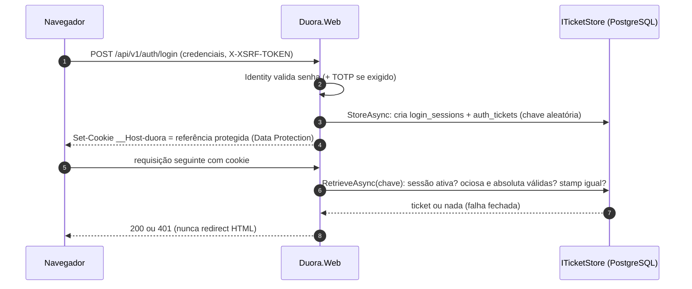

# Autenticação, sessão e proteção do navegador — especificação do M1

Especificação do que o M1 implementa em identidade: cookie e ticket no servidor, expiração, MFA, CSRF,
recuperação, revogação, anti-enumeração, Data Protection e rate limit, mais o contrato das rotas API-A01 a
API-A16. Fontes: spec 4.3, 8.1, 8.2, 9.2, 9.3, 11.1–11.5 e 13.4 (A11Y-01); ADRs
[0005](../architecture/adr/0005-identity-local-cookie-ticket-persistente.md),
[0006](../architecture/adr/0006-mesma-origem-spa-api-hub.md) e
[0017](../architecture/adr/0017-mfa-por-papel.md); fichas D-AUTH-01, D-AUTH-02, D-AUTH-04, D-AUTH-05 e
D-SEC-03 ([sources.yml](../references/sources.yml)). Ameaças tratadas: TM-01 a TM-22, TM-45 e TM-64 do
[threat-model.md](threat-model.md). Tabelas: [model.md](../data/model.md#schema-identity).

Regra do projeto: nada de criptografia ou protocolo de autenticação próprio. Hash de senha, tokens de e-mail,
TOTP, cookie e antiforgery vêm do ASP.NET Core Identity e do framework (spec 2.1; *Secure APIs*, cap. 4.4).
Toda mudança neste documento ou no código correspondente exige revisão humana
([permissions.md](../automation/permissions.md)).

Valores numéricos marcados **(hipótese)** são iniciais e configuráveis, versionados e sujeitos a medição
(spec 4.3, 11.5). Mudá-los não exige mudar este documento, só a configuração revisada.

## Papéis e contas

| Tipo de conta | Papéis | MFA | Política de sessão |
|---|---|---|---|
| Participante | `participant` | Opcional, TOTP (ADR-0017) | Normal: 30 min ociosa, 12 h absoluta |
| Privilegiada | `moderator`, `product_admin`, `operator` (um ou mais) | Obrigatório e confirmado antes da primeira sessão administrativa | Administrativa: 15 min ociosa, 8 h absoluta |

**Proposta — confirmar:** conta privilegiada nunca recebe o papel `participant`, e vice-versa. A spec 1.3 já
exige contas distintas para responsabilidades distintas; tornar isso regra de dados (constraint na atribuição
de papel) permite decidir a política de sessão pela conta, sem "elevar" uma sessão de participante. Bootstrap
e concessão de papel privilegiado: comando operacional único, auditado, fora da API pública, com convite que
expira e exige configurar MFA (spec 11.1).

## Ticket no servidor

| Item | Especificação |
|---|---|
| Cookie de autenticação | `__Host-duora`; `Secure`, `HttpOnly`, `Path=/`, sem `Domain`, `SameSite=Lax`; sem `Max-Age`/`Expires` (cookie de sessão do navegador; a validade real é a do servidor) |
| Conteúdo do cookie | Só a referência ao ticket (claim de chave de sessão), protegida pelo Data Protection; nenhuma claim de papel, e-mail ou elegibilidade legível ou confiável no cliente |
| `CookieAuthenticationOptions.SessionStore` | Implementação de `ITicketStore` sobre `identity.auth_tickets` e `identity.login_sessions` (D-AUTH-02) |
| Chave do ticket | 256 bits de CSPRNG, codificada em base64url; gerada em `StoreAsync`; nunca reutilizada |
| Ticket armazenado | `AuthenticationTicket` serializado e protegido pelo Data Protection (`bytea`), nunca em claro; classe S |
| `RetrieveAsync` | Uma consulta: ticket + sessão + `users.security_stamp` + estado da conta. Devolve nada (→ `401`) se: sessão revogada, `idle_expires_at <= agora`, `absolute_expires_at <= agora`, stamp da sessão diferente do atual, conta `Deleted` ou `DeletionPending` |
| Conta restrita ou suspensa | Sessão válida, mas a política de autorização limita a conta própria, segurança e recurso (spec 8.2) |
| Respostas da API | `401`/`403` em Problem Details; `OnRedirectToLogin` e `OnRedirectToAccessDenied` substituídos para nunca redirecionar a API para HTML (spec 8.2; D-AUTH-01) |
| Banco indisponível | Falha fechada: `503` sem detalhe; nunca aceitar ticket sem consulta (TM-16) |
| Relógio | `TimeProvider` injetado em toda decisão de expiração; `FakeTimeProvider` nos testes |
| Negar por padrão | Política de fallback exige usuário autenticado; rotas públicas numa allowlist explícita (API-A01, A02, A03, A04, A06, A07, saúde e webhooks) (TM-64) |

Custo aceito (ADR-0005): uma consulta ao ticket store por requisição autenticada. A renovação da expiração
ociosa grava no máximo uma vez por minuto por sessão **(hipótese)** para não transformar toda leitura em
escrita.

## Expiração

| Política | Ociosa | Absoluta | Aplicação |
|---|---|---|---|
| Normal | 30 min | 12 h | Contas de participante |
| Administrativa | 15 min | 8 h | Contas privilegiadas |

- No login: `absolute_expires_at = agora + absoluta` (imutável) e `idle_expires_at = min(agora + ociosa,
  absolute_expires_at)`.
- Em cada requisição autenticada aceita: `idle_expires_at = min(agora + ociosa, absolute_expires_at)`. A
  renovação nunca ultrapassa a absoluta (spec 11.1; TM-13).
- Sem "lembrar para sempre" no padrão (spec 4.3). O cookie não persiste além do navegador.
- Expirada a sessão, o hub é fechado (`CloseOnAuthenticationExpiration`) e a SPA limpa dados privados e leva à
  reautenticação (spec 9.2, 13.5).

## Fixação e renovação

Nova sessão (nova linha em `login_sessions`, nova chave de ticket, novo cookie) e revogação da anterior em:
login, troca de senha (API-A16), conclusão de reset (API-A07 não emite sessão), ativação ou desativação de MFA
e qualquer mudança de papel. Nunca reaproveitar sessão anônima (spec 11.1; TM-03). Depois de login, logout ou
troca de identidade, o token antiforgery é renovado (spec 8.2).

## Reautenticação e step-up

API-A13 grava `login_sessions.reauthenticated_at`. A janela de autenticação recente é **5 min (hipótese)**,
verificada no servidor; o frontend não concede privilégio (spec 8.2).

| Exige autenticação recente | Prova exigida |
|---|---|
| API-A09 com detalhes, A11, A14, A15, A16 | Senha; TOTP também quando a conta tem MFA |
| API-D01, D03, D04 (exportação e exclusão) | Senha; TOTP quando houver |
| Ações administrativas críticas: decisão de moderação (ADM14, ADM15), leitura de evidência (ADM13), publicar/cancelar evento (ADM04, ADM05), publicar/aposentar catálogo (ADM09, ADM10), pausas operacionais (ADM17, ADM18), reprocessar job (ADM20) | TOTP obrigatório |

Faltando autenticação recente: `401` com `code = REAUTHENTICATION_REQUIRED`, sem efeito.

## MFA

Conforme [ADR-0017](../architecture/adr/0017-mfa-por-papel.md): obrigatório para contas privilegiadas,
opcional (TOTP) para participantes, pelos mesmos endpoints.

| Tema | Especificação |
|---|---|
| Método | TOTP do Identity (`AuthenticatorTokenProvider`); passkeys só depois, pelo suporte oficial e com teste (spec 11.1) |
| Cadastro (API-A11) | Exige autenticação recente; gera nova chave do autenticador e devolve `sharedKey` e URI `otpauth://` uma única vez, com `no-store`; MFA ainda **inativo** |
| Confirmação (API-A12) | Código TOTP válido ativa o MFA, gera 10 códigos de recuperação **(hipótese)** mostrados uma vez, renova a sessão e notifica o titular |
| Login com MFA (API-A04) | Mesmo corpo com `twoFactorCode` ou `recoveryCode`. Senha correta sem segundo fator → `401` `MFA_REQUIRED`, **sem** criar sessão. Falhas de TOTP contam no mesmo lockout da senha |
| Conta privilegiada sem MFA confirmado | Login só abre sessão restrita ao cadastro de MFA (A11, A12, A05, A08); toda rota `/admin/*` → `403` `MFA_ENROLLMENT_REQUIRED` |
| Novos códigos (API-A14) | Autenticação recente; revoga o conjunto anterior; mostra o novo uma vez; nada em log |
| Desativar (API-A15) | Autenticação recente; recusado (`403` `MFA_REQUIRED_BY_ROLE`) se a conta é privilegiada; para participante, desativa, revoga as outras sessões e notifica |
| Recuperação de MFA de conta privilegiada | Não há caminho self-service por e-mail: procedimento operacional auditado, com outra pessoa ou conta privilegiada quando houver (TM-22) |
| Armazenamento | Chave do autenticador e códigos de recuperação ficam em `identity.user_tokens` (classe S). **A verificar antes do M1:** se a versão adotada do Identity os guarda em claro, avaliar `ProtectPersonalData`/proteção por Data Protection, porque um dump do banco daria o segundo fator |

## CSRF

Cookie same-origin com `SameSite=Lax` reduz, mas não elimina CSRF; login e logout também são mutações
(spec 11.3; *Web Application Security*, 2ª ed., caps. 11 e 29). O M1 usa três camadas:

| Camada | Especificação |
|---|---|
| 1. Token antiforgery | `AddAntiforgery(o => o.HeaderName = "X-XSRF-TOKEN")`, `app.UseAntiforgery()` e validação em toda rota `POST`, `PUT`, `PATCH` e `DELETE` autenticada por cookie, **inclusive** API-A02 a A07 (D-AUTH-05). Cookie interno do antiforgery: `__Host-duora-af`, `HttpOnly`, `Secure`, `SameSite=Strict` |
| 2. Cookie legível | API-A01 chama `GetAndStoreTokens` e grava o request token no cookie `XSRF-TOKEN` (`Secure`, `Path=/`, `SameSite=Strict`, **sem** `HttpOnly`, para a SPA ler). A SPA o envia no header `X-XSRF-TOKEN` (já implementado em `frontend/src/shared/api/antiforgery.ts`). O token sozinho não basta: precisa casar com o cookie `__Host-` e com a identidade |
| 3. Origem | Em mutação: `Origin` presente e diferente da origem da aplicação → rejeita; `Origin` ausente e `Sec-Fetch-Site` presente e diferente de `same-origin` → rejeita; os dois ausentes → só a camada 1 decide (cliente não-navegador). No hub, `Origin` é obrigatório e exato (TM-45) |

- Falha de antiforgery ou de origem: `403` Problem Details com `code = CSRF_VALIDATION_FAILED`, sem efeito
  (o padrão do framework é `400`; o M1 mapeia para `403`).
- `DisableAntiforgery()` só em `/webhooks/{provider}` (sem cookie; autenticação por assinatura) e nunca em
  outra rota sem revisão.
- O token é ligado à identidade: depois de login, logout ou troca de identidade, a SPA chama API-A01 de novo.
- CORS: nenhuma política aberta; respostas não trazem `Access-Control-Allow-Origin` para origem não aprovada
  (ADR-0006).

## Recuperação de senha

| Passo | Especificação |
|---|---|
| Pedido (API-A06) | Recebe e-mail; responde sempre `202` com corpo neutro idêntico. Se a conta existe e está apta, enfileira e-mail via outbox; senão, nada (ou e-mail "não há conta com este endereço" se o produto quiser, sempre pelo mesmo canal assíncrono) |
| Token | `GeneratePasswordResetTokenAsync` do Identity (Data Protection, ligado ao security stamp). Provedor próprio para reset com vida de **30 min (hipótese)**, separado do token de confirmação de e-mail (**24 h, hipótese**) |
| Link | Aponta para uma rota da SPA com o token no **fragmento** (`#token=...`), que não vai a servidor, log de proxy nem `Referer`; `Referrer-Policy: no-referrer` nas páginas de conta |
| Conclusão (API-A07) | `POST` com e-mail, token e nova senha. Sucesso: troca a senha, atualiza o security stamp (o token deixa de valer), revoga **todas** as sessões, não emite sessão nova, notifica o titular. Falha: erro neutro `RESET_TOKEN_INVALID` |
| Conta privilegiada | Reset troca a senha, mas não remove nem contorna o MFA (TM-22) |
| Política de senha | Comprimento mínimo de 12 caracteres e máximo de 128 **(hipótese)**, sem regras de composição forçada; colar e gerenciador de senhas permitidos (A11Y-01); verificação contra senhas vazadas fica como evolução, se houver serviço aprovado |

Confirmação de e-mail (API-A03) usa o mesmo desenho: link para a SPA, ação por `POST` explícito (scanner de
e-mail que faz `GET` não confirma), token de uso controlado e resposta idempotente.

## Revogação

| Gatilho | Efeito |
|---|---|
| Logout (API-A05) | Revoga a sessão corrente (`revoked_at`, motivo `logout`), apaga o ticket, expira o cookie, fecha as conexões do hub desta sessão |
| Revogar sessão (API-A10) | Só sessão da própria conta (alheia → `404`); mesmo efeito do logout naquela sessão |
| Troca de senha (API-A16) | Atualiza stamp; revoga todas as outras sessões; emite sessão nova para a corrente |
| Reset (API-A07), ativar/desativar MFA | Revoga todas as sessões (ou as outras, no caso de MFA feito na própria sessão) |
| Suspensão, exclusão (API-D03), medida de moderação que restringe a conta | Revoga todas as sessões, ou a conta passa à política restrita (spec 8.2, 8.4) |
| Restore de backup | Revoga todas as sessões antes de reabrir (spec 18.4; T-11) |
| Comprometimento do key ring | Novo key ring e revogação de todas as sessões; restaurar chave antiga não é resposta a invasão (spec 11.2) |

Hub: o processo web mantém um registro em memória `sessionId → connectionIds` (uma instância, ADR-0009). A
revogação, gravada no banco, aciona o fechamento dessas conexões no mesmo processo; uma revogação vinda do
worker (exclusão, sanção) chega por outbox de tempo real. Mesmo que o fechamento falhe, a próxima leitura ou
comando do cliente falha no `RetrieveAsync` (spec 9.2; T-14).

## Anti-enumeração

| Rota | Comportamento igual para conta existente e inexistente |
|---|---|
| API-A02 cadastro | `202` com corpo neutro. E-mail já cadastrado: o titular recebe "você já tem uma conta" pelo mesmo canal assíncrono |
| API-A04 login | `401` com `code = INVALID_CREDENTIALS` para e-mail inexistente, senha errada e conta bloqueada por lockout; para e-mail inexistente o servidor ainda executa uma verificação de hash de custo equivalente, para aproximar o tempo de resposta |
| API-A06 pedido de reset | `202` neutro |
| API-A03 e A07 | Token inválido, expirado ou de conta inexistente → mesmo erro |

`429` (rate limit) pode ser distinguível, porque depende de origem e volume, não da existência da conta
(*Secure APIs*, cap. 4.4; TM-06).

## Data Protection

| Item | Especificação (spec 11.2, 15.4; D-AUTH-02) |
|---|---|
| Persistência | `PersistKeysToFileSystem` num volume persistente restrito (`0700`, dono = usuário do container web), fora da camada gravável do container |
| Proteção em repouso | `ProtectKeysWithCertificate` com certificado lido de arquivo de segredo; persistir não é criptografar |
| Nome da aplicação | `SetApplicationName("duora-<ambiente>")` estável entre deploys; homologação e produção com nomes, volumes e certificados diferentes |
| Vida da chave | Padrão do framework (90 dias) com rotação automática; chaves antigas mantidas enquanto houver payload válido (cookies de no máximo 12 h, tokens de no máximo 24 h) |
| Worker | Não recebe o key ring de cookies; usa referências de conta e jobs. Se um dia precisar desproteger algo, usa purpose próprio e o ADR registra |
| Backup | Key ring e certificado no inventário de backup, com custódia separada do backup do banco (spec 18.3) |
| Startup | Web falha ao subir sem volume, certificado ou nome de aplicação configurados (spec 11.4) |
| Comprometimento | Novo key ring, revogação de todas as sessões e invalidação de tokens pendentes |

Teste: T-15 (recriar container mantém sessões válidas; rotação não derruba sessões dentro da política).

## Rate limit e lockout

Duas camadas (spec 11.5; *Secure APIs*, cap. 5.1): **lockout por conta no banco** (Identity, sobrevive a
reinício e não depende de IP) e **rate limiter em memória** por origem e por sessão (`AddRateLimiter`,
D-AUTH-04), que reinicia com o processo (aceito no piloto, ADR-0009). O IP usado é o do proxy confiável
(Forwarded Headers aceitos só do Caddy).

| Operação | Chave | Limite inicial (hipótese) | Resposta |
|---|---|---|---|
| Login (A04): falhas de senha ou MFA | Conta | 5 falhas → lockout de 1 min, dobrando a cada novo lockout até 1 h; zera no sucesso; aviso por e-mail no 3.º lockout | `401` `INVALID_CREDENTIALS` (sem revelar lockout) |
| Login (A04) | IP | 20 tentativas / 5 min | `429` + `Retry-After` |
| Cadastro (A02) | IP | 5 / hora | `429` + `Retry-After` |
| Reenvio de confirmação, pedido de reset (A06) | Hash do e-mail normalizado e IP | 3 / hora por e-mail; 10 / hora por IP | `202` neutro (excesso descartado em silêncio por e-mail); `429` por IP |
| Conclusão de reset (A07), confirmação (A03) | IP | 10 / 15 min | `429` + `Retry-After` |
| Reautenticação (A13) | Sessão | Mesmo lockout da conta | `401` |
| MFA (A11, A12, A14, A15), troca de senha (A16) | Sessão | 10 / hora | `429` + `Retry-After` |
| Revogar sessão (A10) | Sessão | 30 / hora | `429` + `Retry-After` |

Valores calibrados pelo uso real e versionados; nunca bloquear permanentemente uma conta por falhas de terceiros
(TM-09). Métricas: contagem de `401`/`429` por rota e origem agregada, sem e-mail nem ID de pessoa como label
(spec 19.2).

## Contrato de rotas API-A01 a A16

Todas sob `/api/v1`, JSON UTF-8, `Cache-Control: no-store`, erros em Problem Details (spec 8.1). "Antiforgery"
inclui a checagem de origem da seção [CSRF](#csrf). "Recente" = autenticação recente na janela de
[step-up](#reautenticação-e-step-up).

| ID | Rota | Autenticação | Antiforgery | Recente | Entrada → saída | Erros principais | Auditoria |
|---|---|---|---|---|---|---|---|
| API-A01 | `GET /auth/csrf` | Pública | — | — | — → `204` + cookie `XSRF-TOKEN` | — | — |
| API-A02 | `POST /auth/register` | Pública | Sim | — | `email`, `password`, `termsVersion`, `privacyVersion` → `202` neutro | `400` validação; `429` | Cadastro criado (sem e-mail no evento) |
| API-A03 | `POST /auth/confirm-email` | Pública | Sim | — | `userId`, `token` → `204` | `400` `CONFIRMATION_TOKEN_INVALID` | Confirmação |
| API-A04 | `POST /auth/login` | Pública | Sim | — | `email`, `password`, `twoFactorCode?`, `recoveryCode?` → `204` + cookie | `401` `INVALID_CREDENTIALS`, `401` `MFA_REQUIRED`; `429` | Sucesso, falha, lockout |
| API-A05 | `POST /auth/logout` | Cookie | Sim | — | — → `204` | `401` | Logout |
| API-A06 | `POST /auth/password-reset-requests` | Pública | Sim | — | `email` → `202` neutro | `429` por IP | Pedido (pseudonimizado) |
| API-A07 | `POST /auth/password-resets` | Pública | Sim | — | `email`, `token`, `newPassword` → `204` | `400` `RESET_TOKEN_INVALID`, `400` validação de senha | Reset concluído |
| API-A08 | `GET /me` | Cookie (inclusive conta restrita) | — | — | → conta própria: `id`, `state`, `eligibility`, `roles`, `mfaEnabled`, configuração pública | `401` | — |
| API-A09 | `GET /me/sessions` | Cookie | — | Só para detalhes | → `items[]`: `sessionId`, `current`, `createdAt`, `lastSeenAt`, `deviceSummary`; com recente: `networkPrefix` | `401` | — |
| API-A10 | `DELETE /me/sessions/{sessionId}` | Cookie | Sim | — | → `204` | `404` (alheia ou inexistente) | Revogação |
| API-A11 | `POST /me/mfa/enrollments` | Cookie | Sim | Sim | → `sharedKey`, `authenticatorUri` | `401` `REAUTHENTICATION_REQUIRED`; `409` MFA já ativo | Início de cadastro |
| API-A12 | `POST /me/mfa/confirmations` | Cookie | Sim | Sim | `code` → `recoveryCodes[]` + sessão renovada | `400` `MFA_CODE_INVALID` | MFA ativado |
| API-A13 | `POST /auth/reauthenticate` | Cookie | Sim | — | `password`, `twoFactorCode?` → `204` | `401` `INVALID_CREDENTIALS`; `429` | Reautenticação |
| API-A14 | `POST /me/mfa/recovery-codes` | Cookie | Sim | Sim | → `recoveryCodes[]` (conjunto anterior revogado) | `409` MFA inativo | Códigos regenerados |
| API-A15 | `DELETE /me/mfa` | Cookie | Sim | Sim | → `204` | `403` `MFA_REQUIRED_BY_ROLE` | MFA desativado |
| API-A16 | `POST /me/password-changes` | Cookie | Sim | Sim | `currentPassword`, `newPassword` → `204` + sessão renovada | `400` validação; `401` senha atual errada | Senha trocada |

Regras comuns: DTO estrito (campo desconhecido → `400`); nenhum segredo (senha, token, código, chave) em log,
trace ou métrica; nenhuma credencial em query string; respostas de sucesso não ecoam e-mail nem dados de
outras contas; contrato publicado pelo OpenAPI gerado (ADR-0018).

## Testes do M1

| Teste | Cobre |
|---|---|
| T-01 | Conta pendente, suspensa ou sem requisito etário negada nas rotas de participação |
| T-13 | Login, logout e escrita sem antiforgery ou com origem indevida → `403`, sem efeito |
| T-14 | Sessão revogada ou expirada com hub ativo: novas ações negadas, conexão fechada |
| T-15 | Container recriado e rotação de chave: sessões conforme a política |
| T-21 | Logout de A e login de B no mesmo navegador: nada de A visível a B |
| Verificações do ADR-0017 | `/admin/*` nega conta sem MFA; A15 não remove MFA de conta privilegiada; participante ativa e desativa TOTP |
| Testes "a criar" do [threat-model.md](threat-model.md#6-ameaça--mitigação--teste) | TM-01 a TM-22, TM-45 e TM-64 |

## Estado de implementação

Preencher no PR que implementar cada item, com link para o teste e a evidência do runner. Nenhum status muda
sem artefato do CI (spec 25.19).

| Item | Status | Teste / evidência | PR |
|---|---|---|---|
| Cookie `__Host-duora` e `ITicketStore` PostgreSQL | não implementado | — | — |
| Expiração ociosa e absoluta, normal e administrativa | não implementado | — | — |
| Fixação: nova sessão no login e nas mudanças de privilégio | não implementado | — | — |
| Reautenticação e step-up | não implementado | — | — |
| MFA TOTP (A11, A12, A14, A15) e política por papel | não implementado | — | — |
| Antiforgery, cookie `XSRF-TOKEN` e checagem de origem | não implementado (cliente da SPA já envia `X-XSRF-TOKEN`) | `frontend/src/shared/api/api-client.test.ts` cobre só o lado do cliente | — |
| Recuperação de senha e confirmação de e-mail | não implementado | — | — |
| Revogação (A05, A10, troca de senha, reset) e fechamento do hub | não implementado | — | — |
| Anti-enumeração | não implementado | — | — |
| Data Protection persistente e protegido | não implementado | — | — |
| Rate limit e lockout | não implementado | — | — |
| Contrato A01 a A16 no OpenAPI gerado | não implementado | — | — |
